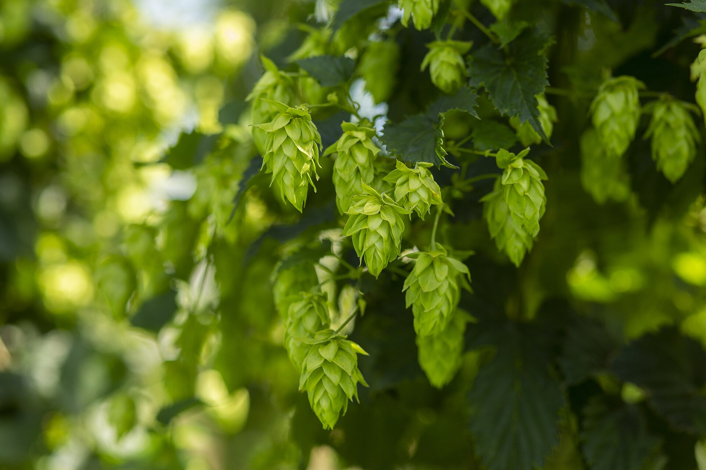

# 啤酒花与苦度：IBU 能说明什么，不能说明什么

在精酿啤酒的讨论里，IBU 几乎成了“苦不苦”的代名词。酒标上写着 40、60 或 80，饮者便据此判断一款酒的性格。IBU 确实是一个有用的指标，但它测量的是特定化学物质的浓度，而不是你舌头感受到的全部苦味。理解这一点，才能把啤酒花、苦度与风味放在正确的位置。

图：啤酒花与苦度：IBU 能说明什么，不能说明什么相关实景照片。图片：ScienceEditorBB，CC BY-SA 4.0，via Wikimedia Commons（[原图页面](https://commons.wikimedia.org/wiki/File:Humulus_lupulus_(Hops).jpg)）。

## 问题从哪来

啤酒的苦味主要来自啤酒花。啤酒花（Humulus lupulus）的雌花序中含有被称为蛇麻腺的结构，富含α-酸等树脂类物质。它们在煮沸过程中异构化，生成异α-酸，带来典型的苦味。与此同时，啤酒花也提供香气与部分保存性。问题在于，消费者常把“苦度”简化成一个数字，把“酒花多”等同于“更苦”，再把“更苦”等同于“更好”。这些简化会让品鉴失焦。

## 体系与原理

啤酒花中的α-酸在加热后转化为异α-酸，后者是苦味的主要来源。煮沸时间越长，异构化越充分，苦味贡献通常越高；但在煮沸后期或回旋沉淀阶段加入的酒花，更多贡献香气而非苦味；干投（在发酵或成熟阶段加入酒花）主要增加香气，对 IBU 的直接贡献较小。啤酒花的品种也会影响风格：有的以苦味见长，有的以香气见长，也有兼用型。

IBU 是 International Bitterness Units 的缩写，通常以异α-酸的质量浓度表示，单位为毫克每升，也就是常说的 ppm。测量方法包括分光光度法与色谱法，不同方法、不同实验室与不同样品处理可能带来差异。因此，IBU 是一个可比较的分析指标，但不是感官苦味的完整映射。

## 关键分类或参数

理解苦度，至少要同时看四个参数：酒花品种、投放阶段、煮沸强度与时间、以及成品酒的其他成分。酒花品种决定苦味的“质感”与香气方向；投放阶段决定苦味与香气的比例；煮沸条件影响异构化效率；麦芽的甜度、酒精度、碳酸化程度与 pH 则会影响苦味的感知。

酒花产品也有多种形态：整花、颗粒、浸膏与萃取物等。不同形态的利用率与香气表现不同，具体差异要看生产商的技术资料。风格层面，皮尔森型拉格常以清爽、干净的苦味为特征；IPA 类风格常通过后期投放与干投强调香气；世涛与波特则可能用烘烤麦芽的苦味与酒花苦味叠加。这里不给出具体 IBU 区间，是因为风格指南与生产商数据会更新，且同一风格内部的差异很大。

## 案例

以皮尔森型拉格为例，传统做法强调清澈、爽净的苦味与柔和的酒花香气，苦味通常服务于整体的清爽感，而不是压过麦芽。以 IPA 为代表的风格，则常把酒花香气放在更突出的位置：大量后期投放与干投带来柑橘、热带水果或松针般的气息，苦味则作为骨架支撑香气。世涛与波特的苦味来源更复杂，烘烤麦芽带来的焦香与收敛感，会与酒花苦味一起塑造收尾。

把这三类放在一起，会发现“苦”不是单一维度：有的苦干净利落，有的苦厚重绵长，有的苦与甜、与香气同时出现。IBU 只能告诉你异α-酸的浓度，无法告诉你苦味的质地、持续时间与平衡方式。若想系统练习，可参考[啤酒品鉴入门](ref:beer-tasting-intro)，用同一风格的不同酒做对照。

## 常见误解

第一，IBU 越高越苦。IBU 与感官苦味相关，但感知还受麦芽甜度、碳酸化、温度、杯型与个人敏感度影响。第二，酒花越多越苦。后期投放与干投主要增加香气，对苦度的贡献远小于早期煮沸投放。第三，苦就是缺点。苦味是啤酒结构的一部分，是否合口取决于风格与场景。第四，IBU 是绝对统一的数值。不同分析方法与实验室之间可能存在差异，跨品牌比较时应看同一来源的数据。第五，低 IBU 等于没风味。香气、麦芽与发酵风味同样构成啤酒的完整体验。

## 争议与边界

苦度讨论的争议，一部分来自测量：IBU 的分析方法并非只有一种，样品处理与仪器条件会影响结果；生产商公布的数值也可能来自计算而非实测。另一部分来自风格：风格指南给出的区间是描述性工具，不是法律标准；不同国家与组织的分类并不完全一致。还有一部分来自农业：酒花的α-酸含量会随品种、年份、产地与加工方式变化，同一配方的苦度也可能随批次波动。

因此，本页不把任何 IBU 数值当作质量判据，也不把“苦度”当作风格好坏的唯一尺度。具体产品的 IBU、酒花品种与投放信息，应以生产商公布为准；风格定义与分类，应以发布该指南的机构文本为准。

## 怎么用

选购时，先确定自己想喝的是“苦味主导”还是“香气主导”。若酒标给出 IBU，把它与同风格的其他酒比较，而不是与跨风格的酒比较。品鉴时，先看颜色与泡沫，再闻香气，小口感受苦味出现的位置、持续时间与收尾；温度升高后苦味感知可能变化，碳酸化也会影响口感。若觉得某款酒“太苦”，可以尝试同风格的较低 IBU 版本，或选择苦味更柔和的酒花品种。

配餐上，苦味可以切割油脂、平衡甜味，适合搭配油炸、烧烤或浓郁奶酪；但高苦度也会放大咸味与苦味食材。储存方面，啤酒讲究新鲜，酒花香气会随时间衰减，光照还可能引发异味；具体保质期与储存条件以生产商标注为准。最后，IBU 是工具，不是结论；真正的判断仍然回到杯中。

## 另见

- [啤酒](ref:beer)：大类概览。
- [IBU](ref:ibu)：苦度单位的定义与用法。
- [制麦](ref:malting)：麦芽如何影响啤酒的基底。
- [拉格陈酿](ref:lagering)：低温熟成与清爽风格的关系。
- [啤酒品鉴入门](ref:beer-tasting-intro)：从闻到喝的练习路径。

对照阅读：[啤酒](ref:beer)、[制麦](ref:malting)。

**关键事实。**

| 项目 | 内容 |
| --- | --- |
| 一句话定位 | 啤酒花带来苦味、香气与保存性，IBU 是衡量异α-酸浓度的苦度单位；本文说明苦味如何产生、IBU 如何测量，以及为什么“IBU 越高越苦”并不可靠 |
| 议题 | 啤酒、啤酒花、苦度、酿造 |
| 时期 | 近现代 |
