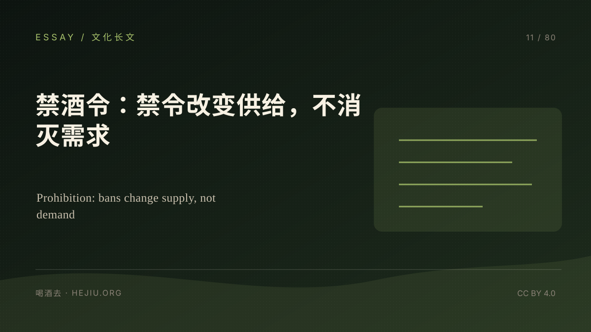

# 禁酒令：禁令改变供给，不消灭需求

“禁酒”听起来像一条清楚的命令：不许喝。但历史上真正执行的禁酒法令，几乎都很快变成一套复杂的管制系统：谁可以生产、谁可以运输、谁可以持有、哪些用途例外、由谁执法。结果是酒没有消失，酒的供给方式、价格与风险被重新分配。

这篇文章以美国 1920 至 1933 年的全国禁酒为主线，再对照其他国家的经验，最后回到中国历史上的酒禁与专卖。

图：禁酒令：禁令改变供给，不消灭需求 类型示意图。图片：Doubao Seedream 5.0 AI 辅助绘制（项目自有），不是禁酒令：禁令改变供给，不消灭需求的实拍。

## 美国：从运动到宪法修正案

19 世纪的美国禁酒运动由宗教团体、妇女组织与改革派推动，[反酒馆联盟](ref:anti-saloon)是其中最有动员能力的组织之一。它把酒馆视为贫困、家庭暴力与腐败的源头，推动地方禁酒与宪法修正。

1919 年，第十八修正案获得足够州批准；1920 年 1 月，全国禁酒正式生效。配套的沃尔斯泰德法案把“致醉饮料”定义为酒精含量超过 0.5% 的饮品，并规定生产、销售、运输与持有均受管制。宗教仪式用酒与药用酒精获得豁免，这为后来的漏洞埋下伏笔。

## 执行：豁免、私酒与地下经济

禁酒时期并非完全没有酒。药用酒精可以凭处方购买，宗教用酒可以申请配额，家庭自酿果酒在有限范围内被允许。执法资源不足、边界模糊与地方抵制，让规避行为普遍存在。

私酒（moonshine）与走私酒进入市场，工业酒精被非法改造后流入饮用环节，造成中毒与死亡。地下酒吧（speakeasy）在城市的公寓、地下室与店铺后间出现，形成一套新的社交空间与暗号文化。

## 后果：黑市、犯罪与财政

禁酒最直接的后果是供给从合法市场转入黑市。价格上升、质量失控、税收损失，有组织犯罪借走私与地下分销扩张。执法不均也让不同阶层承担不同风险：富人能买到受监管的存酒，穷人更容易接触劣质私酒。

1933 年，第二十一修正案废止第十八修正案，禁酒结束。这是美国宪法史上第一次以修正案废止另一条修正案。禁酒留下的遗产包括更复杂的酒类许可制度、联邦与州的分权，以及“酒精管制”作为公共政策领域的形成。

## 其他国家：战争、健康与宗教

俄国在 1914 年一战期间实行酒类专卖限制，后来在苏联时期反复调整；芬兰在 1919 年至 1932 年实行禁酒，最终因走私与犯罪问题废止；冰岛在 1915 年实行禁酒，啤酒的禁令一直延续到 1989 年。各国的动机不同：战时动员、公共卫生、宗教伦理或民族主义。

这些案例的共同点是：禁令可以短期降低消费，却难以长期维持，且往往带来黑市与执法成本。相反，高税收、限时销售、专卖与广告限制等“管制而非禁止”的政策，通常更可持续。

## 中国历史上的酒禁与专卖

中国很早就把酒作为财政对象。汉代有“榷酒酤”的专卖讨论，《汉书·食货志》记录了国家在酒利与民间消费之间的取舍。此后历代在酒禁、酒税、酒户与官酿之间反复调整，禁酒多与粮食短缺、灾荒或战时需要有关。

与美国的道德改革不同，中国历史上的酒政更多是财政与粮食政策。禁令的对象常是私酿与浪费，而不是饮酒本身。这也解释了为什么“禁”与“榷”经常交替出现：国家需要酒税，也需要在缺粮时限制用粮。

## 结论：禁令改变供给，不消灭需求

禁酒史给出的教训不是“禁酒一定失败”，而是“禁令必须考虑替代供给与执法成本”。当需求稳定存在，禁止合法供给会把市场推向地下，并带来质量、税收与治安问题。

对今天的读者，更有用的提问是：一项酒类政策想解决什么问题？是减少伤害、增加税收、保护粮食，还是维护秩序？目标不同，工具就不同。禁酒只是其中一种，而且往往不是最有效的一种。

禁酒令的关键不是“人们是否还想喝酒”，而是供给如何被重新组织：法规关闭合法渠道后，私酒、药用豁免、跨境走私与地下经济填补空缺，执法成本与有组织犯罪同时上升。美国经验说明禁令可以改变供给与价格，却很难消灭需求；把它简单读成“道德失败”或“政策成功”都跳过了执行与市场结构。禁酒令的执行还改变了税收结构、医疗豁免与跨境执法，这些制度后果比“有酒没酒”的二元判断更值得比较。

## 相关条目

- [美国禁酒令](ref:us-prohibition)：1920 至 1933 年的时间线与制度。
- [反酒馆联盟](ref:anti-saloon)：禁酒运动的组织与动员。
- [美国](ref:usa)：禁酒法令的适用地域。
- [中国](ref:china)：历代酒禁、酒税与专卖。
- [酒馆史](ref:taverns)：禁酒如何改变酒馆空间。
- [酒馆与城市](ref:public-house)：酒吧与城市生活的关系。

对照阅读：[美国禁酒令：1920年至1933年的实验与废止](ref:us-prohibition)、[美国](ref:usa)。

**关键事实。**

| 项目 | 内容 |
| --- | --- |
| 一句话定位 | 以美国 1920 至 1933 年的全国禁酒为主线，兼及俄国、芬兰、冰岛与中国的酒禁经验，说明禁酒法令如何执行、出现哪些漏洞、产生什么后果，以及为什么“禁酒”很少等于“无酒” |
| 议题 | 禁酒、酒政、法律史 |
| 时期 | 19 世纪至 20 世纪 |

**来源与边界。** 本页关于「禁酒令：禁令改变供给，不消灭需求」的关键事实，主要由以下来源交叉核对：U.S. National Archives（第十八修正案的文本、通过与被批准时间；第二十一修正案废止禁酒的时间与程序）、Encyclopaedia Britannica（禁酒运动的组织、执行与后果的通行叙述）、汉班固撰；中华书局点校本（汉代“榷酒酤”等酒类专卖记载）。价格、批次与状态会变，涉及这些字段时以页面所列来源的最新版本为准。正文为项目自写，来源只作核验，不复制原文。

**并读。** 把「禁酒令：禁令改变供给，不消灭需求」与「美国禁酒令：1920年至1933年的实验与废止」、「反酒馆联盟：把禁酒送入宪法的压力集团」、「美国」放在一起读时，先确认它们是同一层级还是上下游关系：先确认主题与论证范围，再比较材料、观点与结论。本页负责给出文章的基本坐标，对照条目补上具体案例与差异；读完再回到本页，才能分清哪些差别属于文章本身，哪些只是产地、批次或品牌选择。
