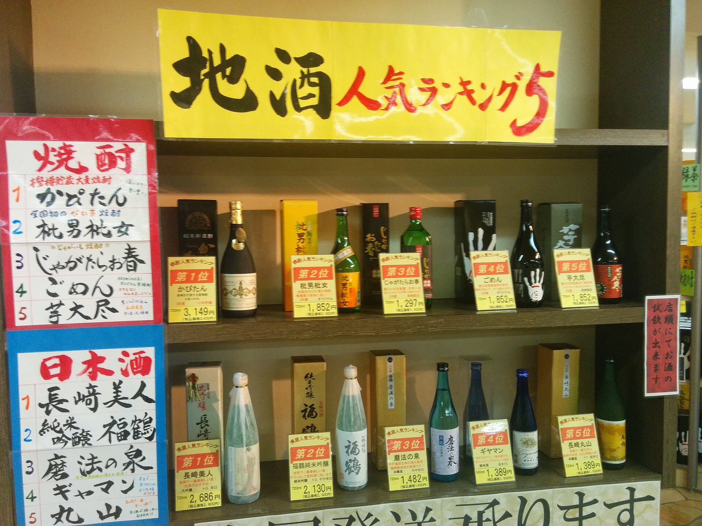

# 清酒与烧酎：同为日本酒，工艺完全不同

在中文语境里，“日本酒”常被当作一个笼统的称呼，清酒与烧酎也经常被混为一谈。两者确实都与米、与水、与日本的酿造传统有关，但它们的工艺路径不同：清酒是酿造酒，烧酎是蒸馏酒。把这一条分清楚，酒标上的许多术语才会各归其位。

图：清酒与烧酎：同为日本酒，工艺完全不同相关实景照片。图片：NevinThompson，CC BY-SA 4.0，via Wikimedia Commons（[原图页面](https://commons.wikimedia.org/wiki/File:Local_sake_and_shochu_on_display_in_a_shop,_Nagasaki,_April_2015.jpg)）。

## 问题从哪来

混淆主要来自三个地方。第一是名称：日文里的“日本酒”常指清酒，而“烧酎”是另一类酒；中文把它们都叫“日本酒”，容易让人以为只是同一种酒的两种叫法。第二是原料：清酒以米为主，烧酎也常用米、麦、甘薯等原料，看起来相近。第三是饮用场景：两者都能在日式餐厅出现，温度与喝法也常被并排讨论。于是消费者容易忽略最关键的区别——清酒靠发酵，烧酎靠蒸馏。

## 体系与原理

清酒的酿造核心是“并行复发酵”：米中的淀粉先由曲菌糖化，酵母再把糖转化为酒精，糖化与发酵在同一体系里同时进行。为了控制风味，米会被磨去外层，留下核心部分，这个比例称为精米步合。清酒通常还会经过压榨、过滤、杀菌与贮存等环节，成品可以是清澈的，也可以保留少量酒糟成分。

烧酎则是先发酵、后蒸馏。原料经过糖化与发酵得到酒醪，再通过蒸馏器浓缩酒精与香气。按蒸馏方式，烧酎常分为单式蒸馏与连续蒸馏两大类；单式蒸馏的烧酎（本格烧酎）保留更多原料风味，连续蒸馏的烧酎则更接近中性酒精。原料可以是甘薯、麦、米、荞麦、黑糖等，不同原料带来不同的香气轮廓。冲绳的泡盛以米为原料、使用独特的曲与单式蒸馏，也常被放在烧酎的讨论里，但它有自己的名称与传统。

## 关键分类或参数

清酒的常见分类围绕“是否只加米、水、曲与酵母”以及精米步合展开。纯米酒不添加酿造酒精；本酿造会添加少量酿造酒精；吟酿与大吟酿强调低温、长时间的发酵，通常伴随更低的精米步合。具体门槛与名称定义以日本官方分类为准，不同资料的中文译名也可能略有差异。

烧酎的关键参数包括原料、蒸馏方式（单式或连续）、酒精度与是否经过樽熟成。本格烧酎强调单式蒸馏与原料风味；甲类烧酎多为连续蒸馏，风味更轻。清酒与烧酎在日本税制与统计中属于不同类别，这一点也说明它们不是同一种酒的两种口味，而是两种不同的制造方式。

## 案例

清酒方面，新潟一带常被讨论为“淡丽辛口”风格的代表，京都伏见与神户滩区则各有自己的水与酿造传统。把同一款清酒分别以冷酒、常温与温酒的温度尝试，能明显感到香气与口感的差异。烧酎方面，鹿儿岛与宫崎常以甘薯为原料，熊本球磨地区以米为原料，九州与冲绳的蒸馏传统因此常被并提。饮用方式上，烧酎常加水、加冰或加苏打，清酒则更常以杯型与温度来调整体验。

这些案例只是入口，不能替代酒标。同一产区内，不同酒厂、不同原料与不同工艺仍会做出很不一样的产品。若想系统入门，可先读[清酒入门](ref:sake-intro)，再对照[清酒](ref:sake)与[烧酎](ref:shochu)的术语页。

## 常见误解

第一，清酒就是烧酎。清酒是酿造酒，烧酎是蒸馏酒，工艺与风味逻辑不同。第二，清酒都要温着喝。清酒可以冷饮、常温或温饮，温度选择取决于酒款与个人偏好。第三，精米步合越低越好。更低的精米步合意味着更高的成本与不同的风味取向，但不等于绝对品质。第四，烧酎都是高度酒。烧酎的酒精度因产品而异，“高度”不是定义本身。第五，清酒越陈越好。多数清酒适合新鲜饮用，熟成酒是另一类产品，需看酒标与生产商建议。

## 争议与边界

清酒与烧酎的讨论也有边界。其一是名称与译名：中文里的“清酒”“烧酎”“日本酒”并非一一对应日文概念，翻译时容易丢失税制与分类信息。其二是原料与产地保护：烧酎的原料、蒸馏方式与地理名称在推动保护，具体规则以日本官方文本为准。其三是市场变化：清酒在日本国内消费与出口市场的表现不同，烧酎则经历了不同阶段的流行起伏；这些趋势需要数据支撑，本页不做估算。其四是饮用建议：温度、兑水比例与配餐都因人和场景而异，没有唯一答案。

因此，本页不提供“必须怎么喝”的规则，也不把某一类酒写成等级高低。涉及具体产品的分类、酒精度、原料与保存方式，请以酒标与生产商信息为准；涉及税制与标签法规，请以日本官方发布为准。

## 怎么用

入门时，可以先用“酿造还是蒸馏”做第一道分类，再看原料、精米步合或蒸馏方式。清酒适合用较小、收口的杯子，温度从冷到温逐步尝试；开瓶后建议冷藏并尽快饮用，避免光照。烧酎通常可常温避光保存，饮用时按个人口味加水、加冰或加苏打，注意稀释后的整体酒精度。配餐上，清酒常与海鲜、清淡料理相搭，烧酎则常与烧烤、重口味菜肴并提；这些只是经验，仍以实际口味为准。

购买时，看清酒标上的类别名称、原料、酒精度与生产日期；对“纯米”“吟酿”“本格”“樽熟成”等词，先确认它们的定义，再判断是否符合自己的偏好。若要把清酒与烧酎放在同一场品鉴里，最好分开杯型与温度，避免用一套标准评价两种工艺。

## 另见

- [清酒](ref:sake)：酿造酒的分类与术语。
- [烧酎](ref:shochu)：蒸馏酒的分类与原料。
- [发酵](ref:fermentation)：清酒并行复发酵的基础。
- [蒸馏](ref:distillation)：烧酎与泡盛的工艺核心。
- [日本](ref:japan)：产区与饮用文化的背景。
- [清酒入门](ref:sake-intro)：从酒标到杯中的入门路径。

对照阅读：[清酒](ref:sake)、[发酵](ref:fermentation)。

**关键事实。**

| 项目 | 内容 |
| --- | --- |
| 一句话定位 | 清酒是酿造酒，烧酎是蒸馏酒，二者常被中文语境混为一谈；本文从原料、发酵、蒸馏、分类与饮用方式说明它们的差别，并解释酒标上的常见术语 |
| 议题 | 清酒、烧酎、日本酒、酿造与蒸馏 |
| 时期 | 近现代 |
