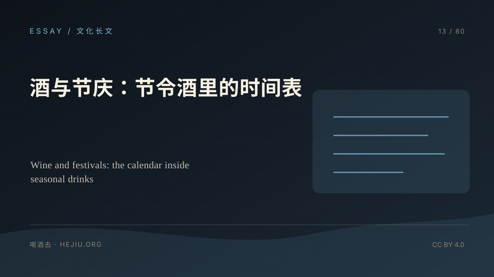

# 酒与节庆：节令酒里的时间表

传统中国的节令不是抽象日期，而是由一套动作组成的：换衣、祭祖、聚餐、出游、饮特定的酒。酒在这里像一枚时间标记，喝什么、什么时候喝、和谁喝，都在提醒人“现在是一年中的哪一段”。

这篇文章按四个节令来读。每一种酒都同时有药用、礼仪与社交三层含义，而这三层在不同时代的比重并不相同。

图：酒与节庆：节令酒里的时间表 类型示意图。图片：Doubao Seedream 5.0 AI 辅助绘制（项目自有），不是酒与节庆：节令酒里的时间表的实拍。

## 岁首：椒柏酒与屠苏酒

岁首饮酒的记载很早。汉代已有元日饮椒柏酒的做法，用花椒与柏叶浸酒，取驱邪与长寿之意。后来更常见的是[屠苏酒](ref:new-year-wine)：把大黄、白术、桂枝等药材放入绢袋，除夕悬于井中或浸入酒内，元日取出饮用。

屠苏酒的饮法有个特别之处：年少者先饮，年长者后饮。这与常规的长幼次序相反，解释是“少者得岁，长者失岁”，让年轻人先得新岁之福。这类细节说明，节令酒不只是配方，还是一套关于时间的说法。

今天家庭自制药酒需要谨慎：药材来源、酒精度、浸泡时间都会影响安全，不可把古籍配方当作医疗建议。

## 端午：雄黄酒与菖蒲

端午在农历五月，传统做法包括饮雄黄酒、洒雄黄水、挂菖蒲与艾草。雄黄是含砷矿物，古人认为可以驱蛇虫、辟邪。但雄黄酒并不适合饮用：砷化物有毒，现代医学不建议内服，外用也需谨慎。

因此今天讲端午酒，重点应放在“习俗为何形成”，而不是鼓励复制。菖蒲酒、艾叶酒在部分地区的记载中也属于节令饮品，但同样需要区分象征意义与实际安全。

《荆楚岁时记》还记五月五日“采艾以为人，悬门户上”，并用菖蒲浸酒。可见早期端午的主角是艾与菖蒲，雄黄是在后来的地方记述中才逐渐加重。菖蒲的辛香来自挥发油，古人把它当作驱邪与清洁的象征，这与现代消毒、杀虫的观念并不相同。

## 中秋：桂花酒与新酒

中秋饮酒与赏月几乎绑定。孟元老在《东京梦华录》里记汴京中秋前“诸店皆卖新酒”，市民争饮，酒楼重新装饰、通宵营业。这说明中秋饮酒首先是城市商业的节令高峰，然后才是家庭团圆的情感符号。

桂花酒是中秋常见的选择：以桂花入酒或浸渍，香气清甜。它更像一种应季风味，而不是严格意义上的药酒。各地还有用葡萄酒、米酒赏月的做法，节令与酒种并没有全国统一规定。

[李清照](ref:li-qingzhao)写重阳“东篱把酒黄昏后”，把花、酒与思念放在一起。诗人笔下的节令酒，往往比民俗记载更强调情绪，而不是配方。

## 重阳：菊花酒

重阳在农历九月九日，传统活动包括登高、佩茱萸、饮菊花酒。菊花酒的做法在《西京杂记》《岁时广记》等文献中都有记载：采菊花与茎叶，杂以黍米酿酒，次年九月饮用。它被赋予延年益寿的寓意。

重阳酒的社会功能很明确：这是敬老与团聚的节令。今天菊花酒更多作为风味酒或礼盒出现，古法的药用诉求已大幅减弱。

《东京梦华录》留下两条可对照的记载：中秋前新酒开卖，生意好到“午未间，家家无酒，拽下望子”，连招揽客人的酒旗都撤了下来；重阳时汴京的酒店把菊花扎成门洞，称作“菊花洞户”，赏菊与卖酒合成一景。把两条放在一起看，节令酒既是民俗，也是城市商业按节气排布的销售节奏。

## 节令酒的共同结构

第一，时间固定：酒与节气绑定，过了节令就不喝。第二，原料应季：桂花、菊花、菖蒲都是当令植物。第三，动作成套：不只是喝，还包括采、浸、挂、赠。第四，意义叠加：驱邪、养生、敬老、团圆，往往一层压着一层。

这套结构让酒成为“可重复的仪式”。即使配方失传，动作和名称仍能延续，比如今天的中秋月饼配酒、春节家宴敬酒。

## 今天的节庆酒：保留什么，放弃什么

可以保留的是节令感与团聚功能：中秋选一瓶适合配餐的酒，春节为家人准备一杯低度酒，重阳陪长辈吃饭。需要放弃的是把含毒矿物入酒、把古籍配方当疗效、以及用劝酒制造压力。

节令酒的价值不在于“古法”，而在于它提醒人按时间生活。理解来源，才能有选择地继承。

## 相关条目

- [屠苏酒](ref:new-year-wine)：岁首饮酒的配方与次序。
- [中秋赏月酒](ref:mid-autumn-wine)：中秋新酒与桂花酒。
- [中国](ref:china)：节令风俗的地理与文献背景。
- [李清照](ref:li-qingzhao)：重阳词中的酒与思念。
- [一杯酒里的时间](ref:time-in-a-cup)：节令、农事与酒的长期关系。
- [酒与诗](ref:wine-and-poetry)：节令饮酒的文学书写。

对照阅读：[年节饮酒：椒柏酒与屠苏酒](ref:new-year-wine)、[中国](ref:china)。

**关键事实。**

| 项目 | 内容 |
| --- | --- |
| 一句话定位 | 中国传统节令几乎都配一种酒：岁首的屠苏、端午的雄黄、中秋的桂花、重阳的菊花；本文按节令梳理这些酒的原料、文献来源与民俗含义，并说明哪些做法今天已不适合饮用 |
| 议题 | 节令、民俗、饮食史 |
| 时期 | 汉至当代 |

**来源与边界。** 本页关于「酒与节庆：节令酒里的时间表」的关键事实，主要由以下来源交叉核对：梁宗懔撰；通行整理本（岁首、端午等节令的饮宴与药物习俗）、宋孟元老撰；古诗文网提供在线文本（北宋汴京中秋前卖新酒、重阳赏菊等记载；只引短句）、明李时珍撰；通行整理本（雄黄、菊花等入药与用酒的传统说法）等 8 条来源。价格、批次与状态会变，涉及这些字段时以页面所列来源的最新版本为准。正文为项目自写，来源只作核验，不复制原文。

**并读。** 把「酒与节庆：节令酒里的时间表」与「年节饮酒：椒柏酒与屠苏酒」、「中秋赏月酒」、「中国」放在一起读时，先确认它们是同一层级还是上下游关系：先确认主题与论证范围，再比较材料、观点与结论。本页负责给出文章的基本坐标，对照条目补上具体案例与差异；读完再回到本页，才能分清哪些差别属于文章本身，哪些只是产地、批次或品牌选择。

**适用边界。** 对「酒与节庆：节令酒里的时间表」而言，议题与证据边界会随新材料更新；本页结论不覆盖所有产区与所有年代。
