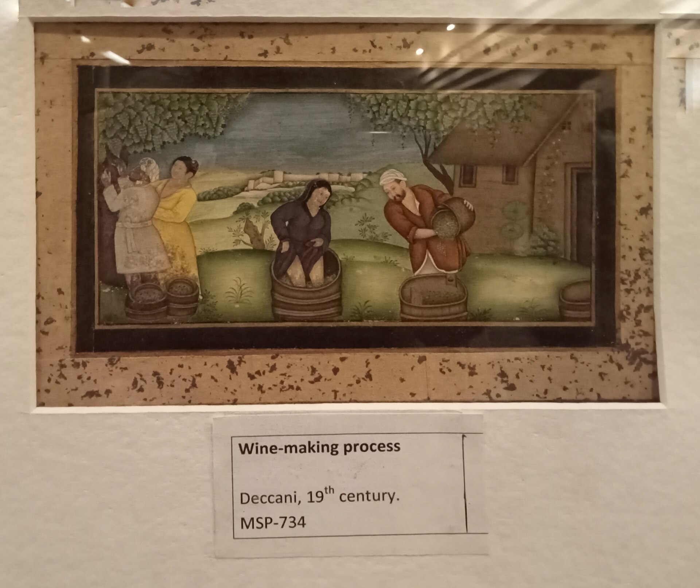

# 酒与画：宴饮图像的四种看法

酒在画里往往不是主角，却常常是最有信息量的细节。一只酒杯放在谁手里、桌上有没有酒壶、光线从哪边打进来、旁人在做什么，这些安排都在说明身份、时间与关系。看酒画，如果只问“他们喝的是什么酒”，会漏掉大部分内容。

本文提出一个读法：先看器物，再看空间，再看人物关系，最后看叙事意图。四层之间不是并列的清单，而是一条从“物”到“意义”的链条。四件作品分别对应四种场景，也分别暴露这条链条的边界。

图：酒与画：宴饮图像的四种看法相关实景照片。图片：Natasha Khaitan，CC BY-SA 4.0，via Wikimedia Commons（[原图页面](https://commons.wikimedia.org/wiki/File:Wine_making_process_-_Deccan_Painting_-19th_Century.jpg)）。

## 论点

酒在绘画中主要不是“饮品”，而是“关系与制度的指示器”。同一只杯子，放在市井酒肆的柜台上，说明的是商业与消费；放在夜宴的矮几上，说明的是座次与权力；放在神话人物的手中，说明的是神性与邀请；放在荷兰家庭的桌上，说明的是日常、阶层与道德。

因此，看酒画的核心问题不是“这是什么酒”，而是“这杯酒在为谁、为什么、以什么方式被使用”。器物的形状、酒的数量、饮用者的姿态，都是答案的一部分。但图像同时是建构：它有程式、有理想化、有后世的临摹与改造，不能直接当作社会统计。

## 证据链之一：汴京的酒旗与正店

[《清明上河图》](ref:qingming)是北宋张择端的绢本长卷，现藏故宫博物院，高约 24.8 厘米，长约 528.7 厘米。画卷中段虹桥一带商业密集，酒肆、酒楼沿街分布，门前挂酒旗，店内有客座，河上有运粮与运酒的船只。画中可以看到“孙羊店”一类招牌，以及“正店”字样，说明画面刻意区分了不同等级的卖酒场所。

这条视觉线索能与文献对上。《东京梦华录》记北宋汴京“在京正店七十二户，此外不能遍数，其余皆谓之脚店”：正店有酿酒权，可以向脚店批发；脚店则从正店取酒零售。酒旗承担广告功能，彩楼欢门用于招揽，夜市与节令新酒构成营业节奏。酒在这里不是孤立物件，而是城市商业网络的一环：粮食从水路来，酒在城内酿造与销售，批发与零售分层，税收与专卖制度在背后运行。

看这幅画时，可以先找酒旗，再顺藤摸瓜找仓库、码头与柜台。画家的兴趣在“运转”，不在某一杯酒的滋味。酒因此成为理解宋代城市经济的入口，而不是一幅静物。

## 证据链之二：夜宴的座次与器物

[《韩熙载夜宴图》](ref:han-xizai)传为五代南唐顾闳中所作，现存多为宋代摹本，藏故宫博物院。长卷分听乐、观舞、暂歇、清吹、散宴五段，酒贯穿其中：主客的座次、歌伎的位置、谁在举杯、谁在沉思，都被细致安排。传统说法认为这幅画带有监视与汇报的背景，韩熙载以纵情宴乐来躲避猜忌。

无论具体政治情节如何，图像本身说明了一件事：宴饮是可以被观看、被记录、被用来传达态度的场合。画面中的注子、注碗、盘盏、矮几，构成一套完整的宴饮器物组合；酒壶放在哪里、杯子朝向谁，都不是随手安排。酒在这里不是享受，而是一种姿态：喝与不喝、看与被看，都是表演的一部分。

## 证据链之三：神话与日常的两极

[卡拉瓦乔的《巴克斯》](ref:bacchus)约作于 1596 至 1597 年，藏于乌菲齐美术馆。画中少年手持玻璃高脚杯，面前摆着水果与酒壶。酒神话题本是古典母题，但画家把人物拉到极近的距离，皮肤、杯中的反光、果叶的虫子都清晰可见。酒杯因此不只是象征，它把神话变成了一个可以伸手触碰的瞬间。人物正对观者，酒杯递向前方，构图本身在“邀请”。

另一极是荷兰风俗画。17 世纪荷兰画家大量描绘室内饮酒场景，[德·胡赫笔下的饮酒女人](ref:de-hooch)约作于 1658 年，现藏伦敦国家美术馆：人物坐在光线柔和的房间里，桌上有一只酒杯，关系平静而日常。这类画常被读作对节制、家庭与阶层的讨论：饮酒是生活的一部分，也可能带来失序。

把两幅画并置，差别很清楚：神话画把酒变成神性，风俗画把酒放回房间；前者让观者面对一个超越日常的形象，后者让观者辨认自己的生活。酒在两幅画里都不是“酒本身”，而是关于身体、欲望与社会规范的不同说法。

## 反例与边界

第一，图像不是照片。《清明上河图》存世有多个版本与摹本，明仇英本等后世作品在构图与细节上已有改动；不能把某一版本的每个细节都当作北宋实录。第二，画中器物可能是理想化或仿古的。画家为了画面效果，可能把不同年代、不同等级的器物并置，不能仅凭一只杯子给整幅画断代。

第三，《韩熙载夜宴图》的政治解读主要来自题跋与传说，不是画内自明的证据。把“监视—伪装”的故事当成唯一答案，会压扁图像的复杂性。第四，《巴克斯》的酒是神话道具，不是 1590 年代罗马日常饮酒的实录。第五，荷兰风俗画的道德解读也有争议：并非每幅饮酒场景都在劝诫，有些只是生活记录或市场趣味的产物。

这些边界并不否定图像的价值，而是提醒我们：图像能提供文献没有的细节，却不能替代文献的证据链。最稳妥的用法，是让图像与账簿、笔记、器物、法律条文互相校正。

## 与站内其他条目的分工

本文处理的不是单件作品的著录，而是“如何看酒”的方法。具体分工如下：[酒器史](ref:vessels)负责杯、壶、瓶的形制演变与材质差异，本文只取图像中可见的器物作为证据；[酒馆史](ref:history-of-taverns)负责酒肆、客栈与酒吧的空间与经营，本文关注画家如何表现这些空间；酒与礼负责仪式中的座次与献酒次序，本文关注这些次序如何被画出来。

单件作品的作者、年代、尺寸与递藏，归各自的 artwork 条目；本文不重复著录，只在论证需要时引用。节令饮酒归酒与节庆条目，本文不展开。这样分工，是为了避免把一篇“看画方法”写成作品清单的拼接。

## 另见

- [《清明上河图》](ref:qingming)：宋代城市与酒肆的图像材料。
- [《韩熙载夜宴图》](ref:han-xizai)：夜宴、座次与政治处境。
- [卡拉瓦乔《巴克斯》](ref:bacchus)：酒神题材的近景处理。
- [德·胡赫《饮酒的女人》](ref:de-hooch)：荷兰风俗画中的日常饮酒。
- [酒器史](ref:vessels)：杯、壶、瓶的形制变化。
- [酒馆史](ref:history-of-taverns)：酒肆与城市空间的历史。
