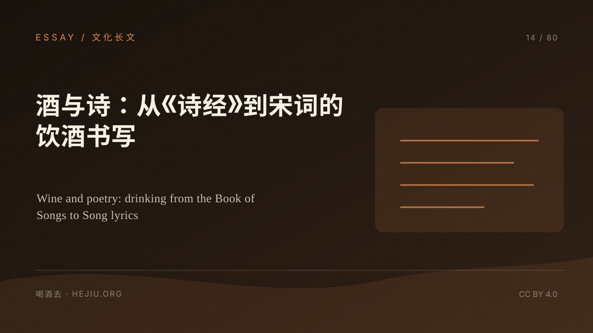

# 酒与诗：从《诗经》到宋词的饮酒书写

中国诗里酒出现得太频繁，以至于“诗酒”成了一个固定搭配。但不同时代的酒并不是同一种东西：先秦是低度谷物酒，唐宋也以米酒、黄酒为主，蒸馏酒要到更晚才普及。喝酒的场合也各有制度：祭祀、乡饮、送别、独酌、贬谪。读饮酒诗，先要分清杯子里是什么酒、在什么场合举杯。

这篇文章按四段时间来读：先秦的礼与农事、魏晋的自我表达、唐代的宴集与个人处境、宋词里的日常与回忆。最后说明为什么不能把诗句直接当作酒类统计。

图：酒与诗：从《诗经》到宋词的饮酒书写 类型示意图。图片：Doubao Seedream 5.0 AI 辅助绘制（项目自有），不是酒与诗：从《诗经》到宋词的饮酒书写的实拍。

## 先秦：酒在礼与农事里

《诗经》里的酒大多有制度背景。《豳风·七月》写农事收成之后“为此春酒，以介眉寿”，酒是节令与养老的一部分；《小雅·宾之初筵》则细致描写宴饮失仪，从“温温其恭”到“载号载呶”，酒在这里是礼仪秩序的试金石。也就是说，早期诗歌关心的不是酒的味道，而是酒是否被放在正确的位置上。

这一时期的酒由谷物发酵而成，用曲糖化再发酵，酒度不高，保存期短。诗中出现的爵、觥等器物，既是饮器也是礼器。读《诗经》中的酒，最好同时读礼书，否则容易把仪式场景当成日常聚会。

## 魏晋：饮酒成为自我表述

汉末到魏晋，饮酒诗的重心从礼制转向个人。竹林七贤的传说把纵酒与反抗联系在一起，但传说的成分需要分离。更可靠的文本是[陶渊明](ref:tao-yuanming)的《饮酒》二十首：诗前小序说明他“既醉之后，辄题数句自娱”，酒在这里不是政治宣言，而是闲居、读书与思考生死时的伴随物。

陶渊明的写法影响很大：酒与田园、菊花、黄昏连在一起，形成一种可以被后人模仿的生活图像。但要注意，他的“饮酒”不等于每天大量饮酒；组诗里有不少句子在写“止酒”和身体的限度。

## 唐：宴集、送别与个人处境

唐代城市商业发达，酒肆、酒旗与酒令进入日常生活。[李白](ref:li-bai)把饮酒写成一种夸张的想象，《将进酒》里“烹羊宰牛且为乐，会须一饮三百杯”是修辞，不是酒量记录；《月下独酌》则把孤独写成与月亮、影子共饮的场景。李白的酒常常通向天空和神话，现实细节反而被推远。

[杜甫](ref:du-fu)几乎走相反的路。他写故人来访时“樽酒家贫只旧醅”，写晚年病中“潦倒新停浊酒杯”。酒在杜甫诗里标记的是经济状况、身体状况与战乱消息，而不是飘逸的姿态。把李杜并读，能看到同一种饮料如何被写成两种完全不同的经验。

唐诗中的“三百杯”“一斗”都是文学语言。唐代量制与酒度都和今天不同，诗句不能换算成现代饮酒量。这一点在引用名句时尤其要说清楚。

## 宋：词里的日常与回忆

到了宋代，酒更深入地进入城市生活与文人交往。词这种体裁适合写片段情绪，酒因此常与天气、花期、睡眠和回忆绑在一起。[李清照](ref:li-qingzhao)写“三杯两盏淡酒，怎敌他晚来风急”，酒在这里无法抵御寒冷，也无法抵消失去；《醉花阴》里的“东篱把酒黄昏后”则把重阳、菊花与思念放在一个画面里。

宋人饮酒还伴随复杂的酒令与席间游戏，酒筵是社交场合，也是文学生产的场合。苏轼、辛弃疾等人的词把酒与政治失意、地方治理和乡土记忆连在一起。与唐诗相比，宋词里的酒更日常，也更擅长写“喝过之后”的余味。

## 为什么不能把诗当酒类统计

第一，诗中的数量多是夸张或格律需要，“三百杯”不能当消费量。第二，诗里的酒名常是泛称，比如“浊酒”“新酒”，并不对应今天的品牌或香型。第三，诗写得最动人的往往是例外状态：贬谪、送别、病中、国破，这些场景不能代表日常饮酒频率。第四，版本与异文会影响字句，引用时应说明底本。

诗能提供的是场景、感受与语言资源，而不是产量、价格或酒度数据。把这些边界说明白，诗仍然是最好的入口：它让人记得，酒从来不只是饮品，它还是人与人相处的方式。

把酒诗当史料，先要分清“诗中的酒”与“社会中的酒”：诗可以记录场合、器物、情绪与社交关系，却常常省略价格、产量、产地与饮用频率。先秦的礼酒、魏晋的服药与宴饮、唐宋的宴集与送别各有语境；读诗时应把意象、版本与写作背景一起看，不能把一句“醉”当成统计数字。

## 相关条目

- [《诗经》](ref:shijing)：早期饮酒语句与礼制背景。
- [陶渊明](ref:tao-yuanming)：饮酒组诗与田园生活。
- [李白](ref:li-bai)：宴饮与想象的代表诗人。
- [杜甫](ref:du-fu)：酒与病中、漂泊的书写。
- [李清照](ref:li-qingzhao)：宋词里的酒与回忆。
- [将进酒](ref:qiang-jin-jiu)：李白名篇的文本与读法。
- [一杯酒里的时间](ref:time-in-a-cup)：节令、农事与酒的关系。

对照阅读：[诗经](ref:shijing)、[杜甫](ref:du-fu)。

**关键事实。**

| 项目 | 内容 |
| --- | --- |
| 一句话定位 | 酒在中国诗里既是宴饮道具，也是时间、友情与政治处境的标记；本文按先秦、魏晋、唐、宋四段梳理饮酒诗的变化，说明不同时代的酒器、酒令与写作动机，并给出把诗当史料时的边界 |
| 议题 | 诗酒传统、饮酒场景、文学史 |
| 时期 | 先秦至宋 |

**来源与边界。** 本页关于「酒与诗：从《诗经》到宋词的饮酒书写」的关键事实，主要由以下来源交叉核对：中国哲学书电子化计划（底本《毛诗正义》）（《七月》《宾之初筵》等篇的饮酒语句与礼制背景；只引短句）、中华书局整理本；中国哲学书电子化计划在线文本（李白、杜甫诗题与通行字句；不复制全篇）、中华书局整理本（李清照词牌与字句；只引短句）等 5 条来源。价格、批次与状态会变，涉及这些字段时以页面所列来源的最新版本为准。正文为项目自写，来源只作核验，不复制原文。

**并读。** 把「酒与诗：从《诗经》到宋词的饮酒书写」与「诗经」、「李白」、「杜甫」放在一起读时，先确认它们是同一层级还是上下游关系：先确认主题与论证范围，再比较材料、观点与结论。本页负责给出文章的基本坐标，对照条目补上具体案例与差异；读完再回到本页，才能分清哪些差别属于文章本身，哪些只是产地、批次或品牌选择。
