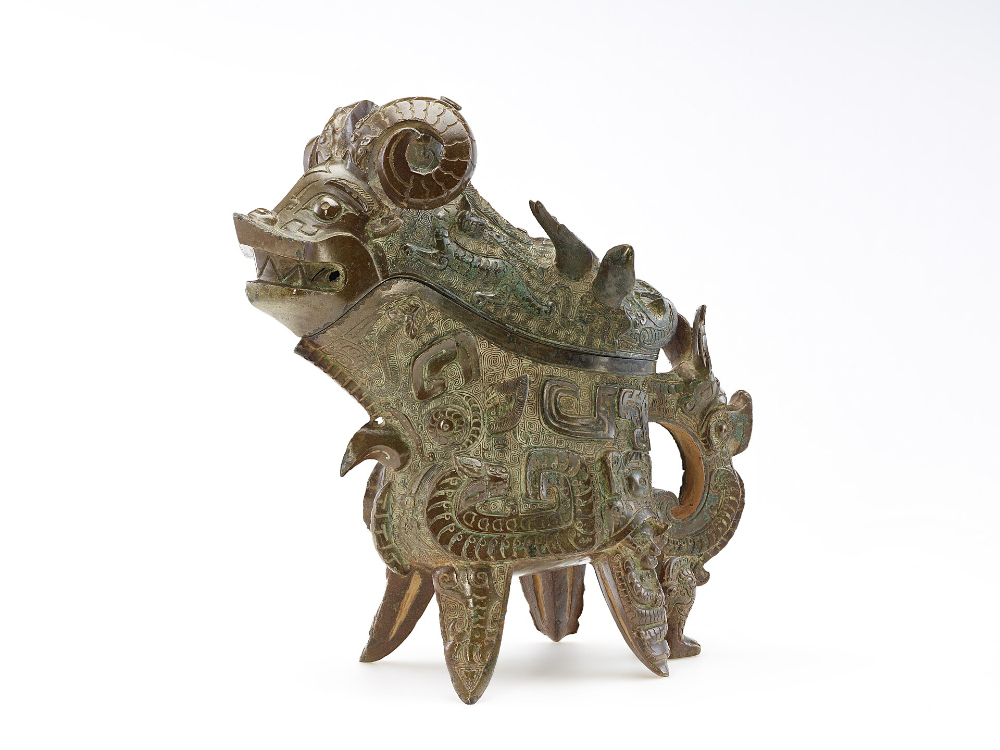

# 酒与礼：从乡饮酒礼到今天的敬酒

在中国传统里，酒首先是一种礼器性的饮料。它出现在祭祀、冠婚、乡饮、朝聘与宴飨中，承担的不是解渴，而是把人与人之间的关系排成可见的次序：谁先举杯、谁后饮、杯放在哪里、用什么器物。理解了这套次序，很多看似繁琐的饮酒规矩才有解释。

需要先说明：经典记载的是理想化的礼仪，后世实际执行往往简化、变形甚至走样。读礼书，要把它当作“规范文本”，而不是社会实录。本文因此分三层：经典怎么规定，制度怎么运行，今天的敬酒又如何从这套规定里脱胎。

图：酒与礼：从乡饮酒礼到今天的敬酒相关实景照片。图片：anonymous，CC0，via Wikimedia Commons（[原图页面](https://commons.wikimedia.org/wiki/File:Ritual_wine_ewer_(gong)_with_masks_(taotie),_dragons,_and_real_animals.jpg)）。

## 论点

酒在礼制中的核心功能是“序人”，不是“悦口”。它用三个可操作的手段把关系固定下来：酒器的等级、座次的先后、献酒的次数。三者叠加，使抽象的长幼、亲疏、尊卑变成可以被看见、被模仿、被批评的动作。

但“序人”不等于“灌酒”。礼书同时强调“节”：饮酒要有度，失仪才是失礼。后世的劝酒文化把“喝得多”当成“给面子”，恰好把礼制的目的颠倒过来。理解酒与礼，是为了看清酒桌上的权力关系，而不是为劝酒寻找依据。

## 证据链之一：《周礼》的酒官与五齐三酒

《周礼》设“酒正”“酒人”“浆人”等职，负责酒的酿造、储存与供给。酒正“掌酒之政令，以式法授酒材”，并分辨“五齐”之名：泛齐、醴齐、盎齐、缇齐、沈齐；又辨“三酒”之物：事酒、昔酒、清酒。五齐按发酵程度与清浊区分，三酒按用途与陈放时间区分。

这套分类说明，酒在制度里是可管理的物资，而不是随意饮用的消费品。祭祀用酒讲究洁净与等级，宴饮用酒则按宾客身份配给。《礼记·月令》还记载不同季节的酿酒与用酒安排，国家通过时间表控制生产与消耗，背后是粮食安全与礼制秩序的双重考虑。

## 证据链之二：《仪礼》的乡饮酒礼

乡饮酒礼是古代地方社会的重要仪式，见于《仪礼》与《礼记·乡饮酒义》。仪节大致包括迎宾、献酒、作乐、旅酬、送宾。核心不在喝，而在“序”：按年龄、德行与身份安排座次和饮酒次序，让年轻者观察并学习长者的举止。

《礼记·乡饮酒义》把规则写得很具体：“六十者坐，五十者立侍，以听政役，所以明尊长也。六十者三豆，七十者四豆，八十者五豆，九十者六豆，所以明养老也。”豆是盛食物的器皿，数量随年龄递增。酒与食物一起，把“尊长”与“养老”变成可计量的待遇。文章还解释，通过饮酒让乡里知道尊卑长幼，从而减少争讼。酒在这里是媒介，真正被传递的是社会规范。也正因如此，乡饮酒礼中的“醉”是被严格限制的，失仪会被记录和批评。

## 证据链之三：祭祀、鬯与玄酒

祭祀用酒有专门的名称与程序。[《诗经》](ref:shijing)中的祭祀诗反复出现“鬯”“醴”等词。鬯是以黑黍加郁金草酿成的香酒，被认为可以降神；醴是较甜的薄酒。酒被用来浇灌、献享与降神，气味本身构成与神灵沟通的媒介。

《礼记·郊特牲》说“酒醴之美，玄酒明水之尚，贵五味之本也”。玄酒即清水，明水是取于月下的露水；祭礼用最清淡的水与酒并置，表达“返本”的意思。这一点与今天的理解差别很大：现代人常把祭祀用酒理解为“供奉一瓶好酒”，古代礼制更在意酒的种类、温度、器物与献酒动作是否合乎等级。酒的质量重要，但“合乎礼”更重要。

## 证据链之四：酒器、合卺与后世变形

[酒器](ref:history-of-vessels)是礼制的物质载体。商周青铜器中的爵、觚、尊、卣，数量、形制与组合常与身份相关；《诗经》与礼书里的“爵”“觥”既是饮器也是礼器。器物一旦进入礼仪，就不能只看容量，还要看它在组合中的位置。这也是为什么考古发现中的酒器组合，比单件器物更能说明墓主人的身份。

婚礼中的合卺更能说明“礼”如何变成“俗”。《仪礼·士昏礼》记“合卺而酳”，把瓠剖成两半，夫妇各执一瓢饮酒，象征合为一体。今天常说的[合卺酒](ref:wedding-wine)或交杯酒，原型与古代婚礼仪节有关，但现代仪式已经高度娱乐化。解释这类习俗时，最好区分“文献可考的源流”与“当代的再创造”。

## 反例与边界

第一，礼书是规范，不是实录。商代饮酒之风很盛，殷墟妇好墓出土大量青铜酒器，说明上层社会确实大量用酒；而《尚书·酒诰》是周初的戒酒文告，反映的是周人对前朝饮酒风气的批判。两者并置，说明“礼”常常是对现实的矫正，而不是现实的写照。

第二，乡饮酒礼在后世变形。它可能与地方敬老礼、科举鹿鸣宴、宗族宴席结合，仪节早已不是先秦原样。把后世的座次规矩直接说成“周礼”，是常见的附会。

第三，礼书内部也有差异。《周礼》偏制度设计，《仪礼》偏仪节流程，《礼记》偏解释与发挥，三者成书年代与立场不同，不能当成一部统一的法典。

第四，现代劝酒与礼制的“节”相反。《礼记》反复讲饮酒要有节制，失仪才是失礼；“不喝就是不给我面子”是把酒量变成权力测试，与“序人”无关，与“节”更无关。

## 与站内其他条目的分工

本文处理“礼制如何用酒安排关系”，不写具体的祭祀操作。[祭祀用酒](ref:china)条目负责家祭、墓祭与公祭的当代流程，本文只取三献与酹酒的结构。[酒器史](ref:history-of-vessels)负责爵、觚、尊、卣的形制与分期，本文只讲器物在礼制中的等级意义。

[合卺酒](ref:wedding-wine)条目负责婚礼饮酒习俗的源流与当代变化，本文只取《士昏礼》的文本依据。[将进酒](ref:poem-li-bai)条目负责宴饮诗中的劝酒修辞，本文不展开文学分析。[中国](ref:china)条目提供礼制与地方风俗的地理背景。

## 另见

- [《诗经》](ref:shijing)：祭祀与宴饮诗中的酒器与礼语。
- [中国](ref:china)：礼制与地方风俗的地理背景。
- [合卺酒](ref:wedding-wine)：婚礼饮酒习俗的源流与变化。
- [酒器史](ref:history-of-vessels)：爵、觚、尊、卣的形制与等级。
- [将进酒](ref:poem-li-bai)：宴饮诗中的劝酒修辞。
