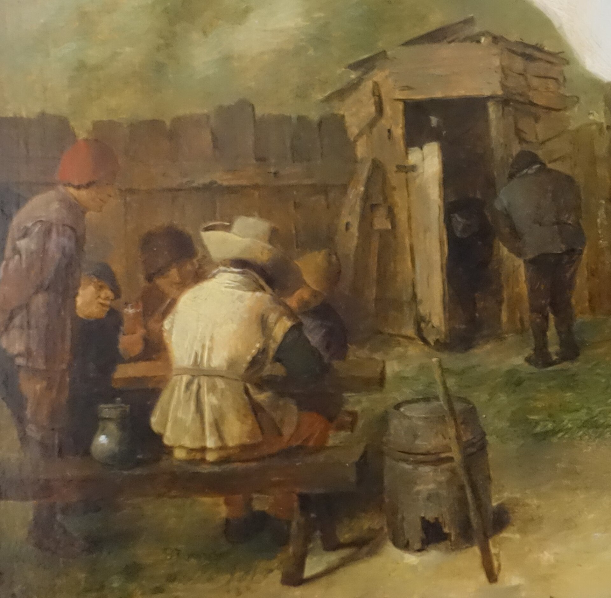

# 《饮酒者》：勃鲁维尔的客栈与一张脸

勃鲁维尔画里的人很少“体面”。他们喝酒、抽烟、争吵、睡着，脸上带着酒后的红晕与失控的表情。可正是这些不体面的脸，让他的画在 17 世纪显得格外新鲜：他没有把农民画成牧歌里的善良牧人，也没有把他们画成纯粹的笑话；他画的是人在酒精与喧闹中失去防备的样子，既可笑，又可怜。

图：《饮酒者》：勃鲁维尔的客栈与一张脸作品图像。图片：Karmakolle，CC0，via Wikimedia Commons（[原图页面](https://commons.wikimedia.org/wiki/File:Seated_Drinkers_by_Adriaen_Brouwer_-_detail.jpg)）。

## 作品信息

这幅画的作者是阿德里安·勃鲁维尔（Adriaen Brouwer，约 1605/1606–1638），弗兰德斯画家。莫瑞泰斯皇家美术馆（Mauritshuis，海牙）著录的作品题为 Drunken Peasants at an Inn（《醉酒的农民在客栈》），年代约为 1625–1626 年；材质为油画，具体支撑材料、尺寸与馆藏编号以馆方记录为准。中文里常把这类题材泛称为《饮酒者》或《农民饮酒》，本文以馆藏题名为准，同时保留“饮酒者”的通称。

需要提醒的是，勃鲁维尔的同名或相近题材作品不止一件，不同博物馆、拍卖图录与旧文献可能使用 The Drinker、Peasant Drinking、Drunken Peasants 等不同题名。读者检索时，最好以馆方编号与馆方题名为准，避免把不同作品混为一谈。

## 画面与酒器

画面是一个客栈内部。几个人围坐或站立，喝酒、抽烟、交谈；前景的一位女子已经从凳子上滑下来，睡着了。莫瑞泰斯的官方描述大意是：在这家客栈里，没有人还保持清醒，酒、烟草与兴奋让所有人失去了分寸。这个描述把画面的基调说得很清楚：它不是一场安静的聚餐，而是一个喧闹、失控、带着喜剧感的场景。

酒器在画面里并不精致。它更像日常使用的壶、杯或罐，和粗糙的衣物、木桌、昏暗的室内相配。酒不是被“品鉴”的对象，而是被大口喝下的东西；它的作用不是展示身份，而是把人推向失态。本文不逐一举出杯中液体的种类，因为复制品难以判断；更重要的是酒器的使用方式：谁在倒，谁在喝，谁已经喝到不能再喝。

## 酒文化关联

客栈与酒馆是 17 世纪低地国家城市与乡村生活的重要空间。它们不只是喝酒的地方，也是消息、交易、争吵与社交的场所。勃鲁维尔的画把这种空间画得拥挤、昏暗、带点混乱；酒在这里是社交的媒介，也是失控的起因。它让人暂时离开工作与规矩，却也让人暴露出贪婪、懒惰与脆弱。

这类画常被归入“低俗题材”（low-life genre）：画家不画贵族与神话，而画农民、酒徒、吸烟者与流浪者。但“低俗”不等于“没有意义”。勃鲁维尔在滑稽的表面下，常常带着对人性弱点的冷静观察；他不嘲笑画中人，也不美化他们。酒与烟草在这里是现代早期消费文化的一部分，也是道德讨论的对象。若想了解酒馆的历史，可以读[酒馆的历史](ref:history-of-taverns)；若想了解酒吧与城市生活，可以看[酒馆与城市](ref:pub-and-city)。

## 技法与时代背景

勃鲁维尔的笔法很有特点：他不追求光滑的 finish，而是用短促、松动、几乎带着速写感的笔触去塑造脸、手与衣物。人物的表情被夸张，但不失结构；醉态被画得具体，却不变成漫画。这种“松而不散”的处理，让画面有一种现场感，像是画家就在客栈的角落里看着。

他活动的年代是 17 世纪初，弗兰德斯与荷兰的风俗画正在发展。客栈、农民、饮酒与吸烟是常见题材，但勃鲁维尔的处理更直接、更少修饰。他对后来的弗兰德斯风俗画家（如小达维德·特尼尔斯与阿德里安·范·奥斯塔德）有影响；他的小尺幅作品也被当时的收藏家看重。具体的影响关系与收藏史，以艺术史研究与馆方资料为准。

## 收藏与流传

这幅作品现藏莫瑞泰斯皇家美术馆。它的早期收藏、转入该馆的年代与展览历史，以馆方著录为准。对观众来说，重要的是把它放回 17 世纪的风俗画传统：同一座博物馆里还有别的客栈与饮酒场景，把它们放在一起看，能看出不同画家如何处理“酒”与“人”的关系。

勃鲁维尔的作品尺幅通常不大，适合近距离观看。这也影响了他的画法：笔触与表情要在近处才看得清，远看可能只剩一团颜色。今天在博物馆里，观众不妨靠近一点，看看那张脸上的红晕、嘴角的松动与眼睛的失焦；这些细节比“故事”更能说明酒的作用。

## 常见误读

第一，把它当成“醉汉笑话”。画里确实有滑稽成分，但画家对人物的观察是冷静的，甚至带着同情；不是单纯的取笑。

第二，把它读成纯粹的道德说教。酒与烟草可以被视为警告，但画面并没有给出一个明确的“教训”；它更像一面镜子，让观者自己判断。

第三，把人物当成没有个性的“农民类型”。勃鲁维尔的脸画得很具体，每个人都有自己的表情与姿态；类型化的标签会抹掉这些差异。

第四，把酒器当成无关的道具。壶、杯与烟斗在画面里推动动作，也暗示消费与社交；它们不是背景装饰。

## 观看建议

先看前景：那位从凳子上滑下来的女子，她的姿态把“失控”放在画面最前面。再看男人的脸：谁在笑，谁在发呆，谁在说话。然后看酒器与烟斗：它们在谁手里，如何传递。最后看空间：客栈的墙、桌与暗处如何把人物围在一起。

如果可能，找一幅小达维德·特尼尔斯或阿德里安·范·奥斯塔德的客栈画对比。勃鲁维尔的画通常更小、更粗、更直接；特尼尔斯更叙事、更精细，奥斯塔德更温和。对比之后，再看这幅画里的醉态，会发现它不是“风俗画的标配”，而是画家对人性的一次近距离观察。

## 另见

- [啤酒](ref:beer)：啤酒的类型与饮用传统。
- [酒馆的历史](ref:history-of-taverns)：酒馆如何成为城市生活的一部分。
- [酒馆与城市](ref:pub-and-city)：酒吧、街区与城市生活的关系。
- [酒馆之外](ref:beyond-the-pub)：饮酒空间如何超出传统酒吧。

对照阅读：[啤酒](ref:beer)、[认识一座城，从一间酒馆开始](ref:pub-and-city)。

**关键事实。**

| 项目 | 内容 |
| --- | --- |
| 一句话定位 | 弗兰德斯画家阿德里安·勃鲁维尔的客栈风俗画，以莫瑞泰斯皇家美术馆藏《醉酒的农民在客栈》为代表，常被泛称为《饮酒者》；画面里酒、烟草与喧闹让所有人失去清醒 |
| 媒介 | 油画 |
| 收藏 | 莫瑞泰斯皇家美术馆，海牙 |
