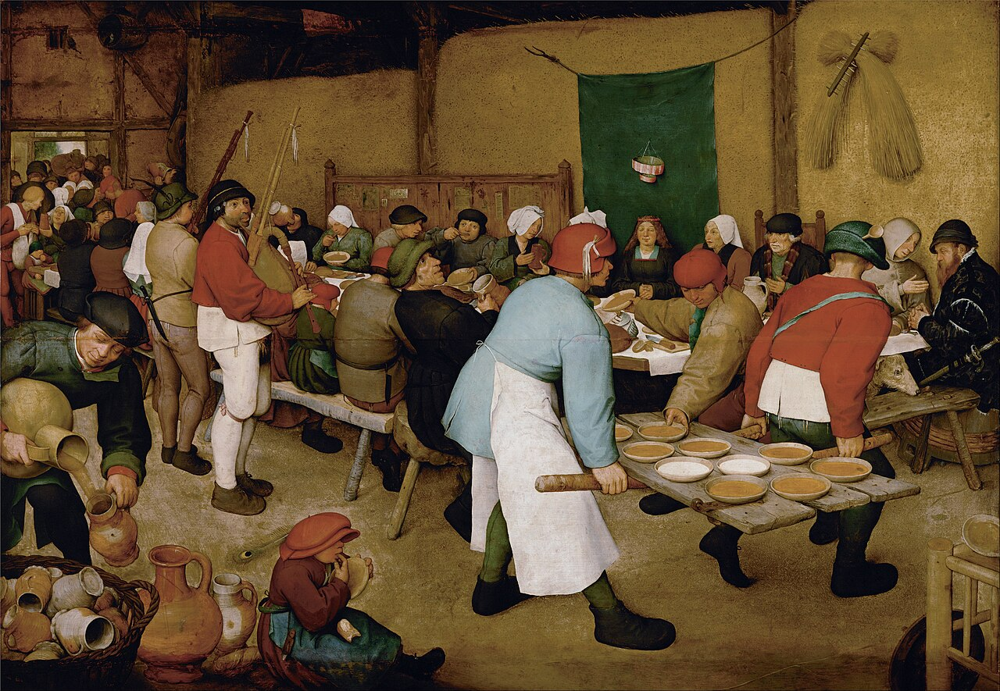

图：勃鲁盖尔《农民婚礼》复制图，1568，现藏维也纳艺术史博物馆；不是婚宴现场记录。。图片：Pieter Bruegel the Elder，Public domain，via Wikimedia Commons（[原图页面](https://commons.wikimedia.org/wiki/File:Pieter_Bruegel_the_Elder_-_Peasant_Wedding_-_Google_Art_Project.jpg)）。

## 一场挤在谷仓里的婚礼

画面几乎没有留白。左边是门口，客人还在往里挤；中间是一张长桌，桌边坐满了人；右边是墙，墙上挂着一块绿色布幔，新娘坐在布幔前，头顶悬着一顶纸冠。前景两个男人用一块卸下来的门板端着一摞麦糊碗，正往桌边送；一个穿红衣的仆人把大壶里的啤酒倒进小壶；一个孩子坐在地上吃东西；一条狗趴在桌子下面。

这就是老彼得·勃鲁盖尔（Pieter Bruegel the Elder，约 1525/30–1569）的《农民婚礼》。它看起来像一张“现场抓拍”：门板当托盘、客人挤在门口、孩子在地上吃、狗在桌下——这些细节太具体，像画家刚刚走进谷仓看见的一切。但博物馆的说明提醒我们：这个“抓拍感”是精心构图的。人物的位置、视线、动作都经过安排，画面不是照片，而是一场被组织过的乡村婚宴。

## 作品信息

画面作于 1568 年，材质为木板油画。维也纳艺术史博物馆著录的尺寸约为 114 × 164 厘米（画面本身 113 × 164 厘米），藏品号 Gemäldegalerie 1027。它现藏维也纳艺术史博物馆绘画馆第十展厅。

画中的空间是佛兰德斯乡村的谷仓或大房间，不是城市餐厅。婚礼的客人围着一张长桌，桌上摆着面包、麦糊和简单的餐具；墙边挂着干草和农具。新娘坐在绿色布幔前，纸冠悬在她头顶，这是婚礼的标记。新郎不在画面里，按照佛兰德斯习俗，新郎在婚宴开始时不露面，要到晚上才出现。这个“缺席”是理解画面的关键：这不是一张“新郎新娘合影”，而是一张“新娘在席上、新郎还没来”的婚宴图。

画面里还有几类不属于农民的人：一位戴帽子的律师或公证人、一位方济各会修士、一位带着狗的庄园领主。他们站在人群里，说明婚礼不仅是农民的家庭事件，也涉及土地、教会和法律。勃鲁盖尔没有把他们画成讽刺漫画，而是让他们自然地混在宴席中。这种“社会混合”比单纯的“农民风俗”更复杂。

## 酒与食物在画面里做什么

这幅画的主角不是酒，而是“宴席的物流”。

第一，**啤酒是日常饮料**。画面里最清楚的饮酒动作，是红衣仆人把大壶里的啤酒倒进小壶。啤酒在16世纪低地国家是日常饮料，尤其在农村；它比葡萄酒便宜，也比水更安全。婚礼上喝啤酒，不是“低级”，而是当地饮食结构的一部分。想了解啤酒在当时的地位，可以看[啤酒](ref:beer)。

第二，**食物是宴席的尺度**。两个男人用门板端麦糊，说明客人太多，普通托盘不够用；桌上的面包、碗、勺子都很朴素。勃鲁盖尔没有把婚宴画成丰盛的宴席，而是画成“够吃、但不精致”的乡村宴席。这种朴素感让画面更可信，也让“门板端菜”的细节成为整幅画最著名的动作。

第三，**酒与秩序**。谁在倒酒、谁在端菜、谁坐着、谁站着、谁在门口往里挤，构成一套乡村社会的秩序。酒从大壶到小壶，从仆人到手，再到客人；它像一条看不见的线，把宴席的等级和流程串起来。这和[酒馆史](ref:taverns)里说的酒馆空间有相似之处：酒不是孤立的饮料，而是把人组织起来的媒介。

## 勃鲁盖尔与农民题材

勃鲁盖尔是16世纪尼德兰最重要的风俗画家之一。他画农民、节庆、谚语、宗教寓言和风景，但“农民”在他笔下从来不是简单的“土气”或“可笑”。他既画他们的粗俗，也画他们的生命力；既画宴席的热闹，也画人群里的孤独。后来的研究者一直在争论：他的农民画到底是同情、讽刺，还是一种带着距离的观察？这幅《农民婚礼》通常被认为更偏向“记录”：它没有把农民画成漫画，也没有把他们理想化。

画面的构图很讲究。长桌从前景向左后方延伸，形成一条对角线；客人的身体都沿着这条线排列，视线被引向新娘。新娘坐在绿布前，是画面里最安静的人；她不能吃、不能说话，只能坐着。周围的喧闹和她形成对比。这个对比不是偶然：勃鲁盖尔把“婚礼的主角”画成最被动的人，把“宴席的配角”画成最活跃的人。

## 为什么它重要

**它把日常生活画成了历史画。** 在16世纪，历史画和宗教画地位最高，农民婚礼属于“低题材”。勃鲁盖尔却用大画幅、复杂构图和大量人物来画一场乡村婚宴，等于把日常经验提升到值得被认真观看的程度。

**它保留了16世纪低地国家的饮食与婚俗细节。** 门板端菜、纸冠、绿布、啤酒壶、麦糊碗、风笛乐手，这些细节不是装饰，而是当时生活的证据。研究饮食史、民俗史的人可以从这幅画里读到很多文字材料没有的东西。

**它让“宴席”成为社会关系的图像。** 婚礼不只是两个人结婚，它把家庭、邻里、教会、地主、法律都拉进同一个房间。勃鲁盖尔画的不是“农民有多快乐”，而是“一个乡村共同体如何组织一场宴席”。

## 常见误读

**误读一：这是一张现场抓拍。** 画面看起来像抓拍，但人物位置、视线和动作都经过设计。博物馆明确说它是“精心构图”的。把它当成照片，会忽略画家的安排。

**误读二：新郎缺席说明婚礼不完整。** 新郎不在席上是佛兰德斯习俗，不是“画家漏画了”。理解这个习俗，才能理解新娘为什么独自坐在绿布前。

**误读三：画里的农民都是醉汉。** 画面没有画醉态，也没有画混乱。客人拥挤、孩子在地上吃、仆人忙着倒酒，但整体秩序还在。勃鲁盖尔画的是宴席的忙，不是宴席的失控。

**误读四：这是一幅讽刺农民的画。** 画面有幽默，但没有把农民画成动物或漫画。律师、修士、领主的存在说明这不是“农民自己的世界”，而是一个有外部权力介入的乡村社会。讽刺与否，仍是研究者的争论，不宜下定论。

## 怎么看这幅画

先看对角线：长桌从前景左侧向后方延伸，把视线带到新娘。再看前景的门板：两个男人抬着它，身体前倾，步伐一致，是画面里最有动感的动作。然后看新娘：她坐在绿布前，纸冠悬在头顶，周围越热闹，她越安静。最后看门口：客人还在往里挤，说明宴席已经开始，但人还没到齐。

可以把这幅画和[《饮酒者》](ref:brouwer)的《饮酒者》对照：勃鲁维尔画的是酒馆里的喧闹个体，勃鲁盖尔画的是宴席里的群体秩序。再和[酒与节庆](ref:festivals)里的节庆图像对照：婚礼、丰收、狂欢都是“集体吃饭”的场合，酒和食物把人们聚在一起，也把等级摆出来。

最后，把[酒与画](ref:painting)放在这里：酒与画的关系不只是“画里有什么酒”，还包括“谁有资格被画进宴席”。勃鲁盖尔把农民、仆人、孩子、狗都画进了大画幅，这本身就是一种态度。

相关条目：[《饮酒者》：勃鲁维尔的客栈与一张脸](ref:brouwer)、[啤酒](ref:beer)、[酒馆史：从酒肆、客栈到酒吧](ref:taverns)。

**关键事实。**

| 项目 | 内容 |
| --- | --- |
| 一句话定位 | 老彼得·勃鲁盖尔 1568 年的木板油画，现藏维也纳艺术史博物馆；画面是佛兰德斯农民的婚宴：新娘坐在绿布前，新郎按习俗不在席上 |
| 媒介 | 木板油画 |
| 收藏 | 维也纳艺术史博物馆，绘画馆（Gemäldegalerie, inv. 1027） |

**来源与边界。** 本页关于「《农民婚礼》：勃鲁盖尔把一场乡村婚宴画成一张社会切片」的关键事实，主要由以下来源交叉核对：Kunsthistorisches Museum, Vienna（作者、年代、材质、尺寸、藏品号、画面人物与佛兰德斯婚俗；馆方英文页，本页只转述事实；德文著录中的尺寸、木板材质、来源与画面细节；未复制馆方原文）、Google Arts & Culture / Kunsthistorisches Museum（画面结构、人物动作与“新娘不能吃、不能说话”的婚俗说明；高清图版权归馆方）、Encyclopaedia Britannica（勃鲁盖尔生平、尼德兰风俗画背景与代表作品；不作为作品细节的唯一依据）等 5 条来源。价格、批次与状态会变，涉及这些字段时以页面所列来源的最新版本为准。正文为项目自写，来源只作核验，不复制原文。
