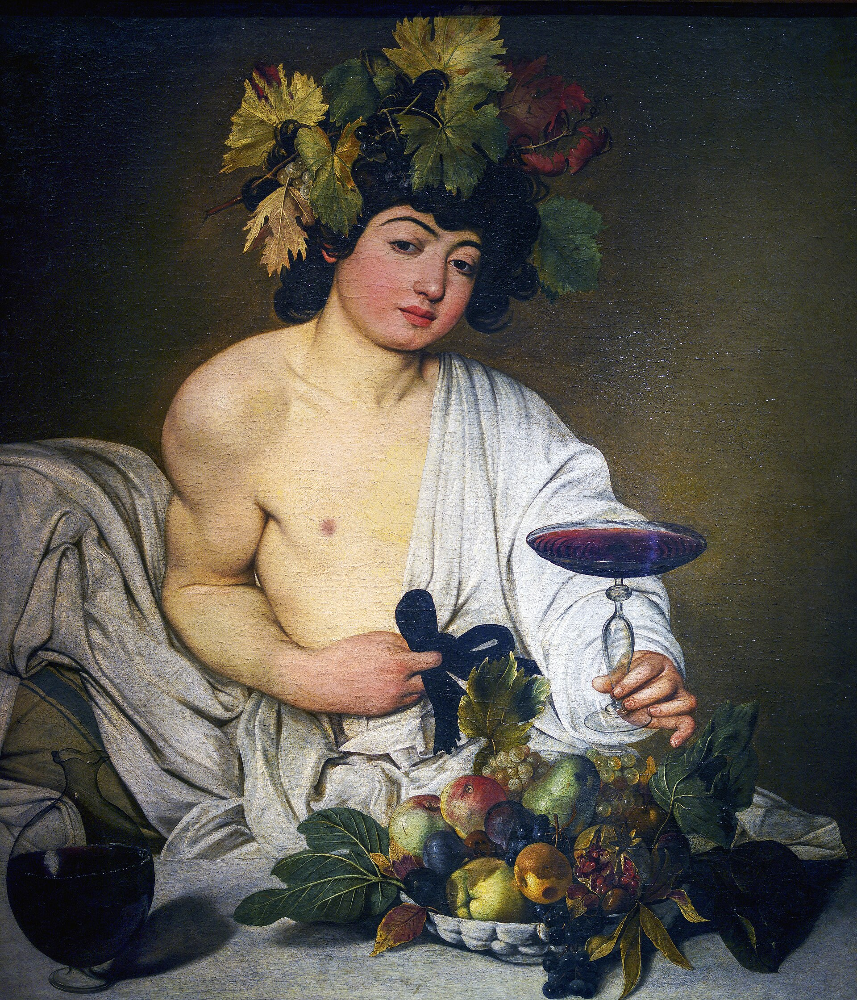

# 《酒神巴克斯》：卡拉瓦乔的一杯酒与一篮水果

在乌菲齐美术馆的展厅里，卡拉瓦乔的《酒神巴克斯》常被观众当成一幅“好看的年轻人肖像”。但画面并不安静：酒杯被递到观者面前，水果篮被画得几乎可以触摸，酒神的眼神却带着醉意与疏离。它把神话、静物与肖像挤在同一张画布上，留下一个不容易一次读完的谜题。

图：《酒神巴克斯》：卡拉瓦乔的一杯酒与一篮水果作品图像。图片：Caravaggio，Public domain，via Wikimedia Commons（[原图页面](https://commons.wikimedia.org/wiki/File:Bacchus_by_Caravaggio_1.jpg)）。

## 画面里发生了什么

画面是一位半身青年，坐在垫子上，头戴葡萄藤冠，白色长袍从肩头滑落。他左手举着一只浅而宽的玻璃杯，杯中装着红酒，杯口朝向画外，像是在邀请观者接过这杯酒。右侧前方是一篮水果，葡萄、苹果与其他果实堆叠在一起，细节被画得极为清楚。

乌菲齐官方页面把这一动作描述为“酒神递上的酒杯”，并指出酒神因醉酒而显出呆滞的神情。这个说法提醒我们：画中人不是单纯的神话符号，他的身体与神态都属于“喝过酒”的状态。酒在这里既是属性（酒神当然与酒有关），也是动作（他正在把酒递给你）。

## 画作的基本信息

乌菲齐官方页面给出的信息是：作者为米开朗基罗·梅里西，即卡拉瓦乔（1571—1610）；年代约为 1598 年；材质为布面油画；尺寸 95 × 85 厘米；藏品编号 1890 n. 5312。不同出版物对年代的写法可能略有差异，但“16 世纪 90 年代后期、卡拉瓦乔早期罗马时期”这一范围是共同的。

这幅画属于卡拉瓦乔早期的一批半身像系列。官方页面把它与《捧果篮的少年》（罗马博尔盖塞美术馆）、《被蜥蜴咬伤的少年》（佛罗伦萨隆吉基金会）、《水果篮》（米兰安布罗西亚纳画廊）放在一起。它们都以近距离的半身构图、强烈的光线和精细的静物著称。换句话说，《酒神巴克斯》不是孤立的杰作，而是理解卡拉瓦乔早期风格的一把钥匙。

## 一杯酒与一篮水果

画中最容易被忽略的，是静物的分量。水果篮不是装饰，酒杯也不是道具；它们被画得几乎可以独立成画。乌菲齐页面说，卡拉瓦乔在这幅作品里展示了对静物的高超自然主义描绘，水果篮与酒杯的细节令人惊讶。

官方页面还提到，有评论者把这些元素解释为一种贺拉斯式的邀请：节制、共饮与友谊。这个解释未必是唯一答案，但它说明画面并不只是“酒神在喝酒”。酒与水果同时出现，既可以读成享乐，也可以读成对享乐的限制；既可以读成待客，也可以读成对观者的试探。

对今天的读者来说，最容易犯的错误是把画中的酒直接对应成某种现代酒款。卡拉瓦乔画的是 16 世纪末意大利的饮酒想象，杯形、酒色与饮用方式都属于那个时代。若想了解今天的葡萄酒分类，可以看[葡萄酒](ref:wine)；若想了解酒在更长时间里的文化位置，可以读[一杯酒里的时间](ref:time-in-a-cup)。

## 酒神的醉态与古代模型

乌菲齐页面指出，酒神像一尊雕塑，醉态使他显出呆滞的表情；这一形象参考了古典艺术，尤其是安提诺乌斯的肖像，并被赋予一种慵懒的感官性。艺术史家米娜·格雷戈里（Mina Gregori）还在画中看到一种对古代的感受：它赞颂感官的自由，并指向罗马的酒神仪式与入会礼。

这层信息很重要。它说明卡拉瓦乔并不是把“酒神”当成一个可爱的年轻人来画，而是把古代雕像、宗教仪式与当代生活叠在一起。酒神既是神话人物，也是一个被观看的身体；他的醉态既可以被读成放纵，也可以被读成一种超越日常的状态。

## 谁委托了这幅画

乌菲齐页面说，这幅画属于卡拉瓦乔早期在罗马的创作，当时他受红衣主教弗朗切斯科·马里亚·德尔蒙特（Cardinal Francesco Maria del Monte）的赞助。1608 年，德尔蒙特把这幅画与《美杜莎》一起送给费迪南多一世·德·美第奇，作为其子科西莫二世婚礼的贺礼。

这条流传线索把艺术作品放回了具体的人际网络：它不是画家在画室里随意完成的练习，而是赞助人之间交换、庆祝与展示的礼物。理解这一点，就不会把画中的酒神只看成“艺术家的想象”，而会看到它在 17 世纪初的宫廷与收藏体系中的位置。

## 从库房到乌菲齐

这幅画今天之所以为人熟知，还有一个发现故事。乌菲齐页面记载，它在 1913 年于乌菲齐的库房中被发现，由艺术史家罗伯托·隆吉（Roberto Longhi）归入卡拉瓦乔名下。在此之前，它并没有以现在的名字与地位出现在公众视野里。

这段历史提醒我们：经典作品的地位不是天生的。鉴定、档案、展览与学术研究都会改变一幅画的命运。今天我们在展厅里看到的“名作”，背后可能有一段时间被放在库房里、被误认、或被遗忘。看画时把这一层也带上，会比只看画面更有意思。

## 常见误读

第一，把《酒神巴克斯》当成单纯的肖像。画中确实有具体的面孔与身体，但酒神属性、静物与古代模型都说明它不止于肖像。

第二，把年代说死。乌菲齐写“约 1598 年”，不同资料可能给出略有差异的年份；在没有新证据前，最好保留“约”字。

第三，把画中的酒杯当成今天的高脚杯。16 世纪末的玻璃器形与今天不同，杯子的浅、宽与透明感是画面效果的一部分。

第四，把酒神的表情读成单纯的“开心”。官方描述强调醉态与呆滞；它更像一种被酒改变的状态，而不是节庆式的欢笑。

## 今天为什么还值得看

这幅画把三件事放在一起：神话、静物与人的身体。它让我们看到，酒在艺术里从来不只是“喝的东西”，它可以是神的属性、待客的姿态、道德的试探，也可以是对古代世界的想象。

如果你关心酒的实际风味，可以从[如何开始品酒](ref:first-tasting)入手；如果你更关心酒在文化中的位置，这幅画是一份很好的起点。它不提供饮酒建议，却提供了一个观看酒的方式：先看杯子，再看人，最后看画外那个被邀请的你。

## 延伸阅读

- [葡萄酒](ref:wine)：葡萄酒的基本类型与风格。
- [一杯酒里的时间](ref:time-in-a-cup)：《酒神巴克斯》：卡拉瓦乔的一杯酒与一篮水果所处的节令、礼制与文学背景。
- [如何开始品酒](ref:first-tasting)：读《酒神巴克斯》：卡拉瓦乔的一杯酒与一篮水果时从观色、闻香到入口的路径。

相关条目：[葡萄酒](ref:wine)、[一杯酒里的时间](ref:time-in-a-cup)。
