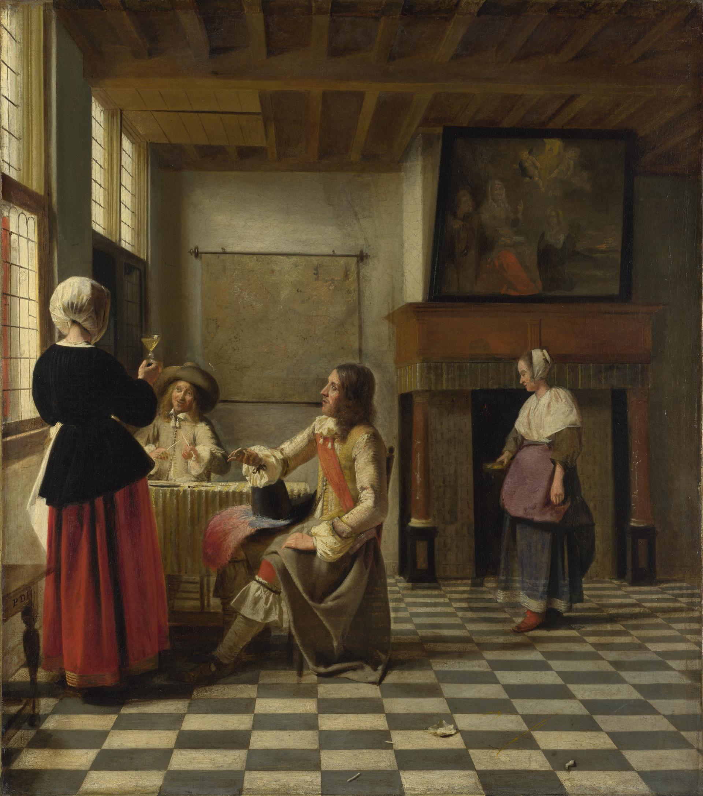

# 《室内：饮酒女子与两位男子》：代尔夫特的一杯酒

这幅画常被简称为“饮酒女子与两位男子”，但它的全名更长：`An Interior, with a Woman drinking with Two Men, and a Maidservant`。名字里已经藏着画面的大部分信息：室内、女子、两位男子、一名女仆。真正让画面耐看的，不是这些人物的身份，而是他们之间没有被说破的关系。

图：德·霍赫《室内：饮酒女子与两位男子》，约1658年，布面油画，伦敦国家美术馆藏。图片：Pieter de Hooch，Public domain，来源：[原始页面](https://www.nationalgallery.org.uk/paintings/pieter-de-hooch-a-woman-drinking-with-two-men)。

## 画面里发生了什么

画面右侧，一位女子背对观者坐着，手里举着一只酒杯；她的左手可能提着酒壶，也可能只是收在胸前。桌子后面，一位男子把两支陶土烟斗当成“小提琴与琴弓”，另一位男子则做出指挥二重奏的手势。伦敦国家美术馆的官方页面因此提出一个可能：这位女子正在唱歌，而不只是在喝酒。

这个解释没有被画面“证明”，但它吻合人物的动作。女子背对我们，看不到表情，也看不到她左手的全部动作；两位男子的手势又确实像在配合一场音乐表演。画面把“饮酒”和“歌唱”放在同一个动作里，让观者无法只用一个标签概括。

## 一个开放的解释

国家美术馆页面明确指出，这种开放性是 17 世纪荷兰风俗画的常见特征，描绘音乐聚会的画尤其暧昧：它们可以代表无害的娱乐，也可以暗示更情色的内容。在这幅画里，连“这是不是一场音乐聚会”都不能确定，更不用说它是否“纯洁”。

这种不确定性不是画家没画清楚，而是画面结构的一部分。女子背对观者、男子手势夸张、桌上与地上的物件散落，所有这些都让观者不断猜测，却拿不到一个确定的答案。看这类画，重要的不是猜中“标准答案”，而是理解画家如何把多种解释同时留在画面里。

## 酒杯、烟斗与暗示

画面里的酒与烟斗不是随手摆放的道具。官方页面提到，男子们的注意力集中在持杯女子身上，而地上的棋盘格地砖上还丢着一支折断的烟斗；在 17 世纪，烟草与酒都被视为催情之物。这些细节把“饮酒”从单纯的日常动作，推向了带有性暗示的社交场景。

酒杯在这里还有一层社交功能：它让女子成为被注视的中心。两位男子没有直接碰她，却通过音乐、目光与烟斗把注意力围拢过来。酒不是暴力的媒介，而是距离的调节器——它让陌生人之间的接近显得自然，也让观者意识到这种接近可能并不单纯。

## 墙上的画：圣母的教育

画面壁炉上方挂着一幅画，官方页面指出它描绘的是圣母玛利亚的教育：年幼的玛利亚跪在母亲圣安妮面前。这是一个关于“如何把美德教给年轻女子”的典范图像。把它挂在女仆可能被调情的场景上方，反讽意味很清楚。

不过，官方页面也提醒：画中原先还有一位男子，站在女仆附近，很可能在调情；后来这个人物被删去。若他还在，墙上画作与下方场景的反差会更直接。删去之后，反讽变得含蓄，但并没有消失：画面仍然在讨论“美德教育”与“现实欲望”之间的距离。

## 空间、地砖与透视

德·霍赫擅长用室内空间制造真实感。官方页面说，黑白棋盘格地砖的线条与大小帮助观者理解人物、家具、墙壁与窗户之间的相对位置。地砖不只是装饰，它是一套视觉标尺。

有趣的是，画家并不追求绝对的透视准确。页面指出，若严格分析房间的几何结构，前景女子的尺寸会显得不对——相对于其他人物，她大约有七英尺高。也就是说，德·霍赫为了画面效果调整了透视。这个细节提醒我们：风俗画的“真实感”是建构出来的，不是照片式的记录。

## 红外线下的修改

红外线照片显示，画面最初还有另一位男子，站在端着热炭的女仆附近，很可能在调情。官方页面说，这个人物可能是在女仆被加入之前就被删去；如果不是，那么删去他就柔化了画面中“私通”的暗示。

这个修改让画面的道德重心发生了变化。保留那位男子，画面会更直接地呈现“诱惑”；删去他，观者只能从男子的目光、折断的烟斗与墙上的圣母画去推测。德·霍赫没有把道德结论写死，而是把判断留给了看画的人。

## 收藏与流传

国家美术馆页面给出的基本信息是：全名 `An Interior, with a Woman drinking with Two Men, and a Maidservant`；作者彼得·德·霍赫（1629—1684 年后）；年代约 1658 年；布面油画；尺寸 73.7 × 64.6 厘米；有签名与题记；藏品编号 NG834；1871 年购入。

它的早期流传并不完全清楚。页面说，它可能出现在 1749 年阿姆斯特丹的 David Jetswaart 拍卖，但描述太模糊，无法确认；可以确定的是它出现在 1804 年巴黎的 van Leyden 拍卖，由 Paillet 购入；1826 年，Emmerson 与 Smith 从巴黎的 Comte de Pourtalès 处购得，后卖给罗伯特·皮尔爵士；1871 年随皮尔收藏一起进入国家美术馆。

## 常见误读与今天怎么看

第一，把画当成“醉酒女子”的道德讽刺画。画面确实有道德框架，但女子的动作也可能是歌唱，画家没有给出单一结论。

第二，把画面当成照片式的空间记录。地砖与透视都经过调整，前景女子的比例并不严格符合几何。

第三，把烟斗与酒杯当成单纯的生活道具。它们在 17 世纪的语境里带有社交与情色含义，不能只按今天的习惯理解。

第四，把墙上的圣母画当成无关的装饰。它与下方场景构成对照，是理解画面道德层次的关键。

今天看这幅画，可以把酒当成一条线索：它连接人物、器物、空间与道德判断，却不让任何一项单独成立。若想了解葡萄酒的基本类型，可以看[葡萄酒](ref:wine)；若想了解酒馆与城市生活的关系，可以读[酒馆与城市](ref:pub-and-city)；若想把观看转为品鉴，可以从[如何开始品酒](ref:first-tasting)开始。

## 延伸阅读

- [葡萄酒](ref:wine)：葡萄酒的基本类型与风格。
- [酒馆与城市](ref:pub-and-city)：酒吧、街区与城市生活的关系。
- [一杯酒里的时间](ref:time-in-a-cup)：《室内：饮酒女子与两位男子》：代尔夫特的一杯酒所处的节令、礼制与文学背景。
- [如何开始品酒](ref:first-tasting)：读《室内：饮酒女子与两位男子》：代尔夫特的一杯酒时从观色、闻香到入口的路径。

相关条目：[一杯酒里的时间](ref:time-in-a-cup)。
