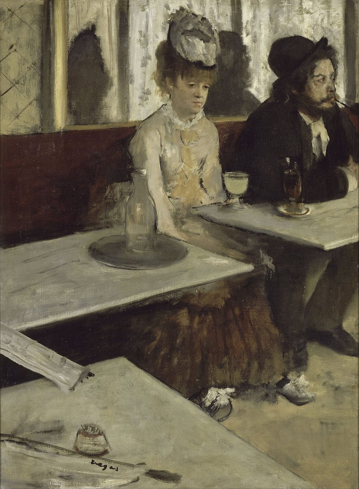

图：德加《在咖啡馆》（通称《苦艾酒》）复制图，1875–1876，现藏奥赛博物馆；不是咖啡馆现场照片。。图片：Edgar Degas，Public domain，via Wikimedia Commons（[原图页面](https://commons.wikimedia.org/wiki/File:Edgar_Degas_-_In_a_Caf%C3%A9_-_Google_Art_Project.jpg)）。

> **先给结论**
> **一句话：** 这页判断《苦艾酒》：德加画的是两个人坐在一起，却谁也不看谁该怎么看，以及它在饮酒图像里的位置。
>
> - **适合谁：** 想把《苦艾酒》：德加画的是两个人坐在一起，却谁也不看谁放回饮酒史与图像传统里看的人。
> - **不适合谁：** 只想看一张图、不关心作品年代和饮酒语境的人。
> - **先看这两点：**
>   - 先看两人的视线：女人向下，男人向右，两条线不相交。
>   - 画面里有一男一女，坐在同一张咖啡桌旁。

## 两个人，谁也不看谁

画面里有一男一女，坐在同一张咖啡桌旁。女人穿着浅色衣裙，戴一顶装饰繁复的帽子，目光向下，落在桌面某个不确定的地方；男人穿深色外套，戴黑色高帽，叼着烟斗，脸转向画面右侧，像在看别处。两人之间没有交谈，也没有身体接触。桌上放着一杯浅绿色的苦艾酒，旁边是一张摊开的报纸。

德加给这幅画的原题是《在咖啡馆》（Dans un café），后来在伦敦展出时才被改名为《苦艾酒》（L'Absinthe）。名字一变，观众的理解也变了：原本是一幅咖啡馆室内画，后来变成“苦艾酒危害”的插图。德加自己并不喜欢这个后来的标题，但他无法控制观众怎么读。这幅画的历史，某种程度上就是“标题如何改变一幅画”的历史。

## 作品信息

德加（Edgar Degas，1834–1917）在 1875–1876 年前后完成这幅画，材质为布面油画，尺寸约 92 × 68 厘米。它现藏巴黎奥赛博物馆，1911 年由卡蒙多伯爵（Count Isaac de Camondo）遗赠给法国国家博物馆系统，后来归入奥赛。

画中人物不是无名路人。女人通常被认为是女演员埃伦·安德烈（Ellen Andrée），男人是画家、版画家马塞兰·德布坦（Marcellin Desboutin）。两人都是德加圈子里的熟人。德加让他们坐在巴黎新雅典咖啡馆（Café de la Nouvelle Athènes）里，那是当时印象派画家常去的地方。画面因此不是“街头抓拍”，而是一场有模特、有地点、有安排的室内构图。

德加喜欢画室内：剧院、舞厅、咖啡馆、排练室。他不像莫奈那样追光，也不像雷诺阿那样把人画得柔软。他更关心人物在空间里的位置、身体的姿态、视线的方向。这幅画里，女人坐在前景偏左，男人在她右侧稍后方；两人被桌子、镜子和画面边缘切成几块。观众站在他们对面，却无法进入他们的谈话，因为他们根本没有谈话。

## 酒在画面里的位置

苦艾酒在这幅画里只占很小一块，但它是整幅画的“锚”。

第一，**它给女人一个动作**。她没有举杯，也没有喝；杯子放在桌上，靠近她的手。她的目光向下，可能在看杯子，也可能什么都没看。酒是“已经点了”的东西，不是“正在享受”的东西。这个时态很重要：它让画面停在等待、沉默和消耗之间。

第二，**它给观众一个标签**。如果没有这杯酒，这幅画可以被读成“咖啡馆里的一对男女”；有了它，19 世纪末的观众立刻想到苦艾酒、波希米亚、堕落和神经衰弱。德加没有画醉态，但观众带着“苦艾酒”的知识来看，就会把女人的疲惫读成酒精的后果。

第三，**它给空间一个中心**。画面没有窗，也没有明确的出口；桌子、镜子、墙壁把两人围住。苦艾酒放在桌上，像一个小小的心跳，把观众的视线从女人的脸拉到她的手，再拉到男人的侧脸。酒不是主角，但它是让画面不散掉的钉子。

## 德加与城市孤独

德加是印象派群体里最“室内”的画家。他很少画户外阳光，更常画后台、包厢、排练厅和咖啡馆。他对人的兴趣不在于表情，而在于姿态：一个人怎么坐、怎么扭头、怎么把手放在桌上。这幅画里，女人的肩膀微微下沉，男人的身体向后靠，两个人都没有“面向观众”的姿态。他们不是在被画，而是在被观察。

这种“被观察”的感觉，来自德加的构图。画面右侧被裁掉一部分，男人的身体靠近边缘；前景的桌子斜切进来，把观众和人物隔开；背景的镜子反射出模糊的人影，却不为观众提供更多信息。德加不让你看清整个房间，只让你看见两个人之间那一小块空白。

19 世纪的巴黎咖啡馆是新的公共空间：不同阶层、不同职业的人可以坐在一起，喝酒、读报、看人。它既是社交场所，也是孤独的展示柜。德加画的不是“咖啡馆生活”的热闹，而是“在人群中仍然孤独”的状态。这一点比苦艾酒本身更接近画的核心。

## 从《在咖啡馆》到《苦艾酒》

这幅画在 1876 年前后的印象派展览中展出时，标题还是《在咖啡馆》。1893 年在伦敦展出时，画商和展览方把它改成了《苦艾酒》，英国观众立刻被这个标题吸引。当时的英国舆论对法国“堕落艺术”本来就有戒心；一幅画着女人和苦艾酒的画，正好提供了道德批判的素材。

有评论说女人的脸“像被酒精掏空”，也有人说这幅画证明法国人正在自我毁灭。这些反应更多反映的是英国观众的焦虑，而不是德加的意图。德加画的是两个具体的人、一个具体的室内、一种具体的沉默；他没有画“苦艾酒会把女人变成什么样”的寓言。

标题的改变也影响了艺术史写作。很多后来的文章把这幅画当成“苦艾酒危害”的证据，甚至说它推动了禁酒运动。实际上，法国对苦艾酒的禁令要到 1915 年才出现，比这幅画晚了近四十年。把画当成禁令的原因，是倒果为因。

## 常见误读

**误读一：这是一幅“咖啡馆抓拍”。** 人物是德加认识的演员和画家，地点是当时艺术家常去的咖啡馆，构图经过安排。它看起来像抓拍，是因为德加刻意制造了“被切断的瞬间”，不是因为真的偷拍。

**误读二：女人已经喝醉了。** 她的杯子几乎还是满的，姿态也不像醉酒后的失控。她更像疲惫、走神或不耐烦。把她的状态全部归因于苦艾酒，会忽略德加对姿态和空间的兴趣。

**误读三：男人在看女人。** 他的脸转向画面右侧，视线越过女人，落在画外。两人并排而坐，却没有交流。正是这种“不看”制造了画面的张力。

**误读四：这是一幅反苦艾酒宣传画。** 德加没有画道德剧。他画的是现代城市里两个人的距离。苦艾酒是标题和观众后来加上去的意义，不是画家唯一的主题。

画中的苦艾酒是城市孤独的道具，不是德加在控诉某种酒；把《苦艾酒》当成禁酒宣传画，会忽略原题《在咖啡馆》与人物关系，也会看丢画面的沉默。

## 怎么看这幅画

先看两人的视线：女人向下，男人向右，两条线不相交。再看桌子：它斜着切进画面，把观众挡在外面；桌上的杯子、报纸、烟斗各自占一块。然后看背景的镜子：它没有把房间打开，反而把空间压得更窄。最后看女人的手和男人的肩，它们比脸更诚实。

可以把这幅画和[《苦艾酒饮者》](ref:manet)的《苦艾酒饮者》对照：马奈画一个站着的男人，德加画两个坐着的人；马奈把孤独放在街道，德加把孤独放在咖啡馆。再和[《室内：饮酒女子与两位男子》](ref:de-hooch)的《室内：饮酒女子与两位男子》对照：代尔夫特画的是有说有笑的室内，德加画的是无话可说的室内。三张画连起来，正好是“酒馆/咖啡馆”从社交空间变成孤独空间的过程，见[酒馆史](ref:taverns)。

最后，把[苦艾酒](ref:absinthe)和[酒与画](ref:painting)放在一起读：苦艾酒在 19 世纪末既是日常饮料，也是道德恐慌的符号；德加的画像一面镜子，照出观众自己的恐惧，而不是画中人的病。今天再看，最值得注意的不是她喝了什么，而是她和身边的人为什么无话可说。

相关条目：[《室内：饮酒女子与两位男子》：代尔夫特的一杯酒](ref:de-hooch)、[《苦艾酒饮者》：马奈把一个边缘人画成了历史画的大小](ref:manet)、[苦艾酒](ref:absinthe)。
