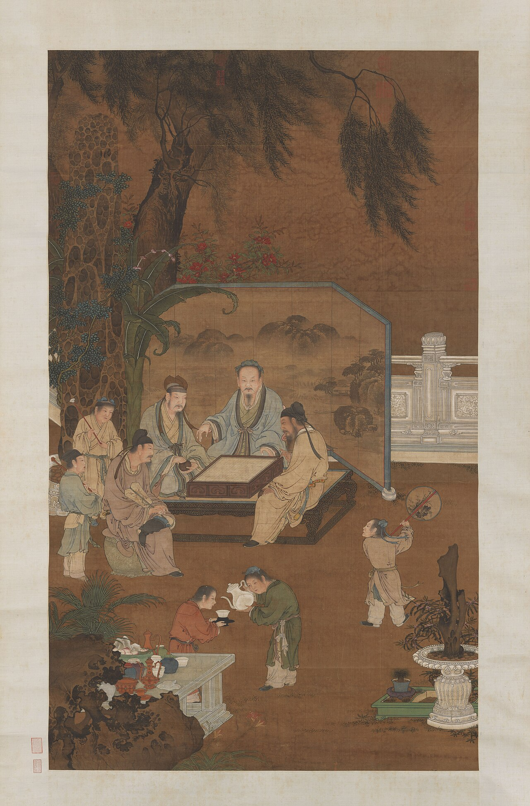

图：旧题宋人《十八学士图》挂轴之一，现藏台北故宫博物院；不是唐太宗十八学士的现场肖像。。图片：Unknown author Unknown author，Public domain，via Wikimedia Commons（[原图页面](https://commons.wikimedia.org/wiki/File:%E5%AE%8B%E4%BA%BA%E5%8D%81%E5%85%AB%E5%AD%A6%E5%A3%AB%E5%9B%BE%E8%BD%B4.%E7%BB%A2%E6%9C%AC%E8%AE%BE%E8%89%B2.%E5%8F%B0%E5%8C%97%E6%95%85%E5%AE%AB%E5%8D%9A%E7%89%A9%E9%99%A2%E8%97%8F.jpg)）。

## 四幅画，四种文人生活

台北故宫的《十八学士图》不是一幅画，而是一套四幅挂轴。每幅一个主题：琴、棋、书、画。画面里，学士们坐在园林中的桌旁，有的弹琴，有的对弈，有的展卷，有的观画；仆人捧茶、执壶、搬书、铺席。四幅合起来，就是一套“文人四艺”的视觉教材。

这套画常被标为“宋人十八学士图”，但台北故宫的研究者认为它可能晚到明代中晚期，不是宋画。旧题“宋人”来自清代宫廷编纂的《石渠宝笈三编》，后来的研究修正了这个判断。也就是说，我们今天看到的不是唐太宗时代十八学士的“现场肖像”，而是后人反复重画的一个题材。

“十八学士”的历史来源很清楚：唐太宗李世民在即位前设立文学馆，招纳十八位学士；即位后，他命画家阎立本为这十八人画像，以显示自己“重文尊士”。这是一种政治工程：把一群读书人画成朝廷的栋梁，让天下人看见“文治”的成功。后来的画家不断重画这个题材，但画的不再是具体十八个人，而是一种“学士应该如何聚会”的理想。

## 作品信息

这套挂轴为绢本设色，每幅约 173.7 × 102.9 厘米，现藏台北故宫博物院。四幅分别以琴、棋、书、画为主题，画面人物众多，器物精细，园林背景用石、树、竹、栏杆构成。旧题宋人，今多认为明人所作；具体作者不详。

画面里的“十八学士”并不一定每幅都出现十八个人。四幅是四个场景，人物在不同场景中重复出现，像一组连续叙事。每幅的中心是一张桌子或一块席子，学士围坐，仆人侍奉。桌上有酒盏、茶具、书册、画轴、棋局、琴。这些器物不是随便摆的，它们对应“四艺”的主题，也对应文人的身份。

值得注意的是，这套画把“学士”画成了一种生活方式的代表，而不是政治人物的肖像。他们的脸并不个性化，动作也不激烈；他们弹琴、下棋、读书、看画，姿态优雅，彼此呼应。画家关心的不是“谁是谁”，而是“他们如何一起生活”。这正是后代“十八学士图”的基本语法。

## 酒在画面里做什么

画面里的酒很克制。桌上有酒盏，仆人有执壶，但没有人大口喝，也没有人醉倒。酒是雅集的一部分，不是画面的中心。

第一，**酒是“四艺”之外的第五件事**。琴、棋、书、画是文人的四种技艺；酒和茶是把这四件事连起来的媒介。弹琴前喝一杯，下棋时添一杯，展卷时再斟一杯——酒让雅集有节奏，也让时间变慢。它不抢戏，但不可缺少。

第二，**酒是身份的标记**。画面里的酒器、茶具、书册、画轴，都是“文房清供”的延伸。它们说明这不是普通饭馆，而是有文化资本的私人场合。酒在这里不是解渴，而是“我们知道怎么聚会”的证明。这一点和[酒与礼](ref:ritual)里的酒礼相通：酒器、座次、先后，都是关系。

第三，**酒是政治的记忆**。十八学士的主题本身来自唐太宗的政治工程；后代的《十八学士图》反复画酒宴、茶会、琴棋书画，其实是在重复一个信息：读书人聚在一起，朝廷就稳。酒在这里是“和谐”的符号，而不是“放纵”的符号。

## 从唐太宗到明人：一个题材的变形

唐太宗的十八学士是具体的政治集团。李世民在武德年间设立文学馆，招纳房玄龄、杜如晦、虞世南、褚亮等十八人，号称“十八学士”。他即位后命阎立本画像，把这些人变成朝廷的象征。这个题材从一开始就带有强烈的政治性：它不是普通的“文人聚会”，而是“皇帝与读书人结盟”的图像。

宋代以后，十八学士逐渐变成“文人雅集”的通用题材。画家不再关心具体是谁，而是关心“学士应该如何生活”：弹琴、下棋、读书、看画、喝酒、喝茶。台北故宫这套四幅挂轴，就是这种“通用化”的结果。它把十八学士拆成四个场景，每个场景对应一种技艺，让观众一眼就能认出“这是文人”。

这种变形很重要。它说明一个政治题材可以变成文化符号：从“唐太宗的十八个幕僚”变成“所有读书人的理想生活”。酒也跟着变形：从“朝廷宴会的酒”变成“文人雅集的酒”。前者讲权力，后者讲品味。

## 为什么它重要

**它是“十八学士”题材的晚期代表。** 这套四幅挂轴把琴棋书画分成四个场景，构图完整，器物丰富，是研究该题材演变的重要材料。

**它把文人生活画成了可复制的模板。** 后来的画家画“雅集”“文会”“十八学士”，常常借用这种“桌子+围坐+仆人+园林”的结构。它不只影响绘画，也影响后人对“文人聚会”的想象。

**它保留了明代对宋代文人文化的再创造。** 这套画旧题宋人，实为明人所作，说明明代画家如何想象宋代：他们画的不是宋代现实，而是明代人理解的“宋人风雅”。这种“复古的想象”本身就是文化史的材料。

## 常见误读

**误读一：这是唐太宗时代十八学士的现场画像。** 不是。原初的阎立本画像没有流传下来；台北故宫这套是后人的重画，可能晚到明代。它画的是“题材”，不是“现场”。

**误读二：这是一幅画。** 它是一套四幅挂轴，分别对应琴、棋、书、画。把它们当成一幅长卷，会错过“四艺”的结构。

**误读三：十八学士每幅都出现十八个人。** 四幅是四个场景，人物在不同场景中重复；画面人数不等于十八。这个题材的重点是“学士群体”，不是“点名”。

**误读四：画里的人都在喝酒。** 酒盏和茶具并置，仆人既备酒也备茶；琴、棋、书、画才是画面主题。把“十八学士”简化成“喝酒聚会”，会错过它的文人性质。

## 怎么看这幅画

先看每幅的中心：琴、棋、书、画各有一个视觉焦点。再看人物：谁在操作，谁在观看，谁在侍奉。然后看器物：酒盏、茶具、书册、画轴、棋局，分别放在哪里。最后看四幅之间的关系：它们不是四个独立场景，而是一组“文人生活”的四个侧面。

可以把这套画和[《文会图》](ref:wenhui)的《文会图》对照：两者都画学士围桌，但《文会图》是一场具体的雅集，《十八学士图》是一个历史题材的四种变奏。再和[《兰亭集序》](ref:lanting)的《兰亭集序》对照：兰亭讲“曲水流觞”的文人聚会，十八学士讲“琴棋书画”的文人生活。两张画放在一起，正好是“聚会”与“日常”的两个面向。

最后，把[《韩熙载夜宴图》](ref:han-xizai)和[酒与画](ref:painting)放在这里：韩熙载的夜宴是私密的、政治的、带焦虑的；十八学士的雅集是公开的、理想的、去冲突的。两种“文人聚会”的图像，正好说明酒在不同场合里可以承担完全不同的意义。

相关条目：[《文会图》：宋徽宗把一场文人饭局画成了朝廷的理想秩序](ref:wenhui)、[《兰亭集序》：曲水流觞与一篇序](ref:lanting)、[《韩熙载夜宴图》：一场被画下来的夜宴](ref:han-xizai)。

**关键事实。**

| 项目 | 内容 |
| --- | --- |
| 一句话定位 | 台北故宫收藏的一套四幅《十八学士图》，旧题宋人，今多认为明人所作；每幅以琴、棋、书、画为主题，画十八学士在园林中雅集 |
| 媒介 | 绢本设色，四幅挂轴 |
| 收藏 | 台北故宫博物院 |

**来源与边界。** 本页关于「《十八学士图》：唐太宗留下的一组政治肖像，被后人画成了四种文人生活」的关键事实，主要由以下来源交叉核对：国立故宫博物院（藏品著录、四幅一套的形制、尺寸与“琴棋书画”主题；典藏检索页需按作品名检索，本页只转述事实；作品在台北故宫的收藏与展览背景；具体藏品号以典藏系统为准）、Encyclopaedia Britannica（唐太宗生平、文学馆十八学士与贞观朝政治背景；不作为作品真伪的依据）、The Metropolitan Museum of Art（唐代人物画、宫廷赞助与后世“十八学士”题材的流传）等 5 条来源。价格、批次与状态会变，涉及这些字段时以页面所列来源的最新版本为准。正文为项目自写，来源只作核验，不复制原文。
