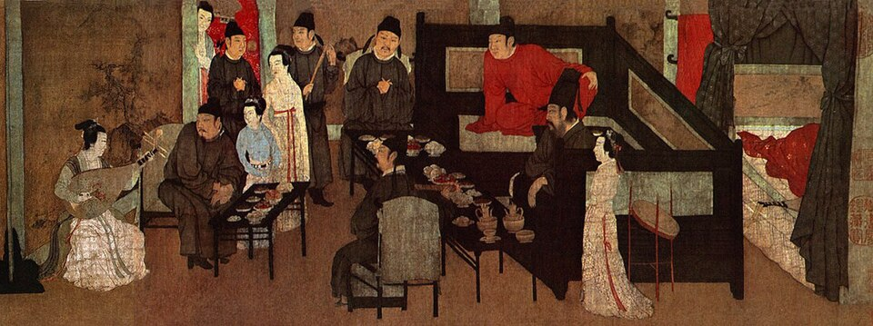

# 《韩熙载夜宴图》：一场被画下来的夜宴

这幅长卷的流传，比画中的夜宴更曲折。1921 年，溥仪把它带出宫变卖；后来张大千以五百两黄金从北京玉池山房马霁川手中购得，携至香港；20 世纪 50 年代政府从香港购回，1959 年由文化部文物局拨入故宫博物院。今天它在故宫，绢本设色，纵 28.7 厘米，横 335.5 厘米，一级甲文物。画卷本身没有作者款印，旧题五代南唐顾闳中，学界多认为现存本是宋摹本。

图：《韩熙载夜宴图》局部“听乐”，传五代顾闳中，宋摹本，绢本设色，北京故宫博物院藏。图片：Anonymous Song dynasty artist after Gu Hongzhong (crop by BabelStone)，Public domain，来源：[原始页面](https://commons.wikimedia.org/wiki/File:Night_Revels_of_Han_Xizai_pipa_player.jpg)。

## 作品与馆藏

故宫的著录把时代写作“五代～南宋”，作者写作“(传) 顾闳中”，这个写法很谨慎：它承认传统归属，也承认现存本可能晚于五代。质地为绢本，尺寸 28.7 × 335.5 厘米，级别一级甲，乾隆初年入藏清宫，著录于《石渠宝笈初编》。卷后有明人程南云的题跋，是流传链上的一环。

画面分五段：听乐、观舞、歇息、清吹、送客。段与段之间没有硬性边框，靠屏风、床榻、帷帐与器物自然分隔。每一段都有韩熙载，他有时坐在榻上，有时亲自击鼓，有时在侍女环绕中休息，最后一段则站在门廊送客。同一个人反复出现，把五个场景串成一个夜晚。

## 画面细读

第一段听乐，宾客围坐，乐伎抱乐器演奏，韩熙载坐在榻上，身体略向前倾。第二段观舞，舞者起舞，韩熙载挽起袖子亲自击鼓，宾客有人拍手，有人侧身观看。第三段歇息，床榻、被褥、侍女、水盆把节奏放慢，人物之间的关系也从公开转向私密。第四段清吹，几名乐伎并坐吹奏管乐，韩熙载衣着放松，坐在一旁。第五段送客，宾客与女乐在门廊间交谈，有人还回头张望。

酒器分布在这五段里：注子与温碗用于温酒，杯盏与盘盏摆在食案上，果盘与酒樽填补桌面。它们不是每段都醒目，却把“宴”的连续性维持住了。尤其要注意第三段与第四段之间：宴饮暂停，酒器仍在案上，说明这不是散席，只是换一个节奏。

屏风是另一条线索。它既分隔空间，也分隔时间；每一扇屏风后面都藏着下一段的人物。画家用屏风的转折引导视线，让观者像走进一间间相连的房间。这种“室内连环画”的构图，比单纯的情节罗列更接近真实夜宴的经验。

## 酒在画面中的功能

酒是这场夜宴的时间轴。开席时它让人入座，观舞时它让人兴奋，歇息时它暂时退场，清吹时它又回到案上，送客时它变成余味。五段之间没有明确的钟点，但酒器的状态告诉观者：宴进行到哪一步了。

酒也是社交的润滑剂，却带着表演性。韩熙载不断劝客、不断举杯，表面上是主人好客，实际上这场夜宴有一个看不见的观众——奉命窥视的画师，以及画师背后的皇帝。酒在这里不只是喝的东西，而是“演给别人看”的道具。韩熙载越是纵情，越显得他在用醉态遮掩什么。

最耐人寻味的是他的清醒。周围人笑、闹、起舞，他的神情却常常沉静，甚至疲惫。酒没有让他失去控制，反而让他更清楚地知道自己正在表演。这种“众人皆醉我独醒”的反差，比画中有多少酒器更能说明这幅画的主题。画中宴饮接近米酒与[黄酒](ref:yellow-wine)的传统，不是今天的烈性白酒。

## 创作背景

韩熙载（902—970），字叔言，青州人，后唐同光年间进士，因父亲被杀而南奔，仕于南唐，官至中书侍郎。史载他晚年纵情声色，后主李煜曾想任他为相，又因他生活放荡而犹豫。《宣和画谱》把这幅画的缘起写成一次秘密观察：李煜派顾闳中等人到韩家窥视，顾闳中把所见记下，回宫后画成此图。

顾闳中是南唐画院画家，擅长人物。南唐都金陵，即今天的南京，宫廷与士人的生活构成了画卷的背景。五代十国政权更迭频繁，臣子在猜忌中自保是常见处境；韩熙载的“自污”，既可以理解为享乐，也可以理解为一种政治策略。文献与画面在这里互相补充，但不能互相替代。

## 真伪、年代与摹本

现存本是否为顾闳中原作，是这幅画最大的争议。故宫的著录写作“五代～南宋”，已经暗示了断代的不确定；学界多数意见认为它是宋摹本，具体是北宋末还是南宋，尚有不同说法。卷中无作者款印，人物服饰、家具形制与酒器样式都可以用来断代，但这些证据往往指向一个时间段，而不是一个精确年份。

第二个争议是五段的关系。有学者认为现存长卷可能由多幅屏风画或册页拼合而成，五段的连接处经过后人调整；也有学者认为它原本就是一件完整长卷。第三是叙事性质：把《宣和画谱》的记载当作画作的创作说明，等于把文献当成了图注。文献可能晚出，也可能经过增饰；画中的细节未必都能与记载一一对应。

第四是流传。1921 年出宫、张大千购藏、1950 年代回购、1959 年拨入故宫，这条链条清楚，但它说明的是近现代的收藏史，不能用来证明五代的创作情形。研究时要把“何时入藏”和“何时创作”分开。

## 常见误读

第一，把宋摹本当成五代原作。现存本是摹本，不是顾闳中的手迹。

第二，把画当成现场写生。顾闳中即使真的去过韩家，也不可能在宴席上当场完成这样一件长卷；它更可能是事后根据记忆与素材重构的。

第三，把韩熙载的放纵当成单纯享乐。画面中的沉静与疲惫，提示了另一层政治处境。

第四，把五段当成五个互不相干的场景。它们共享人物、器物与空间，是一个连续夜晚的五个切片。

第五，把画中的酒当成今天的白酒。五代南唐的宴饮更接近谷物酒的传统，蒸馏酒尚未成为主流。

## 观看建议

从右往左看，先不要急着认人。第一遍只看空间：屏风在哪里，床榻在哪里，门廊在哪里。第二遍看人：韩熙载在每一段的位置、姿态与视线。第三遍看器物：酒器在谁手边，案上还剩什么。三遍之后，再回头看《宣和画谱》的记载，你会更容易分辨哪些是画出来的，哪些是写出来的。

如果看高清图，注意韩熙载的手与眼。他的手常常放在膝上或袖中，眼睛很少直视宾客；这种“在场而不投入”的状态，是整幅画的情绪核心。看完可以对照[《清明上河图》](ref:qingming)，一幅画室内，一幅画街市，都是长卷，却用了完全不同的空间组织方式。

相关条目：[中国](ref:china)、[一杯酒里的时间](ref:time-in-a-cup)。

## 另见

- [《清明上河图》](ref:qingming)：另一幅以长卷展开城市生活的宋代绘画。
- [黄酒](ref:yellow-wine)：画中宴饮所接近的谷物酒传统。
- [一杯酒里的时间](ref:time-in-a-cup)：《韩熙载夜宴图》：一场被画下来的夜宴所处的节令、宴集与写作背景。
- [中国](ref:china)：国家产区页，提供地理与制度框架。
