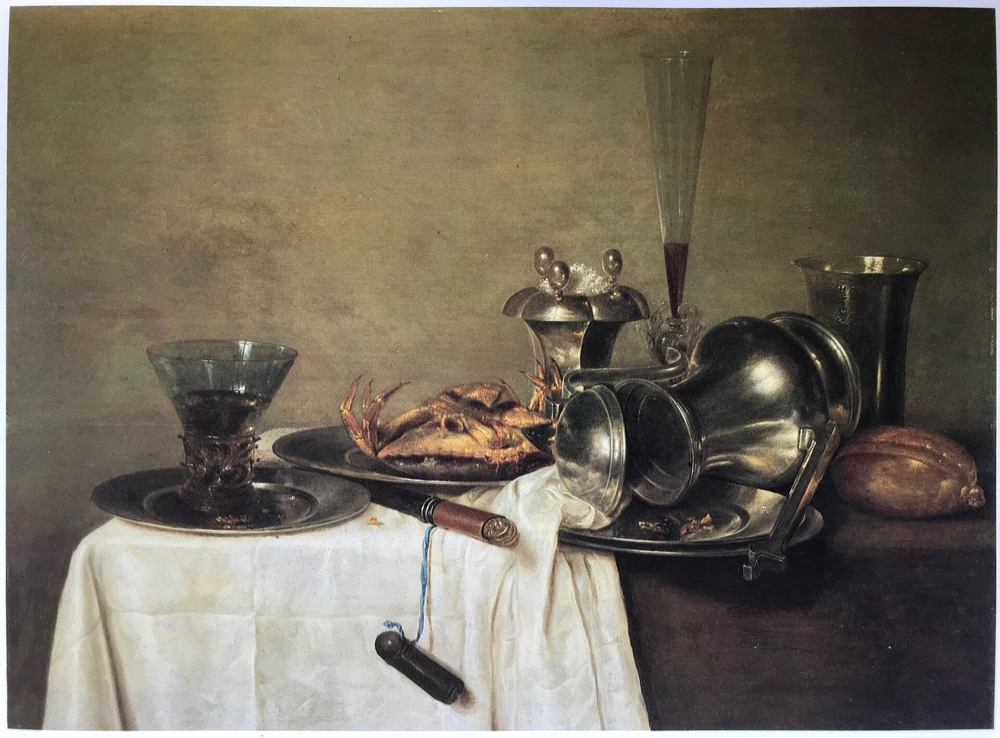

# 《静物：酒杯与酒器》：海达的大酒杯与怀表

静物画看起来最“安静”：没有人物，没有故事，只有桌上的器物。但荷兰黄金时代的静物画并不只是把东西摆好看。酒杯、银器、食物与怀表被放在一起，往往带着“享受”与“时间”的双重暗示。海达的这幅作品正是如此：一只大酒杯占据了画面的视觉中心，怀表在旁边提醒时间，桌布与金属的反光把两者连成一个安静却不安稳的世界。

图：《静物：酒杯与酒器》：海达的大酒杯与怀表作品图像。图片：Willem Claesz. Heda，Public domain，via Wikimedia Commons（[原图页面](https://commons.wikimedia.org/wiki/File:Willem_Claesz_Heda_-_Still_life_with_upturned_Jan_Steen_pitcher,_crab,_and_drinking_vessels.jpg)）。

## 作品信息

这幅画的作者是威廉·克拉斯·海达（Willem Claesz. Heda，约 1596–1680；生年另有 1594 说，以馆方著录为准），荷兰哈勒姆（Haarlem）的静物画家。莫瑞泰斯皇家美术馆（Mauritshuis，海牙）著录的作品题为 Still Life with a Roemer and Watch，年代为 1629 年；材质为油画，具体支撑材料（木板或布面）、尺寸与馆藏编号以馆方记录为准。本文以这幅馆藏作品作为海达“酒杯与酒器”主题的代表，中文标题取意译，不把英文题名当作唯一标题。

需要说明的是，海达的静物画在中文里常被泛称为“酒杯与酒器”“静物”或“早餐画”；不同博物馆、拍卖图录与旧文献可能给出不同的英文题名。读者检索时，最好以馆方编号与馆方题名为准，避免把相似构图的不同作品混为一谈。

## 画面与酒器

画面的中心是一只“大酒杯”（roemer）：这类杯子在 17 世纪的荷兰绘画中很常见，杯身较宽，杯底有凸起的装饰性支撑，玻璃表面容易产生反光。它的旁边是怀表；画面里通常还会出现银器、食物、刀与铺着布的桌面，具体物件以馆方高清图为准。海达没有把每件东西画成孤立的“标本”，而是让它们在同一个光线下互相映照：玻璃反射银器，银器反射桌布，桌布又把光散回器物。

酒器的意义在于“使用”。一只空杯、一只半满的杯、一只倾倒的杯，给人的暗示完全不同。本文不逐一举出杯中液体的种类，因为复制品与屏幕会改变颜色与透明度；更重要的是杯子的位置与状态。它被放在桌边，像是在等待一只手；怀表在旁边，像是在提醒这场饮酒有时间限制。具体物件与摆放细节，应以馆方高清图像为准。

## 酒文化关联

在荷兰黄金时代，酒是日常消费，也是社会身份的展示。葡萄酒、啤酒与其他饮品在市场上的位置不同，酒器的材质与形制也暗示阶层与场合。海达的画不直接告诉你“这是葡萄酒还是啤酒”，而是通过杯形、银器与食物营造一种“有闲的餐桌”。这类静物画常被称为“早餐画”或“宴会画”，它们把丰盛的食物、酒器与贵重物品并置，既展示财富，也提醒节制。

怀表是理解这幅画的关键。它把“饮酒”与“时间”放在一起：酒带来享受，时间带来流逝；酒杯让人靠近当下，怀表让人想到终点。这种组合与“虚空”（vanitas）传统有关：画中的器物再精致，也终会过去。酒在这里不是单纯的饮料，而是一种关于“如何使用时间”的隐喻。若想了解酒馆与城市饮酒生活，可以读[酒馆的历史](ref:history-of-taverns)；若想把观看转为品鉴，可以从[如何开始品酒](ref:first-tasting)开始。

## 技法与时代背景

海达属于哈勒姆静物画传统，与彼得·克拉斯（Pieter Claesz）等人共同推动了“近乎单色”的静物风格。画面以灰、褐、银灰与少量暖色为主，靠质感与反光制造丰富感，而不是靠鲜艳的色彩。玻璃的透明、金属的冷光、食物的表面与桌布的褶皱，被画得几乎可以触摸；这种“物质感”是荷兰静物画的核心成就之一。

这种风格与当时的市场、消费与家庭生活有关。荷兰城市中产与富裕家庭喜欢在餐桌上展示银器、瓷器、酒器与异国食物；静物画既记录这些物品，也参与了对“富足”的讨论。它不一定是道德说教，但通常带有“享受有度”的暗示。海达没有把画面画成混乱的宴席，而是把物件排得相对整齐；这种秩序感本身，就是一种态度。

## 收藏与流传

这幅作品现藏莫瑞泰斯皇家美术馆。它的早期收藏、转入该馆的年代与展览历史，以馆方著录为准。对观众来说，重要的是它在馆内的观看位置：莫瑞泰斯收藏了大量荷兰黄金时代绘画，把海达的静物与同时代的风俗画、肖像画放在同一座博物馆里，能帮助观者理解“酒器”在荷兰视觉文化中的普遍性。

静物画的命运也值得一提。它们曾长期被视为“低于历史画与肖像画”的类型，后来才被重新评价为对物质世界与日常生活的重要记录。今天看海达，不妨放下“这只是一桌东西”的成见：桌上的每件器物都在说话，只是说得很轻。

## 常见误读

第一，把它当成“食物照片”。静物画的构图、光线与物件选择都经过安排，不是随手拍下的餐桌。

第二，把桌上的东西一律读成“奢侈品”。银器与酒杯可能昂贵，但食物与日常器物也有自己的位置；过度强调财富，会忽略画面的节制与时间主题。

第三，把大酒杯直接认定成啤酒杯或葡萄酒杯。roemer 是当时常见的一类玻璃酒器，杯中液体不能只凭画面断定；具体酒种与器形应以馆方资料与器物研究为准。

第四，认为静物画没有道德含义。怀表、倾倒的器物与食物状态常常带有时间、节制或虚空暗示；不必强行说教，但也不应完全忽略。

## 观看建议

先看大酒杯：它的形状、反光与位置。再看怀表：它在哪里，和酒杯构成什么关系。然后看银器、食物与桌布：它们如何把光反射回来，如何撑起画面的前后层次。最后退后一步，看整体色调：为什么画家选择近乎单色的灰褐，而不是鲜艳的颜色？

如果可能，找一幅彼得·克拉斯的静物画对比。两人同属哈勒姆传统，但海达的构图更讲究垂直与水平的关系，器物之间的“对话”更明显。看完对比，再看这幅画的怀表，可能会有不同的感受：它不是装饰，而是画面里的第二个主角。

相关条目：[葡萄酒](ref:wine)、[啤酒](ref:beer)。

## 另见

- [葡萄酒](ref:wine)：葡萄酒的基本类型与风格。
- [啤酒](ref:beer)：啤酒的类型与饮用传统。
- [酒馆的历史](ref:history-of-taverns)：酒馆如何成为城市生活的一部分。
- [如何开始品酒](ref:first-tasting)：读《静物：酒杯与酒器》：海达的大酒杯与怀表时从观色、闻香到入口的路径。
