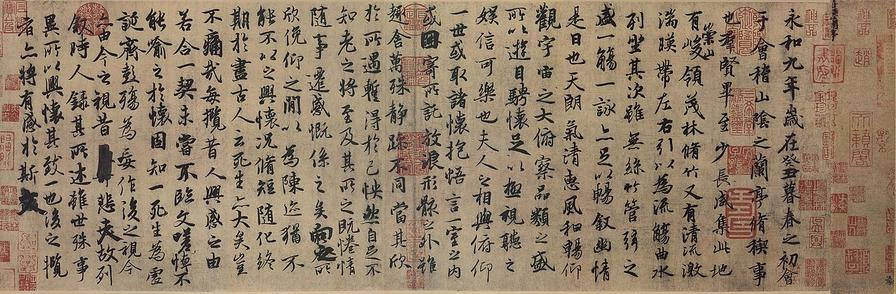

# 《兰亭集序》：曲水流觞与一篇序

永和九年（353）三月三日，会稽山阴的兰亭来了一群客人。他们临水而坐，把酒杯放进曲折的水渠，任它顺流而下；杯停在谁面前，谁就饮酒、赋诗，作不出来就罚酒。诗写完之后，王羲之为这本诗集作序，记下当日的天气、山水、欢聚，也记下欢聚之后忽然涌上来的死生之感。酒在这场聚会里不是助兴的配角，而是让诗得以产生的规则本身。

图：冯承素摹王羲之《兰亭集序》“神龙本”正文，纸本墨迹，唐，北京故宫博物院藏。图片：Feng Chengsu, after Wang Xizhi，Public domain，来源：[原始页面](https://commons.wikimedia.org/wiki/File:LantingXu.jpg)。

## 作品与馆藏

今天能看到的最著名本子，是北京故宫博物院藏《行书摹兰亭序帖卷》，旧题唐冯承素摹，纸本，纵 24.5 厘米，横 69.9 厘米。卷前隔水有“唐摹兰亭”四字标题，引首为乾隆所题“晋唐心印”。清宫著录见于《石渠宝笈续编》，注明“贮重华宫，八玺全”。

此卷用楮纸两幅拼接，前纸十三行，行距较松；后纸十五行，行距趋紧。通篇二十八行、三百二十四字，是通行本的字数。卷后题跋与观款共二十四则，钤印一百八十余方；其中只有元郭天锡、鲜于枢、邓文原，以及明李廷相、文嘉、项元汴等人的题跋被认为是本帖原题，其余有从定武本或其他本子移剪过来的。这一细节很重要：一件名迹的“附件”并不都可靠。

## 画面细读

这里没有图像，只有文字与笔迹，所以“细读”要分两层。第一层读文：开头交代时间、地点、人物与缘由，接着写山水之美、天气之朗、流觞之乐，然后笔锋一转，从“乐”写到“忧”，从当下写到“后之视今，亦犹今之视昔”。全文的情绪是一条下行的曲线，前面的明亮是为了衬出后面的沉郁。

第二层读字。前纸行距松，字与字之间还有余地；后纸行距紧，笔画开始相互牵连。文中有涂改与添补，改写的字保留着先后书写的层次，这正是稿本的证据：它不是一次写成的“作品”，而是一份边想边写的草稿。帖中多个“之”字写法各异，常被后人当作行书变化的教材。

把两层合起来看，会发现书法与文意是同步的。写到宴饮游乐时，笔势轻快；写到“死生亦大矣”，字形收拢，行气变紧。这种同步不是巧合，而是书写者在情绪里的自然反应。

## 酒在画面中的功能

酒为这场聚会提供了一套程序。修禊本是三月上巳临水祓除的习俗，兰亭之会把它与饮酒、赋诗结合：杯顺流而下，停在谁面前，谁就饮酒作诗；作不出，罚酒。后世称这种玩法为“曲水流觞”。[羽觞](ref:yellow-wine)一类耳杯是常见酒器，两侧有耳，便于在水面上浮行。

这套程序把陌生人变成同席者，也把时间切成一个个小段：杯来、酒尽、诗成、杯去。序文说“一觞一咏，亦足以畅叙幽情”，又说“虽无丝竹管弦之盛”，可见这场聚会的重点不在排场，而在节奏。酒让节奏可见，诗让节奏留下痕迹。

酒还承担了“乐极生悲”的转折。微醺时人容易觉得此刻可以永远持续，王羲之却在最热闹处想到“向之所欣，俯仰之间，已为陈迹”。酒在这里既是快乐的载体，也是快乐会过去的提醒。这种双重性，使《兰亭集序》超出了一般宴集序的范围。

## 创作背景

王羲之（303—361），字逸少，曾任右军将军、会稽内史，世称“王右军”。永和年间他住在会稽，与谢安、孙绰等名士往来。兰亭之会发生在永和九年暮春，参加者通常说四十余人，赋诗三十余首；具体人数与名单，不同记载略有出入，引用时应说明依据。

东晋士族南渡之后，会稽成为文人聚集之地。兰亭一带山水清佳，适合修禊与雅集。这次聚会写下的诗，后来编成《兰亭集》，王羲之的序就附在集前。序的地位原本是“说明”，却因为书法太好，反而比诗集更有名；这是理解《兰亭集序》时必须知道的一层错位。

## 真伪、年代与摹本

真迹的下落，是一个流传很久的故事：相传唐太宗酷爱此帖，死后随葬昭陵。此后世间所见，都是摹本、临本或刻本。神龙本属于摹本系统中的“唐摹”一类，因卷首有“神龙”年号半印小玺而得名。

但故宫的著录明确指出：这方“神龙”半印并不是唐中宗内府的钤印，而是后人所添。这一点常被忽略。把“神龙”印当作唐代内府认证，会高估此卷的“原件性”。真正把它定在冯承素名下的，是元郭天锡的跋语与明项元汴的题记；项元汴之后，冯承素摹本的说法才逐渐固定下来。

另一套系统是“定武本”，属于刻本，相传出自欧阳询临本。神龙本是纸本摹本，定武本是石本拓片，二者不能互相比对笔锋细节。1965 年，郭沫若发表文章，从王谢墓志的出土谈到《兰亭序》的真伪，怀疑序文与书法并非王羲之所为；高二适撰文反驳，学界称之为“兰亭论辩”。这场争论至今没有定论，但它提醒我们：文本的归属与书法的归属，是两个可以分开讨论的问题。

## 常见误读

第一，把神龙本当作王羲之真迹。它是唐摹本，不是真迹；真迹已不存。

第二，把“神龙”印当作唐中宗内府印。故宫著录已说明此印为后人所添。

第三，把《兰亭集序》只当书法作品。它首先是一篇序，文字内容与书写状态同样重要。

第四，把曲水流觞当成唯一的酒令。它是上巳修禊与饮酒结合的一种玩法，不同时代、不同地区还有别的酒令。

第五，把“四十余人”当成确数。参加人数在文献中有出入，宜写作“四十余人”并注明依据。

## 观看建议

看神龙本，最好放大到能看见笔锋与涂改的程度。先找那几个改写的字，看墨色深浅与笔画叠压；再看前后两纸的行距变化；最后通读一遍文字，体会情绪如何从明亮转向低沉。这样看，书法不再是抽象的线条，而是一个人当场思考的痕迹。

看完可以找定武本拓片对照。拓本经过刻石与捶拓，笔画的边缘更硬，细节更少；两相对照，才明白“摹”与“刻”是两种不同的复制方式。若对酒与文人的关系感兴趣，可接着读[一杯酒里的时间](ref:time-in-a-cup)。

## 另见

- [中国](ref:china)：兰亭之会发生的国家与地理背景。
- [黄酒](ref:yellow-wine)：理解羽觞、耳杯等传统酒器的工艺背景。
- [酒与绘画](ref:wine-and-painting)：酒如何进入视觉艺术。
- [一杯酒里的时间](ref:time-in-a-cup)：从《诗经》到唐诗，酒与节令写作的关系。
- [《韩熙载夜宴图》](ref:han-xizai)：另一场被记录下来的宴饮。

对照阅读：[中国](ref:china)、[酒与画：宴饮图像的四种看法](ref:wine-and-painting)。
