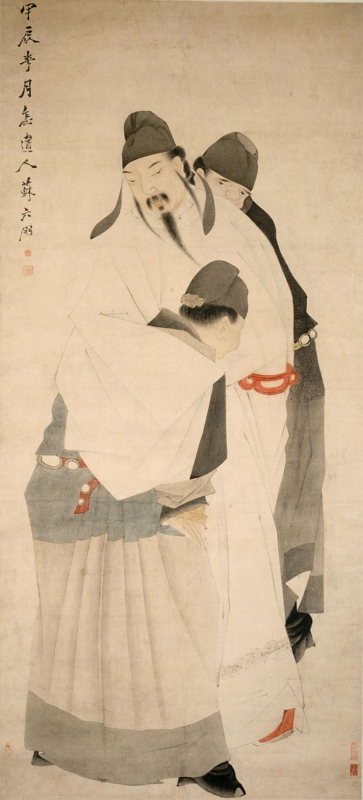

# 《李白醉酒图》：一个被反复画的题材

上海博物馆藏有一轴苏六朋《太白醉酒图》，款署“甲辰花月怎道人苏六朋”，甲辰即道光二十四年（1844）。纸本设色，纵 204.8 厘米，横 93.9 厘米，画的是李白醉倒在唐宫，两名内侍一左一右把他扶住。这幅画不是孤例，而是“李白醉酒”这个题目在晚清的一次具体落点：同一个李白，被不同时代画成不同的醉法。

图：苏六朋《太白醉酒图》轴，1844年，纸本设色，上海博物馆藏。图片：Su Liupeng，Public domain，来源：[原始页面](https://www.shanghaimuseum.net/mu/frontend/pg/m/article/id/CI00020511)。

## 作品与馆藏

苏六朋，字枕琴，号怎道人，广东顺德人，活动于清道光、咸丰年间，以人物画见长。上海博物馆的著录把此轴定为清代、道光二十四年，纸本、设色、立轴，主题标为“太白醉酒、李白、侍从”。画面省略背景，只留三个人物，重心全在搀扶的动作上。

另有两件常被拿来比较的作品。其一是南宋梁楷《李白吟行图》，现藏东京国立博物馆，编号 TA-164，纸本墨画，纵 81.1 厘米，横 30.5 厘米，定为 13 世纪，是日本重要文化财。其二是波士顿美术馆藏《唐明皇招饮李白图卷》，编号 08.81，绢本设色，画面 29.6 × 83 厘米，画的是唐明皇召李白饮酒的场面。

三件作品讲的不是同一个故事：一件画醉态，一件画行吟，一件画君臣对饮。把它们都叫“李白醉酒图”，会抹掉各自的重点。

## 画面细读

苏六朋本的结构很简单：李白居中，身体向后仰，重心落在两名内侍的手臂上；他戴学士巾，留五绺清须，面部用工笔层层晕染，眉眼之间还留着一点傲气。内侍一高一低，衣纹用较快的笔线，和李白面部细致的画法形成对比。背景全部留白，没有宫殿、没有酒案，连一只酒壶也没有画出来。

这正是它的巧处：酒不在画里，醉在画里。观者从李白的姿态、内侍吃力的动作、散开的衣襟，就能补出前一晚的宴饮。酒器被省掉，反而让“醉”变成画面的主角。相比之下，梁楷本画李白缓步吟诗，笔线极简，重点在“吟”；波士顿本则把人物放回具体场景，酒是君臣关系的媒介。

## 酒在画面中的功能

酒在这幅画里承担的是“性格证明”。李白在唐代就以嗜酒著称，杜甫说他“一斗诗百篇，长安市上酒家眠”，这句诗把才华与醉态绑在一起。苏六朋要画的不是酒的味道，而是酒后的李白仍然不肯低头的样子：身体已经站不稳，神情却还是傲的。

酒也制造了一个短暂的空间倒转。宫廷本该是秩序最严的地方，内侍搀扶、衣冠不整的诗人却站在中央；酒让等级暂时失效，让一个翰林供奉可以失礼而不受罚。画面的趣味，正来自这种不合规矩的瞬间。

至于酒器，苏六朋本刻意省略，说明“醉酒图”并不一定需要酒壶。反过来，波士顿本《唐明皇招饮》必须有酒，因为那幅画的主题是“召饮”，酒是君臣互动的由头。两幅画一对比，就能看出酒在不同叙事里的不同位置。

## 创作背景

李白（701—762）于天宝元年（742）奉诏入长安，供奉翰林，天宝三载（744）被“赐金放还”。这段不到三年的宫廷经历，后来被不断加工：力士脱靴、贵妃研墨、醉草吓蛮书，都是后世传说，未必可信，却为“李白醉酒”提供了最流行的情节。苏六朋画的内侍搀扶，正是这一传说系统的视觉化。

晚清广东的商品画市场发达，人物画需求量大，苏六朋一类画家既画文人雅事，也画通俗故事。李白醉酒这类题材，既有文人欣赏的“傲”，也有普通观众爱看的“闹”。1844 年这个年款很重要，它让这幅画有了明确的时间坐标。

## 真伪、年代与版本

苏六朋本的可靠性，主要来自款识与纪年。“甲辰花月怎道人苏六朋”把作者、年份、别号都写清楚了，虽不能排除后人添款，但至少提供了一个可核对的基准。上海博物馆的著录与款识一致，是目前讨论此轴最稳的起点。

梁楷本的作者问题更复杂。画上无作者款，只有“大司徒印”等鉴藏印；这方印用八思巴文，相传是元代阿尼哥的印记，并非梁楷自己的印章。也就是说，今天我们把它归在梁楷名下，依据是风格比对与早期著录，而不是画上的签名。东京国立博物馆仍把它定为梁楷笔，同时以“重要文化财”的身份加以保护，这代表了日本学界的主流意见。

波士顿本的题名是“唐明皇招饮李白”，不是“李白醉酒”。它在流传中被归入李白题材，但画面情节与苏六朋本完全不同。三件作品混为一谈，就会得出“李白醉酒图有宋、清两种风格”这类没有意义的结论。

## 常见误读

第一，把梁楷《李白行吟图》当作《李白醉酒图》。前者画的是边走边吟，后者画的是醉后失态；构图、道具、情绪都不同。

第二，把“力士脱靴”当成画中情节。苏六朋本只画两名内侍搀扶，没有脱靴的细节；传说与图像要分开。

第三，用一件作品概括整个题材。仅上海、东京、波士顿三地就有三种不同的李白形象，何况还有版画、瓷器与年画。

第四，把画中的酒当成唐代蒸馏酒。李白喝的更可能是米酒一类的谷物酒，[白酒](ref:baijiu)的普及是后来的事。

第五，把晚清商品画当成唐代写实。苏六朋画的是晚清人想象中的李白，不是 8 世纪的现场记录。

## 观看建议

先看李白的重心：他是往后倒，还是往旁边歪？再看他与内侍的距离：是被人架着，还是自己还能走？然后看面部：眉眼是闭着的、半开的，还是睁着的？这三处决定了“醉”的程度。最后再看题款与印章，确认你面对的是哪一件作品。

若要把三件作品放在一起看，可以按“动作”排序：梁楷画走，苏六朋画倒，波士顿本画卷。走、倒、卷三个动作，正好对应李白形象的三种面向：诗人、酒徒、词臣。看完再回到[酒与诗歌](ref:wine-and-poetry)，会更清楚这些形象是怎样被文学塑造出来的。

相关条目：[白酒](ref:baijiu)、[中国](ref:china)。

## 另见

- [中国](ref:china)：题材所属的文化传统。
- [李白](ref:li-bai)：题材的主人公。
- [酒与诗歌](ref:wine-and-poetry)：李白酒诗与唐代饮酒风气。
- [《饮中八仙图》](ref:ba-xian)：同一人物形象在群像中的呈现。
