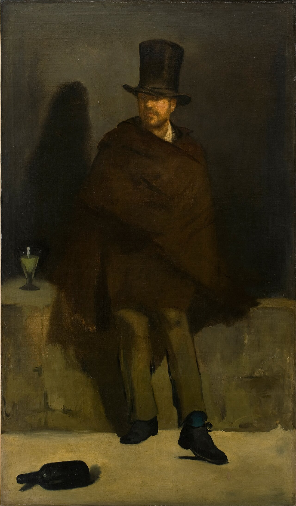

图：马奈《苦艾酒饮者》复制图，约 1859 年，现藏新嘉士伯美术馆；不是咖啡馆现场，也不是马奈自画像。。图片：Édouard Manet，Public domain，via Wikimedia Commons（[原图页面](https://commons.wikimedia.org/wiki/File:Edouard_Manet_-_The_Absinthe_Drinker_-_Google_Art_Project.jpg)）。

## 一个男人，一只空瓶

画面几乎空无一物。一个男人站在灰褐色的墙前，披着一件厚重的棕色斗篷，戴一顶黑色高帽，脚边躺着一只空酒瓶。他没有看观众，也没有明确的动作；身体略微侧转，像在等待什么，又像只是站着。画面的左下角，一只小玻璃杯放在台面上，杯中有浅色液体。

这就是马奈的《苦艾酒饮者》。它的大小接近一幅历史画或全身肖像：高约 1.8 米，宽约 1.06 米。但画中人不是皇帝、圣徒或将军，而是一个在巴黎街头边缘生活的男人。马奈把这种“无身份的人”放在了一个本该属于大人物的尺幅上。这个选择，比画里的酒更值得注意。

## 作品信息

马奈（Édouard Manet，1832–1883）在 1858–1859 年前后完成这幅画，通常系于约 1859 年。它现藏哥本哈根的新嘉士伯美术馆，藏品号 MIN 1778。画面为布面油画，尺寸约 180.5 × 105.6 厘米。

这是马奈第一件真正独立的作品，也是他第一次向巴黎沙龙提交的画作。1859 年沙龙评审拒绝了它；有记载说它只获得一票，那一票有时被归给德拉克洛瓦，但这一说法仍属传闻。拒绝的理由可能不只一个：画法粗率、人物类型不体面、主题不符合沙龙趣味。一个醉汉被画成真人大小，本身就让评审不舒服。

画面在 1867 年马奈自办展览时被裁短过；后来他又对画布做了调整。杯中的苦艾酒是 1867–1872 年间后加的元素，这一判断来自对画面的技术研究。也就是说，最初让这件作品得名的“苦艾酒”，可能并不是马奈一开始就画进去的。这个细节很重要：它说明“苦艾酒饮者”这个标题，是作品后来被接受、被命名的过程的一部分。

## 酒在画面里的位置

酒在这幅画里非常少，却非常关键。

第一，**空瓶在脚边**。它不是被举起的酒杯，而是喝完之后剩下的器物。空瓶把时间往后推：饮酒已经发生，画面留下的是后果。它也让男人的姿态显得更沉：他不是在品酒，而是在酒后的空白里站着。

第二，**小杯在台面上**。杯子的位置低于人物，靠近画面边缘，像是被人随手放下。它不与人物发生直接互动，却提示了“苦艾酒”这个身份。苦艾酒在 19 世纪法国常与波希米亚、边缘艺术家和工人阶层联系在一起；到 20 世纪初，它才成为道德恐慌和禁令的对象。马奈画的是 1859 年，不是 1915 年。

第三，**酒与“现代生活”**。马奈不画酒馆里的热闹，也不画宴席上的丰盛；他画一个孤立的人。酒在这里不是社交的媒介，而是社会位置的标记。用[苦艾酒](ref:absinthe)可以了解苦艾酒的历史与工艺，但不要把它直接读成“酗酒警告”。这幅画没有说教，它只是把一个通常被回避的人放在画面中央。

## 马奈、委拉斯开兹与沙龙

马奈的早期风格受到委拉斯开兹影响很大。委拉斯开兹画过乞丐、哲学家和宫廷侍从，人物站在空荡的背景前，衣服和姿态比面部更先被看见。马奈把这种“低处的人物、简洁的背景、厚重的衣物”移到巴黎街头。男人身上的斗篷几乎占去画面一半，脸部反而被帽檐和阴影压住。观众先看见的是一团颜色和轮廓，然后才辨认出一个人。

1859 年的沙龙拒绝这件作品，并不奇怪。当时的沙龙期待神话、历史、肖像和道德叙事；一个无名醉汉的全身像，既没有故事，也没有可供辨认的身份。马奈把“谁值得被画”这个问题提了出来。后来的现实主义者和印象派画家都在这条路上继续走：画普通人，画日常生活，画城市里不被注意的角落。

这幅画也常被拿来和库尔贝、波德莱尔放在一起谈。波德莱尔在《现代生活的画家》里主张，艺术家应该在城市的临时、偶然和瞬间里寻找美。马奈没有直接插图波德莱尔的理论，但他确实把“当代巴黎的一刻”放进了画布。男人不是英雄，也不是受害者；他是一个在城市里被看见的人。

## 为什么它重要

**它把边缘人放进了大画幅。** 在 19 世纪中期的法国，历史画是最高等级；马奈用接近历史画的尺寸画一个醉汉，等于在挑战学院的题材等级。

**它把“未完成感”变成了语言。** 画面的背景几乎是空墙，人物的边缘处理得很松，斗篷的褶皱没有精细刻画。这种“没有画完”的感觉，后来成为现代绘画的重要特征。沙龙评审把它当成技术缺陷，马奈却把它当成表达。

**它让酒成为社会符号，而不是道德寓言。** 画里的酒没有让人物变得滑稽，也没有让他变得可怕。它只是让观众知道这个人属于哪一类空间。马奈没有给观众一个安全的道德距离。

## 常见误读

**误读一：这是马奈的自画像。** 不是。画中人的身份并不确定，通常被认为是巴黎的边缘人物或马奈认识的模特；没有可靠证据说是马奈本人。

**误读二：这是一幅禁酒宣传画。** 苦艾酒在 1915 年才被法国禁止，这幅画作于 1859 年。它不承担“苦艾酒有害”的说教功能。后来的观众因为禁令背景，才把它读成警告。

**误读三：画里的男人正在喝苦艾酒。** 他并没有举杯；杯子放在台面上，空瓶在脚边。画面更像饮酒之后的停顿，而不是饮酒的瞬间。这个“之后”比“正在”更有张力。

**误读四：苦艾酒让人发疯，所以人物才恍惚。** 这是 19 世纪末反苦艾酒宣传的常见说法，不是马奈的证据。画中人的状态可以由贫困、疲惫、寒冷或酒后的迟钝解释；把一切归因于“苦艾酒毒害”，反而简化了作品。

## 怎么看这幅画

先看人物的轮廓：帽子、斗篷、裤腿、鞋，几乎是一整块深色形状。再看脸：它被帽檐压住，表情很少。然后看脚边的空瓶和台面上的小杯，它们把画面的“时间”补上。最后退后，看人物占画面的比例——他几乎顶到画布上沿，脚下却只留很窄的地面。这种构图让人物既高大又无处可去。

可以把这幅画和[《室内：饮酒女子与两位男子》](ref:de-hooch)的《室内：饮酒女子与两位男子》对照：后者把酒放在室内社交里，人物彼此有关系；马奈把酒放在一个人的脚边，人物与谁都无关。再和[《饮酒者》](ref:brouwer)的《饮酒者》对照：勃鲁维尔画的是酒馆里的喧闹群像，马奈画的是喧闹之后的一个人。三种画法，三种“酒与人”的距离。

最后，把[酒与画](ref:painting)和[禁酒令](ref:prohibition)放在一起读：酒与画的关系不只是“画里有什么酒”，还包括“社会允许谁喝酒、在哪里喝、喝完之后被怎样看见”。马奈画的正是最后这个问题。

相关条目：[《室内：饮酒女子与两位男子》：代尔夫特的一杯酒](ref:de-hooch)、[《饮酒者》：勃鲁维尔的客栈与一张脸](ref:brouwer)、[苦艾酒](ref:absinthe)。
