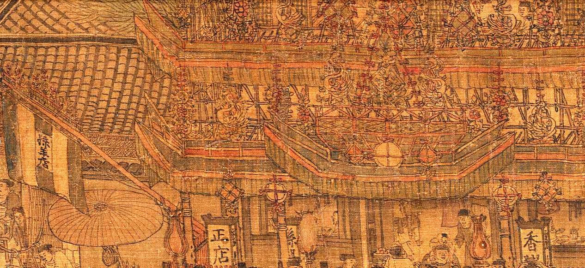

# 《清明上河图》：汴京酒肆与城市节奏

把《清明上河图》完全展开，画面长约五米三，高不到二十五厘米。它不是一幅“看风景”的画，而是一条被压扁的街：从城外郊野、汴河码头、虹桥，一直走到城门内的市街。酒肆就嵌在这条街的节奏里——有的门面气派，挂着欢门彩楼；有的只在门口支一块可点灯的招牌。读懂这些差别，比数出画里有几家酒店更有意思。

图：张择端《清明上河图》局部：孙羊正店门前的彩楼欢门与“正店”“香醪”灯箱，北宋，绢本设色，北京故宫博物院藏。图片：Zhang Zeduan，Public domain，来源：[原始页面](https://digicol.dpm.org.cn/cultural/detail?id=4e1f69d35f7d419e9f1269e3a5fa2271&source=1)。

## 作品与馆藏

此卷为北宋张择端作，绢本设色，纵 24.8 厘米，横 528.7 厘米，现藏北京故宫博物院，文物号新00087177。卷中无作者款印，作者依据的是尾纸金人张著的跋文；张著称张择端字正道，东武（今山东诸城）人，早年游学汴梁，后供职于内府翰林图画院。这一条跋文，是整卷作者归属的起点。

清宫著录见于《石渠宝笈三编》，注明“贮延春阁，五玺全”。尾纸另有张著、张公药、郦权、张世积、杨准、刘汉、李祁、吴宽、李东阳、陆完、冯保、如寿等十三家题跋。流传经过也清楚：北宋末入徽宗内府，金灭北宋后流落北方，元初入内廷，明代几度出入宫廷与权臣之手，清乾隆年间经毕沅收藏，抄家后入宫；逊帝溥仪时由溥杰携出宫外，1957 年回归故宫。

故宫的说明给出了一个大致统计：人物约六百名，牲畜八十余头，房舍三十多栋，树木百余棵。数字不必当作精确人口普查，但可以看出画面的密度：它不是一件安静的山水，而是一份经过选择与组织的城市观察。

## 画面细读

全卷通常分三段看。首段是城外郊野，疏林、农舍、驮队，节奏缓慢；中段以汴河与虹桥为核心，漕船、纤夫、桥上市摊挤在一起，是全卷的高潮；末段进入城门，街道两侧店铺密集，行人、轿马、摊贩层层叠叠。城门被认作东角子门，是汴京城东的一处水门要道。

酒肆的等级，就写在门面上。孙羊店是正店，门前立着欢门彩楼，竹木扎成的装饰高出屋檐，等于今天的巨幅招牌；店内还有柜台与酒瓮。十千脚店是脚店，规模小得多，门口挂着一盏可以点亮的灯箱招牌，便于夜市招客。正店与脚店之间，不只是大小之别，还有经营权之别：正店可以酿造并批发，脚店只能零售。

虹桥一段也值得细看。桥面上有轿子、马匹、挑担的人，桥下是一艘正在落桅的漕船，船工用长杆抵住桥柱，岸上的人伸手呼喊。在这个最紧张的场景里，酒肆退到画面边缘，但它并没有消失：桥头的摊贩、脚店与酒楼，正是人流停下来的理由。

## 酒在画面中的功能

宋代酒类实行专卖，正店向官府买曲、酿酒，再批发给脚店；脚店从正店进酒，零卖给顾客。《东京梦华录》说汴京有正店七十二户，其余“不能遍数”的则是脚店。画中的孙羊店与十千脚店，正好对应这一头一尾：一个是有酿造权的大店，一个是靠零售与夜市的小店。

酒因此不是孤立商品，而是一条链子的末端。船把粮食运进汴河，正店把粮食变成酒，脚店把酒卖给行人，酒楼再带动餐饮、说书、杂剧与住宿。酒旗、灯箱、欢门，都是这条链子在城市空间里的可见标记。看画时若能顺着“粮—酒—店—客”走一遍，就会明白酒业为什么占了这么多画面。

酒也是税源。宋代酒课是国家财政的重要一项，正店的经营资格与官府的许可、课税绑在一起。画里那些气派的门面，背后是制度，不只是富商的排场。这一点常被忽略：我们容易看到热闹，却看不到热闹背后的账本。

## 创作背景

北宋汴京是当时世界上人口最多的城市之一，汴河承担着把江淮粮米运到京城的任务。清明前后，漕运、踏青、扫墓、商贸同时进行，城市进入一年中最忙碌的时段。张择端选择这个时间点，等于选择了一个“所有人都在动”的时刻。

画家的身份也影响画法。他曾供职翰林图画院，熟悉界画（用界尺画建筑）的技术，所以桥梁、船体、屋顶的结构都画得准确；但他并不是在画工程图，人物的大小、街道的疏密、视点的移动，都经过安排。全卷没有单一消失点，观者的视线随着画面横向移动，像在街上走。

## 真伪、年代与争议

现存本一般被认为是张择端的原作，但争议并未消失。第一，“清明”指什么：清明节、汴京的“清明坊”，还是“政治清明”的颂词？三种说法各有支持者，没有定论。第二，季节是春是秋：有学者从画中的扇子、炭盆、饮品等细节提出“秋景说”，也有人认为这些细节不足以推翻清明。第三，“上河”是汴河还是别的河段，同样有不同解释。

第四，全卷是否完整。现存画面从郊野直接进入汴河，有人认为卷首可能缺失一段；也有人认为这就是原貌。第五，后世摹本极多，台北故宫藏有清院本，明代仇英也有仿本，它们常被误当成张择端原作。讨论时必须先确认是哪一本，再谈内容。

## 常见误读

第一，把画当成照片或地图。它没有统一透视，人物比例也不完全写实；它是一幅经过构图的画。

第二，把“清明”直接等同于清明节。这个前提本身还在争论中，不宜当作结论。

第三，把孙羊店当成唯一的酒店。画中还有十千脚店与其他酒肆，正店、脚店、酒摊构成一个层级，不是一家店。

第四，把画中的酒当成今天的白酒。宋代城市酒以米酒、黄酒一类为主，蒸馏酒的地位另有讨论。

第五，把清院本或仇英仿本当作张择端原作。摹本有很高的艺术价值，但作者与年代不同，不能混为一谈。

## 观看建议

看长卷要慢。先从右往左走一遍，感受节奏：郊野的静、虹桥的乱、城内的密。第二遍专门找酒：酒旗在哪，欢门在哪，灯箱在哪，店门口有没有酒瓮。第三遍看人：谁在店里，谁在门口，谁只是路过。把这三遍叠起来，酒业网络就出来了。

如果看的是数字图像，注意分辨版本。故宫数字文物库的文物号是新00087177，可以用它来确认你打开的是哪一卷。若想理解酒肆在宋代城市中的位置，可以接着读[认识一座城，从一间酒馆开始](ref:pub-and-city)。

相关条目：[中国](ref:china)、[黄酒](ref:yellow-wine)、[《韩熙载夜宴图》：一场被画下来的夜宴](ref:han-xizai)。

## 另见

- [《韩熙载夜宴图》](ref:han-xizai)：另一幅以长卷描绘宴饮与室内空间的五代作品。
- [黄酒](ref:yellow-wine)：宋代米酒与黄酒的工艺谱系。
- [认识一座城，从一间酒馆开始](ref:pub-and-city)：酒馆如何成为观察城市生活的入口。
- [中国](ref:china)：国家产区页，提供地理与制度框架。
