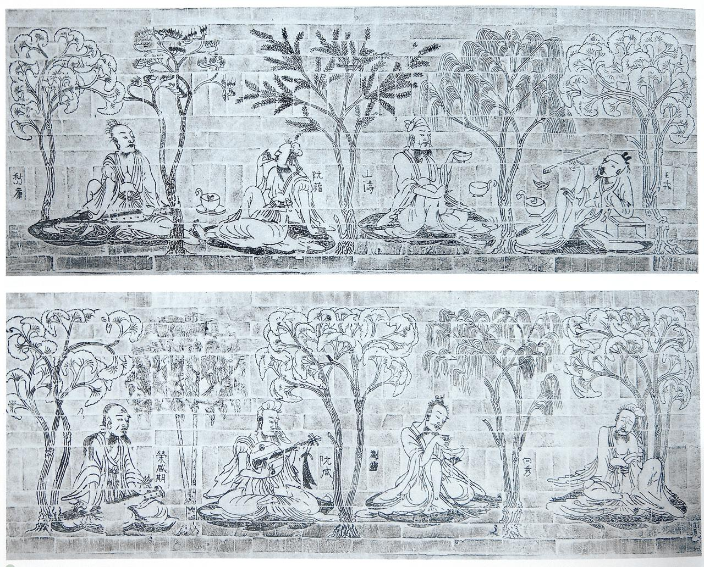

# 《竹林七贤与荣启期》：南朝墓中的砖画

1960 年，南京西善桥宫山北麓的一座南朝墓被清理，墓室南北两壁各嵌一组人物画像，每组四人。八个人不是普通宾客：嵇康、阮籍、山涛、王戎、向秀、刘伶、阮咸，加上春秋隐士荣启期。这组砖画后来入藏南京博物院，成为讨论魏晋名士形象与南朝绘画最常被引用的实物之一。它不是卷轴，而是墓葬建筑的一部分；这一点决定了它的尺寸、构图与观看方式。

图：《竹林七贤与荣启期》模印砖画两组拓片，南朝，南京西善桥宫山大墓出土，南京博物院藏。图片：Anonymous Southern Dynasties craftsmen，Public domain，来源：[原始页面](https://www.njmuseum.org.cn/en/collectionDetails?id=465)。

## 作品与馆藏

南京博物院藏本分两组：一组高 78 厘米、长 242.5 厘米，另一组高 78 厘米、长 241.5 厘米。两组原分置于墓室南北两壁，各由近三百枚模印砖拼嵌而成，砖面图像在烧制前已经印好，再按设计编号上墙。这种工艺允许同一画面批量制作，也要求严密的工坊分工；它和手绘壁画是两套完全不同的生产系统。

画面中八人皆席地而坐，各具神态，每个人物身旁都标明姓名。人物之间以银杏、松树、槐树、垂柳等树木相隔，既把八人分开，又让整面墙保持连续。榜题、树木与坐姿三样东西，构成了这组砖画最基本的阅读框架。

## 画面细读

嵇康头梳双髻，目送秋鸿，手弹五弦；阮籍身着长袍，一手支着皮褥，一手放在膝上，作长啸状；山涛头裹巾，一手挽袖，一手执杯而饮；王戎斜身靠几，手里弄着玉如意；向秀头戴帻，一肩袒露，闭目沉思；刘伶双目凝视手中的酒杯，另一只手蘸酒品尝；阮咸垂带飘于脑后，弹一件四弦乐器；荣启期披发长须，腰系绳索，凝思弹奏五弦琴。

这八段姿态几乎没有重复：弹琴的有嵇康与荣启期，但一个目送飞鸿，一个凝思内敛；饮酒的有山涛与刘伶，但一个从容举杯，一个低头品尝。画家用很小的动作差别区分人物性格，而不是靠夸张的表情。线条细而连续，衣纹的转折依赖砖缝的拼接，近看会看到明显的块面感，远看才连成流畅的轮廓。

值得注意的是，八人并没有共同的动作，也没有共同的视线。他们各看各的方向，彼此之间由树木连接，而不是由交谈连接。这种“同处一室却互不交流”的构图，正是后世对竹林七贤想象的核心：他们是一个群体，但每个人都是孤立的。

## 酒在画面中的功能

酒在这组砖画里出现得很克制。真正与酒直接相关的只有山涛与刘伶：山涛执杯而饮，刘伶凝视酒杯并用手指蘸酒。其余六人，有的弹琴，有的长啸，有的弄如意，有的沉思。酒不是统摄全场的道具，而是七贤生活方式中的一项，与音乐、清谈、沉默并列。

这恰好符合魏晋名士的自我形象。刘伶以《酒德颂》闻名，把饮酒说成一种接近“德”的状态；酒在这里不是享乐，而是对礼法的疏离。山涛的举杯则更日常，像是一个正在进行的动作，而不是宣言。两个人一个把酒喝成哲学，一个把酒喝成习惯，画面因此有了层次。

荣启期没有酒。他是春秋隐士，被安排在七贤之后，作用更像是“前代高士”的注脚：隐逸的传统比竹林更早。酒把七贤与荣启期区分开来，也把“名士”与“高士”这两种形象并置在同一面墙上。

## 创作背景

竹林七贤并称，见于《世说新语》一系的记载，《晋书》卷四十九为嵇康等人立传。他们活动于曹魏末年，以清谈、饮酒、越礼著称。到了南朝，七贤已经成为一种文化符号：既代表不受拘束的个人风度，也代表对政权更替的疏离。把这种符号画进墓室，既是对墓主身份的修饰，也是一种自我表白。

南朝墓葬中使用高士图像并不止这一座。南京、丹阳一带的多座南朝墓也出有同类题材的砖画，说明这是一种在高级墓葬中流通的图像传统，而不是孤例。砖画的粉本可能来自更早的绘画传统，工坊按粉本翻制，再根据墓室尺寸调整人数与排列。

## 真伪、年代与墓主

砖画没有作者，属于工坊集体制作，这一点没有争议。争议集中在三处：墓葬的绝对年代、墓主身份，以及粉本与名家（尤其是顾恺之、陆探微）的关系。

年代通常放在南朝中晚期，依据是墓葬形制、砖纹与随葬品；但“刘宋”还是“南齐”，学界尚有不同意见。墓主也没有定论，只能根据墓葬规模推测为高等级贵族或帝陵级人物，墓中没有留下可以确证姓名的墓志。把某座墓直接指认为某位皇帝，缺乏硬证据。

至于“顾恺之粉本”说，依据主要是风格比对：人物衣纹的连绵、树木的形态、坐姿的安排，确实与传为顾恺之系统的绘画有相似之处。但相似不等于作者，砖画经过粉本、模印、拼镶多道工序，即使粉本出自名家，成品也不能直接归到名家名下。研究引用时应说明是原砖、摹本还是线图，三者不能混用。

## 常见误读

第一，把它当成卷轴画。砖画是墓室墙壁的一部分，尺寸、观看角度与卷轴完全不同；它的“长卷感”来自拼镶，而不是装裱。

第二，把八个人都当成竹林七贤。荣启期是春秋人，不在七贤之列；他的加入是为了凑成八人、形成对称，也为了把隐逸传统往前推。

第三，把“竹林”当成实景。画面里没有竹林，用的是银杏、松、槐、柳等树木；竹林是一个文化地名，不是写生对象。

第四，把砖画当手绘壁画。模印砖的图像在烧制前已定，颜色与线条都受工艺限制；看到线条的块面感，不要误以为画家笔力弱。

第五，把墓主当成已知人物。没有墓志，就没有姓名；所有“某帝陵”的说法都只是推测。

## 观看建议

先找榜题。八个人的名字就写在身旁，这是最可靠的入口；认字之后再对姿态，比先猜人物有效得多。然后看树木：每一棵树都承担分隔功能，注意树的种类与形态如何变化。最后看砖缝：顺着拼缝看线条怎样被切断又重新接上，你会更理解这组画的工艺属性。

如果看的是拓片或线图，要记得它已经过滤掉颜色与砖面质感；如果看的是复制品，要注意它可能调整了八人的排列顺序。引用时最好注明所据版本，并回到南京博物院的藏品页核对尺寸。

相关条目：[中国](ref:china)、[黄酒](ref:yellow-wine)、[酒与礼：从乡饮酒礼到今天的敬酒](ref:wine-and-ritual)。

## 另见

- [中国](ref:china)：砖画出土与收藏的国家。
- [黄酒](ref:yellow-wine)：魏晋时期谷物酒的工艺背景。
- [酒与礼](ref:wine-and-ritual)：酒在礼制与名士生活中的不同位置。
- [《韩熙载夜宴图》](ref:han-xizai)：另一件以宴饮人物为主题的绘画实物。

补充阅读：[《饮酒者》：勃鲁维尔的客栈与一张脸](ref:c-extra-1)。
