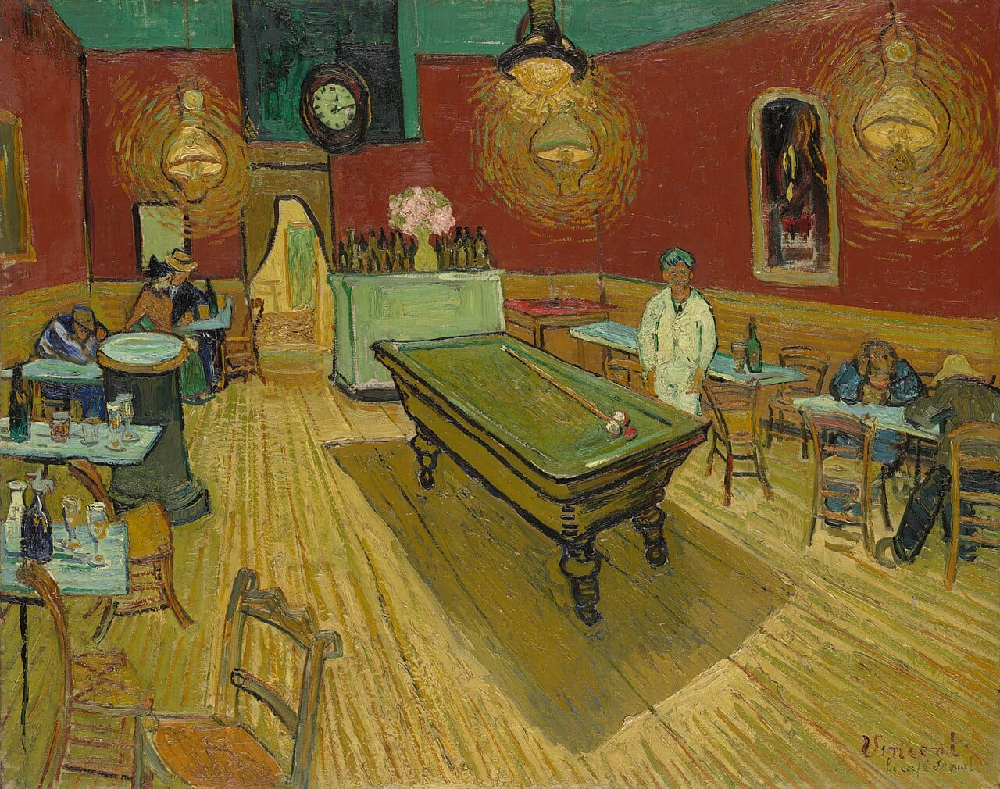

图：凡高《夜间咖啡馆》复制图，1888，现藏耶鲁大学美术馆；不是阿尔勒咖啡馆的实景照片。图片：Vincent van Gogh，Public domain，via Wikimedia Commons（[原图页面](https://commons.wikimedia.org/wiki/File:Van_Gogh_-_The_Night_Caf%C3%A9_(1888).jpg)）。

> **先给结论**
> **一句话：** 这页判断《夜间咖啡馆》：凡高把一盏煤气灯画成一场通宵的发烧该怎么看，以及它在饮酒图像里的位置。
>
> - **适合谁：** 想把《夜间咖啡馆》：凡高把一盏煤气灯画成一场通宵的发烧放回饮酒史与图像传统里看的人。
> - **不适合谁：** 只想看一张图、不关心作品年代和饮酒语境的人。
> - **先看这两点：**
>   - 先看灯：四盏煤气灯把天花板压下来，光晕像四个小太阳。
>   - 画面是一个咖啡馆的深夜。

## 一间不肯睡着的房间

画面是一个咖啡馆的深夜。墙是血红色，天花板是绿色，地板是褪色的黄；台球桌在中央，绿色桌面像一块冷下来的池塘；四盏煤气灯从天花板垂下来，每一盏都带着柠檬黄的光晕。房间深处，一个穿白衣的店主站在吧台旁；几张桌子边，客人趴着、歪着、坐着，像被灯光压住。前景有一张空桌，几把椅子，一瓶酒。

这就是凡高的《夜间咖啡馆》。它不是一张“咖啡馆风俗画”，也不是一张“喝酒很开心”的画。它更像一间不肯睡着的房间：灯光不让人放松，红色不让人安静，绿色不让人清醒。凡高在给弟弟提奥的信里说，他想用红绿对比表达“人类可怕的激情”；在给妹妹的信里，他说自己用了“六七种红，从血红色到淡粉色，和同样多的绿”。这些话不是后人的解释，而是画家自己留下的说明书。

## 作品信息

凡高（Vincent van Gogh，1853–1890）1888 年 9 月在法国南部阿尔勒完成这幅画。材质为布面油画，尺寸约 72.4 × 92.1 厘米。它现藏美国康涅狄格州纽黑文的耶鲁大学美术馆，藏品号 1961.18.34，1961 年由斯蒂芬·卡尔顿·克拉克（Stephen Carlton Clark）遗赠。

画面画的是阿尔勒的火车站咖啡馆（Café de la Gare），位于拉马丁广场，由约瑟夫-米歇尔·吉努（Joseph-Michel Ginoux）和妻子玛丽经营。凡高在阿尔勒期间常在这里吃饭。他在信中有时把这家店写作“Café de l'Alcazar”，学者对具体店名的对应有不同表述，但“火车站附近的全夜咖啡馆”这个空间事实是清楚的。

1888 年 9 月，凡高还没有迎来高更。高更在同年 10 月底才到阿尔勒。所以这幅画不是“和高更一起实验”的产物，而是凡高独自在阿尔勒探索色彩的结果。他当时想画一种“用颜色表达情绪”的绘画，不再满足于印象派式的自然光。咖啡馆的夜灯正好给了他一个实验室：没有阳光，只有人造光；没有自然色，只有被光染过的红、绿、黄。

## 酒在画面里的位置

画面里的酒并不抢眼。桌上有瓶子，吧台上有酒瓶，台球桌旁边也有；但没有人大口喝，也没有人举杯。酒是“通宵营业”的一部分，是房间里的一种道具，而不是画面的主角。

第一，**酒与时间**。咖啡馆是通宵营业的，酒是让人熬过夜晚的燃料。画面里的客人不像在享受，更像在消耗时间。酒瓶、杯子、台球桌、钟表，都在提醒观众：这个房间不属于白天，它属于那些没有地方可去的人。

第二，**酒与社会边缘**。凡高在信里说，这家咖啡馆是“一个可以毁掉自己、发疯或犯罪的地方”，客人和流浪者、妓女有关。酒在这里不是中产阶级的晚宴饮料，而是边缘生活的日常。它让人暂时忘记时间，也让时间变得更重。

第三，**酒与颜色**。画面里最“醉”的不是人，而是颜色。红墙、绿桌、黄灯互相冲突，像喝多了之后的视觉。凡高不是用酒来画醉态，而是用颜色来画一种精神上的过度清醒：灯光太亮，夜晚太长，人却睡不着。这种“清醒的醉”比酒本身更接近画的主题。

## 凡高在阿尔勒

凡高 1888 年 2 月来到阿尔勒，想在这里建立一个“南方画室”，邀请高更和其他画家一起工作。他被南方的阳光、色彩和异国情调吸引，也被当地的孤独和经济压力困扰。阿尔勒时期是他创作力最旺盛、也最不稳定的时期之一：他画向日葵、麦田、罗纳河、卧室，也画咖啡馆和夜间场景。

《夜间咖啡馆》和《罗纳河上的星夜》《黄房子》属于同一组“夜间”作品。凡高对夜晚的兴趣不只是“夜色好看”，而是“夜晚让人看见白天看不见的东西”。他在信中把咖啡馆描述成一个充满“可怕激情”的地方：不是说那里的人会杀人，而是说那里的情绪没有被白天的秩序压住。红和绿把这种情绪放大，直到观众也觉得房间在发烫。

## 为什么它重要

**它把颜色从描述变成情绪。** 凡高不再用颜色还原现实，而是用颜色制造心理状态。红墙不是为了“像”一面红墙，而是为了让房间显得不安；绿桌不是为了“像”台球桌，而是为了让中央冷下来。后来的表现主义画家从这种用法里学到了很多。

**它把室内空间画成心理空间。** 画面的透视很陡，地板向观众涌来，桌子却向后退；台球桌占住中央，人物被推到边缘。观众不是站在门口看一个房间，而是被吸进房间。凡高用构图制造“出不去”的感觉。

**它让“咖啡馆”成为现代孤独的场景。** 咖啡馆原本是社交场所，凡高却画成一间让人无法交流的房间。客人各自趴着，店主独自站着，灯光把每个人分开。这种“在公共空间里孤独”的感觉，后来成为现代城市绘画的常见主题，见[酒馆与城市](ref:pub)。

## 常见误读

**误读一：这是凡高住过的房间。** 这是阿尔勒的火车站咖啡馆，凡高常去吃饭，但他不住在那里。他住在附近的黄房子。把画当成“凡高的家”，会混淆他的生活空间和绘画对象。

**误读二：画里的客人都是醉鬼。** 画面没有画醉态，也没有画暴力。客人更多是疲惫、睡着、发呆。酒是环境的一部分，不是人物行为的唯一解释。凡高说的“可怕的激情”，指的是空间和颜色，不是“每个人都喝醉了”。

**误读三：这是凡高精神崩溃的现场记录。** 凡高在阿尔勒确实经历过严重的精神危机，但这幅画完成于 1888 年 9 月，早于 1888 年 12 月的割耳事件。它可以被看作他当时情绪状态的表达，但不能简单当成“崩溃的日记”。

**误读四：红绿对比只是为了好看。** 凡高对红绿的使用有明确的色彩理论：互补色放在一起会互相加强，产生震动感。他要的不是“漂亮”，而是“不安”。这一点让画面和装饰性绘画拉开了距离。

## 怎么看这幅画

先看灯：四盏煤气灯把天花板压下来，光晕像四个小太阳。再看台球桌：它占住画面中央，绿色桌面把红色房间切开。然后看人：店主在深处站着，客人趴在桌上，没有人抬头。最后看地板：木板线条向观众方向放射，像要把人吸进去。

可以把这幅画和[《葡萄酒杯》](ref:vermeer)的《葡萄酒杯》对照：维米尔画一个人和一扇窗，光从窗外进来；凡高画一群人与一屋灯，光从头顶压下来。再和[《室内：饮酒女子与两位男子》](ref:de-hooch)的《室内：饮酒女子与两位男子》对照：代尔夫特画的是有秩序的室内，凡高画的是秩序松动的室内。两张画放在一起，能看出“室内”从荷兰风俗画到现代绘画的变化。

最后，把[葡萄酒](ref:wine)和[酒与画](ref:painting)放在一起读。酒在凡高的画里不是主角，但它是“夜间经济”的一部分：咖啡馆靠酒、灯和通宵营业维持，客人靠酒熬过夜晚。凡高画的不是酒，而是酒所在的那个不肯睡着的房间。

相关条目：[《葡萄酒杯》：维米尔的一杯酒与一扇窗](ref:vermeer)、[《室内：饮酒女子与两位男子》：代尔夫特的一杯酒](ref:de-hooch)、[葡萄酒](ref:wine)。

**关键事实。**

| 项目 | 内容 |
| --- | --- |
| 一句话定位 | 凡高 1888 年 9 月在阿尔勒所作的油画，现藏耶鲁大学美术馆；画面是火车站咖啡馆的通宵内景：红墙、绿台球桌、四盏柠檬黄煤气灯，以及几个趴在桌上的客人 |
| 媒介 | 布面油画 |
| 收藏 | 耶鲁大学美术馆，纽黑文（1961.18.34） |
