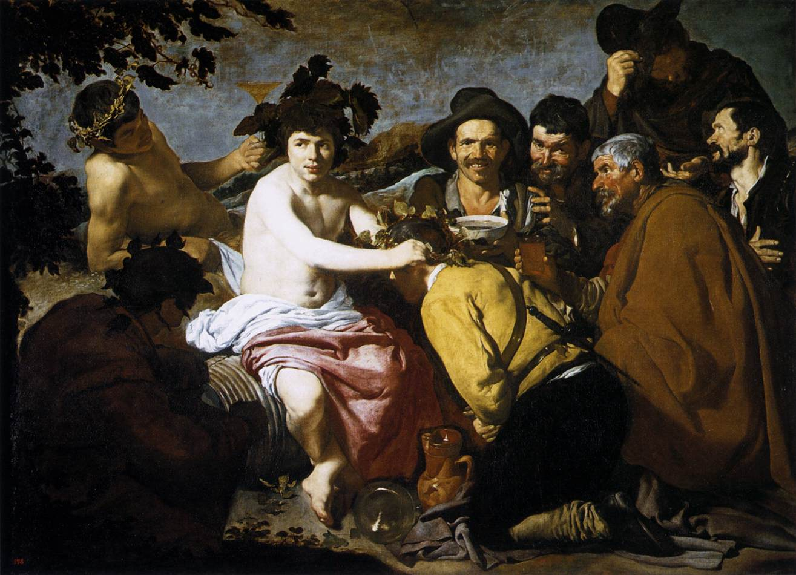

# 《酒神的胜利》：委拉斯开兹把神话拉进人群

在传统的酒神画里，巴克斯通常被画成理想化的神：年轻、裸身、被随从环绕，带着一种远离人间的美。委拉斯开兹的《酒神的胜利》却把这位神放到一群西班牙农民中间。神仍然年轻、仍然戴着葡萄藤冠，但他身边的人有皱纹、有汗水、有醉意；他们不是神话里的宁芙与萨堤尔，而是街巷与村庄里能遇到的人。画面的张力，正来自这种“神与人同席”的不协调。

图：《酒神的胜利》：委拉斯开兹把神话拉进人群作品图像。图片：Diego Velázquez，Public domain，via Wikimedia Commons（[原图页面](https://commons.wikimedia.org/wiki/File:Diego_Vel%C3%A1zquez_-_The_Triumph_of_Bacchus_(Los_Borrachos,_The_Topers)_-_WGA24375.jpg)）。

## 作品信息

这幅画的作者是迭戈·委拉斯开兹（Diego Velázquez，1599–1660），西班牙黄金时代最重要的画家之一。作品约作于 1628–1629 年，材质为布面油画，现藏马德里普拉多博物馆（Museo Nacional del Prado）。它在西班牙语中常被称为 Los borrachos（“醉汉们”），英文也写作 The Drinkers 或 The Feast of Bacchus。普拉多博物馆的资料提到，王室在 1629 年 7 月为这幅酒神画支付了款项，说明它是受王室委托或为王室而作；具体尺寸、馆藏编号与入藏细节以馆方著录为准。

这个委托背景很重要。它说明这幅画不是画家在街头随手画的“醉汉图”，而是一件进入宫廷系统的作品。也正因为它要在宫廷里被观看，画面里的“农民”才不只是风俗记录，而是一种经过安排的对照：神话的高与日常的低，被放在同一张画布上。

## 画面与酒器

画面中央是巴克斯。他坐着，头戴葡萄藤冠，身体被画成理想化的青年形态；围绕他的是几个衣着朴素的男子，有人举杯，有人靠近，有人似乎正准备接受加冠或饮酒。人物之间的距离很近，动作却不整齐；没有一个人完全端庄，也没有一个人完全失控。酒器在人物之间传递，成为画面的连接点：谁拿着杯子，谁在倒酒，谁在等待，决定了观看的视线走向。

需要提醒的是，画中的酒器是 17 世纪西班牙的器物，不是今天的高脚杯或品鉴杯。它的形制、容量与使用方式都属于那个时代；杯中的液体也很难仅凭复制品判断。把画面直接对应成“某种现代葡萄酒”，会错过它真正的意思：酒在这里不是产品，而是仪式、玩笑与身份的混合。

## 酒文化关联

酒神巴克斯在西方传统里是葡萄、酿酒与狂欢的守护者。委拉斯开兹没有把他画成遥远的古代神，而是让他进入一个当代的、乡村的饮酒场景。这个处理带来两层效果。第一层是“降格”：神被拉到人间，神话的庄严被日常的醉态消解。第二层是“提升”：普通农民因为与神同席，获得一种近乎仪式性的位置；他们的饮酒不再只是粗俗的放纵，而是与古老传统发生了联系。

酒在这里同时是“节庆”和“社会平等”的象征。无论神还是农民，都要通过酒杯进入同一个状态；酒让等级暂时模糊，也让身体暴露出弱点。若想了解酒在节庆中的位置，可以读[酒与节庆](ref:wine-and-festivals)；若想了解酒如何成为仪式，可以看[酒与仪式](ref:wine-and-ritual)。它与[卡拉瓦乔的《酒神巴克斯》](ref:caravaggio-bacchus)也可以对读：同样是酒神，卡拉瓦乔把杯子递向画外，委拉斯开兹则把神放回人群。

## 技法与时代背景

委拉斯开兹早年受到卡拉瓦乔式自然主义的影响：强调直接从生活中观察人物，重视质感与光影，不把神话人物画成光滑的符号。这幅画里的巴克斯有理想化的身体，但农民的 faces 更接近写生；两种画法在同一画面里并置，形成一种微妙的“不统一”。这种不统一不是失误，而是主题的一部分：神话与现实的差距，被画成了视觉上的差距。

色彩上，画面以温暖的土色、棕色与红色为主，葡萄藤冠的绿色与酒器的反光点缀其中。光从一侧进入，人物从暗背景中浮现；这种明暗处理让醉态与表情更容易被看见。它属于西班牙黄金时代的宫廷绘画，却又带着风俗画的烟火气；正是这种混合，让它在委拉斯开兹的作品里显得特别。

## 收藏与流传

这幅画很早就与西班牙王室收藏发生关系。普拉多博物馆的资料提到 1629 年的付款记录，说明它并非后世才被追认的作品。此后它进入王室收藏，并最终成为普拉多博物馆的一部分；具体的流转链条、入藏年代与展览历史，以馆方著录为准。

把流传放回历史，可以看到一个有趣的现象：一幅画里同时有“神”和“醉汉”，它却能被宫廷接受，并成为经典。这说明 17 世纪的观看者并不排斥神话被日常化；相反，这种“把古典拉近”的处理，可能正是它被欣赏的原因。

## 常见误读

第一，把它当成单纯的“醉汉聚会”。画中确实有醉态，但巴克斯的存在、葡萄藤冠与加冠动作都说明它是一幅酒神主题的画，不是风俗记录。

第二，把巴克斯当成画家的自画像。没有可靠证据支持这种说法；画中人物是类型化的神与农民，不是某一个人的肖像。

第三，把它读成对宗教的嘲讽。它可以被读成对古典神话的戏仿，但“戏仿”不等于“否定”；委拉斯开兹在处理神话时，既有距离，也有敬意。

第四，把它当成纯粹的“高级艺术”，忽略它的社会层面。画中的农民、酒器与醉态，都是理解西班牙当时饮酒文化的重要线索。

## 观看建议

先看巴克斯：他的身体、姿态与葡萄藤冠如何被理想化。再看周围的人：他们的脸、手、衣服与醉态如何被写实。然后看酒器：杯子在谁手里，谁在倒，谁在接。最后看光：哪些脸被照亮，哪些身体留在暗处。

如果看过卡拉瓦乔的《酒神巴克斯》，可以把两幅画放在一起：卡拉瓦乔的酒神更像一个被观看的、带着醉意的年轻人；委拉斯开兹的酒神则是一个被围在人群里的“神”，他的神性通过与农民的对比才成立。两种处理都没有标准答案，但它们都能帮助我们理解酒在艺术里如何被用来谈人性、社会与信仰。

## 另见

- [葡萄酒](ref:wine)：葡萄酒的基本类型与风格。
- [西班牙](ref:spain)：西班牙的葡萄酒传统与产区。
- [酒与节庆](ref:wine-and-festivals)：酒如何进入节庆与公共生活。
- [卡拉瓦乔的《酒神巴克斯》](ref:caravaggio-bacchus)：另一幅酒神图像的处理方式。
- [酒与仪式](ref:wine-and-ritual)：饮酒如何成为仪式与交往。
