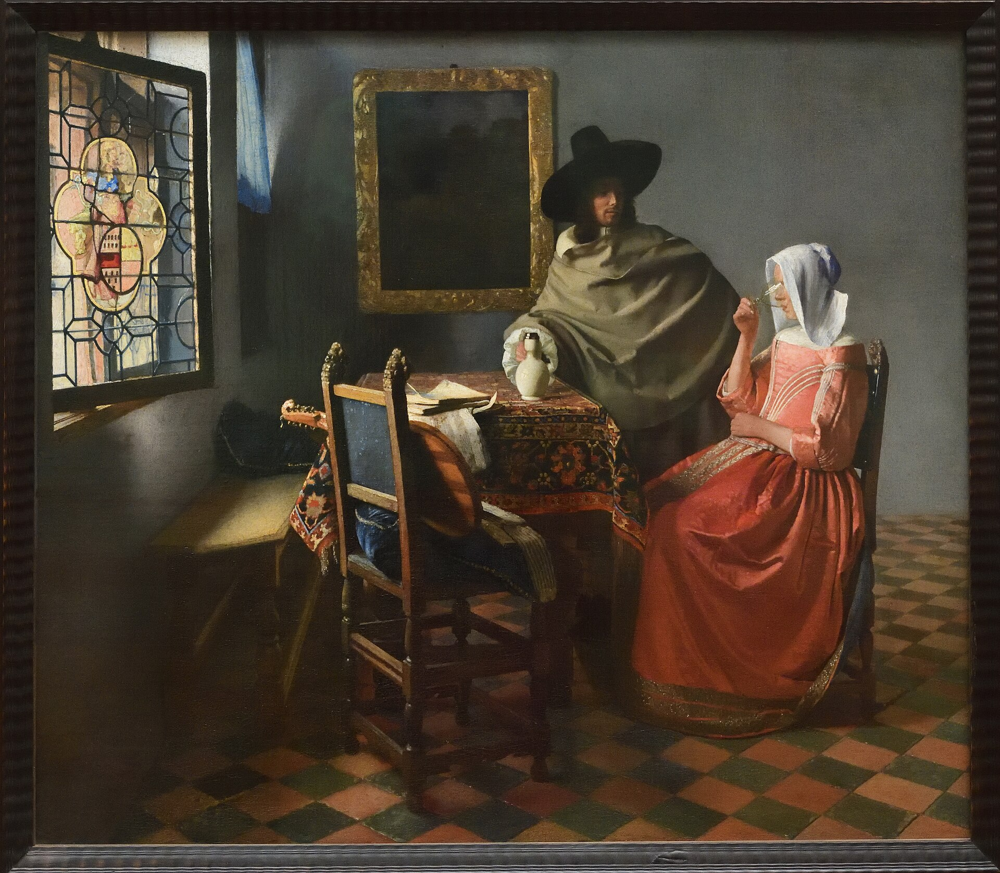

# 《葡萄酒杯》：维米尔的一杯酒与一扇窗

在维米尔的室内画里，酒很少是孤立的静物。它总在一个动作里出现：有人举杯，有人倒酒，有人把杯子递向另一个人。《葡萄酒杯》正是这样一幅画：表面安静，动作却很明确；人物没有说一句话，酒却已经完成了社交。它把我们熟悉的“喝一杯”画成了一套缓慢、克制、带有一点暧昧的仪式。

图：《葡萄酒杯》：维米尔的一杯酒与一扇窗作品图像。图片：Dosseman，CC BY-SA 4.0，via Wikimedia Commons（[原图页面](https://commons.wikimedia.org/wiki/File:Jan_Vermeer_van_Delft_The_glass_of_wine_-_1661-2_-2049.jpg)）。

## 作品信息

这幅画的作者是约翰内斯·维米尔（Johannes Vermeer，1632–1675），荷兰代尔夫特画家。英文常写作 The Glass of Wine，荷兰语题为 Het glas wijn。柏林国家博物馆的著录把年代定在约 1658–1660 年，属于维米尔成熟期的室内画；材质为布面油画，现藏柏林国家博物馆绘画馆（Gemäldegalerie）。具体尺寸与馆藏编号以馆方著录为准。

它不是肖像，也不是纯粹的神话画，而是“室内风俗画”：一男一女，一间有窗的房间，一张铺着布的木桌，几只器物。画面没有戏剧性的情节，却有一个清楚的动作核心——倒酒。正因为动作简单，观看者才会把注意力放到人物关系、光线与器物上。

## 画面与酒器

画面里，一位女子坐在桌旁，手里握着酒杯；一位男子站在她身旁，正从酒壶里把酒倒进杯中。桌上铺着布，放着器物；背景是一扇让光线进入的窗，墙上还挂着一幅画。维米尔没有把人物画成夸张的表情，而是让动作停在半途：酒正在倒，杯正在接，交谈可能刚刚开始，也可能已经结束。

酒器在这里承担了画面的“支点”。透明的玻璃杯让酒液、反光与手的动作同时可见；酒壶的高度与倾斜角度决定了画面的动势；桌布的褶皱与器物的投影则把动作固定在空间里。杯中酒的颜色与杯形细节，最好以馆方高清图像为准，不宜只凭复制品判断。它不必被直接对应成今天某一款葡萄酒；在 17 世纪的荷兰，酒的种类、杯形与饮用习惯都与今天不同。

## 酒文化关联

这幅画最直接的酒文化关联，是“酒作为待客与交往的媒介”。倒酒不是单纯的服侍动作，它让两个人进入同一个节奏：一个人给予，一个人接受；一个人站着，一个人坐着。酒在这里既制造亲近，也维持距离。女子的姿态并不放纵，男子的动作也不粗暴；画面把饮酒放在礼貌与节制的框架里，却又不完全排除暧昧。

在荷兰黄金时代的室内画里，酒常常与音乐、书信、棋牌、求爱一起出现。它可以是社交的润滑剂，也可以是道德警告的对象。维米尔的处理更含蓄：他不直接给出“这是好行为”或“这是坏行为”的判断，而是让观者从人物的姿态、目光与器物去推测。酒因此不是画面的全部，却是理解人物关系的钥匙。若想了解酒在更长时间里的文化位置，可以读[一杯酒里的时间](ref:time-in-a-cup)；若想了解酒在仪式与交往中的角色，可以看[酒与仪式](ref:wine-and-ritual)。

## 技法与时代背景

维米尔擅长用光来组织画面。窗光从一侧进入，落在人物、桌布与墙面上，形成柔和的明暗过渡；这种光不是戏剧性的聚光，而是室内日常的光。它让画面显得安静，也让器物获得质感：玻璃的反光、布料的褶皱、墙面的粗糙，都在光里被区分开来。

构图上，人物被安排在靠近桌子的位置，视线与动作把空间分成前后层次。观者像是站在房间的另一侧，既接近，又不闯入。维米尔是否使用光学辅助（例如暗箱）来构图，学界长期有讨论；这类讨论有助于理解他的透视与光感，但不能简单地说“他的画就是照片”。本文不对这个问题下结论，只提醒读者：画面的“真实感”是绘画建构出来的。

## 收藏与流传

这幅画今天藏于柏林国家博物馆绘画馆。它曾在不同收藏中流转，具体入藏年代、早期藏家与展览历史以馆方著录为准。对普通观众来说，更重要的是它在柏林陈列中的位置：它与维米尔其他室内画一起，构成一个可以比较的观看序列。

看这幅画时，不妨把它和维米尔的其他室内场景放在一起：同样是窗光、桌案与人物，为什么这一幅显得更“有动作”？答案可能在于倒酒这个瞬间。它把时间切成两半：酒还没倒完，话还没说完，观者正好停在中间。

## 常见误读

第一，把它当成“一对礼貌夫妇的肖像”。画中人物没有明确的身份，重点是动作与关系，而不是某个人物是谁。

第二，把杯中的酒直接认定成红葡萄酒或白葡萄酒。复制品会改变颜色，杯形与酒种也不能只凭画面断定；具体以馆方图像与著录为准。

第三，把画面当成照片式的空间记录。维米尔的光与透视经过组织，画面比真实房间更“完整”、更安静。

第四，把维米尔当成孤立的“天才”。他的室内画与代尔夫特画派、荷兰风俗画传统、当时的器物与室内陈设都有关系；把他放回时代，反而更能看出他的特别。

## 观看建议

先看倒酒的动作：酒壶的倾斜、酒杯的位置、两人的手。再看光：窗光落在哪里，哪些地方被留暗。然后看桌面与墙面：布、器物、墙上的画如何把空间撑起来。最后再看人物的表情与距离：他们亲近吗？谁在主导？谁在等待？

如果可能，尽量看原作或馆方高清图，而不是依赖手机屏幕上的压缩图。维米尔的细节很小，酒杯的反光、布料的纹理与墙面的质感都需要近距离才能体会。看完这幅，可以再找一幅维米尔的其他室内画对比，注意他如何处理“没有大事发生”的日常。

相关条目：[葡萄酒](ref:wine)、[第一口，先别急着下结论](ref:first-tasting)。

## 另见

- [葡萄酒](ref:wine)：葡萄酒的基本类型与风格。
- [一杯酒里的时间](ref:time-in-a-cup)：《葡萄酒杯》：维米尔的一杯酒与一扇窗所处的节令、礼制与文学背景。
- [如何开始品酒](ref:first-tasting)：读《葡萄酒杯》：维米尔的一杯酒与一扇窗时从观色、闻香到入口的路径。
- [酒与仪式](ref:wine-and-ritual)：饮酒如何成为仪式与交往。
