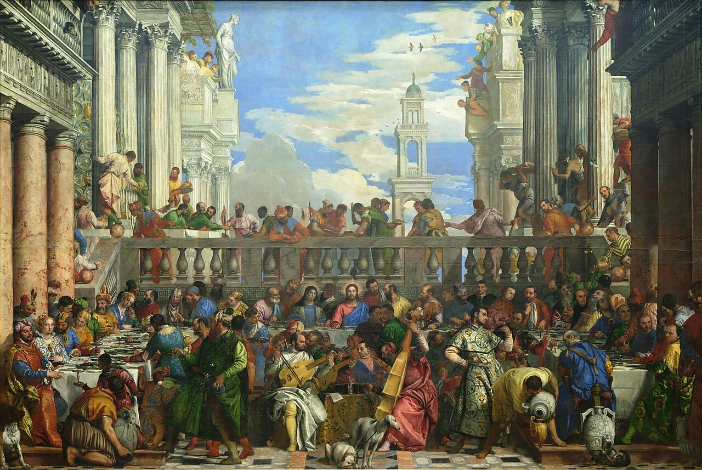

图：委罗内塞《加纳的婚礼》全画复制图，现藏卢浮宫；不是展览现场照片，也不是局部放大。图片：Paolo Veronese，Public domain，via Wikimedia Commons（[原图页面](https://commons.wikimedia.org/wiki/File:Les_Noces_de_Cana_-_Paolo_Veronese_-_Mus%C3%A9e_du_Louvre_Peintures_INV_142_;_MR_384.jpg)）。

> **先给结论**
> **一句话：** 这页判断《加纳的婚礼》：一面墙上的婚宴，和一场被宴席藏起来的奇迹该怎么看，以及它在饮酒图像里的位置。
>
> - **适合谁：** 想把《加纳的婚礼》：一面墙上的婚宴，和一场被宴席藏起来的奇迹放回饮酒史与图像传统里看的人。
> - **不适合谁：** 只想看一张图、不关心作品年代和饮酒语境的人。
> - **先看这两点：**
>   - 这幅画原本挂在圣乔治·马焦雷修道院的餐厅。
>   - 先退后看整体：下层是横向的餐桌带，上层是纵向的柱子和天空；基督在中央偏右，圣母在他右侧；画面右下角的仆人、石缸和管宴席的人构成一条斜线。

## 一面墙上的婚宴

站在卢浮宫德农馆 711 展厅，很难先把《加纳的婚礼》当成一幅宗教画。它太宽、太吵、太像一场正在进行中的宴会：两根巨大的柱子撑起两层建筑，上层是栏杆与天空，下层是一张接一张的餐桌；一百多个人物挤在画面里，仆人端着盘子穿行，狗在桌下抬头，乐师在前景调弦。基督坐在中央，圣母在他旁边，但第一眼抓住视线的是宴席本身。

这幅画宽约 9.94 米、高约 6.77 米，是卢浮宫尺幅最大的绘画之一。它原本不是为博物馆画的，而是为威尼斯圣乔治·马焦雷修道院的餐厅所作。修士们在用餐时抬头看见的，是一场婚宴；婚宴的中心，是《约翰福音》记载的耶稣在加纳把水变成酒。也就是说，这不是一张“宴会风俗画”，而是一张把奇迹放进日常餐桌的宗教画。

## 作品信息

画面作者是保罗·卡利亚里，通称委罗内塞（Paolo Veronese，1528–1588）。卢浮宫藏品著录把它定在 16 世纪，通常系于 1562–1563 年；材质为布面油画，藏品号 INV 142，原属威尼斯圣乔治·马焦雷修道院，1797 年拿破仑军队进入威尼斯后被运往巴黎，之后留在卢浮宫。

画面取材《约翰福音》2:1–11：加纳的一场婚礼上，酒喝完了，耶稣吩咐仆人把水倒进六个石缸，水变成了酒；管宴席的人尝了，不知道来源，把新郎叫来说“人都是先摆上好酒，等客喝足了才摆上次的，你倒把好酒留到如今”。这段经文本身就有戏剧性：奇迹不是公开表演，而是在宴席的流程里悄悄发生。

委罗内塞没有把六个石缸画成画面主角。他把它们放在右侧，靠近仆人；把管宴席的人、端酒的人、倒酒的人放在前景。观众要自己去找“水变酒”的那一刻。这种处理让奇迹从神迹叙事变成了宴席管理的一部分：酒够不够、什么时候上、谁来尝，都是宴会的事。

## 酒在画面里做什么

画面里的酒不是装饰。它至少承担三层功能。

第一层是**宴席的尺度**。桌子上的杯、壶、玻璃器、银盘，和人物身上的丝绸、天鹅绒、金线一起，说明这不是普通农家婚宴，而是威尼斯上层社会的宴饮想象。酒的丰盛程度，直接等于主人的体面。

第二层是**奇迹的线索**。右侧的仆人正在从石缸里取水，管宴席的人举杯品尝；这两个动作把“水”与“酒”连起来。观众如果只看中央的基督，会错过真正的叙事机关。委罗内塞把神迹放在画面的边缘，让宴席的日常逻辑先成立，再让奇迹从边缘进入。

第三层是**秩序的隐喻**。谁坐在哪里、谁站着、谁端盘子、谁在楼上往下看，构成一套严格的社会空间。酒在这里是流动的：从石缸到仆人，从仆人到大杯，从大杯到餐桌。它把不同等级的人连在同一条服务链上。这一点和后来荷兰风俗画里的酒馆场景可以对照，见[酒馆史](ref:taverns)；但委罗内塞的兴趣不在酗酒，而在宴会的组织。

## 委罗内塞与威尼斯宴饮文化

委罗内塞出生在维罗纳，后来在威尼斯工作。威尼斯是16世纪地中海的贸易与奢侈品中心，糖、香料、玻璃、丝绸、葡萄酒都从这里流动。他的画以银灰、蓝绿、粉红和深红著称，人物多、空间大、光线亮，常被形容为“把剧场搬进画布”。

《加纳的婚礼》里的建筑并不是严格的威尼斯实景。柱子、栏杆、穹顶和远处的塔楼更像舞台布景，把人物分成上下两层。这种处理让画面同时具备“室内”和“露天”的感觉：下层是拥挤的餐桌，上层是透气的天空。委罗内塞后来在《利未家的宴会》里把类似结构用得更放肆，甚至因为人物太多、细节太世俗而受到宗教裁判所质询。把这两张画放在一起看，就能理解他为什么总把圣经故事放进威尼斯的上流宴会：他相信神圣事件可以在最日常的社交场合发生。

画面里还有一处常被忽略的细节：前景的四重奏乐师中，穿白色衣服、弹弦乐器的人通常被认为是委罗内塞的自画像。画家把自己放进宴席，不是抢戏，而是表明“这张画是我组织的”。这也是文艺复兴画家常用的签名方式：不写在角落，而是站在画面里看着你。

## 从修道院餐厅到卢浮宫

这幅画原本挂在圣乔治·马焦雷修道院的餐厅。修士们每天吃饭时看见的，是加纳的婚宴和基督的第一次神迹；这个位置决定了画面的尺度——它必须覆盖一面墙，必须让一桌人抬头就看见。它也决定了画面的语气：不是私人收藏的精致小画，而是公共空间的集体图像。

1797 年，拿破仑军队根据《托伦蒂诺条约》从威尼斯运走大量艺术品，《加纳的婚礼》被带到巴黎。1815 年拿破仑帝国结束后，许多作品被要求归还；这张画因为太大，运输风险高，最终留在卢浮宫。法国方面以一幅勒布伦的作品作为交换，具体交换作品在不同文献里有不同说法，但“因为尺幅太大而留下”是通行解释。1870 年和 1939 年，它又两次被撤下、打包，以躲避战火。

今天它挂在《蒙娜丽莎》对面的墙上。这个位置很微妙：一张是文艺复兴的肖像，一张是文艺复兴的宴席；一张安静，一张喧闹。游客常常先看《蒙娜丽莎》，再转身看见这一整墙的人。策展人显然希望观众把两种“文艺复兴”放在一起看：个体的神秘，和集体的秩序。

## 常见误读

**误读一：这是一幅“威尼斯生活记录”。** 画面里的服装、器物、建筑有威尼斯影子，但它是为修道院餐厅画的宗教画，不是现场写生。人物身份、空间结构、光线都经过设计。把它当成16世纪威尼斯的照片，会错过它的神学功能。

**误读二：基督是画面主角，所以奇迹在中央。** 基督确实在中央轴线上，但“水变酒”的动作发生在右侧。委罗内塞把神迹藏在宴席流程里，观众需要移动视线才能找到。这种“边缘叙事”正是他的手法。

**误读三：画里的酒越多，越说明威尼斯人奢靡。** 酒在这里首先是宴席的待客之道，也是奇迹的载体。委罗内塞并不打算画一场道德讽刺；他画的是“丰盛”如何成为神圣事件的舞台。可以用[葡萄酒](ref:wine)理解葡萄酒在当时的社会位置，但不要把画面直接读成禁酒宣传。

**误读四：乐师里的白衣人一定是自画像。** 这是艺术史里被广泛接受的推测，不是画面题记。可以肯定的是，委罗内塞把自己放进了宴席；是否“一定是他本人”，仍属于解释而非证据。

## 怎么看这幅画

先退后看整体：下层是横向的餐桌带，上层是纵向的柱子和天空；基督在中央偏右，圣母在他右侧；画面右下角的仆人、石缸和管宴席的人构成一条斜线。然后走近看三个局部：右侧的仆人倒酒、中央的基督手势、前景的乐师。最后看画面边缘的狗、鹦鹉、孩子和端盘子的仆人——这些“多余”的人，才是委罗内塞真正想让你看见的宴席。

如果把这张画和[《葡萄酒杯》](ref:vermeer)的《葡萄酒杯》并置，会发现两种完全不同的酒：维米尔画的是一个人和一扇窗，委罗内塞画的是一群人和一面墙。前者把酒收进室内，后者把酒铺满公共空间。再和[《酒神巴克斯》](ref:bacchus)的《酒神巴克斯》对照，卡拉瓦乔把神变成一个人，委罗内塞把一个人群变成神迹的背景。三张画放在一起，正好是“酒与画”的三种尺度，见[酒与画](ref:painting)。

今天看这张画，最值得留意的不是“有多少人”，而是“谁在服务谁”。酒从石缸里出来，经过仆人的手，进入管宴席的人的杯子，再进入宾客的嘴。奇迹没有取消等级，反而沿着等级流动。这可能是这幅画最不像宗教画、也最像宗教画的地方：神迹发生在宴席里，而宴席有它自己的规矩。

相关条目：[《葡萄酒杯》：维米尔的一杯酒与一扇窗](ref:vermeer)、[《酒神巴克斯》：卡拉瓦乔的一杯酒与一篮水果](ref:bacchus)、[葡萄酒](ref:wine)。
