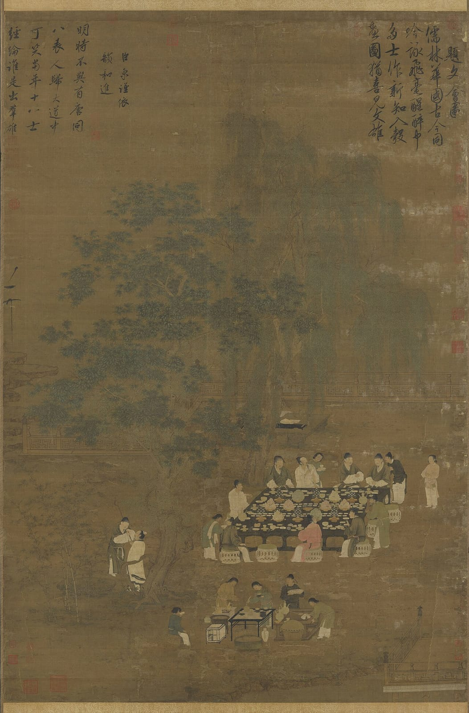

图：旧传宋徽宗《文会图》复制图，绢本设色，现藏台北故宫博物院；不是宋代现场记录。图片：Emperor Huizong of Song，Public domain，via Wikimedia Commons（[原图页面](https://commons.wikimedia.org/wiki/File:%E6%96%87%E4%BC%9A%E5%9B%BE%E8%BD%B4.%E5%AE%8B%E4%BB%A3.%E5%AE%8B%E5%BE%BD%E5%AE%97%E8%B5%B5%E4%BD%B6.%E7%BB%A2%E6%9C%AC%E8%AE%BE%E8%89%B2.%E5%8F%B0%E5%8C%97%E6%95%85%E5%AE%AB%E5%8D%9A%E7%89%A9%E9%99%A2%E8%97%8F.jpg)）。

## 一张大桌，一圈学士

画面先给你一座园林：树、竹、石、栏杆，远处是雾一样的留白。然后是一张巨大的黑漆桌，桌上摆着果盘、碗盏、酒器、茶具和插花。桌边围坐着十几个穿袍服的文人，有的正面，有的侧身，有的举杯，有的交谈。桌外站着仆人，有的执壶，有的捧盘，有的在远处准备。画面下方还有一组人，像在备茶或温酒。

这就是旧传宋徽宗赵佶的《文会图》。它现藏台北故宫博物院，绢本设色，纵约 184.4 厘米、横约 123.9 厘米。画题“文会”指文人雅集：一群人因文章、学问或官职聚在一起，吃饭、喝酒、赋诗、谈艺。它不是一张“喝酒图”，而是一张“文人如何在公开场合相处”的图像。

## 作品信息

这幅画旧传为宋徽宗赵佶（1082–1135）所作，但学术界对真伪与作者有不同看法。画上有徽宗的题识与印章，画面风格也接近宣和画院；但“御题”不等于“亲笔”，宋代宫廷绘画常有画院画家代笔、皇帝题字的情况。比较稳妥的说法是：它属于北宋宣和年间宫廷绘画系统，旧传为徽宗，具体作者仍存疑。

画面采用绢本设色，人物、家具、器物画得很细，树木和坡石则相对放松。这种“人物工、背景松”的处理，是宋代宫廷人物画的常见方式：把注意力集中在人物的姿态、衣纹和器物上，用环境提供气氛，而不是抢戏。

画面中的“文会”不是随便的聚餐。它有明确的座次、侍奉和器物：谁坐主位、谁侧坐、谁站着、谁在桌外，都能看出身份和关系。对宋代文人来说，雅集既是社交，也是政治。它在公开场合展示学问、品味和人脉，也在私下建立同盟。徽宗把这种场合画下来，等于把“文治”的理想变成可视的图像。

## 酒在画面里做什么

画面里的酒并不喧闹。桌上酒盏、酒器、茶具并置，仆人执壶侍奉，但没有人大口喝，也没有人醉倒。酒在这里是“雅集”的一部分，而不是“宴饮”的全部。

第一，**酒是礼仪**。文人雅集讲究“有酒有诗”，酒用来助兴，也用来完成礼节。谁先举杯、谁陪饮、谁不喝，都有讲究。酒不是越多越好，而是“合宜”才好。这一点和[酒与礼](ref:ritual)里说的酒礼相通：酒把人与人的关系摆出来。

第二，**酒是身份**。画面里的酒器、茶具、果盘、插花，都是“文房清供”的延伸。它们说明这不是普通饭馆，而是有品味的私人或宫廷场合。酒在这里不是解渴的饮料，而是“我们知道怎么过日子”的证明。

第三，**酒是政治**。北宋的文人政治依赖宴饮、诗会和书信网络。一场雅集可以联络感情，也可以展示立场。徽宗把文会画成秩序井然的图像，等于说：这些读书人坐在一张桌子上，朝廷就稳了。酒在这里是黏合剂，也是权力关系的润滑剂。

## 徽宗、画院与“文治”图像

宋徽宗是北宋第八位皇帝，年号宣和。他在政治上并不成功，但在艺术上影响巨大：他推动画院制度，重视写生、法度和诗意，也亲自参与书画创作。宣和画院的作品常常精细、富丽、讲究构图，既服务于宫廷审美，也服务于政治表达。

《文会图》可以放在这个背景里看。它不是一张普通的“文人聚会”风俗画，而是一张“朝廷如何看待文人”的图像。画中的学士被画得端正、从容、有秩序；仆人被画得忙碌、谦卑、有分寸。整个画面没有冲突，没有醉态，没有越界。它呈现的是一种理想化的文治秩序：读书人各安其位，酒和茶把大家连在一起。

这种理想化也意味着省略。真实的文人雅集会有争论、有派系、有失意者；画面里没有这些。它把“文会”画成一场和谐的演出，而不是一次可能出问题的政治聚会。看懂这一点，就能理解它为什么重要：它不是记录，而是宣传。

## 为什么它重要

**它是宋代文人雅集图像的代表。** 后代画“文会”“雅集”“十八学士”时常参考这类构图：大桌、围坐、仆人、园林、器物。它提供了一个“文人如何聚会”的视觉模板。

**它把饮食器物画成了文化符号。** 酒盏、茶具、果盘、插花、家具，不只是道具，而是宋代文人生活的物质清单。研究宋代饮食、器物和家具的人，可以从这幅画里读到很多细节。

**它展示了宫廷绘画的政治功能。** 徽宗不是单纯画一幅“好看的聚会”，他画的是“文治”的理想。画面越和谐，越说明朝廷希望别人这样看它。这种“以画为政”的做法，是宋代宫廷艺术的重要一面。

## 常见误读

**误读一：这是宋徽宗本人和文人喝酒的现场记录。** 画面可能是宫廷画院的作品，徽宗题识不等于他亲笔，也不等于他本人就在席上。把它当成“皇帝请客的照片”，会忽略它的理想化。

**误读二：这是“十八学士图”。** “十八学士”是唐太宗秦王府的十八位学士，后代画家反复画这个题材；《文会图》是另一个题目，画面人物数量和构图也不同。两者有关系，但不能混为一谈。

**误读三：画里的人都在喝酒。** 桌上酒器、茶具并置，仆人也在备茶；这是一场包含饮酒、喝茶、吃饭、谈艺的雅集，不是单纯的酒局。把“文会”简化成“喝酒”，会错过它的文人性质。

**误读四：这是一幅写实风俗画。** 它有人物、器物和园林的写实细节，但整体是理想化的秩序图。真实的雅集不会这么整齐，也不会没有冲突。它的“真实”是制度意义上的真实，不是现场记录。

## 怎么看这幅画

先看桌子：它是画面的中心，也是所有人物的交点。再看座次：谁在主位，谁在侧位，谁站着，谁在桌外。然后看器物：酒盏、茶具、果盘、插花，分别放在哪里。最后看仆人：他们的动作把画面从“静态肖像”变成“正在进行”的宴集。

可以把这幅画和[《韩熙载夜宴图》](ref:han-xizai)的《韩熙载夜宴图》对照：后者画的是夜宴的私密、放纵与政治焦虑；《文会图》画的是白天的、公开的、秩序井然的雅集。再和[《清明上河图》](ref:qingming)的《清明上河图》对照：后者画的是城市商业与市井酒肆；《文会图》画的是宫廷文人的室内世界。三张画放在一起，正好是宋代酒文化的三个层次：宫廷、文人、市井。

最后，把[黄酒](ref:yellow-wine)和[酒与画](ref:painting)放在这里：宋代的酒以黄酒、米酒为主，文会上的酒器与酒礼，和今天的白酒桌文化并不是一回事。理解这一点，才不会把《文会图》读成一张“古代饭局”的泛泛插图。

相关条目：[《韩熙载夜宴图》：一场被画下来的夜宴](ref:han-xizai)、[《清明上河图》：汴京酒肆与城市节奏](ref:qingming)、[酒与画：宴饮图像的四种看法](ref:painting)。
