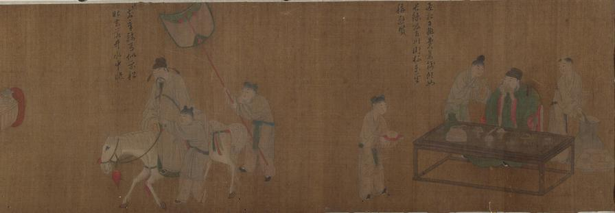

# 《饮中八仙图》：八个人的醉态

杜甫用一首歌行写下八个人的酒量，也顺手写下了盛唐长安的一张社交地图。诗里没有筵席的完整过程，只有八个被酒放大的瞬间：骑马、朝天、举杯、挥毫、高谈。后世画家把这些瞬间拆成人物段落，于是有了《饮中八仙图》。它不是一幅画的名字，而是一个被反复重画的题目；今天能查到的本子，至少分藏台北与纽约两地。

图：《饮中八仙图》局部（大都会艺术博物馆藏本），绢本设色，明或清，纽约大都会艺术博物馆藏。图片：Unidentified Chinese artist，Public domain，来源：[原始页面](https://www.metmuseum.org/art/collection/search/51533)。

## 作品与馆藏

台北故宫博物院藏一卷，旧传元人任仁发所绘，纸本设色，纵 26.7 厘米，横 447.3 厘米，卷后拖尾高 26.7 厘米、长 57.7 厘米。此卷见于《石渠宝笈三编》宁寿宫部分，拖尾有虞集泰定二年（1325）的隶书题跋，起首即录《饮中八仙歌》。“旧传”二字说明，馆方并未把作者当作定论。

纽约大都会艺术博物馆藏一卷，英文题为 The Eight Drunkards，编号 19.149，定为明代或清代，绢本设色手卷，纵 21.6 厘米，横 233.7 厘米，1918 年以罗杰斯基金购藏。画上带有托名南宋刘松年的伪款，馆方在著录中直接标明“伪款”，这为讨论明清市场的作伪手法提供了一个清楚的样本。

两卷尺寸、材质、人物组合都不相同，不能合并成一条“作品信息”。八人名单则来自杜诗：贺知章、汝阳王李琎、左丞相李适之、崔宗之、苏晋、李白、张旭、焦遂。名单是固定的，画法不是。

## 画面细读

读长卷的办法，是顺着诗句找人。贺知章醉后骑马，身体歪斜，像坐在船上；李琎在朝见天子的路上遇见酒车，口水几乎流下来；李适之饮酒如长鲸吸百川；崔宗之高举酒杯、翻着白眼望天，被比作玉树临风；苏晋一面长斋礼佛，一面在醉里逃禅；李白在长安市上的酒家睡着，皇帝召他上船，他仍不肯醒；张旭三杯之后脱帽露顶，在王公面前挥毫；焦遂五斗之后才精神大振，高谈阔论，惊动四座。

画卷通常把这八段横向排开，人物之间以树石、坡岸或空白隔断，形成可以逐段观看的节奏。台北本长达四米余，适合“一段一人”的铺陈；大都会本只有两米多，人物更密集，过渡也更紧凑。两本都用线条与设色塑造人物，衣纹、面容与手势承担大部分叙事，酒器反而常只是手中的小物件。看这类画，先认人，再看他手里的东西。

## 酒在画面中的功能

酒在这里不是宴会用品，而是人物分类的依据。八个人都喝，但醉法不同：贺知章的醉是失态，李琎的醉是嘴馋，李适之的醉是气魄，崔宗之的醉是傲气，苏晋的醉是破戒，李白的醉是才气，张旭的醉是书艺，焦遂的醉是辩才。画家要做的，不是画一只漂亮的酒壶，而是让观者一眼看出“这个人为什么醉”。

酒还把这八个人连成一条文化线索。杜甫写诗，李白写诗，张旭写字；其余几人是宗室、宰相、名士与布衣。酒把不同身份的人拉到同一个平面上，让“饮酒”暂时取代官阶。这种平等是短暂的，也是画面最有趣的地方：它既像群像，又像八张互不相干的小肖像。

## 创作背景

《饮中八仙歌》的写作年代没有定论，一般放在天宝年间。八人活动的时代大致在开元、天宝之间：贺知章（659—744）是前辈，李白（701—762）正当盛年，李适之在天宝年间官至左丞相，后来被贬自尽。杜甫用“仙”称呼他们，并不是说他们真的成仙，而是唐人对善饮者的戏称，带着一点羡慕，也带着一点调侃。

宋代以后，以诗为题的人物画渐多，“饮中八仙”成为常见母题。元代出现了托名任仁发的长卷，明清又有版画、年画与瓷器装饰沿用；晚明人甚至把这八个人当作酒牌图样，八种酒态正好用来行令。

## 真伪、年代与摹本

台北本的作者问题最值得说明。卷后虞集跋作于 1325 年，跋文与画卷的关系却未必是原配；题跋可以后加，也可以从别处移来。馆方用“旧传任仁发”而不是“任仁发”，正是保留了这层不确定。另有整理者认为此卷笔墨力道偏弱，可能出自明人之手；这类判断属于风格意见，不能当作定论，但足以说明“元代名家”的标签需要谨慎对待。

大都会本的伪刘松年款，则展示了另一种情况：作伪者不需要重画，只需添一个名头，就能把一件明或清的作品抬到南宋。馆方把年代定在明或清，把作者定为佚名，等于拆掉了这层包装。两本并置可以看出，同一题材在元明之间经历了从“长卷叙事”到“商品画”的转变，人物越来越类型化，题款越来越不可靠。

传世本恐怕还不止这两件。《中国古代书画图目》一类目录著录的散本，多有小名头或无款本。研究时最稳妥的做法，是先记下馆藏编号、尺寸与题跋，再谈作者。

## 常见误读

第一，把“饮中八仙”当成道教八仙。道教八仙是吕洞宾、铁拐李等一组神仙，与杜甫诗中的八位酒徒没有关系；两者都叫“八仙”，只是词面相同。

第二，把画中的酒直接当成今天的白酒。唐人喝的多是米酒、酒醪一类的谷物酒，蒸馏酒在唐代是否普及仍有争议；把画中酒杯与今天的[白酒](ref:baijiu)对应，是把一千年后的酒类概念塞回唐代。

第三，把题款当作者真迹。大都会本的伪刘松年款就是现成的反例；台北本的“任仁发”也还带着“旧传”二字。

第四，以为传世只有一本。至少台北与纽约各有一卷，且尺寸、材质、人物安排都不同；用一本的细节去否定另一本，方法上不成立。

第五，把八人当成同时同地的一次聚会。诗是杜甫对八个人的分别书写，画是把八段拼在一起；他们并未真的同席。

## 观看建议

先花几分钟把《饮中八仙歌》读一遍，记住八个人的标志动作，再回到画上找人。看长卷时不要一次看完全部，按段落停一停：这一段是谁，他在做什么，酒器在谁手里。看完人物，再看树石与空白，注意画家怎样用间隔制造节奏。最后看题跋与印章，尤其是卷尾的纪年，它往往比画面更能说明这件东西何时进入收藏。

如有机会看原作或馆方高清图，留意人物的眼神与手势。八仙图的趣味不在酒器多精美，而在八个醉汉各自不同的“醉法”。

## 另见

- [中国](ref:china)：题材所属的文化与地理背景。
- [白酒](ref:baijiu)：唐代蒸馏酒问题的对照条目。
- [酒与诗歌](ref:wine-and-poetry)：杜甫的酒诗与唐代饮酒风气。
- [李白](ref:li-bai)：八仙之一，也是酒诗传统的核心人物。
- [《兰亭集序》](ref:lanting)：另一件以饮酒聚会为起点的作品。

对照阅读：[中国](ref:china)、[酒与诗：从《诗经》到宋词的饮酒书写](ref:wine-and-poetry)。
