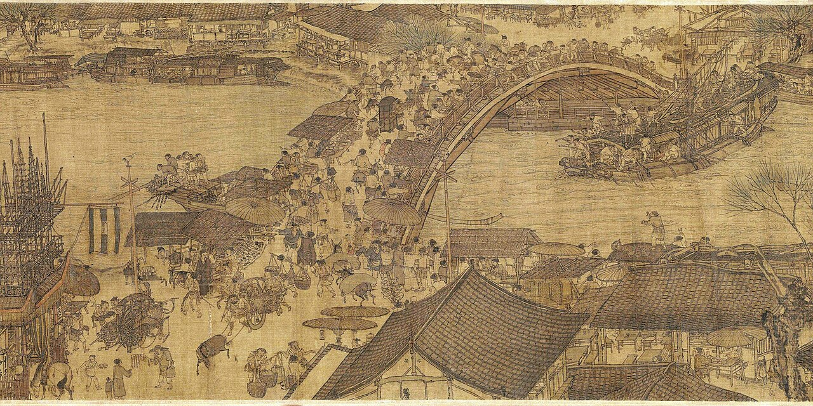

# 《东京梦华录》

图：张择端《清明上河图》局部，描绘北宋汴京的虹桥与市井；此图不是《东京梦华录》书影。图片：Zhang Zeduan，Public domain，via Wikimedia Commons（[原图页面](https://commons.wikimedia.org/wiki/File:Along_the_River_During_the_Qingming_Festival_(detail_of_original).jpg)）。

## 书目与版本

《东京梦华录》是南宋孟元老撰写的笔记体著作，共十卷。作者在绍兴十七年（1147）自序，追忆北宋徽宗崇宁至宣和年间（1102—1125）东京汴梁（今河南开封）的城市风貌、街巷、寺观、酒楼、食店、夜市、节令和民俗。现存最早刻本为元刻本，国家图书馆出版社曾影印出版；现代通行整理本中，中华书局出版的《东京梦华录笺注》（伊永文笺注）影响较大，笺注引证了大量史料和古本插图。

书名里的“东京”是北宋都城汴梁，不是日本东京；“梦华”则来自“华胥梦”的典故，带有追忆、怀旧和“故都如梦”的意味。这个书名本身就提示了它的写法：它不是当时的官方档案，而是南渡之后对失去的城市的回忆。读者若把它当成“北宋汴京的实时记录”，会忽略回忆、筛选和美化的问题。

## 作者与成书

孟元老，本名孟钺，生卒年不详，“元老”可能是字或号，“幽兰居士”也是他的号。他自称在崇宁二年（1103）随父宦游入京，在汴京生活了二十多年，靖康元年（1126）南渡避难。晚年，他担心后人对故都风俗“失于事实”，于是把记忆中的街巷、节令、饮食、歌舞、仪式写成十卷。这个“恐失事实”的动机，说明他有一个明确的写作目标：为失去的城市留下一份可传的记录。

但“亲历”不等于“客观”。孟元老的记忆有选择性：他更关心城市的热闹、节庆、消费和上层生活，对贫民、疾病、劳动和制度黑暗着墨较少；他写的是“梦华”，不是“社会调查”。书中也有一些数字和地名需要校勘，不同版本之间存在差异。阅读时要把“亲历者的回忆”和“后人的笺注”分开：前者提供现场感，后者提供考证和校正。

## 酒在书中的位置

酒是《东京梦华录》最重要的物质线索之一。书里写酒楼、酒肆、正店、脚店、酒旗、夜市、酒器、下酒菜、酒令和节令酒俗，几乎把一座城市的酒业网络铺开。最常被引用的一条，是“在京正店七十二户，此外不能遍数，其余皆谓之脚店”：正店是有资格酿酒、卖酒的大店，脚店是从正店批发酒再零售的小店。这个“正店—脚店”结构，说明汴京的酒业不是零散的小摊，而是有层级、有牌照、有供应链的城市产业。

书里还写到酒楼的空间：门面、彩楼欢门、厅堂、雅间、夜市灯烛、歌妓和伙计。酒楼不只是喝酒的地方，也是谈生意、宴客、听曲、看灯和社交的场所。酒与城市节奏绑定：白天有正店和脚店，夜晚有夜市和“鬼市”；节令有清明、端午、中秋、重阳的酒俗；皇室、官员、商人和市民在不同的酒桌上形成各自的圈子。读这些段落，能理解“酒馆是城市的客厅”这句话不是比喻，而是空间事实。

酒器也值得注意。书里提到银器、瓷器、漆器、注子、台盏等，不同材质和器形与场合、身份相关。酒器不是简单的容器，它参与礼仪和展示：什么酒用什么杯，什么场合摆什么器，都能读出等级和趣味。近年有研究用《东京梦华录》和《清明上河图》互证，讨论宋代酒器的保温功能、酒楼陈设和饮用方式；这类研究能补充文字没有写出的细节，但也要注意图像和文本各自的局限。

## 关键场景与城市酒业

《东京梦华录》里的“酒楼”不是孤立的店铺，而是城市网络中的节点。书里写到“凡京师酒店，门首皆缚彩楼欢门”，用今天的话说，就是每家酒店门口都扎着彩楼和欢门做广告；有的酒楼“入其门，一直主廊约百余步”，南北天井、两廊皆有小阁子，向晚灯烛荧煌，上下相照。这样的描写，把酒楼的建筑、灯光、服务和夜生活连在一起，读者几乎能看见一座不夜城。

节令酒俗是另一个重点。书里写清明、端午、七夕、中秋、重阳、冬至等节日的饮食和饮酒活动；不同节日有不同的酒、不同的人、不同的空间。比如，清明前后的踏青、上河、宴饮，中秋的赏月、饮酒，重阳的登高、菊花酒。酒在节令里不是“附加饮料”，而是时间表的一部分：什么时候喝什么酒，和农事、气候、信仰、社交绑定。

夜市和“鬼市”也值得注意。书里写州桥夜市、马行街夜市，卖食物、果子、酒、茶和杂货；有的摊位三更才收，五更又开。酒在这些夜市里既是商品，也是照明、取暖和社交的媒介。把酒肆、夜市和节令放在一起看，会发现汴京的酒业不是“白天卖酒、晚上关门”的简单模式，而是全天候、全城分布的服务网络。

## 史料价值与局限

作为史料，它的价值在于“密度”和“空间感”。它记录了大量地名、店名、街巷、桥梁、节令、食物和酒器，能帮助研究者重建北宋汴京的城市地图和日常生活。它也能和《清明上河图》、宋代笔记、方志、酒课文献、考古发掘互相印证。比如，书里的“正店七十二户”可以和宋代酒务、酒课记载对照；书里的酒楼建筑可以和图像、遗址对照；书里的节令酒俗可以和诗词、笔记对照。

局限有四点。第一，它是回忆录，不是当时的档案；写作时间距北宋灭亡已二十多年，记忆会有误差。第二，它有怀旧和美化倾向，容易把故都写成“繁华如梦”，忽略社会矛盾和制度问题。第三，版本复杂，元刻本、明刻本、清抄本和现代笺注本之间存在差异；引用时要注明版本。第四，它的地理和数字需要校勘，不能把“七十二户”当成精确统计；它更像一个概数，表示正店数量之多。

## 常见误读

最常见的误读是把《东京梦华录》当成小说或“故事书”；它是笔记体史料，虽然有文学性，但写作目标是记录城市风俗。第二个误读是把书里的“东京”当成日本东京；它指的是北宋都城汴梁。第三个误读是把“七十二户正店”当成汴京全部酒店数量；书里明确说“此外不能遍数，其余皆谓之脚店”，正店只是有酿酒资格的大店，脚店数量更多。第四个误读是把书里的繁华当成北宋全社会的常态；它主要写城市、节庆和消费，不能代表农村、贫民和制度黑暗。第五个误读是把插图或《清明上河图》当成书的“原配图”；两者是不同媒介，可以互证，但不是同一文本。

相关条目：[《清明上河图》：汴京酒肆与城市节奏](ref:qingming)、[认识一座城，从一间酒馆开始](ref:pub-and-city)、[宋代酒课：官务、民酿岁课与财政依赖](ref:song-tax)。

## 另见

- [《清明上河图》：汴京酒肆与城市节奏](ref:qingming)：图像中的汴京酒业与城市空间。
- [认识一座城，从一间酒馆开始](ref:pub-and-city)：酒馆与城市生活的关系。
- [宋代酒课：官务、民酿岁课与财政依赖](ref:song-tax)：宋代酒业制度与财政。
- [黄酒](ref:yellow-wine)：宋代谷物酒的基本类型。
- [中国](ref:china)：把汴京放回中国地理与历史。
