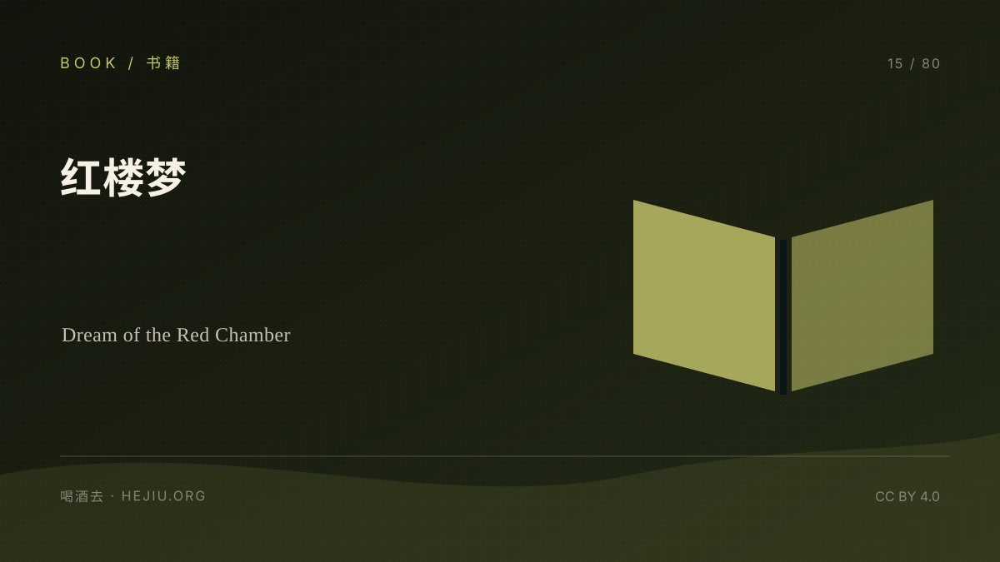

# 红楼梦

《红楼梦》是曹雪芹创作的章回小说，约在 18 世纪中期以抄本流传，1791 年才出现由程伟元、高鹗整理的 120 回刊本。酒在这部小说里几乎从不单独出现：它有名字、有温度、有斟酒的人，也有该不该多喝的规矩。读这些酒段落，等于读贾府的日常秩序，也读人物在秩序里的位置。

图：红楼梦 类型示意图。图片：Doubao Seedream 5.0 AI 辅助绘制（项目自有），不是红楼梦的实拍。

> **先给结论**
> **一句话：** 这页判断红楼梦值不值得读，以及它的问题意识。
>
> - **适合谁：** 想把红楼梦放回酒文化史里理解、并判断值不值得读的人。
> - **不适合谁：** 只想找一句摘要、不准备读原书的人。
> - **先看这两点：**
>   - 曹雪芹约生于 1715 年，卒于 1763 年；他家原先显赫，后来败落，这段经历常被认为与小说中贾府的盛衰有映照关系。
>   - 贾府的酒出现在很多日常场景里：生日、年节、赏花、待客、饯行、诗会。

## 一部怎样的小说

曹雪芹约生于 1715 年，卒于 1763 年；他家原先显赫，后来败落，这段经历常被认为与小说中贾府的盛衰有映照关系。小说以贾宝玉、林黛玉、薛宝钗等人的情感与命运为中心，写贾府由盛转衰，人物众多，日常细节极密。

今本通常为 120 回。前 80 回一般认为是曹雪芹所写，后 40 回的作者与成稿过程存在争议：可能由高鹗续写或整理，也可能有曹雪芹残稿作底。这个版本问题会直接影响读法，因为前后部分在人物语气、情节密度与细节处理上并不完全一致。

因此，读到酒名、酒器或酒令时，先确认它出现在哪一回、属于前 80 回还是后 40 回，比急着把它当成“清代酒俗实录”更稳妥。小说是文学作品，不是酒业调查表。

## 酒在贾府的日常

贾府的酒出现在很多日常场景里：生日、年节、赏花、待客、饯行、诗会。酒既是待客的礼数，也是人物放松下来之后的媒介。长辈赐酒，晚辈要起身；丫鬟斟酒，主子可以自斟；天冷要烫酒，体弱的人只喝半盏。

这些细节说明，酒在贾府不是“想喝就喝”的饮料，而是嵌在尊卑、长幼与亲疏里的社交动作。谁给谁斟酒、谁先举杯、谁被劝酒，往往比酒本身更能说明关系。

也正因如此，小说里的醉态才有意义。醉不仅是生理状态，也是人物暂时离开礼数的时刻；有人借醉说真话，有人因醉失态，有人醉后睡在花丛里。酒把人从规矩中松开一点，又让规矩显得更清楚。

## 黄酒与惠泉酒

第 38 回螃蟹宴上，林黛玉自己斟了半盏，发现“却是黄酒”，随后说吃了螃蟹心口微疼，要热热地吃口烧酒。这一小段把黄酒放在日常席面上：它是现成的、温和的酒，适合宴饮，却不是黛玉此刻想要的那种热而烈的酒。

惠泉酒在书中出现过不止一次。第 16 回凤姐让赵嬷嬷尝“你儿子带来的惠泉酒”，并提醒“只不要过多就是了”；第 62 回芳官则说自己在家时曾吃“二三斤好惠泉酒”。惠泉在无锡，惠泉酒常被解释为用惠泉水酿制的江南名酒，但小说没有给出工艺细节，不能替它补写配方。

从类型上看，这些酒更接近[黄酒](ref:yellow-wine)的谱系：以谷物酿造，酒度通常低于蒸馏酒，适合温饮与配菜。小说里的“黄酒”与“惠泉酒”未必是同一种酒，但都属于当时上层家庭宴席上常见的发酵酒。

## 烧酒与合欢花浸酒

还是第 38 回，黛玉要吃“热热的烧酒”，宝玉便命人“将那合欢花浸的酒烫一壶来”。烧酒是蒸馏酒或高度酒的统称，与黄酒不是一类；合欢花浸酒则是把合欢花浸在酒中制成的药酒式饮法。两条信息放在一起，能看到同一张桌上并置着不同酒类与不同饮法。

“烫一壶”这个动作很关键。温酒不只是为了口感，也与当时对酒性、身体与寒气的理解有关。黛玉体弱、吃了螃蟹觉得心口疼，于是要热而烈的酒；宝玉取合欢花浸酒，则带着照料的意味。酒在这里同时是饮品、药与关心。

读这一段要注意分寸：小说写的是人物感受与家庭经验，不是临床建议。把“吃蟹配热烧酒”直接当成今天的饮食指南，会越过文学与医学的边界。若关心配餐逻辑，可以看[餐酒搭配](ref:food-pairing)里的基本原则，但不要把小说情节当作营养学证据。

## 酒令与宴席游戏

酒令是《红楼梦》宴席的重要组成。第 40 回“金鸳鸯三宣牙牌令”，把牌面、诗句与座次结合起来，谁接不上就要罚酒；刘姥姥的“大火烧了毛毛虫”一类答语，制造了全书的著名笑场。酒令在这里不只是游戏，它同时测试反应、学识与身份。

第 62 回宝玉生日，席上有射覆、拇战，史湘云因多罚了两杯而醉眠芍药裀。酒令把宴会从“吃饭”变成有规则的热闹，规则越复杂，越能显出参与者的机敏与性格。湘云的豪爽、黛玉的敏感、宝钗的稳重，都能在酒令与饮酒反应里看到。

第 28 回冯紫英席上，薛蟠行酒令，语句粗俗，众人发笑。同一套酒令形式，在不同人物口中产生完全不同的效果；这正是小说用酒写人的手法。酒令的“雅”与“俗”，并不只由文字决定，也由在场关系决定。

## 酒与人物

贾宝玉对酒的态度是矛盾的：他享受宴席的热闹，也反感以酒为名的粗俗与强迫。他替黛玉取合欢花浸酒，显示的是体贴；他在某些场合逃避应酬，显示的则是对礼数的不耐。酒在他身上不是单一标签。

王熙凤把酒当作管理工具。她能劝酒、能调度、能在宴席上撑起场面，也知道什么时候该提醒别人少喝。酒在她的场合里是权力与人情的润滑剂，而不是私人的嗜好。

薛蟠、刘姥姥等人物则常以“不会按规矩喝酒”制造喜剧。前者的粗豪、后者的乡野机智，都通过酒令与醉态被放大。小说并不只是嘲笑他们，也让读者看到贵族宴席的规则如何被外来者拆开。

## 酒礼与节制

贾府的酒礼并不抽象，它落在具体动作上：长辈赐酒，晚辈要接；丫鬟斟酒，主子可以让她退下；客人来了要备酒，天冷了要温酒。酒是待客的诚意，也是身份的标记。

与此同时，书中反复出现“少喝”的提醒。第 16 回凤姐让赵嬷嬷尝惠泉酒，赵嬷嬷答“只不要过多就是了”；这类话在宴席上很常见，说明当时对饮酒过量有明确的警惕。酒礼并不鼓励纵饮，它更在意“喝得合规矩”。

这种“有节制的热闹”是理解贾府酒文化的关键。小说既写酒的乐趣，也写酒的失序；既写宴席的丰盛，也写醉后的狼狈。把两面都读到，才不会把《红楼梦》简化成一本“贵族吃喝指南”。

## 怎样读小说里的酒

先看回目与版本。前 80 回与后 40 回在细节上可能不同，同一人物的饮酒习惯也未必前后完全一致。读到一个酒名，先记下回数，再查校注本，不要凭印象拼合。

再看酒在场景里的功能：是待客、庆生、饯行、游戏，还是照料病人。功能不同，酒的类型与饮法就不同。把“黄酒”“烧酒”“惠泉酒”“合欢花浸酒”分别放回场景，才能看出作者的分寸。

最后看人物反应。谁斟酒、谁劝酒、谁只喝半盏、谁醉倒，都是性格与关系的线索。若把酒段落当成独立的酒俗资料，就会丢掉小说最擅长的部分：让人物在具体动作里显形。

小说里的酒名与酒礼要放回人物身份与场合：同一杯黄酒在宴席、祭祀与日常待客中的意义不同，不能只按酒精度分类，也不能把文学描写当成清代日常的完整记录。

## 延伸阅读

- [黄酒](ref:yellow-wine)：谷物发酵酒的工艺与饮用方式。
- [餐酒搭配](ref:food-pairing)：螃蟹、肉类与不同酒类搭配的基本思路。
- [一杯酒里的时间](ref:time-in-a-cup)：酒如何从节令与礼制进入文学。

相关条目：[一杯酒里的时间](ref:time-in-a-cup)、[黄酒](ref:yellow-wine)、[先看盘子里，再看杯子里](ref:food-pairing)。
