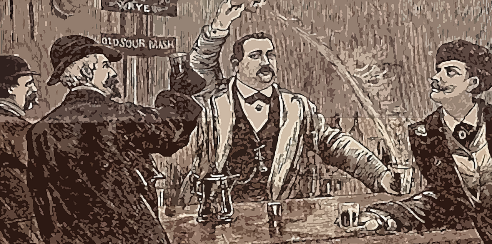

# 《Imbibe!》

图：描绘杰里·托马斯表演“蓝焰”（Blue Blazer）的现代上色插画；它不是历史照片，也不是《Imbibe!》封面。图片：CakeandTail，CC BY-SA 4.0，via Wikimedia Commons（[原图页面](https://commons.wikimedia.org/wiki/File:JerryThomas-blue-blazer-880x435.png)）。

## 书目与版本

《Imbibe!》初版于 2007 年，由纽约 Perigee Books（Penguin Group）出版，副标题把“美国鸡尾酒”和“蓝焰”并列，核心人物是 19 世纪美国调酒师杰里·托马斯。出版方页面明确说，初版在 2007 年获得詹姆斯·比尔德奖；2015 年推出“Updated and Revised Edition”，由 Perigee/Penguin Random House 出版，增加了新发现的配方、历史细节和一批初版没有覆盖的经典酒。修订版有 384 页，序言由 Dale DeGroff 撰写。

两个版本的关系不是“旧版加几页”。修订版重新组织了部分章节，补充了托马斯生平的材料，也修正了初版中一些关于金酒、威士忌和冰块使用的判断。研究引用时应写清“2007 年版”或“2015 年修订版”，不要把修订版的新结论直接归给 2007 年。中文世界有时把书名意译成“调酒人生”或“畅饮”，但这些译名并不是正式中文版书名，检索时应以英文原名为准。

## 作者与成书背景

大卫·旺德里奇是美国鸡尾酒史作家、记者，拥有比较文学博士学位，长期担任《Esquire》的酒类通讯员，也是现代手工鸡尾酒运动的重要推动者之一。他不是从“酒吧师傅”的位置写这本书，而是从历史研究者的位置进入：把 19 世纪的报纸、酒馆广告、配方册、旅行指南和私人记录放在一起，试图回答“美国人什么时候开始把调酒当成一门职业”。

杰里·托马斯（1830—1885）是这本书的中心人物。他在纽约、圣路易斯、芝加哥等地经营酒吧，1862 年出版《How to Mix Drinks, or The Bon-Vivant's Companion》，通常被认为是美国第一本由职业调酒师写成的鸡尾酒指南。托马斯以花式调酒、蓝焰表演和“教授”称号闻名，但关于他的生平，很多细节来自后人回忆和报纸转述，可靠程度不一。旺德里奇的工作，正是在这些零散材料之间做交叉核对，把“传说中的托马斯”还原成一个有职业环境、有商业策略、也有时代局限的酒吧经营者。

## 内容结构

全书大致可以分成三层。第一层是托马斯其人：他的学徒期、酒吧经营、表演风格、出版动机，以及 19 世纪美国酒吧的营业方式。第二层是饮品史：从 punches、cocktails、sours、fizzes、toddies、slings 等类型出发，解释它们如何在原料、冰块、苦精和稀释方式的变化中形成。第三层是配方重建：以托马斯 1862 年版为基础，给出 100 多个经典的“历史配方”，并附上注释，说明哪些比例来自原始文本，哪些是为了适应当代原料做的调整。

这种三层结构让书既可以当传记读，也可以当工具书查。它的配方不是简单照抄 1862 年文本，而是带着“版本校勘”的意识：同一杯酒在 1862 年版、1887 年版和报纸广告里可能不同，旺德里奇会指出差异，并解释为什么会这样。读者如果只看配方部分，会错过全书最重要的方法：把配方当成历史证据，而不是当成不可更改的指令。

## 核心论点与影响

这本书的核心论点可以概括为：美国鸡尾酒的“黄金时代”不是 1920 年代，而是 19 世纪中后期；职业调酒师的出现、冰块贸易的扩张、苦精和糖的商业化，共同把混合饮料从家庭厨房推进到城市酒吧。托马斯不是“发明鸡尾酒”的个人天才，而是这一职业化过程的代表人物。他的配方册之所以重要，不是因为它第一次出现某个名字，而是因为它把一套工作方法固定下来，让后来的酒吧可以学习、复制和修改。

这个论点改变了鸡尾酒史的写法。此前的通俗叙事常把鸡尾酒史压缩成“禁酒令—复兴—手工鸡尾酒”的三段论，旺德里奇把时间轴往前推，把 19 世纪的酒吧、铁路、冰块和印刷文化放回画面。他也让“配方考证”成为鸡尾酒写作的标准动作：引用一杯酒，要说明它出自哪一年、哪一版、哪一页，而不是只写“据传”。

在实践层面，这本书影响了 2000 年代以后的手工鸡尾酒运动。酒吧开始重新使用 19 世纪的配方结构，重新重视苦精、糖浆、冰块和杯具；调酒师也从“发明新酒”转向“理解旧酒为什么这样调”。这本书获得詹姆斯·比尔德奖，进一步把鸡尾酒写作推进主流饮食写作的视野。

## 史料价值与局限

它的史料价值在于“把配方放回语境”。书里对 19 世纪冰块贸易、苦精品牌、糖浆制作、酒吧租金和酒类掺假的描述，能和经济史、城市史、劳工史互相印证。它也让读者看到，配方中的“1 dash”“1 pony”不是随意写法，而是当时度量、器具和服务方式的产物。

局限也需要说明。第一，托马斯生平的空白很多，旺德里奇有时不得不用“可能”“据推测”来连接材料；这些推测不应被读者当成定论。第二，书的覆盖以美国为主，对欧洲、拉丁美洲和亚洲的鸡尾酒传统着墨较少。第三，配方重建使用当代原料和器具，味道不可能与 19 世纪完全一致；它提供的是结构参考，不是复原实验。第四，詹姆斯·比尔德奖是行业奖项，不等于史学界的同行评议。第五，书名里的“Imbibe”是“饮酒”的意思，但书并不是鼓励过量饮酒的读物；它更关心饮品背后的技术和历史。

## 常见误读

最常见的误读是把杰里·托马斯当成“鸡尾酒的发明者”。鸡尾酒作为一个饮料类别，在托马斯之前已经存在；托马斯的历史意义在于职业化和系统化，而不是从零发明。第二个误读是把 1862 年的《How to Mix Drinks》当成“世界第一本鸡尾酒书”；它通常被认为是美国第一本由职业调酒师写成的指南，但英国、法国更早有相关出版物。第三个误读是把书里的配方当成“原味复原”；19 世纪的冰、酒精度、苦精和糖都与今天不同。第四个误读是把“第一次获得詹姆斯·比尔德奖的鸡尾酒书”理解成“唯一重要的鸡尾酒书”；它开创了一个写作范式，但并不是这一领域的全部。第五个误读是把托马斯的花式表演当成日常酒吧的常态；蓝焰、抛瓶和长距离倒酒是表演性技艺，不等于每家酒吧的日常工作。

相关条目：[杰里·托马斯](ref:jerry-thomas)。

## 另见

- [大卫·旺德里奇](ref:wondrich)：作者页补充他的写作方法、媒体工作与鸡尾酒史研究。
- [杰里·托马斯](ref:jerry-thomas)：人物页梳理 1862 年配方册、蓝焰表演与生平争议。
- [美国禁酒令](ref:prohibition)：理解 19 世纪酒吧文化与 1920 年代禁令之间的断裂。
- [调酒，是另一种认识酒的方式](ref:cocktail-basics)：从工具和比例进入调酒实践。
- [古典鸡尾酒](ref:old-fashioned)：书中反复讨论的经典结构之一。

对照阅读：[大卫·旺德里奇](ref:wondrich)、[美国禁酒令：1920年至1933年的实验与废止](ref:prohibition)。
