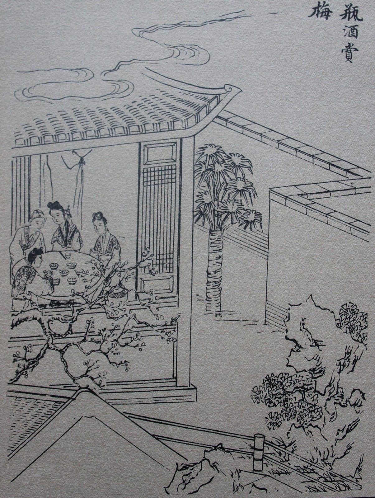

# 《金瓶梅》

图：《金瓶梅》插图中的一个庭院宴饮场景；画面不是色情场景，也不代表小说全貌，更不是现代书封。图片：Unknown, 17. century painter from Suzhou (?), China，Public domain，via Wikimedia Commons（[原图页面](https://commons.wikimedia.org/wiki/File:Jin_Ping_Mei-4.jpg)）。

> **先给结论**
> **一句话：** 这页判断《金瓶梅》：一部世情小说里的酒桌、商路与明代生活值不值得读，以及它的问题意识。
>
> - **适合谁：** 想把《金瓶梅》：一部世情小说里的酒桌、商路与明代生活放回酒文化史里理解、并判断值不值得读的人。
> - **不适合谁：** 只想找一句摘要、不准备读原书的人。
> - **先看这两点：**
>   - 《金瓶梅》是中国明代的长篇世情小说，署名“兰陵笑笑生”，作者真实身份至今没有定论。
>   - 作者“兰陵笑笑生”是笔名，学界对其身份有几十种推测，但没有一种得到公认。

## 书目与版本

《金瓶梅》是中国明代的长篇世情小说，署名“兰陵笑笑生”，作者真实身份至今没有定论。全书一百回，故事以西门庆、潘金莲、李瓶儿、庞春梅为中心，写一个商人家庭的兴衰、妻妾争斗、官商往来和城市消费。现存早期版本主要有两个系统：一是《金瓶梅词话》，保留较多说唱痕迹和方言；二是《绣像金瓶梅》，经过文人整理，附有插图。两者在回目、文字和细节上有差异，引用时应注明版本。

这本书长期被贴上“淫书”标签，但它的内容远不止情色。饮食、服饰、建筑、医药、法律、商业、交通、戏曲和酒桌礼仪，构成了一个密度极高的明代生活世界。就酒史而言，它提供了大量“酒如何被买、被送、被摆上桌、被喝掉”的细节：什么场合用什么酒，酒器如何搭配，下酒菜如何安排，酒在人际关系中承担什么功能。这些细节不能直接当史料，但可以和方志、笔记、菜谱、版画互相印证。

## 作者与成书

作者“兰陵笑笑生”是笔名，学界对其身份有几十种推测，但没有一种得到公认。成书时间通常放在明万历年间，现存最早的《金瓶梅词话》刊本带有万历丁巳（1617）序，但小说的写作和流传可能更早。书的开头借《水浒传》武松杀嫂的故事，随后转入西门庆的家庭和商业世界；这种“借壳”写法说明它和当时的小说、戏曲、说唱市场有密切关系。

作者的教育程度和地域背景，也能从文本内部看出来。书中大量使用山东方言、运河商业城市的物价、官场规则、医药知识和饮食细节；同时又有文人的诗词、戏曲和典故。无论作者是谁，他显然熟悉城市商人的生活，也熟悉明代的出版和娱乐市场。这个“匿名作者”不只是一个版本学问题，也影响我们如何读这本书：它不是一个作家的“个人忏悔”，而是一个时代的多声部记录。

## 酒在书中的位置

酒在《金瓶梅》里几乎无处不在，但很少是“单纯的饮品”。它至少承担四种功能。第一，社交：朋友来访、妻妾聚会、官场应酬、节庆祭祀，都要摆酒；酒桌的座次、酒器、菜肴和敬酒顺序，显示家庭内部的等级和亲疏。第二，交易：酒是礼物、贿赂、抵债和人情往来的一部分；一坛酒可以换来信息、庇护或生意机会。第三，欲望：酒与色常常并置，醉酒成为越界、试探和暴力的催化剂；但书中的“醉”并不总是浪漫，它经常带来失控、争吵和后果。第四，叙事：酒桌是信息交换和冲突爆发的场所，很多情节在宴席上推进，人物的性格也在敬酒、劝酒、拒酒中暴露。

书里出现的酒名很多，最突出的是金华酒。研究指出，“金华酒”是《金瓶梅》中出现次数最多的酒名之一，常被用来送礼、待客和日常饮用；此外还有烧酒、葡萄酒、荷花酒、木樨荷花酒等。不同酒名的使用，不只反映口味，也反映身份、季节和场合。比如，烧酒度数较高，常与寒夜、药补或特定人物联系在一起；金华酒则更像一种“体面的日常酒”，在宴席和人情往来中反复出现。

## 关键场景与人物

西门庆家的宴席，是观察明代城市饮食的最佳窗口。书中写一顿饭，不只列菜名，还写桌子如何摆、杯盏如何配、谁坐哪里、谁先举杯、谁被冷落。酒器有金杯、银杯、瓷杯、犀角杯等，材质和形制与人物身份相关；下酒菜从干果、蜜饯、鲜果到烧鸭、蹄子、鲥鱼，既有北方市井的厚重，也有运河商人带来的南方物产。读者从中看到的，不只是一个家庭的吃喝，而是一条从产地到餐桌的商业链。

潘金莲、李瓶儿、庞春梅三人的酒事，也各有意味。潘金莲常以酒试探、挑逗和挑衅；李瓶儿的酒事更多与生育、疾病和家庭地位相关；庞春梅则在后来的章节里从婢女变成有权势的女性，酒桌的位置变化暗示她的身份变化。这里的“later”是英文，应改为“后来”。酒不是人物性格的标签，而是关系的温度计：谁有资格坐上位，谁被劝酒，谁被罚酒，谁借醉离开，都能读出权力。

插图也是理解酒事的材料。明代或清初的《金瓶梅》插图常把宴饮、花园、床帏和街市并置，画面中的桌、椅、酒壶、杯盏、屏风和花木，能补充文字没有写出的空间关系。使用这些插图时要注意：它们是后人绘制或刊刻的版本，不是小说现场的摄影；画面有道德劝诫和商业出版的意图，不能直接当“明代生活照片”。

## 史料价值与局限

作为史料，它的价值在“密度”和“层次”。正史写制度，笔记写轶事，小说则能写出制度如何在日常生活里被执行、扭曲和利用。书中的酒桌礼仪、酒器使用、酒价与物价、宴席规模、下酒菜组合，能帮助研究者理解明代的消费文化、家庭结构和官商关系。它也能和《清明上河图》这样的图像、运河城市的方志、明代菜谱和酒类文献互相印证。

局限同样明显。第一，它是小说，不是实录；人物和情节有虚构、夸张和讽刺，不能把每一句话当成历史事实。第二，作者和成书年代没有定论，文本又有版本差异；引用时要说明依据哪个版本。第三，书中的酒名有地域性和时代性，同名酒在不同产区的工艺可能不同，不能直接对应今天的产品。第四，小说的情色内容较多，节选和传播时要考虑读者年龄与场景；以酒史、饮食史为切入点，可以避免把整本书简化为情色。第五，书里的宴席有叙事功能，菜单可能被作者根据人物和情节的需要而调整，不一定是一桌真实存在的菜。

## 常见误读

最常见的误读是把《金瓶梅》只当“色情小说”。情色是它的一部分，但它的历史价值更在日常生活、商业网络、语言和人物关系。第二个误读是把书里的酒名直接当成“明代名酒排行榜”；酒名在小说里有叙事和身份功能，不一定是当时市场的完整名单。第三个误读是把“金华酒”当成今天的金华火腿或某种现代黄酒；它是一个历史酒名，具体工艺和产区需要另外考证。第四个误读是把宴席菜单当成“明代标准菜谱”；小说中的饮食有夸张、铺陈和人物塑造的需要。第五个误读是把插图当成“明代照片”；插图是版本的一部分，有绘画传统和出版意图，不能直接当纪实。

相关条目：[黄酒](ref:yellow-wine)。

## 另见

- [中国酒史纲：从谷物发酵到国家名酒](ref:chinese-wine)：把小说中的酒名放回中国酒史脉络。
- [黄酒](ref:yellow-wine)：理解金华酒、老酒等谷物酒的基本类型。
- [明代烧酒：从药用到北方日常](ref:ming-shaoju)：烧酒在明代的位置。
- [《清明上河图》：汴京酒肆与城市节奏](ref:qingming)：图像中的城市酒业。
- [酒馆史：从酒肆、客栈到酒吧](ref:taverns)：酒馆空间与饮食文化。

对照阅读：[中国酒史纲：从谷物发酵到国家名酒](ref:chinese-wine)、[明代烧酒：从药用到北方日常](ref:ming-shaoju)。

**关键事实。**

| 项目 | 内容 |
| --- | --- |
| 一句话定位 | 《金瓶梅》是明代署名“兰陵笑笑生”的世情长篇小说，以西门庆一家的兴衰写商业、家庭、欲望与城市生活；酒在书中既是宴饮的日常，也是交易、诱惑和权力的道具 |
| 作者 | 兰陵笑笑生 |
| 成书/版本 | 明代万历年间成书；现存早期版本有《金瓶梅词话》与《绣像金瓶梅》 |
