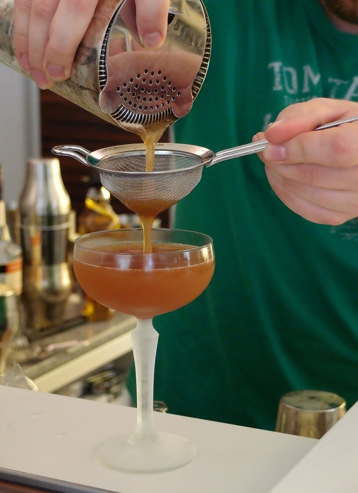

# 《调酒之乐》

图：调酒师用滤网双重过滤一杯鸡尾酒；《The Joy of Mixology》讲的是这类操作背后的结构与比例，此图不是该书封面。图片：SKopp，CC BY 4.0，via Wikimedia Commons（[原图页面](https://commons.wikimedia.org/wiki/File:Double_straining_a_cocktail.jpg)）。

## 书目与版本

《The Joy of Mixology》初版于 2003 年，由 Clarkson Potter 出版；2018 年 8 月 28 日推出“Revised and Updated Edition”，仍由 Clarkson Potter 出版，352 页。出版方把 2018 年版描述为“15 周年修订版”：保留 2003 年版的分类框架，重写配方部分，增加 2000 年以后鸡尾酒复兴的新材料，并修正初版中的一些比例和名称。

书名中的“Joy”既是“乐趣”，也指作者加里·里根本人的绰号“Gaz”。中文世界有时把它译成“调酒之乐”，有时直接叫“鸡尾酒的乐趣”；目前没有一个被广泛采用的正式中文版书名。引用时应以英文原名为准，并注明 2003 年或 2018 年版，因为两版的配方数量和部分分类并不相同。

## 作者与成书背景

加里·里根（1951—2019）是英裔美国调酒师、作家，长期在纽约酒吧工作，后来以写作和教学为主。他在鸡尾酒复兴的早期就强调“调酒师应该理解配方为什么这样组合，而不是只会背配方”，这本书就是这一理念的集中表达。里根还创办了面向调酒师的年刊和“101 Best New Cocktails”评选，活跃于行业教育、比赛评审和鸡尾酒写作。

这本书成书的 2003 年，正处在手工鸡尾酒运动从纽约、伦敦向更多城市扩散的阶段。酒吧开始重新重视新鲜果汁、冰块、苦精和古典配方，但大量培训仍依赖“记住这杯酒用多少毫升”的方式。里根想把调酒从“配方记忆”变成“结构理解”：只要知道一杯酒属于哪个家族、各成分承担什么角色，就能在原料变化时做出调整。

## 内容结构

全书可以分成四块。第一块是工具、原料和基本技法：摇酒壶、搅拌杯、滤冰器、量酒器、冰块、糖浆、苦精、柑橘汁的处理。第二块是“鸡尾酒家族”分类：把饮品按结构归入 old-fashioned、martini、sour、daisy、fizz、flip、punch 等家族，并解释每个家族的基酒、甜味、酸味、稀释和装饰逻辑。第三块是配方：在家族框架下给出大量经典酒和变体，配方只是家族原则的实例。第四块是行业与创作：如何设计新酒、如何平衡、如何写菜单、如何训练味觉。

这套分类不是学术植物学式的严格分类，而是工作记忆工具。比如一杯“sour”可以是用威士忌、金酒、朗姆或龙舌兰做的，也可以是加蛋清、加果泥或加香草的变体；它们共享“基酒 + 酸 + 甜 + 稀释”的骨架，但具体比例和质感不同。里根用“家族树”把这些关系画出来，让调酒师在看到一个新配方时，能迅速判断它属于哪一支、缺了什么、可以怎样改。

## 核心论点与影响

核心论点是：配方是结果，结构才是知识。掌握家族和比例，调酒师就能从“背一百杯酒”转向“理解一百杯酒为什么成立”。这个观点降低了创作的门槛，也提高了对平衡的要求：一杯酒好不好，不在于它是否严格符合某个配方，而在于酸、甜、苦、酒精、稀释和香气是否形成可辨识的结构。

这本书的影响主要体现在培训和创作两个层面。培训上，它把“家族分类”变成许多酒吧和调酒课程的教学工具，让初学者先学结构、再学配方。创作上，它鼓励调酒师在家族框架内做变量控制：换基酒、换甜味、换苦精、换酸度，而不是凭直觉把原料混在一起。书中的“比例”不是固定公式，而是一组起点；真正的工作是依据原料强度、冰块大小和客人偏好做微调。

从鸡尾酒写作史看，里根代表了一种介于“配方书”和“技法书”之间的写法：它不追求历史考证的深度，也不只是罗列酒单，而是把酒吧的隐性知识写成可教的结构。这种写法后来被大量鸡尾酒教材借鉴，成为现代调酒教育的基础语汇之一。

## 史料价值与局限

这本书的史料价值不在于“记录了多少历史配方”，而在于“记录了一个职业调酒师在 2000 年代如何理解配方”。它可以帮助研究者看到手工鸡尾酒运动早期的教学焦虑：当配方数量爆炸、原料越来越复杂时，行业如何建立一套可复述的知识体系。书里的工具清单、操作顺序、菜单语言和培训建议，也是酒吧文化史的一手材料。

局限主要有五点。第一，家族分类是工作模型，不是科学分类；不同家族之间存在重叠，某些酒很难被归入单一类别。第二，比例是起点，不是万能公式；同一比例在不同基酒、不同糖浆和不同冰块下会得到完全不同的结果。第三，书的视角以美国酒吧为主，对亚洲、拉丁美洲和欧洲其他地区的调酒传统覆盖有限。第四，2018 年修订版重写了配方，引用旧版配方时要注明版本。第五，里根的写作风格轻松、口语化，有些判断来自个人经验而非系统实验，读者不应把每一句话当成定论。

## 常见误读

最常见的误读是把“家族”当成官方分类。它是一套教学工具，不同作者、不同酒吧会有不同分法；理解结构比记住分类名称更重要。第二个误读是把“比例”当成固定配方；比例只说明各成分的相对关系，实际调酒还要看原料强度、温度、冰块和杯型。第三个误读是把这本书当成“配方大全”；它的重点不是配方数量，而是配方背后的结构。第四个误读是把 2018 年版当成 2003 年版的简单增补；修订版对配方部分做了较大重写，引用时要区分。第五个误读是把“调酒之乐”理解成“随便玩”；里根强调的“乐”是建立在反复练习、准确测量和理解平衡之上的自由。

相关条目：[调酒，是另一种认识酒的方式](ref:cocktail-basics)。

## 另见

- [加里·里根](ref:regan)：人物页补充他的酒吧经历、写作与行业教育。
- [调酒，是另一种认识酒的方式](ref:cocktail-basics)：从工具、比例和平衡进入调酒实践。
- [摇酒壶](ref:shaker)：理解摇酒、稀释与冰量的关系。
- [干马天尼](ref:martini)：书中“martini 家族”的代表酒。
- [威士忌酸](ref:sour)：理解“sour 家族”的酸、甜与蛋清结构。

对照阅读：[加里·里根](ref:regan)、[摇酒壶](ref:shaker)。

**关键事实。**

| 项目 | 内容 |
| --- | --- |
| 一句话定位 | 加里·里根 2003 年首版、2018 年修订的《The Joy of Mixology》，以“鸡尾酒家族”和比例系统帮助调酒师理解配方结构，而不是死记硬背；本文梳理其版本、作者、方法、影响、局限与常见误读 |
| 作者 | 加里·里根 |
| 成书/版本 | 2003 年 Clarkson Potter 首版；2018 年 Clarkson Potter 修订版 |
