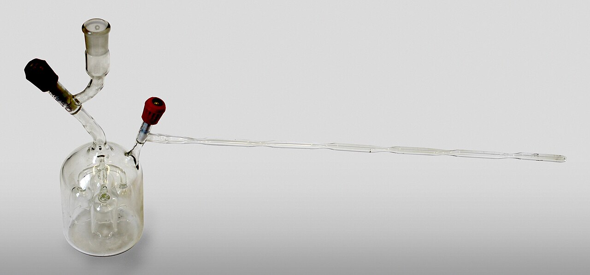

# 《Proof：酒的科学》

图：实验室中的蒸馏烧瓶；《Proof》讨论发酵、蒸馏与感官的科学，此图不是该书封面。图片：UCL Mathematical and Physical Sciences from London, UK，CC BY 2.0，via Wikimedia Commons（[原图页面](https://commons.wikimedia.org/wiki/File:Distillation_flask_(21380108976).jpg)）。

## 书目与版本

《Proof: The Science of Booze》于 2014 年由 Houghton Mifflin Harcourt 在纽约出版，272 页。出版方与书评资料把它描述为一本“关于酒的制造与消费的科学”的通俗作品：从酵母发酵、蒸馏、橡木桶熟成，到嗅觉、味觉、酒精代谢和宿醉。它获得 IACP 饮食写作奖的“葡萄酒、烈酒与啤酒”类奖项，并进入 PEN/E. O. Wilson 科学写作奖决选；平装版后来由 Houghton Mifflin Harcourt/Harvest 推出。

书名中的“Proof”有双重含义：一是酒精度数的旧称，二是“证据”。这本书的写法更接近“证据之旅”：作者访问酒厂、实验室、品鉴室和神经科学研究所，把研究者的实验、行业的经验和历史材料放在一起。它不是一本调酒配方书，也不是一本“如何酿酒”的操作手册；它回答的是“为什么这杯酒会这样”。

## 作者与成书背景

亚当·罗杰斯是美国科学记者，长期在《Wired》工作，担任资深记者/编辑。他的写作背景不是酿造学或化学，而是科学新闻：擅长把实验、数据和研究者访谈转写成可读的故事。这种背景决定了《Proof》的写法：它不追求覆盖所有酒类，而是选取能说明科学原理的案例——酵母为什么会产酒精、蒸馏如何分离风味、橡木桶如何改变酒、鼻子和大脑如何构建“香气”。

这本书成书的 2010 年代，正是“手工酒”与“科学饮食”同时兴起的时期。一方面，精酿啤酒、单一麦芽、手工金酒和精品葡萄酒强调工艺与产地；另一方面，消费者开始关心“为什么这杯酒好喝”“宿醉是怎么回事”“添加剂有没有害”。罗杰斯试图在两者之间搭桥：用科学解释工艺，但不把酒变成冷冰冰的参数。

## 内容结构

全书按“从原料到身体”的顺序展开。开头是发酵：酵母如何把糖转化成酒精和二氧化碳，为什么不同菌株会带来不同风味，温度、pH、营养和氧气如何影响结果。接着是蒸馏：壶式蒸馏和塔式蒸馏的区别，酒头、酒心、酒尾的切割，风味物质如何随沸点变化。然后是熟成：橡木桶的烘烤程度、木材来源、桶的重复使用、仓库温湿度和“天使分享”如何改变酒。再往后是感官：鼻子如何工作，香气如何被大脑解释，为什么同一杯酒在不同人嘴里不一样。最后是身体：酒精如何被代谢，宿醉的机制，以及“适量饮酒”的争议。

这种结构让书可以被当作“酒的 science 入门”来读，但它不是线性的教科书。每一章都有历史插曲和人物故事：19 世纪的蒸馏器、禁酒令时期的工业酒精、现代实验室的气相色谱、酒厂里的品鉴小组。这些故事不是装饰，而是说明科学知识如何在行业中生成和使用。

## 核心论点与影响

核心论点是：酒是“生物技术 + 化学 + 感官心理学”的复合对象。发酵是微生物的工作，蒸馏是物理化学的分离，熟成是木材、空气和时间的交互，品鉴是大脑对信号的解释，醉与宿醉是生理过程。把其中任何一层抽掉，都无法解释一杯酒为什么呈现某种味道、为什么让人愉悦、又为什么让人难受。

第二个论点是“科学不消灭神秘，而是重写神秘”。罗杰斯并不试图用分子式取代品鉴的乐趣；他更关心“当我们说这杯酒有香草味时，实际上发生了什么”。这种写法让科学成为品鉴的工具，而不是品鉴的敌人。它也提醒读者：感官是主观的，但主观感受仍然可以被实验、比较和语言训练。

这本书的影响主要在“科普”和“行业对话”两个层面。它让普通读者理解发酵、蒸馏和熟成的基本原理，也让酒厂、调酒师和记者有一个共同语言去讨论“风味”。它获得 IACP 奖和 PEN/E. O. Wilson 决选，说明饮食写作与科学写作的边界正在变得模糊。

## 史料价值与局限

作为科普书，它的价值在于“把科学问题问清楚”。它不回避争议：宿醉的机制没有单一答案，适量饮酒的健康效应在流行病学中仍有争论，感官品鉴的可靠性受环境影响。它也提醒读者，很多行业说法（比如“陈年一定更好”“蒸馏次数越多越纯”）需要回到具体条件判断。

局限有四点。第一，它是通俗科学，不是研究综述；书里的实验和结论会被后续研究修正，读者不能把 2014 年的表述当成最新共识。第二，它覆盖的范围以欧美酒类为主，对亚洲的米酒、黄酒、烧酒和白酒着墨较少。第三，它不提供配方、工艺参数或设备清单，想学酿酒的人会觉得“不够用”。第四，作者大量使用访谈和场景，有些结论依赖单一研究或行业经验，读者应保留怀疑。

## 常见误读

最常见的误读是把《Proof》当成“酿酒教材”。它解释原理，但不教你如何操作蒸馏器、如何控制发酵温度、如何设计配方。第二个误读是把“科学解释”当成“唯一正确答案”；酒的感官体验有文化、记忆和情绪的成分，不能完全还原为化学。第三个误读是把书里的“宿醉机制”当成“解酒指南”；理解机制不等于找到万能解药，补水、休息和时间仍是基础。第四个误读是把“适量饮酒有益”当成普遍结论；流行病学证据复杂，个体风险差异很大，不能把一本书当成医疗建议。第五个误读是把“手工”当成“科学”；手工工艺有价值，但也需要卫生、温控和质量检测，不能只靠“自然”二字。

相关条目：[蒸馏](ref:distillation)。

## 另见

- [发酵](ref:fermentation)：从酵母、糖和温度理解酒的第一道工序。
- [蒸馏](ref:distillation)：从沸点、切割和蒸馏器理解烈酒。
- [威士忌](ref:whisky)：把书里的熟成与感官知识放到具体酒类。
- [第一口，先别急着下结论](ref:first-tasting)：把感官科学变成品鉴练习。
- [香气（aroma）](ref:aroma)：理解“闻到的”和“尝到的”为什么不是一回事。

对照阅读：[发酵](ref:fermentation)、[威士忌](ref:whisky)。

**关键事实。**

| 项目 | 内容 |
| --- | --- |
| 一句话定位 | 亚当·罗杰斯 2014 年出版的《Proof: The Science of Booze》，以发酵、蒸馏、熟成、感官和宿醉为线索，解释酒精的科学；本文按发酵、蒸馏、熟成与感官四章拆解书中的科学论证 |
| 作者 | 亚当·罗杰斯 |
| 成书/版本 | 2014 年 Houghton Mifflin Harcourt 首版 |
