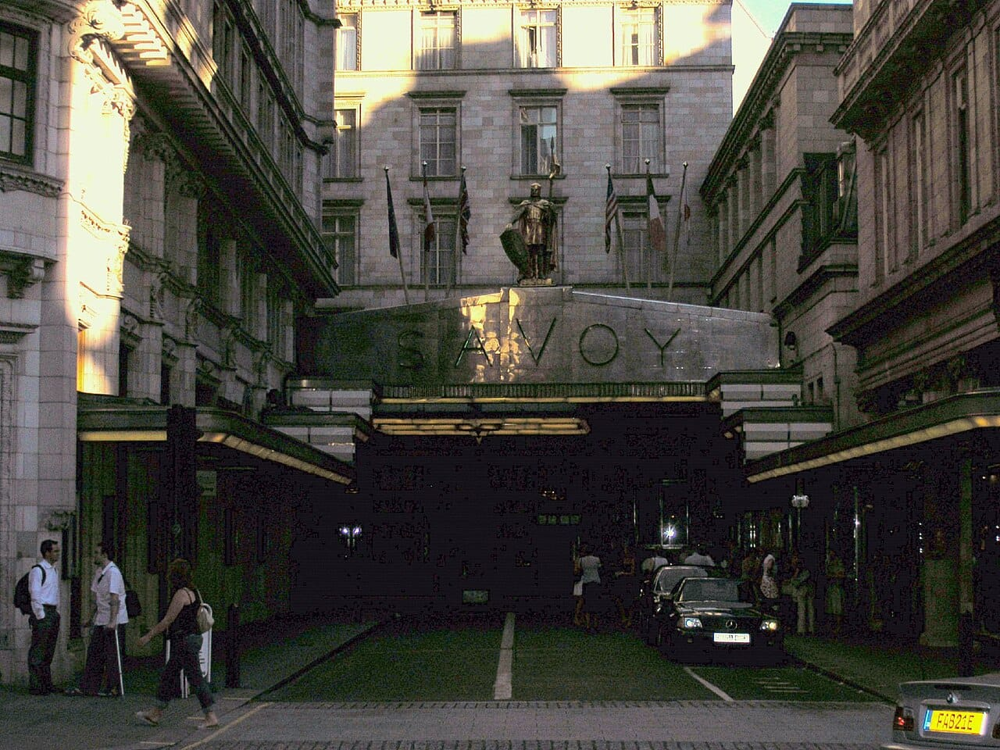

# 《萨伏伊鸡尾酒书》

图：伦敦萨伏伊酒店正门；美国酒吧位于酒店内，克拉多克在此编成《萨伏伊鸡尾酒书》。此图不是该书封面。图片：gailf548 from New York State, USA，CC BY 2.0，via Wikimedia Commons（[原图页面](https://commons.wikimedia.org/wiki/File:Savoy_Hotel_02.jpg)）。

## 书目与版本

《萨伏伊鸡尾酒书》（The Savoy Cocktail Book）于 1930 年由伦敦 Constable 出版，署名编者为萨伏伊酒店美国酒吧的首席调酒师哈里·克拉多克，插图由吉尔伯特·伦博尔德绘制。出版方页面给出的数字是 750 个配方，并把这本书记述为“当时点燃伦敦的鸡尾酒”的实录。2014 年，Constable/Hachette 推出复刻版，增加了一篇新导言和若干萨伏伊当代配方；市面上常见的“750 配方”说法，主要来自这一出版传统，而不是后来某个精确的版本学统计。

需要先区分三个对象：1930 年的首版、2014 年的复刻版，以及各种以“Savoy”为名的后期选编本。首版是黑底、装饰艺术风格封面的小开本，内页按饮品类型编排；复刻版保留了大量原版版式和插图，但新增内容不属于 1930 年的文本。引用时最好写明“1930 年版”或“2014 年复刻版”，不要把复刻版的新导言当作克拉多克本人的原话。

## 作者与成书背景

克拉多克生于 1876 年，早年在纽约的酒吧工作，熟悉美国禁酒令之前和禁酒令时期的调酒实践。1920 年代他回到伦敦，随后进入萨伏伊酒店美国酒吧，长期担任首席调酒师。萨伏伊的美国酒吧是伦敦少数能持续提供美式鸡尾酒、并吸引演艺界和上流社会客人的场所；在纽约酒吧因禁酒令而转入地下或改行的时候，伦敦反而成了保存美国鸡尾酒技艺的一个重要节点。

《萨伏伊鸡尾酒书》不是克拉多克个人的理论著作，而更像一本“酒吧账本”：把酒吧日常供应、客人点单、同行交流中形成的配方整理成册。它的成书处在鸡尾酒史上一个特殊时刻：美国正在禁酒，欧洲的酒吧仍在营业；美式鸡尾酒的名字、比例和装饰手法，正通过伦敦、巴黎这样的城市被重新整理和传播。克拉多克在书前的短序里谈鸡尾酒的功能和酒吧的礼节，语气轻松，不是学院式的历史论证。

## 内容结构

全书的主体是配方，按饮品类型分成 Slings、Smashes、Fizzes、Flips、Punches、Cocktails 等大类，再按名称排列。每条配方通常给出基酒、辅料、装饰和比例，使用“dash”“pony”“glass”等酒吧惯用单位，而不是毫升。书前有短序和少量说明，书后没有现代意义上的技法教程、设备清单或系统索引；它假设读者已经知道如何摇酒、如何搅酒、如何准备冰块。

这种编排方式透露了它的使用场景：酒吧师傅翻书找配方，而不是初学者从头读到尾。书里既有当时流行的经典，也有明显的酒吧内部变体。今天经常被引用的 Corpse Reviver #2、Hanky Panky、White Lady 等，都能在萨伏伊的配方传统中找到位置；但“书里出现”不等于“克拉多克发明”，更不等于“萨伏伊首创”。同一个名字在不同版本、不同酒吧之间常有比例差异，这正是鸡尾酒书写的特点。

插图是这本书不可忽略的部分。伦博尔德的装饰艺术插图把酒吧、酒具、人物和异域想象并置，制造出一种介于菜单、旅行手册和广告之间的视觉语言。它让这本书不只是一本配方汇编，也成为 1930 年代伦敦酒吧文化的视觉档案。今天读这些插图，要注意它们是商业出版物的一部分，不是对酒吧现场的纪实摄影。

## 核心论点与影响

这本书没有一个用章节论证的“论点”，它的主张藏在编排里：鸡尾酒是一套可以分类、命名、复述和迁移的技术体系。只要掌握基酒、甜味、酸味、稀释和装饰之间的关系，就能在不同城市、不同原料条件下复现一杯酒。这个看法后来成为现代调酒教育的基础，但在 1930 年，它更多是酒吧师傅的实践共识，而不是写在纸上的理论。

它的影响主要通过“引用”发生。后来的鸡尾酒史作者、酒吧菜单、调酒比赛和培训课程，不断回到萨伏伊的配方，把某些比例当成经典基准。Corpse Reviver #2 的 equal parts 结构、Hanky Panky 的 bitter 收尾、White Lady 的干金与柠檬组合，都因为被反复引用而获得“标准”地位。萨伏伊酒店的品牌也为这本书提供了信任背书：它不只是一本匿名配方册，而是一家真实酒吧的工作记录。

从文化史角度看，这本书还保存了禁酒令时期的一个悖论：美国以法律禁止酒精，美国的鸡尾酒文化却在伦敦被整理、商品化并输出回英语世界。它不是禁酒令史，却是理解“禁令如何改变供给、却不消灭需求”的一个具体物证。

## 史料价值与局限

作为史料，它的价值在于“当时的人如何调、如何命名、如何定价和如何招待客人”。配方中的基酒类型、苦精品牌、酒杯形状、装饰物，能帮助研究者判断 1920—1930 年代伦敦酒吧的物料网络。它也能和菜单、酒店档案、回忆录互相印证，而不是单独作为“鸡尾酒起源”的证据。

局限同样明显。第一，配方不是实验室记录：同一杯酒在不同版本里的比例可能不同，冰的大小、摇酒时间、杯温都没有标准化。第二，原料已经变化：今天的干金、味美思、苦精和 1930 年代的酒精度、糖分、草本配方并不完全对应，照搬比例未必能得到同样的味道。第三，署名与发明权含混：克拉多克是编者，酒吧是集体工作场所，很多配方的真正作者无法确认。第四，书里的部分做法在今天看来有食品安全或过量酒精的风险，不能当作现代操作规范。第五，它的地理覆盖很窄，主要是伦敦萨伏伊酒吧的视角，不能代表整个欧洲或全球鸡尾酒史。

## 常见误读

最常见的误读是把“萨伏伊”当成“所有经典鸡尾酒的发明地”。实际上，萨伏伊是一个高度可见的传播节点，很多配方来自美国、法国和同行酒吧，书的作用是整理和保存，而不是全部原创。第二个误读是把 750 个配方当成 750 种完全不同的酒；其中包含大量同名前身、地区变体和比例微调。第三个误读是把这本书当成现代调酒教材；它没有系统讲解摇酒、搅拌、冰量和平衡，读者需要另外的技法训练。第四个误读是把 2014 年复刻版的新导言和新增配方当成 1930 年原文；引用时要把版本说清楚。第五个误读是把书中的插图当成历史照片；它们是商业插图，适合读视觉风格，不适合当现场记录。

相关条目：[哈里·克拉多克](ref:craddock)、[萨沃伊美式酒吧](ref:savoy-bar)、[调酒，是另一种认识酒的方式](ref:cocktail-basics)。

## 另见

- [哈里·克拉多克](ref:craddock)：人物页补充他的纽约经历、萨伏伊任期与“鸡尾酒之王”的称号。
- [萨伏伊美式酒吧](ref:savoy-bar)：酒吧空间与萨伏伊酒店的关系。
- [调酒，是另一种认识酒的方式](ref:cocktail-basics)：从工具、比例和平衡进入调酒实践。
- [美国禁酒令](ref:prohibition)：理解这本书成书时美国与伦敦的制度反差。
- [还魂酒二号](ref:corpse-reviver)：书中被反复引用的经典配方之一。
