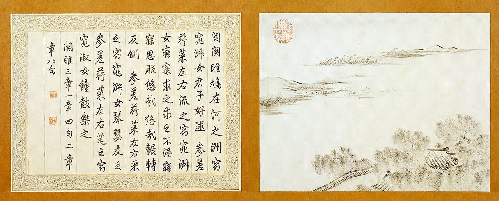

# 诗经

《诗经》是中国现存最早的诗歌总集，通行本收诗 305 篇，另有 6 篇笙诗存目无辞。它不是某一位诗人的别集，而是从西周初年到春秋中叶逐渐汇集、编订的乐歌文本。酒在这部书里不是主角，却反复出现在祭祀、宴饮、送别与农事之间。把这些出现放回礼制与节令，才能读出它们的分量；若只挑一句“酒”字当作豪饮的证据，反而会看窄了这部书。

图：诗经。图片：Wikimedia Commons contributor，Public domain，via Wikimedia Commons（[原图页面](https://commons.wikimedia.org/wiki/File:Shi_Jing.jpg)）。

## 一部怎样的诗集

今本《诗经》分为风、雅、颂三部分。风多属各诸侯国的民间与宫廷歌谣，雅分小雅、大雅，颂则是宗庙祭祀所用的乐歌。这个三分结构不是简单的题材分类，也与演唱场合、使用者身份有关。同一首诗在典礼中唱，和在席间唱，意味并不相同。

关于编订，传统有“孔子删诗”之说，但现代学界多认为《诗经》是长期采集、整理与编订的结果，孔子可能做过整理或用于教学，未必是唯一的删定者。汉代传诗有齐、鲁、韩、毛四家，前三家后来散佚，今本属毛诗系统，所以常称“毛诗”。理解这一点，就不会把今天读到的 305 篇当成一个瞬间完成的定本。

《诗经》的句子短，复沓多，许多篇以重复的章法推进情绪。酒句往往嵌在这样的复沓里：同一场景反复出现，每次只换几个字，情绪就往前走一层。读的时候要留意这种结构，而不是只摘出带“酒”的那一行。

## 酒在《诗经》里的位置

《诗经》中的酒，首先属于祭祀。《小雅·信南山》有“祭以清酒，从以骍牡”，清酒与牲体并置，说明酒是祭仪的一部分，而不是宴乐的附属品。祭祖、祭天、祈求丰年，都需要酒；酒在这里连接的是人与祖先、人与土地的关系。

其次是宴饮。《小雅·鹿鸣》说“我有旨酒，以燕乐嘉宾之心”，酒用来款待宾客、联络情谊。这类宴饮诗常与音乐、礼物、座次一起出现，酒是整套待客礼仪中的一环。它表达的是一种秩序里的亲近，不只是“喝得高兴”。

第三是乡饮酒礼一类场合。礼书所记的乡饮酒礼，把饮酒纳入长幼、宾主与敬让的次序；《诗经》本身不是礼书，但其中的宴饮篇章与这套礼制共享同一个生活世界。读酒句时若完全抽掉礼制，就容易把仪式性的饮酒误读成日常放纵。

## 《豳风·七月》与“春酒”

《豳风·七月》是《诗经》里农事色彩最浓的篇目之一，它按月份铺陈耕种、采集、纺织与祭祀。“十月获稻，为此春酒，以介眉寿”一句，把收稻、酿酒与祝寿连成一条线：十月收下稻谷，用来酿造春酒，再以酒祈祝老人长寿。

旧注把“春酒”解释为冬天酿造、春天饮用的酒，毛传有“春酒，冻醪也”的说法。这种解释未必等于今天每一种米酒的工艺，但它提示了一个基本事实：古代谷物酒的酿造与农时紧密相连，酒不是全年任意时间都能轻易得到的商品。收获之后才有余粮，有余粮才谈得上酿酒；酒因此带着收成的重量。

“以介眉寿”也值得留意。酒在这里不是消愁的工具，而是祝福的媒介。把酒献给长者，是把它当作可以共享的、带来康健的礼物。这一层意思，与后世诗里“借酒浇愁”的用法并不冲突，但需要分开来看。

## 酒器、酒礼与宴饮

《诗经》提到多种酒器，如金罍、兕觥、爵、尊、壶等。器物不只是容器，也标记场合与身份。兕觥常与较大的饮酒场面相关，金罍则见于《周南·卷耳》“我姑酌彼金罍”；这些名称在后世注疏里有不同解释，不能逐一对应到今天的杯型。

酒礼的核心是次序。谁先举杯、谁向谁敬、喝完如何回应，都有讲究。礼书里的献、酬、酢，大体是主人献酒、宾客回敬、主人再答的往复结构；《诗经》的宴饮诗虽然不逐条记录仪节，却常把这种往复写成节奏。读这些诗，可以注意“酌”“酬”“燕”这类动词，它们比“饮”更能说明酒在关系中的位置。

酒器与酒礼还提醒我们：先秦的酒多为谷物发酵酒，酒精度通常低于后世蒸馏酒。用今天的白酒经验去想象“金罍”“兕觥”里的内容，会把器物、容量与饮法一起错置。

## 酒与农事、节令

酒在《诗经》里经常和食物、收成、季节一起出现。这不是偶然，因为谷物酒依赖粮食，而粮食依赖农时。春天播种、秋天收获、冬天酿造、春天饮用，这条链条决定了酒在一年中的位置。

节令也影响酒的情感色彩。祭祀时的酒偏庄重，宴饮时的酒偏亲和，送别时的酒偏留恋。同一物质在不同场合承担不同功能，这正是《诗经》处理酒的方式：它很少孤立地赞美酒的味道，而是把酒放回具体的人事。

对今天的读者来说，这一层特别有用。它提醒我们，酒文化不是一串名酒与酒器清单，而是人与时间、土地、亲族、宾客之间的关系。理解了这层关系，再看后世的酒诗与酒俗，才不会只剩下“干杯”一个动作。

## 读《诗经》酒句的四个提醒

第一，先辨字义。诗中的“酒”“醴”“旨酒”“清酒”所指并不完全等同，有的偏指酒的质量，有的偏指酒的用途。只按今天的“酒”字去理解，容易漏掉限定。

第二，先看场合。祭祀、宴饮、饯行、农事，场合不同，酒的功能就不同。脱离篇旨谈酒，等于把仪式用语当成日常口语。

第三，注意版本与注释。今本属毛诗系统，毛传、郑笺、孔疏层层叠加；不同注本对同一句的解释可能有差异。引用时最好说明依据哪一种注本，不要把所有解释混成一句“古人说”。

第四，不要以今释古。先秦的谷物酒、酒器容量、饮法与今天差异很大；“斗酒”一类说法常是修辞，不是精确计量。把文学夸张换算成今天的瓶数，既不准确，也没有必要。

## 对后世酒文化的影响

《诗经》为后世提供的不只是酒句，更是一套把酒放进场景的语言。“春酒”后来成为诗文中常见的意象，指的不一定是一种固定酒类，而常常是节令、家宴与祝寿的组合。读[一杯酒里的时间](ref:time-in-a-cup)，可以看到这条意象线索怎样从《诗经》延伸到唐诗。

在工艺谱系上，先秦谷物酒与后世[黄酒](ref:yellow-wine)有相通之处，但不能直接画等号。原料、曲种、发酵与杀菌方式都在变化；把“春酒”说成今天的某一种黄酒，是过度简化。

在文学传统上，《诗经》的宴饮与送别为后世诗人提供了反复借用的场景。[李白](ref:li-bai)写送别、独酌与宴饮，虽然语言与篇幅都已不同，却仍在处理“酒把人与场合连起来”这件事。把《诗经》与唐诗对读，能看出酒在诗里怎样从礼制场景逐渐变成个人抒情。

相关条目：[黄酒](ref:yellow-wine)、[一杯酒里的时间](ref:time-in-a-cup)。

## 怎样继续读《诗经》

可以先从“风”读起，选篇幅短、复沓明显的篇目，感受酒句在整篇中的位置；再读“雅”中的宴饮诗，注意宾主关系；最后读“颂”，看祭祀语境里酒与牲体、乐舞如何并置。

准备两三种注本对照，遇到“春酒”“旨酒”“清酒”这类词，先看注释再下判断。若读译文，最好与原文对照，留意译者对酒器、酒礼的处理，因为那往往是理解差异最明显的地方。

读的时候不妨做一张小表：篇名、场合、酒的类型词、酒器、与酒同时出现的其他事物。表做完，酒在《诗经》里的分布就会清楚，也更容易发现哪些是礼制，哪些是文学修辞。

## 延伸阅读

- [一杯酒里的时间](ref:time-in-a-cup)：从《诗经》的春酒到唐诗里的金樽，酒如何进入节令与写作。
- [黄酒](ref:yellow-wine)：谷物发酵酒的工艺谱系，以及它与古代谷物酒的距离。
- [李白](ref:li-bai)：唐诗中的酒如何从礼制场景转向个人抒情。
