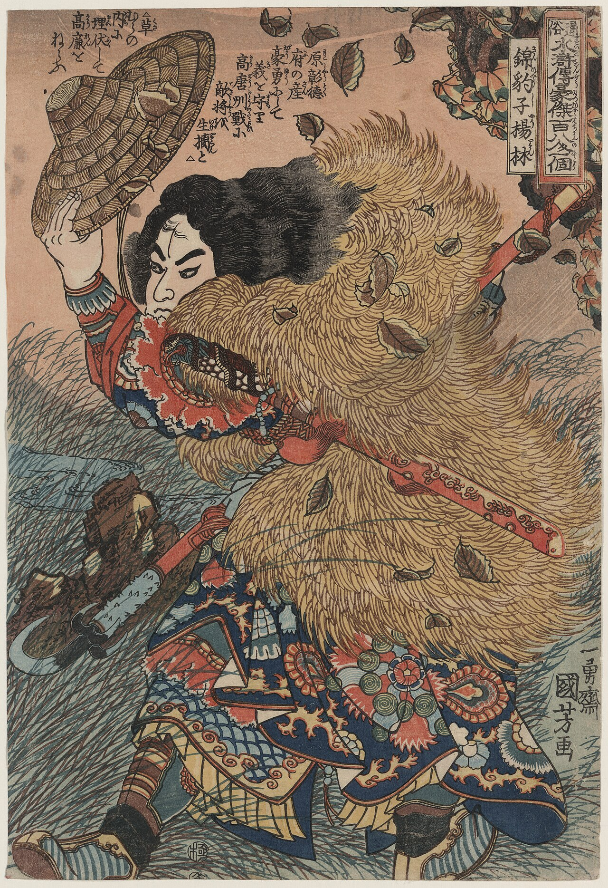

# 《水浒传》

图：歌川国芳《水浒》系列版画中的一位好汉；它不是《水浒传》正文插图，也不是现代书封。图片：Utagawa Kuniyoshi，Public domain，via Wikimedia Commons（[原图页面](https://commons.wikimedia.org/wiki/File:Suikoden.jpg)）。

## 书目与版本

《水浒传》是中国明代的长篇章回小说，通常署名施耐庵，也有“施耐庵、罗贯中合著”的说法。常见版本有一百回本、一百二十回本和七十回本；不同版本在招安、征方腊、梁山排座次等情节上存在差异。英译本有赛珍珠的《All Men Are Brothers》、沙博理的《Outlaws of the Marsh》等，书名和回目处理各不相同。引用时最好注明版本，否则“水浒”两个字会掩盖很多文本差异。

小说的故事背景设在北宋末年，写宋江等一百零八位好汉从各处被逼上梁山、聚义、受招安、征方腊的过程。它不是一个朝代的实录，而是长期积累的说书、戏曲和文人整理的产物。酒在书里出现的频率极高，几乎每一回都有饮酒场景；但酒不是背景道具，而是推动情节、显示身份、测试人心和制造反转的“机关”。

## 作者与成书

施耐庵的生平材料很少，学界对“施耐庵”是否就是最终写定者、他与罗贯中的关系、成书年代，都有争议。比较稳妥的说法是：《水浒传》在元末明初逐渐成形，经过说书艺人和文人的反复加工，到明代出现多种刊本。它不是一次完成的“个人创作”，而是“集体叙事 + 文人写定”的产物。这个成书过程解释了书里的语言层次：有说书人的套语，有文人的诗词，有市井的粗话，也有官场的公文。

把《水浒传》当酒史材料，必须先承认它是小说。书里的“宋代”是明代人想象中的宋代，酒名、酒器、酒价和饮酒习惯，可能混入了明代的市场经验。它可以帮助我们理解“人们如何想象江湖的酒”，但不能单独证明宋代某地某酒的实际工艺。它需要和《宋史》、宋代笔记、酒课文献、考古酒器互相参照。

## 酒在书中的位置

酒在《水浒传》里至少承担五种功能。第一，结义：好汉见面、入伙、结拜，常以酒为礼；酒是“自己人”的标记。第二，壮胆：武松打虎、醉打蒋门神，酒被写成英雄气概的催化剂；但酒也带来失控和危险。第三，设局：智取生辰纲用蒙汗药下酒，酒成为欺骗和反抗的工具。第四，等级：梁山排座次、宴席座次、敬酒顺序，酒桌是权力结构的缩影。第五，转折：很多人物因为酒后失言、酒后杀人或酒后暴露身份，走上梁山。

书里的酒名也值得注意。“村酒”“老酒”“透瓶香”“出门倒”等，既有真实酒类的影子，也有说书人的夸张。“三碗不过冈”是景阳冈酒店的广告语，店家说自己的村酒“比老酒的滋味”更烈，三碗便醉，过不得山冈。武松偏要喝十八碗，这个数字是文学夸张，不是精确的饮酒量。研究者根据宋代酒的类型推测，这类村酒接近黄酒，酒精度可能在 10 度左右；但具体度数无法从小说中直接测定。

## 关键场景与人物

“三碗不过冈”是全书最著名的酒场景之一。它的叙事功能不是“证明武松能喝”，而是制造一个“被低估的英雄”：店家越是警告，武松越要挑战；三碗的限度被十八碗打破，英雄的胆量和酒量同时被建立。接下来的打虎，则把酒后的勇气转化为真实的搏斗。这里的酒是“入场券”：没有它，武松只是一个过路客人；有了它，他才进入“打虎英雄”的传说。

“醉打蒋门神”把酒的另一面写得更复杂。武松不是单纯醉酒闹事，而是用“醉”做伪装，一路喝酒、一路试探，最后在快活林打倒蒋门神。酒在这里是策略：它让对手低估他，也让读者看到“醉”可以被表演。武松说“带一分酒，便有一分本事；五分酒，五分本事”，这句话既是豪言，也是叙事技巧：作者用酒量来量化战斗力，把饮酒变成一种可计算的英雄资本。

“智取生辰纲”则把酒写成骗局的载体。晁盖、吴用等人冒充枣商，在黄泥冈与杨志一行相遇；他们先喝一桶酒表示无毒，再借“偷瓢”制造混乱，把蒙汗药下进另一桶。杨志谨慎，不肯让众人买酒，但最终还是在炎热、口渴和同伴的劝说下喝了。酒在这里不是义气的象征，而是权力博弈的工具：谁控制酒，谁就控制局面。这个场景也说明，书里的“酒”从来不只是好汉的豪饮，它可以是毒品、诱饵和武器。

## 史料价值与局限

作为文学文本，它的价值在于“保存了江湖的酒文化想象”。书里的酒店、酒旗、酒器、下酒菜、酒令、劝酒话术和酒后行为，能帮助读者理解明代人如何想象宋代的市井饮酒。它也能和《东京梦华录》《清明上河图》、宋代酒课文献互相印证：酒店的位置、酒旗的写法、脚店与正店的关系，在小说和史料中常有呼应。

局限有四点。第一，它是小说，情节和人物有虚构、夸张和类型化；不能把“十八碗”当成宋代人的平均酒量。第二，版本差异会影响细节；不同版本的回目、诗词和情节可能不同，引用时要注明。第三，酒精度和酒名无法从小说明确测定；“村酒接近黄酒、约 10 度”是研究者的推测，不是文本内的数据。第四，书的视角是江湖好汉，对女性、平民、官府的饮酒生活覆盖有限；它不能代表整个宋代社会。

## 常见误读

最常见的误读是把宋代的“白酒”当成今天的白酒。宋代文献中的“白酒”有时指清澈的米酒或黄酒，不是蒸馏烧酒；用今天的高度白酒去想象武松的酒量，会得出完全错误的结论。第二个误读是把“十八碗”换算成十八瓶现代啤酒或白酒；碗的容量、酒的度数和酒的饮用方式都不同，不能直接换算。第三个误读是把“三碗不过冈”当成真实酒店的经营规则；它是小说里的广告语和叙事装置。第四个误读是把《水浒传》当成宋代酒史的直接史料；它更多反映明代的想象和出版市场。第五个误读是把酒只当“兄弟情”的背景；书里的酒经常用于欺骗、暴力和权力运作，义气只是其中一面。

相关条目：[黄酒](ref:yellow-wine)、[宋代酒课：官务、民酿岁课与财政依赖](ref:song-tax)、[酒馆史：从酒肆、客栈到酒吧](ref:taverns)。

## 另见

- [黄酒](ref:yellow-wine)：理解“村酒”“老酒”可能对应的谷物酒类型。
- [宋代酒课：官务、民酿岁课与财政依赖](ref:song-tax)：宋代酒业制度背景。
- [酒馆史：从酒肆、客栈到酒吧](ref:taverns)：酒店、酒旗与江湖空间。
- [中国酒史纲：从谷物发酵到国家名酒](ref:chinese-wine)：把小说中的酒名放回长时段。
- [认识一座城，从一间酒馆开始](ref:pub-and-city)：把“酒店”“酒旗”放回城市空间。
