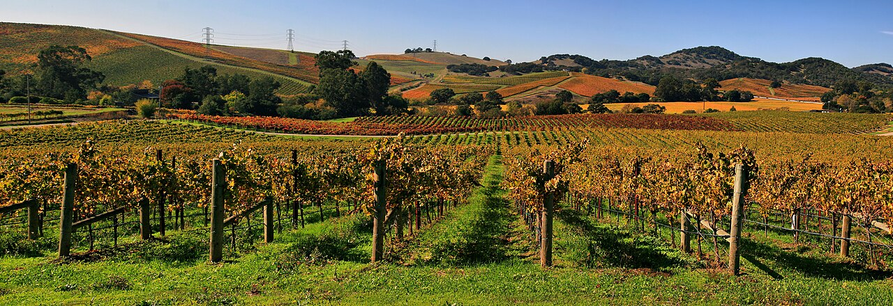

# 《葡萄酒圣经》

图：纳帕谷葡萄园秋景；《The Wine Bible》以产区与品种为经纬，此图不是该书封面。图片：Brocken Inaglory，CC BY-SA 3.0，via Wikimedia Commons（[原图页面](https://commons.wikimedia.org/wiki/File:Vineyards_in_Napa_Valley_7.jpg)）。

## 书目与版本

《The Wine Bible》由美国葡萄酒作家、教育者凯伦·麦克尼尔撰写，2001 年由 Workman Publishing 在纽约首版。出版方与作者官网都把这本书描述为美国最畅销的葡萄酒书之一，销量超过一百万册；首版从构思到出版用了约十年。2015 年推出第二版，2022 年推出第三版，第三版仍由 Workman 出版，并被美国葡萄酒教育者协会（Society of Wine Educators）列入 2024 年 CWE 推荐阅读书单。

三个版次的差别不只是“更新年份”。第二版增加了新的产区、品种和气候内容，第三版继续扩展，并重新调整了部分章节的编排。葡萄酒世界变化很快：气候变暖、产区法规、酒标术语、市场热点都在变，一本 2001 年的书不可能覆盖 2020 年代的全部现实。读者如果引用具体酒庄、年份或价格，必须回到最新版或出版方页面核对，不能把旧版当现况。

## 作者与成书背景

凯伦·麦克尼尔是美国葡萄酒写作与教育界的重要人物。她长期从事葡萄酒报道、教学和咨询，曾任 NBC《Today Show》的葡萄酒通讯员，主持过 PBS 系列节目《Wine, Food and Friends with Karen MacNeil》，并获得艾美奖。她还是美国烹饪学院（Culinary Institute of America）Rudd 葡萄酒研究中心的创建者之一，该中心常被称为葡萄酒教育界的“哈佛”。

《The Wine Bible》的写作动机，来自她在教学和媒体工作中反复遇到的一个问题：葡萄酒知识被拆成太多碎片——产区、品种、法规、品鉴、配餐、酒标——初学者很难把它们连成一张地图。她想写一本“既可以当课程读，也可以当工具书查”的书：从葡萄酒是什么、如何酿造、如何品鉴开始，再进入主要产区和品种，最后回到餐桌与储存。这个结构让它在出版后迅速成为葡萄酒课程、侍酒师考试和家庭书架上的常用书。

## 内容结构

全书大致分为四部分。第一部分是基础：葡萄、发酵、橡木、酒精度、酸度、单宁、甜度、气泡、加强酒，以及如何看、闻、尝。第二部分是产区：法国、意大利、西班牙、德国、葡萄牙、美国、澳大利亚、新西兰、南美、南非等，按地理和历史线索展开，解释法规、品种和风格。第三部分是品种与酒款：把常见的白葡萄、红葡萄和混酿放在产区脉络里讲，而不是孤立地列特征。第四部分是实践：配餐、储存、开瓶、醒酒、酒杯、酒单阅读和购买建议。

这种“基础—产区—品种—实践”的编排，接近一本教科书，但语言比教科书轻。麦克尼尔喜欢用比喻和场景解释抽象概念，比如把酸度比作“酒的骨架”，把单宁比作“口腔里的砂纸”。这些比喻有帮助，也有边界：它们能让初学者快速建立感觉，但不能替代具体的化学和感官训练。书里的地图、表格和“酒标速查”是工具，不是装饰；读者最好边读边对照一瓶真实的酒，才能把文字变成经验。

## 核心论点与影响

这本书的核心主张是：葡萄酒的味道不是一串评分，而是“地方、品种、工艺和时间”的共同结果。理解一瓶酒，要先知道它从哪里来、用什么葡萄、怎么酿、在什么阶段被喝；价格和名庄只是其中的变量，不是全部。麦克尼尔把“风土”讲得很具体：气候、土壤、坡度、光照、水源、昼夜温差，以及当地的法律和市场，都会影响酒的风格。

第二个主张是“可访问性”：葡萄酒不应该被术语和仪式感包围。她用日常语言解释专业概念，鼓励读者从自己的味觉出发，先描述“我尝到了什么”，再学习行业词汇。这种方法对初学者友好，也符合现代葡萄酒教育的趋势：先建立感知，再建立术语。

它的影响主要体现在教育市场。许多侍酒师、葡萄酒课程和考试把《The Wine Bible》当作入门或复习书；它也被媒体和影视作品引用，成为美国大众葡萄酒文化的一个符号。它的成功说明，葡萄酒工具书不必写成字典，也可以用叙事和场景把知识串起来。

## 史料价值与局限

作为一本工具书，它的价值在于“把碎片连成体系”。它可以让读者快速理解一个产区的历史、法规、主要品种和代表酒款，也可以帮助读者在酒单上做判断。书里的地图和表格，对建立地理感尤其有用；它不追求学术论文的脚注密度，而是追求可读性和可查性。

局限也很明显。第一，它的视角是美国市场和英语读者，对欧洲旧世界的细节有时不如当地教材深入。第二，葡萄酒世界变化快，酒庄、年份、价格、法规和气候都在变，书中的具体推荐会过时。第三，它覆盖广，但不可能在每个产区都达到研究级深度；读者若要做产区专题，仍需查阅当地法规和专业文献。第四，它的比喻和拟人化表达有助于入门，但可能让读者低估葡萄酒的化学复杂性。第五，它是一本“书”，不是数据库；查具体酒款的最新信息，仍要回到酒庄、产区协会和可靠数据库。

## 常见误读

最常见的误读是把“Bible”当成“不可质疑的权威”。书名是出版商的营销选择，不是宗教式真理；葡萄酒知识会更新，读者应保留核对和质疑的习惯。第二个误读是把它当成“只适合初学者”的书；它确实入门友好，但产区章节的密度和细节，对从业者也有参考价值。第三个误读是把书里的年份、价格和酒庄推荐当成现况；这些信息会过时，必须查最新版或官方页面。第四个误读是把“风土”理解成“土壤决定一切”；风土还包括气候、地形、水源、栽培和法规，土壤只是其中一环。第五个误读是把“畅销”当成“学术权威”；销量说明它被市场接受，不等于它在每个产区都具备研究级精度。

相关条目：[纳帕谷](ref:napa)。

## 另见

- [葡萄酒](ref:wine)：从定义、类型和基本工艺理解葡萄酒。
- [纳帕谷](ref:napa)：书中重点讨论的新世界产区之一。
- [风土（terroir）](ref:terroir)：理解“地方味道”这个概念的历史与争议。
- [第一次喝葡萄酒怎么选](ref:first-wine)：把书里的知识用到第一次购买和品鉴。
- [葡萄酒分级体系](ref:grading)：理解地理标志、国家等级与酒庄分级。

对照阅读：[葡萄酒](ref:wine)、[风土（terroir）](ref:terroir)。
