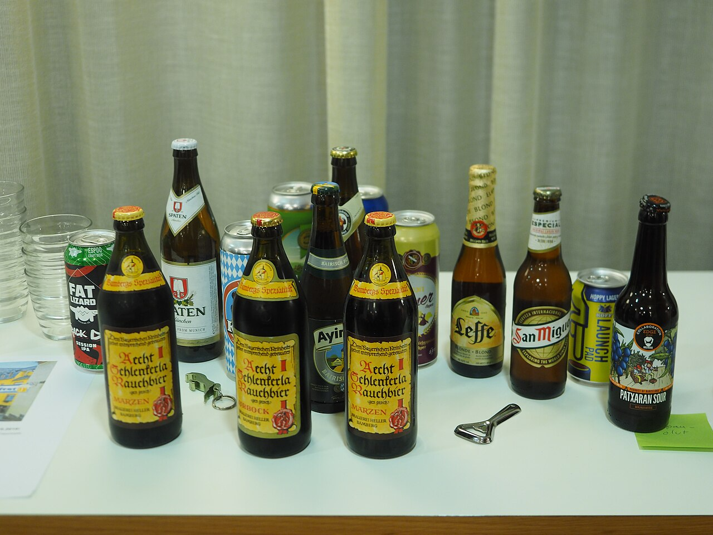

# 《世界啤酒地图》

图：啤酒节品鉴桌上的多国啤酒；《世界啤酒地图》以产区与风格为经纬，此图不是该书封面。图片：JIP，CC BY-SA 4.0，via Wikimedia Commons（[原图页面](https://commons.wikimedia.org/wiki/File:German-style_beers_at_Oktoberfest_beer_tasting.jpg)）。

## 书目与版本

《The World Atlas of Beer》由英国啤酒作家蒂姆·韦伯与加拿大啤酒作家斯蒂芬·博蒙特合著，2012 年首版，随后在 2016 年推出修订版，2021 年由 Mitchell Beazley 出版第三版，272 页。出版方资料说，前两版合计售出约 12 万册；第三版“完全更新”，增加了啤酒与食物搭配、倒酒方法、精酿趋势和新兴产区的内容。

“World Atlas”这个书名容易让人以为它是一本“世界酒厂名录”。实际上，它更接近一本“啤酒地理”：用地图、产区、风格和历史解释啤酒为什么在不同地方呈现不同样子。第三版的书目信息可以在 Hachette 的目录和 WorldCat 中核对；如果要引用具体酒款或酒厂，必须注明版次，因为啤酒行业的变化比葡萄酒更快，酒厂开业、倒闭、易主和配方调整都很常见。

## 作者与成书背景

蒂姆·韦伯是英国啤酒写作与消费者运动的重要人物。他在 CAMRA（Campaign for Real Ale）董事会任职六年，负责过英国全国啤酒节，并参与创建 CAMRA 的出版公司；从 1992 年起，他持续撰写《Good Beer Guide Belgium》，并在多个国家获得啤酒写作奖项。他的写作偏向“饮酒者视角”：关心一杯酒在酒吧里如何被保存、服务和享用，而不只是酒厂的技术参数。

斯蒂芬·博蒙特是加拿大啤酒作家、编辑和顾问，长期为啤酒出版物撰稿，也参与国际啤酒评审和行业活动。他的写作范围覆盖北美、欧洲和亚洲，强调“啤酒是一种食物”，需要和餐桌、季节、地方习惯放在一起理解。两位作者的分工，大致是韦伯负责欧洲和酒吧文化，博蒙特负责北美和全球趋势；这种合作让书既有旧世界的细节，也有新世界的视角。

这本书成书的 2012 年，正处在全球精酿啤酒快速扩张的阶段。美国、英国、加拿大、澳大利亚和北欧的微型酒厂大量出现，亚洲市场也开始出现本地精酿品牌。传统的“啤酒地图”大多以比利时、德国、英国和捷克为中心，这本书试图把视野扩展到美洲、亚洲和新兴市场，同时保留欧洲经典产区的历史深度。

## 内容结构

全书大致分成四块。第一块是基础：啤酒的原料、糖化、发酵、啤酒花、酵母、水质、酒精度、苦度、色泽和泡沫。第二块是风格：从英式艾尔、德式拉格、比利时酸啤、美式 IPA、修道院啤酒到亚洲和拉美的地方风格，按历史和产区解释。第三块是地理：按国家或地区画地图，介绍酒厂、酒吧、饮用习惯和代表酒款。第四块是实践：如何倒酒、如何配餐、如何保存、如何品鉴，以及啤酒旅行的建议。

地图是这本书的骨架。它不只是标出酒厂位置，还把语言、宗教、战争、移民、贸易和农业带进画面：比利时的修道院为什么集中在小片区域，捷克的皮尔森为什么成为全球拉格的模板，英国的“real ale”为什么和酒吧的保存方式绑定，美国的 IPA 为什么在西海岸变得更苦。读者如果只看风格章节，会得到“啤酒有哪些类型”；把地图和风格一起看，才能理解“为什么这里会出现这种类型”。

## 核心论点与影响

核心论点是：啤酒风格不是一张固定的清单，而是地方历史、原料条件、税收政策、宗教制度和消费者口味的产物。比如，英式艾尔的柔和苦味与英国的水质、麦芽和酒吧保存方式有关；比利时酸啤的复杂酸感与当地的野生酵母、木桶和混酿传统有关；美式 IPA 的高苦度和柑橘香气，与美国的啤酒花品种、冷链和精酿市场有关。地图把这些变量并置，让读者看到“风格”背后的制度。

第二个论点是“啤酒值得被认真对待”。两位作者把啤酒和葡萄酒、食物放在同一个文化层级上：它有产地、有年份、有酿造者、有侍酒方式，也有自己的品鉴语言。这个态度影响了 2010 年代以后的啤酒写作和酒吧菜单，让“啤酒配餐”“啤酒旅行”“啤酒教育”成为更常见的主题。

这本书的影响主要在旅行、餐饮和入门教育。读者可以用它规划啤酒旅行，餐厅可以用它做配餐参考，啤酒课程可以用它建立“风格—产区—历史”的框架。它的地图和摄影也让读者对“啤酒世界”产生直观想象，但引用图片和地图时要注意版权，不能直接复制。

## 史料价值与局限

作为工具书，它的价值在于“把风格放回地方”。书里的酒厂历史、酒吧文化、饮用习惯和配餐建议，能和地方志、行业报告、酒厂官网互相印证。它也能帮助读者理解啤酒税、宗教改革、移民和战争如何影响啤酒：修道院啤酒的存续、捷克的拉格传统、英国的酒吧制度，都不是孤立的“口味故事”。

局限有四点。第一，啤酒行业变化极快，书里的酒厂推荐、酒款和价格会过时；第三版也只能覆盖到 2021 年的情况。第二，全球覆盖不均衡，欧洲的篇幅明显大于非洲、南亚和中东。第三，书是“地理 + 风格”的综述，不是酿造教材；读者想学配方和工艺，需要另找技术书。第四，品鉴和配餐建议带有作者偏好，不是普遍规律；同一杯酒在不同温度和不同菜肴下会有不同表现。

## 常见误读

最常见的误读是把“世界啤酒地图”当成“所有酒厂的完整名录”。它选择的是有代表性、可访问、可核验的酒厂和酒吧，不是普查。第二个误读是把啤酒风格当成“永远不变的分类”；风格会随原料、法规、市场和消费者口味变化，书里的分类是某一时点的快照。第三个误读是把“比利时啤酒”等同于“修道院啤酒”；比利时还有酸啤、农舍啤酒、小麦啤酒和大量非修道院风格。第四个误读是把“精酿”当成“小厂”或“贵酒”的同义词；精酿更多是一种所有权、规模和工艺态度，不是单一指标。第五个误读是把书里的配餐建议当成规则；配餐的核心是味觉平衡，不是“某种酒只能配某种菜”。

相关条目：[啤酒](ref:beer)、[精酿啤酒](ref:craft-beer)、[啤酒品鉴入门：从香气、酒体到苦度](ref:beer-tasting)。

## 另见

- [啤酒](ref:beer)：从原料、发酵和风格理解啤酒。
- [精酿啤酒](ref:craft-beer)：理解“精酿”的定义争议与市场位置。
- [啤酒品鉴入门](ref:beer-tasting)：把书里的风格知识用到品鉴。
- [比利时](ref:belgium)：书中重点讨论的旧世界产区。
- [烧烤配啤酒](ref:pairing)：把“啤酒配餐”落到具体场景。
