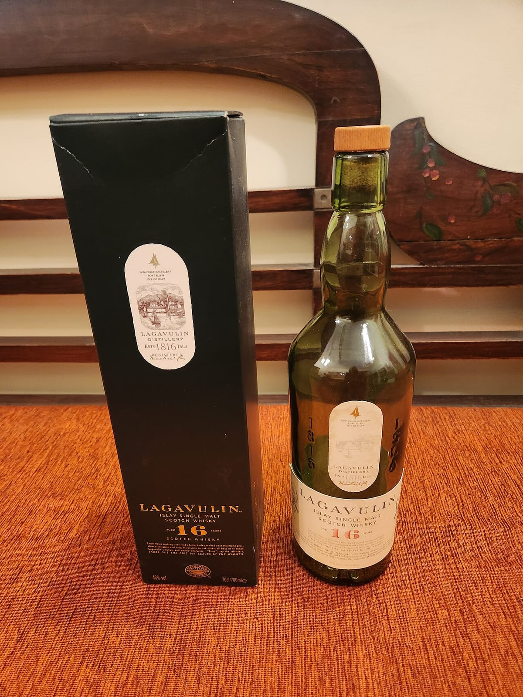

# 《世界威士忌地图》

图：拉加维林 16 年单一麦芽威士忌；《世界威士忌地图》以酒厂与风味为坐标，此图不是该书封面。图片：Amitbalani，CC0，via Wikimedia Commons（[原图页面](https://commons.wikimedia.org/wiki/File:Lagavulin_Single_Malt_Scotch_Whisky_Aged_16_Years.jpg)）。

## 书目与版本

《The World Atlas of Whisky》由英国威士忌作家戴夫·布鲁姆撰写，2010 年由 Mitchell Beazley（Octopus Publishing Group 旗下品牌）在伦敦首版。2014 年推出“Fully Revised and Updated”第二版，页数依电子版与纸质版不同，出版方描述其覆盖 200 多家酒厂、750 款酒样，并用六个“风味营地”（Flavor Camps）把威士忌按风格重新排列。此后出版社又推出了第三版，增加了新的酒厂和更新数据；引用时应写清“2010 首版”“2014 修订版”或“第三版”，不要把不同版次的数字混在一起。

这本书的“地图”不只是地理图。它把苏格兰的产区、酒厂位置、道路、海岸线和风味特征叠在一起，再延伸到爱尔兰、日本、美国、加拿大和世界其他地区。对读者来说，地图是入口：先看见酒厂在哪里，再理解它为什么呈现某种风格。对研究者来说，地图是一种论证方式：产地、原料、蒸馏器和橡木桶的关系，被空间化地呈现出来。

## 作者与成书背景

戴夫·布鲁姆是英国威士忌写作与品鉴界的资深人物，长期为威士忌杂志、报纸和行业出版物撰稿，也参与威士忌教育、比赛评审和酒厂咨询。他的写作不以“打分”为中心，而更关心“这瓶酒为什么这样”：原料、蒸馏、橡木桶、气候和酒厂选择如何共同塑造风味。他此前写过威士忌目录、品鉴指南和苏格兰威士忌专著，这些工作为《世界威士忌地图》积累了酒厂访问和酒样记录。

这本书成书的 2010 年，正是全球威士忌市场快速扩张的时期。苏格兰单一麦芽从 niche 走向大众，日本威士忌开始在国际比赛中获得关注，美国精酿蒸馏和爱尔兰威士忌也在复苏。旧的“威士忌地图”大多以苏格兰为中心，布鲁姆想把视野扩大到全球，同时保留苏格兰的细节密度。这种“全球框架 + 苏格兰深描”的结构，是这本书最明显的编辑策略。

## 内容结构

全书大致分成三层。第一层是总论：威士忌的定义、原料、糖化、发酵、蒸馏、橡木桶、熟成、调配、品鉴和风味语言。第二层是产区与酒厂：苏格兰按产区划分，再逐家酒厂介绍历史、设备、产能、风格和代表酒款；爱尔兰、日本、美国、加拿大和其他地区各有章节。第三层是风味与酒款：用“风味营地”把不同酒厂的酒按香气、口感、尾韵归类，再给出品鉴笔记和推荐。

“风味营地”是这本书最容易被记住的设计。它把威士忌分成 malty、fragrant、oaky dried fruit、oaky soft fruit、peaty、waxy 等风格组，让读者在不知道酒厂名字的情况下，也能按“我想喝什么味道”来选酒。这个分类是编辑工具，不是科学分类；同一款酒可能同时具备多个特征，不同版次的分组也可能调整。读者应把它当成“找酒的地图”，而不是“威士忌的生物学分类”。

## 核心论点与影响

核心论点是：威士忌的风味是“地方 + 工艺 + 时间”的产物，而不是某一个酒厂的神秘天赋。产地影响水源、气候和大麦品种；工艺影响酒体、香气和尾韵；橡木桶和熟成时间影响颜色、单宁和甜感。布鲁姆用地图和酒厂条目把这个因果链拆开，让读者看到“风味”背后的具体选择。

第二个论点是“全球视野”：威士忌不只是苏格兰的同义词。爱尔兰的壶式蒸馏、美国的波本和黑麦、日本的精密酿造、加拿大的混合传统，都有各自的历史和风格。把它们放在同一本书里，不是为了排座次，而是为了比较：同样的原料和橡木桶，在不同制度和市场里会变成不同的酒。

这本书的影响主要在“选酒”和“旅行”两个场景。读者可以用它规划酒厂旅行，也可以用它按风味选酒；酒吧和餐厅用它做酒单参考；威士忌课程用它建立产区框架。它获得过威士忌写作与出版方面的奖项，也被不少行业人士当作常备工具书。它的地图和酒厂照片，后来成为许多威士忌网站和教材的视觉参考，但引用时要注意版权，不能直接复制。

## 史料价值与局限

作为工具书，它的价值在于“把分散的酒厂信息放进一个可比较的框架”。书里的酒厂历史、设备类型、产能、水源、橡木桶政策和代表酒款，能帮助读者理解一家酒厂的风格选择。它也可以和酒厂官网、产区协会资料、法规文本互相印证，而不是单独作为“酒厂历史”的证据。

局限有五点。第一，品鉴笔记是主观记录，不是化学分析；同一款酒在不同时间、不同杯型和不同状态下会有差异。第二，酒厂和酒款变化很快，产能、所有权、限定版和价格都会过时；2014 年版的数据不能直接当 2026 年的现况。第三，书的“全球”覆盖并不均衡，苏格兰的篇幅明显大于其他地区，非洲、南亚和南美的威士忌着墨较少。第四，酒样来源和品鉴条件没有完全公开，读者无法复现每一次品鉴。第五，书中的“风味营地”是编辑分类，不是行业标准；不同酒厂和评论家会有不同分法。

## 常见误读

最常见的误读是把“世界 atlas”当成“全世界所有酒厂的名录”。它覆盖的是作者认为有代表性、可核验的酒厂，不是完整普查。第二个误读是把“风味营地”当成科学分类；它是选酒工具，不是化学或感官科学的标准。第三个误读是把品鉴笔记当成“客观分数”；笔记描述的是作者在特定条件下的感受，读者应把它当参考，而不是结论。第四个误读是把苏格兰以外的章节当成“补充”；爱尔兰、日本、美国等产区各有独立历史，不能只用“像不像苏格兰”来衡量。第五个误读是拿旧版数据判断现况；酒厂关闭、易主、扩产和新品都在发生，引用前要核对最新版或官方信息。

相关条目：[威士忌](ref:whisky)、[苏格兰威士忌](ref:scotch)、[苏格兰](ref:scotland)。

## 另见

- [威士忌](ref:whisky)：从原料、蒸馏、橡木桶和产区理解威士忌。
- [苏格兰威士忌](ref:scotch)：书中篇幅最大的产区。
- [苏格兰](ref:scotland)：地理、法规与酒厂分布。
- [威士忌入门](ref:whisky-intro)：把书里的产区知识用到第一次品鉴。
- [单一麦芽威士忌](ref:single-malt)：理解“单一酒厂”与“调和”的区别。
