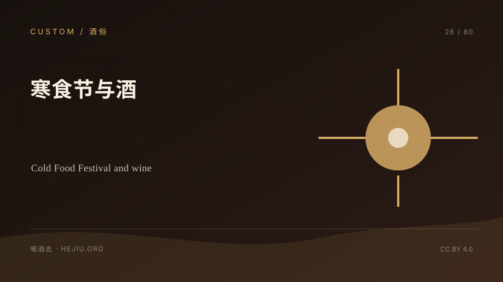

# 寒食节与酒

寒食是一个围绕“火”的节日：这一天不举火，吃提前备好的冷食，出城祭墓，也顺便踏青。酒在这个节日里并不总是主角。它更多出现在祭扫时的奠酒、家族聚餐的席面上，以及诗中“寒食”与“酒”并置的句子中。把酒放回寒食的禁火语境，才能看清它为什么常常是冷的、少量的、带着追思意味的。

图：寒食节与酒 类型示意图。图片：Doubao Seedream 5.0 AI 辅助绘制（项目自有），不是寒食节与酒的实拍。

## 时间与地域

寒食的日期按旧说在清明前一二日，也有“冬至后一百五日”的算法。由于寒食与清明日期紧邻，唐宋以后两者在实际生活中逐渐合并，很多地方直接把这段春季节令统称为清明。今天多数人扫墓、踏青都在清明前后，寒食作为一个独立节日的存在感已经很弱。

地域差异主要表现在保留程度。山西介休一带因介子推传说，寒食记忆较深；一些北方地区仍讲究提前蒸制冷食；南方更多把青团、艾粄等春季时令食品与清明联系在一起。不同地方的日期、食物与祭扫方式并不统一，不能拿某一地的做法代表“整个传统”。

## 历史来源

寒食的早期来源常被追溯到先秦的改火旧俗：不同季节更换火种，换火期间有禁火的时段。后世又把禁火与介子推的传说联系起来，说他不受封赏、抱木焚死，百姓为纪念他而禁火冷食。传说流传很广，但它属于解释性故事，不能当作信史。

汉唐之间，寒食在并州一带已成规模，出现过长时间冷食的记载；唐宋时期，寒食上墓、插柳、秋千、蹴鞠等活动进入城市生活，《东京梦华录》一类笔记也记录了清明前后汴京的市井热闹。需要区分三层：改火旧俗是礼俗底层，介子推传说是民间叙事，唐宋的寒食清明活动是已经成型的节令生活。三者相互叠加，但不是同一个来源。

## 流程与酒器

寒食的常见动作包括：提前备食、禁火、祭墓、插柳、踏青、荡秋千、吃冷食。祭墓时，酒通常作为供品出现，斟入杯中或直接酹地，表示奉请与告别；家宴上则用酒佐冷食，量不大，重在应节。

由于当天不举火，温酒不方便，酒多为提前温热后装入保温的容器，或干脆常温饮用。传统酒器里，壶用于盛酒，盏用于饮，注子与温碗用于温酒；寒食的禁火恰好限制了“温”的环节，这也解释了为什么文献里寒食饮酒的记载不如其他节令密集。现代家庭没有禁火条件，酒器多简化为瓶、杯，仪式感主要靠供桌与奠酒动作维持。

## 酒与食物

寒食食物以冷食为主：寒食粥、寒食面、子推燕（面制飞燕）、冷淘一类面食，各地还有青团、艾粄、馓子等。这些食物偏冷、偏干或偏甜，酒的作用是佐餐与暖口，而不是解腻。黄酒、米酒因口感温和、酒度较低，比较适合搭配冷食；白酒在祭扫场合也可能出现，但通常只用于奠酒，不用于大量饮用。

值得说明的是，文献中并没有一个全国统一的“寒食酒”配方。所谓寒食酒，多是对寒食期间所饮之酒的泛称，或诗中为了对仗而使用的节令词。把某种药材、花卉配方说成“古法寒食酒”，缺乏可靠依据。

## 变迁与当代实践

当代寒食基本并入清明。城市里常见的实践是：清明前后全家扫墓，带酒、水果、糕点；祭扫结束后聚在一起吃饭，酒重新回到餐桌上。乡村地区可能保留提前蒸制面食、门口插柳等做法。近年来也出现网上祭扫、代祭扫、鲜花替代纸钱等变化，酒在这些新形式里往往被简化为一杯供酒或一句祝词。

另一个变化是旅游化。清明假期带动踏青、赏花与短途旅行，寒食的历史内涵被压缩成“春天的节日”。这不必视为坏事，但需要提醒：祭扫与出游是两种情绪，酒在其中的用法也不同——前者宜静、宜少，后者更接近普通聚餐。

## 争议与健康边界

第一，冷食与肠胃。寒食的传统建立在禁火之上，不是健康建议。老人、儿童、肠胃功能较弱的人不宜大量食用冷食，更不宜用酒“暖胃”。酒精会刺激胃黏膜，空腹饮酒配冷食尤其不合适。

第二，饮酒与祭扫。祭扫后驾车的人不应饮酒；墓园周边道路条件复杂，更应避免“喝一点没关系”的侥幸。

第三，禁火与防火。寒食的禁火是象征性的礼俗，现代山林防火则是现实法规。祭扫时焚香烧纸、点烟、燃放爆竹都可能引发火灾，许多地方已明确禁止。用酒祭奠可以保留，但不要以“传统”为由违规用火。

第四，劝酒。节令聚餐容易被“应景”绑架，把喝酒当成完成任务。更合适的做法是准备低度酒或无酒精饮品，让不喝酒的人也有参与感。

## 常见误区

第一，把寒食等同于清明。两者日期相邻、后来合并，但寒食的核心是禁火冷食，清明的核心是祭扫踏青，不能完全互换。

第二，把介子推传说当成寒食唯一起源。改火旧俗、地方禁忌与后世附会共同塑造了这个节日。

第三，以为寒食必须喝酒。文献中寒食饮酒的记载并不均一，酒更多是祭扫与家宴的配角。

第四，相信“古法寒食酒”有固定配方。现存记载不足以支持这种说法。

第五，把冷食习俗当成养生建议。它是历史条件下的饮食安排，不是现代营养学结论。

相关条目：[中国](ref:china)、[酒与节庆：节令酒里的时间表](ref:festivals)。

## 另见

- [中国](ref:china)：寒食与清明的地域差异。
- [酒与节庆](ref:festivals)：节令酒的整体结构。
- [酒与礼](ref:ritual)：祭祀与奠酒的礼制背景。
- [中元节与酒](ref:zhongyuan)：同一季候脉络中的另一个祭祖节日。
- [白居易《问刘十九》](ref:asking-liu)：一首写春夜小聚与邀请的诗。
- [黄酒](ref:yellow-wine)：搭配冷食的温和酒种。

**关键事实。**

| 项目 | 内容 |
| --- | --- |
| 一句话定位 | 寒食在清明前一二日，以禁火冷食、祭墓踏青为核心；酒在其中多承担奠酒与家宴的角色，而非固定的节令配方 |
| 时期 | 先秦改火旧俗至当代；清明前一二日 |
| 地区 | 中国 |
