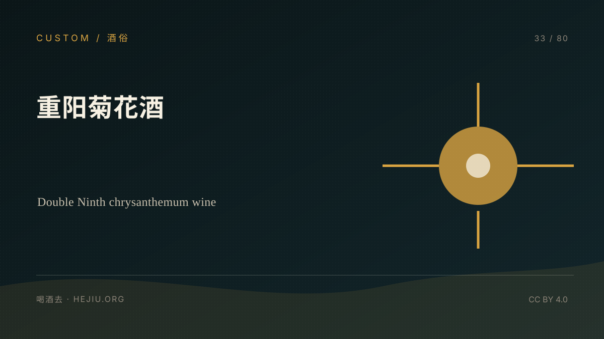

# 重阳菊花酒

重阳在农历九月初九，二九相重，故称“重九”。这一天登高、佩茱萸、赏菊、饮菊花酒、食重阳糕，构成一套彼此呼应的秋季节令动作。菊花酒不是某一种固定配方的酒，而是一类让菊花参与制作、在重阳前后饮用的节令酒。它的意义也不只在风味：九九与“久久”同音，菊花偏在深秋开放，酒因此被用来承载长寿、祛病与敬老的愿望。

也正因为“菊花酒”是类名，读古籍时不能把某一家的做法当成全国标准。汉代的酿法、宋代的市售酒、今天家庭用白酒浸泡的做法，三者之间既有延续，也有断裂。

图：重阳菊花酒 类型示意图。图片：Doubao Seedream 5.0 AI 辅助绘制（项目自有），不是重阳菊花酒的实拍。

## 时间与地域

节令时间固定为农历九月初九，正值秋收之后、菊花开时。酿酒的时间却可以提前一年：《西京杂记》说“菊华舒时”采茎叶，杂黍米酿之，“至来年九月九日始熟”，即头年秋天酿、次年重阳开坛。这条记载把节令、农时与发酵周期扣在一起。

地域上，菊花酒主要流行于汉族聚居区，做法差异很大。黄河中下游多与登高、赏菊结合；长江下游的浙江桐乡、安徽黄山与亳州一带以药用菊闻名，民间有以杭菊、贡菊、亳菊入酒的习惯，所谓“四大名菊”正指亳菊、滁菊、贡菊、杭菊。岭南部分地方把重阳与祭祖、扫墓相连，酒更多用于供奉而非宴饮。北方一些地区则把重阳糕、羊肉与酒配成一套秋日饮食。把某一地的配方写成“古法标准”，会抹掉这些差别。

## 流程与器物

传统做法大致分两系。第一系是浸泡：将干燥菊花放入黄酒或白酒，密封七日至一月，待香气析出后饮用。第二系是发酵：菊花与黍米、酒曲同酿，工序接近米酒，周期更长，风味更接近《西京杂记》所记的“杂黍米酿之”。另有在酒中加入枸杞、当归等药材的药酒做法，但药材配伍属于另一套知识，不能与节令酒混为一谈。

器物以陶坛、瓷壶、温碗和小杯为主。陶坛透气而避光，适合陈放；瓷壶便于分斟；温碗用于隔水温酒，避免直火加热。仪式上，常见顺序是登高归来、摆重阳糕、斟酒、先敬长辈、再众人共饮。部分地方把酒洒在门前或墓前，取驱邪与追思之意，这与宴席上的“敬”是两种动作，不应混用。

## 象征意义

第一层是延年。九为阳数之极，“九九”又被读作“久久”，菊花在霜降前后仍能开放，三者共同支撑了长寿的象征。第二层是祛病。茱萸与菊花在传统药物学中都被认为有驱邪、明目、散风的作用，酒因此被当作载体。第三层是敬老。重阳宴上先敬长者，把“祝寿”变成可见的动作。第四层是秋尝。新收的黍米、新开的菊花、新酿的酒，构成对丰收的答谢。

还有一层属于文人传统。陶渊明“采菊东篱下”的形象，把菊花与隐逸、清高联系起来；后世重阳诗酒雅集，往往借用这层意象。于是同一杯酒，在家庭宴席上是孝心，在文人笔下是风骨，在地方庙会里又可能变成驱邪的符物。

## 历史变迁

汉代《西京杂记》提供了最早的完整说法之一：九月九日佩茱萸、食蓬饵、饮菊花酒，并记下头年酿、次年熟的工艺。三国时曹丕在《九日与钟繇书》中解释重阳设宴的理由，说“九为阳数，而日月并应”，可见重阳宴饮在魏晋已进入上层生活。晋代陶渊明重阳无酒、王弘遣人送酒的故事，则让菊花酒与文人轶事绑定。

唐宋是第二个高峰。重阳诗大量出现，王维“遍插茱萸少一人”写的是兄弟分散，[李清照](ref:li-qingzhao)“东篱把酒黄昏后”写的则是秋思与孤独。城市生活中，《东京梦华录》记汴京重阳赏菊之盛，还提到酒家以菊花扎成门户招揽顾客，说明菊花酒已从家庭自酿进入市售。

明清地方志继续记录重阳酒，但配方更趋地方化。1989 年，中国把农历九月初九定为老人节；2012 年修订的《老年人权益保障法》进一步明确这一天为老年节。2006 年，重阳节列入第一批国家级非物质文化遗产代表性项目名录。节日的“敬老”侧重点，是近现代才被制度化的，不能倒推为汉代的原意。

## 当代争议

第一是药效。菊花含有挥发油、黄酮类成分，但“延年益寿”“治百病”属于传统养生话语，不是临床结论。把菊花酒当药喝，容易延误正规治疗。第二是自制风险。家庭浸泡涉及原料农药残留、容器消毒、酒精度与保存温度；发酵做法还可能因杂菌污染而酸败。第三是药物相互作用。正在服用抗凝药、降糖药、镇静药的人饮酒，风险需要医生评估。

第四是敬老变劝酒。把“长辈喝一杯”当作孝心，可能给高龄者带来跌倒、血压波动等风险。第五是商业化。礼盒装菊花酒溢价很高，配方却可能只是普通米酒加香精。第六是非遗表演化。节庆活动中的“古法酿制”展示，若只保留动作而抽掉工艺，容易变成布景。

更稳妥的做法是把菊花酒还原为节令风味的引子：少量、佐餐、配菊花茶，重点放在登高、陪伴与问候。

## 常见误读

一，以为菊花酒只有一种配方。实际有浸泡、发酵、药酒三条路径，原料与周期都不同。

二，以为汉代人已用蒸馏白酒泡菊花。《西京杂记》所记是黍米发酵酒；蒸馏酒在中国普及要晚得多，不能把今天的白酒工艺套到汉代。

三，把“延年益寿”当成医学结论。它是祝福语与养生话语，不是疗效承诺。

四，以为重阳只是敬老节。登高、佩茱萸、秋尝、驱邪都曾是这个节日的组成部分，敬老只是其中一层。

五，以为菊花酒越陈越好。浸泡酒的花香会随时间衰减，低度酒还可能变质；“陈”只对特定发酵酒有意义。

六，以为所有菊花都能入酒。观赏菊可能残留农药，品种与栽培方式都与药用菊不同。

相关条目：[中国](ref:china)。

## 另见

- [中国](ref:china)：重阳习俗的地域背景。
- [酒与节庆](ref:festivals)：节令酒的整体结构。
- [李清照](ref:li-qingzhao)：重阳词中的酒与思念。
- [中秋赏月酒](ref:mid-autumn-wine)：另一个秋季饮酒节令。
- [春节屠苏酒](ref:new-year-wine)：岁首的节令药酒。
- [随园食单](ref:suiyuan)：清代文人对酒与饮食的品评。
