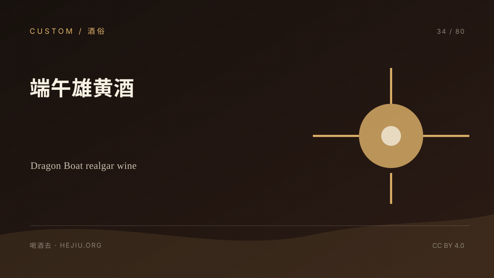

# 端午雄黄酒

端午在农历五月初五。传统习俗包括采艾、挂菖蒲、系五色线、佩香囊，以及饮雄黄酒、洒雄黄水、用雄黄在孩童额上画“王”字。这套动作的核心诉求是驱虫、辟邪与防病，酒只是载体之一。

先把结论放在前面：雄黄的主要成分是四硫化四砷，属于含砷矿物，内服有中毒风险；加热或长期存放还可能生成三氧化二砷，即俗称的砒霜。今天可以把雄黄酒当作历史习俗来了解，但不建议饮用，也不建议让儿童接触。

图：端午雄黄酒 类型示意图。图片：Doubao Seedream 5.0 AI 辅助绘制（项目自有），不是端午雄黄酒的实拍。

## 时间与地域

端午的日期固定在农历五月初五，处于初夏、虫害与疫病容易发生的时段。古人把五月称为“恶月”，五日称为“恶日”，于是发展出一套以药草、香囊、沐浴与饮酒为中心的防护实践。

雄黄酒习俗在汉族地区流传较广，但地方志与岁时记的记载详略不一，具体做法因地区而异：江浙一带常见饮一小口、洒墙角、在小孩额头画“王”；湖南、江西部分地区把雄黄与艾叶、菖蒲同用；北方一些地方更重视系五色线、戴香囊，雄黄酒只是其中一项。还有不少地区端午饮的是菖蒲酒或普通黄酒，并不加雄黄。把“端午必饮雄黄酒”当成全国通例，是把局部经验放大成了标准。

## 流程与器物

常见的动作可以分成三步。第一步是制备：把雄黄研末，兑入黄酒或白酒，搅匀。第二步是使用：少量饮用，或用手指蘸酒在孩童额头画“王”字，或洒在墙角、床下、门后，有的地方还涂在耳鼻、肚脐周围。第三步是处理剩余：有的地方把酒糟丢弃或埋在户外。

这些动作的共同点是“以酒为媒介把药物带到空间与身体上”。酒在这里既是溶剂，也是仪式性的洁净物。器物很简单：小杯、毛笔或手指、喷壶；与之配套的是艾草、菖蒲、香囊与五色线。端午的另一套器物属于龙舟与粽子，与雄黄酒并行，不应混为一谈。

## 象征意义

第一，驱虫。初夏蚊虫滋生，雄黄与艾、菖蒲的气味被用来驱避虫害。第二，辟邪。“王”字借虎威，画在额头是给儿童加一层保护；雄黄属“阳”，与“恶月”的阴气相对。第三，洁净。酒与药草的组合被当作空间消毒与身体清洁的手段。第四，叙事。白蛇传让雄黄酒获得了“照出真相”的象征，一杯酒成了揭开身份的开关。

这四层意义在民间常常叠在一起。实际功能（驱虫）、象征功能（辟邪）与文学功能（现形）互相加强，使雄黄酒成为端午最有戏剧性的物件之一。

## 历史变迁

五月被视为“恶月”的观念很早就存在。南朝梁宗懔的《荆楚岁时记》记录了荆楚一带五月五日采艾、系臂、饮药等做法，说明端午防护习俗在南北朝已经成形。雄黄作为矿物药进入本草传统，被赋予杀虫、解毒的功效；明代李时珍在[《本草纲目》](ref:bencao)中一方面肯定雄黄的药效，一方面也指出其毒性，提醒不可轻用。

两条线索在端午汇合，形成雄黄酒习俗。需要说明的是，古代“饮药”不一定等于“饮雄黄酒”，不同文献的配方与用法也不同。把后世定型的做法直接追溯到汉代，证据并不充分。更稳妥的说法是：端午驱邪习俗很早，雄黄酒的具体形式在长期流传中逐步固定。

白蛇传的情节提供了另一个时间坐标。白娘子端午饮雄黄酒现形的关目，在清代戏曲《雷峰塔》中定型，随后通过说唱、地方戏与影视广泛传播。它是文学与舞台的产物，不能当作习俗起源的史料。

2006 年，端午节列入第一批国家级非物质文化遗产代表性项目名录；2009 年，中国端午节入选联合国教科文组织人类非物质文化遗产代表作名录。名录保护的是龙舟、粽子、艾草、香囊等整体习俗，并不等于鼓励饮用含砷药酒。

## 当代争议

第一，内服风险。雄黄含砷，长期或过量摄入可导致皮肤损伤、神经与消化系统症状，严重时可危及生命；“古人也喝”不是安全证据，古人的平均寿命与中毒记录都不能支持这种类比。第二，外用风险。皮肤破损、儿童误食、宠物舔舐都需要避免；画额后应及时清洗。第三，加热风险。雄黄加热会氧化生成三氧化二砷，因此“温一温更安全”的说法恰好相反。

第四，替代物的边界。用普通黄酒或米酒代替雄黄酒，可以保留节令饮酒的形式；用食品级颜料代替雄黄画额，可以保留亲子活动。但不要用朱砂替代，朱砂主要成分是硫化汞，同样有毒性。第五，儿童饮酒。即使换成普通黄酒，也不应鼓励儿童饮用。第六，叙事混淆。白蛇传是文学，不是史料；把传说当起源会误导对习俗的理解。

如果家里保留这个习俗，最稳妥的方式是“只做象征、不做内服”：在门外洒一点普通酒，讲清来源与风险，不让孩子接触雄黄。

## 常见误读

一，把雄黄酒等同于黄酒。雄黄酒是在酒中加入雄黄，二者不是一回事。

二，以为加热后更安全。加热会促使雄黄转化为毒性更强的三氧化二砷。

三，把白蛇传当成史料。故事定型于清代戏曲，晚于端午防护习俗。

四，以为雄黄能有效驱蛇。民间说法流传很广，但实验观察并不支持“蛇惧雄黄”；气味与酒精可能有轻微驱避作用，不能当作防护手段。

五，以为全国端午都喝雄黄酒。菖蒲酒、艾酒、普通黄酒与不饮酒的做法同样普遍。

六，以为少量无害。砷会在体内蓄积，所谓“少量”没有安全阈值可言。

## 另见

- [中国](ref:china)：端午习俗的地域背景。
- [酒与节庆](ref:festivals)：节令酒的整体结构。
- [春节屠苏酒](ref:new-year-wine)：另一套节令药酒习俗。
- [中秋赏月酒](ref:mid-autumn-wine)：中秋的饮酒实践。
- [本草纲目](ref:bencao)：雄黄的传统药物学记载。

对照阅读：[中国](ref:china)、[年节饮酒：椒柏酒与屠苏酒](ref:new-year-wine)。

**关键事实。**

| 项目 | 内容 |
| --- | --- |
| 一句话定位 | 端午饮雄黄酒、洒雄黄水、以雄黄画额，是汉族地区有文献记载的节令习俗；雄黄含砷，加热还会生成毒性更强的三氧化二砷 |
| 时期 | 汉至当代；农历五月初五 |
| 地区 | 中国 |
