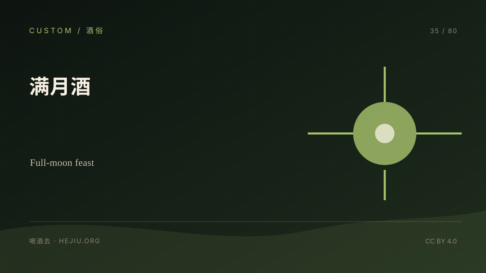

# 满月酒

满月酒是婴儿出生满一个月时举办的宴请，也叫满月宴。它同时是报喜、答谢、命名与社交：向亲友宣布新成员，感谢探望与帮忙，给孩子一个公开的名字，也让人情往来有一个由头。酒在这场宴席里不是主角，却常常是“把喜事说出口”的动作。

需要先区分三个时间点：满月、百日、周岁。满月宴在满月前后，百日宴在出生一百天，周岁宴才轮到“抓周”。把三者混成一套流程，是今天常见的误差。

图：满月酒 类型示意图。图片：Doubao Seedream 5.0 AI 辅助绘制（项目自有），不是满月酒的实拍。

## 时间与地域

“满月”指婴儿出生后满一个月，具体算法各地不同：有的按农历对月，有的按三十天，有的提前或推后几天，要看孩子与家庭的情况。宴请规模差异很大，从家宴几桌到酒店数十桌都有。

地域上，汉族地区普遍有满月习俗，但细节各异。北方部分地区重视“剃头”，把胎发留作纪念或制成胎毛笔；山西、陕西一些地方把满月叫“做满月”，外婆家要送面塑、衣物与长命锁。江南重视红蛋与回礼，红蛋染成红色，分送亲友，取“圆满”与“报喜”之意。广东部分地区把满月与姜醋、猪脚姜连在一起，重心在产妇调养。闽南与台湾一带常见油饭、麻油鸡，分送邻里。城市与乡村、沿海与内陆的做法也不一样，把这些差异写成一条统一流程，会失真。

## 流程与器物

宋代笔记留下了较完整的城市满月记录。《东京梦华录》“育子”条写汴京人家到满月时“大展洗儿会”，亲友聚集，用香汤盛于盆中，投入果子、彩钱、葱蒜，用彩绸绕盆，称为“围盆”；用钗子搅水，称为“搅盆”；观者往水中撒钱，称为“添盆”。这套动作把洗浴、祝福与馈赠合在一起，说明满月早在宋代就是公开的社交场合。

近世以来，常见环节包括：选定日期、发请柬、布置场地、抱婴儿出场、剃头或剪一撮头发、取名或公布名字、亲友送礼、主人回礼、宴席敬酒。部分地区还有认干亲、挂长命锁、拍满月照等附加环节。器物上，红蛋、长命锁、胎毛笔、礼盒与酒并列，构成一套“添喜”的物证。

酒通常出现在两个位置：宴席上的敬酒，以及亲友带来的礼酒。敬酒的主体是父母或祖辈，对象是长辈与来客；礼酒则常被摆在桌上，作为“添喜”的象征。酒的选择跟随家庭习惯与地方风气：[黄酒](ref:yellow-wine)、米酒温和，适合有产妇与老人的场合；[白酒](ref:baijiu)在北方宴席上更常见；啤酒、果汁与茶也越来越多。

## 象征意义

第一，报喜。酒桌是公开宣告的场合，举杯等于把消息传给在座所有人。第二，答谢。父母向长辈、亲友与帮忙的人敬酒，表达感谢。第三，命名。名字在宴席上被公开叫出，孩子由此获得社会身份。第四，护佑。长命锁、红蛋、剃头都带有“留住生命”的象征，酒则把这些祝愿聚在一张桌上。

第五，社交。满月酒也是人情往来的一部分，礼金、回礼与酒席规格都参与关系维护。第六，性别与家族。传统上生男、生女在某些地方的宴席规格不同，这一层今天常被回避，却是理解旧习俗不能跳过的事实。

## 历史变迁

古代礼书中有关于婴儿出生后剪发、命名与见舅姑的记载，比如《礼记·内则》提到“三月之末，择日剪发为鬌”。这与后世的“满月”并不完全相同：时间点、仪式对象与社会背景都有差别。先秦的“三月”礼属于士大夫家族，后世的满月宴则更多与民间家族、邻里往来相连。

“满月酒”作为民间宴客习俗，更多见于近世地方志与民俗记录，而非先秦礼书的直接延续。宋代“洗儿会”是目前可见的较早城市记录，明清地方志则把剃头、送红蛋、办酒席等环节固定下来。把它说成“自古如此”并不准确。更稳妥的表述是：添丁庆贺的传统很早，满月宴请的具体形式在近世地方社会中定型。

当代的变化来自三方面：酒店与婚庆公司把宴席、摄影、伴手礼打包成服务；社交媒体把“报喜”从酒桌扩展到朋友圈；年轻家庭则开始主动缩小规模，或明确“不收礼”。[酒与节庆](ref:festivals)里提到的“人生礼仪酒”，在满月这一环上正被重新设计。

## 当代争议

第一，产妇与哺乳。酒精可以进入乳汁，也可能抑制泌乳反射；世界卫生组织的立场是哺乳期最安全的选择是不饮酒。敬酒时不应强迫产妇喝酒，也不应把“喝一点米酒催奶”当作经验之谈。第二，婴儿安全。宴席人多、噪音大、有人吸烟，婴儿容易受刺激或感染；应安排安静空间、限定探视、避免亲吻与近距离呼吸。

第三，劝酒文化。满月酒是喜事，但不应把“不喝”当成不给面子。第四，礼金攀比。把祝福变成金额竞赛，会削弱仪式的意义，也给年轻父母增加负担。第五，商业化。摄影套餐、场地布置与伴手礼形成一条消费链，容易让家庭把预算花在“看起来体面”上。

比较稳妥的做法是：明确告知宾客“以茶代酒”，为产妇准备无酒精饮品，控制宴席时长，避免在婴儿周围吸烟，把礼金改为实用礼物或直接说明不收礼。

## 常见误读

一，把满月酒与周岁酒混为一谈。抓周在周岁，不在满月。

二，以为满月必须剃光头。传统多剪一撮胎发留作纪念，婴儿头皮薄，剃光反而增加损伤与感染风险。

三，相信米酒能催奶。酒精会抑制泌乳反射，并进入乳汁，所谓“催奶”缺乏可靠依据。

四，以为满月酒自古如此。先秦礼书讲的是“三月剪发”，宋代才有较完整的“洗儿会”记录，今天的酒店宴席更是近现代产物。

五，以为酒越多越有面子。满月酒的核心是报喜与答谢，不是酒量比赛。

六，以为满月必须大办。宴请规模应由家庭情况决定，小型家宴同样成立。

## 另见

- [中国](ref:china)：满月习俗的地域差异。
- [婚宴酒礼](ref:wedding-wine)：另一类人生礼仪中的酒。
- [黄酒](ref:yellow-wine)：宴席常见的低度酒。
- [白酒](ref:baijiu)：北方宴席常见的烈酒。
- [酒与节庆](ref:festivals)：节令与人生礼仪的饮酒结构。

对照阅读：[中国](ref:china)、[黄酒](ref:yellow-wine)。
