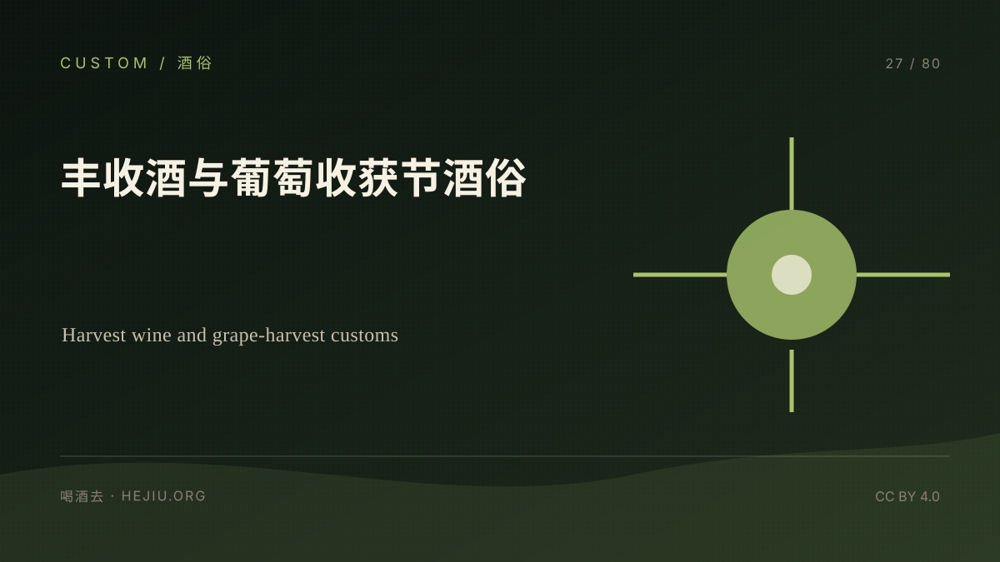

# 丰收酒与葡萄收获节酒俗

丰收酒不是一个统一的酒种，而是一类场合：粮食入仓、果实下树、葡萄压榨之后，人们用新收成酿出的酒或存下的酒，向天地、祖先或邻里表示谢意。中国把它放在秋收与尝新的脉络里，欧洲葡萄产区把它放在采收季与产区节庆里。两者都叫“丰收”，但仪式、酒器与食物并不相同。

图：丰收酒与葡萄收获节酒俗 类型示意图。图片：Doubao Seedream 5.0 AI 辅助绘制（项目自有），不是丰收酒与葡萄收获节酒俗的实拍。

## 时间与地域

在中国，丰收饮酒的时间多集中在秋收之后，靠近中秋与秋社。北方收粟、麦、高粱，南方收稻，时间因作物与纬度而异，所以“丰收酒”没有固定日期。一些地方在尝新时先祭祖、再家宴；一些地方在秋社酬神、分肉、聚饮；少数民族的丰收节庆各有自己的历法与传统，不宜一概而论。

在欧洲葡萄产区，采收季通常从夏末延续到秋季。法国、意大利、西班牙、德国的许多村镇会举办葡萄收获节，活动包括采收、压榨演示、游行、市集与品饮。具体日期由当地葡萄成熟情况决定，每年不同；节庆规模也从村口小聚到吸引游客的大型活动，差异很大。

## 历史来源

中国文献里，秋收与酒的联系很早。《诗经·豳风·七月》写到“十月获稻，为此春酒”，把收稻、酿酒与祝福长寿放在同一段农事节奏里。后世的秋社、尝新、谢神，把这层联系制度化：先献新谷与新酒，再集体宴饮。酒在这里是“把今年的收成告诉祖先”的媒介。

欧洲的葡萄收获节与葡萄酒产业史交织。中世纪的修道院、行会与地方领主都深度介入葡萄种植与酒税，采收是全村的集体劳动，也是结算、庆祝与宗教感恩的时刻。近现代以后，产区旅游兴起，收获节逐渐增加表演、市集与品牌推广的成分。具体哪一个村镇从哪一年开始办节，往往缺乏可靠记载，不宜编造。

## 流程与酒器

中国乡村的丰收酒常见流程是：收割完毕、晒场入仓、设供谢神或祭祖、摆村宴、敬长者与帮工、分食新米新面。酒在这套流程里先“献”后“饮”：先斟给神祖，再众人共饮。酒器多为壶、碗、杯，讲究的用锡壶或瓷壶；集体宴席上常见大壶分斟，重在够用与热闹。

欧洲葡萄收获节的流程更偏向“展示”：清晨采收、搬运葡萄筐、现场压榨、试饮新酒，配合音乐、游行与摊位。酒器包括采收篮、压榨机、橡木桶与品酒杯；不同产区会强调自己的传统容器与工艺。需要说明的是，节庆上的“新酒”不等于成品酒，很多酒还要经过发酵、陈酿才会上市。

## 酒与食物

中国丰收酒桌上的食物以新米、新面、猪肉、鸡鱼与时令蔬菜为主，北方可能有饺子、面食，南方有米饭、米糕。酒多为米酒、黄酒或地方白酒，讲究的是“新”和“足”，而不是精细的风味描述。酒的甜感与谷物的香气，和刚收下的粮食形成一种直接的呼应。

欧洲葡萄收获节的食物更接近产区日常：面包、奶酪、香肠、炖菜、烤肉，搭配当年或近年的葡萄酒。不同产区搭配不同：沿海与内陆、山地与平原的饮食习惯差别很大。节庆上的品饮通常量小、种类多，重点是试新与交流，而不是拼酒。

## 变迁与当代实践

中国的丰收酒正在经历两种变化。一方面，机械化与规模化让收割不再需要全村换工，传统的村宴规模缩小；另一方面，地方文旅与“丰收节”活动又把丰收酒重新搬上台面，成为展示农耕文化的节目。近年来各地设立农民丰收节，时间多与秋分相连，但具体活动由地方安排，酒只是其中一项。

欧洲的葡萄收获节则明显旅游化。酒庄开放日、采收体验、音乐会与市集，把原本的农事节奏包装成可消费的体验。好处是让城市人理解葡萄酒从哪里来；问题是表演化的采收可能掩盖真实的劳动强度与季节压力。气候变暖也在改变采收时间，这一点在讨论“传统日期”时应保持谨慎，不宜给出固定年份。

## 争议与健康边界

第一，节庆与过量饮酒。丰收意味着放松，但节庆场合容易把“庆祝”变成“劝酒”。应提供足量饮水、食物与无酒精选项，并安排代驾。

第二，酒驾与交通。乡村道路照明差、路窄，节庆后驾车风险更高。任何程度的饮酒都不应开车。

第三，食品安全。自酿新酒若发酵未完成、容器不洁，可能产生杂菌或过量气体；不要用“古法”替代基本卫生。

第四，劳动与公平。葡萄收获节的欢庆背后是采收工人的长时间劳动，讨论产区文化时不应把他们的处境隐去。

第五，商业化。把丰收酒完全变成门票与周边商品，会削弱它作为社区互惠的意义。

## 常见误区

第一，以为丰收酒是某一种固定酒。它是一类场合与用酒习惯，不是配方。

第二，以为葡萄收获节等于酿酒完成。采收只是开始，发酵与陈酿还在后面。

第三，把中国丰收酒等同于葡萄酒。中国传统丰收酒多为谷物酒或米酒，葡萄酒是另一条脉络。

第四，以为“尝新”全国同一天。作物与气候不同，时间自然不同。

第五，以为欧洲收获节自古不变。很多节庆是近现代旅游与产区推广的产物。

## 另见

- [中国](ref:china)：秋收与尝新的地域背景。
- [法国](ref:france)：葡萄采收与产区节庆。
- [意大利](ref:italy)：乡村节庆与葡萄酒文化。
- [葡萄酒](ref:wine)：葡萄酿造的工艺谱系。
- [酒与节庆](ref:festivals)：节令酒的整体结构。
- [中秋赏月酒](ref:mid-autumn)：秋收之后的另一场团聚。

对照阅读：[中国](ref:china)、[意大利](ref:italy)。

**关键事实。**

| 项目 | 内容 |
| --- | --- |
| 一句话定位 | 丰收酒是秋收之后谢神、尝新与村宴上的酒；在欧洲葡萄产区，采收季又以葡萄收获节的形式延续 |
| 时期 | 古代至当代；秋收与葡萄采收季 |
| 地区 | 中国、法国、意大利 |

**来源与边界。** 本页关于「丰收酒与葡萄收获节酒俗」的关键事实，主要由以下来源交叉核对：中国哲学书电子化计划（底本《毛诗正义》）（“十月获稻，为此春酒”等秋收与酿酒语句；只引必要短句）、宋孟元老撰；古诗文网提供在线文本（宋代城市秋季节令、市井饮食与酒肆活动的背景；只作背景参照）、Encyclopaedia Britannica（葡萄酒与欧洲产区的一般背景；未复制原文，也未引用具体条目页）等 4 条来源。价格、批次与状态会变，涉及这些字段时以页面所列来源的最新版本为准。正文为项目自写，来源只作核验，不复制原文。
