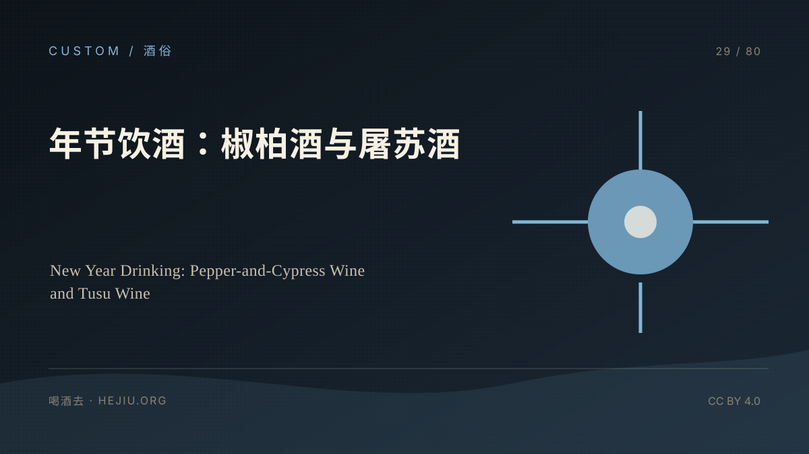

# 年节饮酒：椒柏酒与屠苏酒

正月初一饮酒，在中国有很长的记载传统。南朝梁宗懔《荆楚岁时记》写这一天“长幼悉正衣冠，以次拜贺。进椒柏酒，饮桃汤。进屠苏酒”，并特别记下“凡饮酒次第，从小起”。这段话把三种东西放在一起：拜贺的礼、驱疫的药、以及一套与年龄相反的上酒次序。理解年节饮酒，要从这三层同时入手。

图：年节饮酒：椒柏酒与屠苏酒 类型示意图。图片：Doubao Seedream 5.0 AI 辅助绘制（项目自有），不是年节饮酒：椒柏酒与屠苏酒的实拍。

## 年节饮酒从哪来

古代岁首并不等于今天的“春节”这个词。文献里的“元旦”“正旦”“元日”，通常指农历正月初一；今天的春节假期与民俗活动，则是在近代历法改革之后逐渐定型的。名称变化不影响核心结构：岁首是时间重新开始的节点，人们用仪式、饮食与聚会把它标记出来。

酒在这个节点上有多重身份。它既是祭祖与拜贺的供品，也是抵御时气、祈求康健的“药”，还是家族成员按长幼次序互相祝福的媒介。把年节酒只当成“过年喝点好酒”，会漏掉它最古老的那部分功能。

[一杯酒里的时间](ref:time-in-a-cup)已经讨论过酒与节令的关系。年节饮酒是这条线索最集中的案例：同一天、同一家人、同一套次序，酒把时间、身体与关系绑在一起。

## 椒柏酒与屠苏酒

椒柏酒通常指用椒与柏浸制或调制的酒。椒有辛香，柏常被视为长青之物；《荆楚岁时记》所引旧说，把椒、柏与“蠲除百疾”“身轻能老”一类愿望联系起来。这些说法属于古代的养生与信仰语言，不宜直接当作今天的药效结论。

屠苏酒则是另一种年节药酒。它的配方在历代记载中并不统一，常见说法会把多种药材配入酒中，元旦饮用，以求辟疫。因为配方与炮制方法随时代、地域变化，读古书时不宜把某一种配方当成“唯一正确的屠苏酒”。

椒柏酒与屠苏酒并不一定是同一种东西，也不一定同时出现在所有地区。文献把二者并列，说明岁首酒单本身是复合的：不同酒承担不同象征，家庭可以按条件取舍。

## 为什么要“从小起”

《荆楚岁时记》说“凡饮酒次第，从小起”，并引董勋的解释：正月饮酒先让小孩喝，是因为小孩“得岁”，先以酒贺之；老人“失岁”，所以后喝。这里的“得岁”“失岁”不是寿命长短的判断，而是岁数增长的方向：孩子又长一岁，老人则离天年更近一步。

这套次序与日常宴席的“长者先饮”正好相反，因此格外值得注意。它说明年节饮酒不是普通的尊长仪式，而是一套以“迎新”为核心的象征秩序：先把祝福给新增岁月的人，再轮到被岁月带走的人。

今天读这一条，不必把它当成必须遵守的规矩。它更像一个观察窗口：古人用饮酒次序表达对时间的态度，而这种态度会随家庭结构、寿命观念与医疗条件变化。

## 酒在年节礼序里的位置

岁首饮酒嵌在一整套动作里：整理衣冠、依次拜贺、进酒、进食、贴门饰、放爆竹。酒不是孤立的一步，而是拜贺之后的共享动作。谁先举杯、谁向谁祝，和拜贺的次序相互对应。

酒也承担“通”的功能。古代岁首的饮食常带辛味，如五辛盘；椒、柏、屠苏也都偏辛香。这类选择与“通五脏”“发阳气”的时令观念有关。今天不必照做，但可以理解：年节酒食并非只求丰盛，也有调整身体状态的用意。

酒还是家族公共性的体现。年节饮酒通常不是独酌，而是长幼在场、邻里往来；酒把私人家庭与外部关系连接起来。这一点与今天的春节聚餐仍有相通之处。

## 文献里的年节酒单

《荆楚岁时记》记下的顺序是：进椒柏酒、饮桃汤、进屠苏酒、胶牙饧、五辛盘等。桃汤、胶牙饧、五辛盘与酒并列，说明岁首饮食是一套组合，不是单一饮品。

同一段还引《四民月令》“过腊一日谓之小岁……进椒酒，从小起”，可见“从小起”并非孤例，而是有更早的记载来源。这也提醒我们：岁时文献常常层层引用，读一条材料时要分清原文、引文与注文。

《诗经》里的“春酒”属于另一条线索：它连接收获、酿造与祝寿，见[诗经](ref:shijing)。年节的椒柏、屠苏则更偏驱疫与迎新。两者都说明酒在节令中不是单纯的消费品，而是仪式语言的一部分。

## 后世流变与地域差异

唐宋以后，屠苏酒仍常见于岁首诗文与地方记载，但其配方、饮法与使用范围不断变化。有的记载强调全家共饮，有的强调特定顺序；有的地方重椒柏，有的地方重屠苏。把不同时代的记载拼成一套统一的“古制”，会产生并不存在的整齐。

地域差异同样重要。荆楚是《荆楚岁时记》的记录范围，不能自动代表整个中国。北方、江南、岭南的岁首饮食各有传统，酒的种类与药料也随之不同。今天的地方年俗，往往是长期流动与融合的结果。

现代春节的年夜饭与走亲访友，仍然保留“共饮”与“祝福”的结构，但驱疫色彩已大幅减弱。酒更多承担团聚、庆贺与待客的功能；这是一次功能重心的转移，不是传统的简单消失。

## 常见误读

第一，把屠苏酒当成一种固定配方。历代配方不一，把某一本书的药材表当成全国通行的标准，会忽略历史变化。

第二，把“从小起”理解成长幼秩序被推翻。它是一套岁首象征，不等于日常宴席也照此办理。

第三，把古代药酒的说法直接当成现代医学结论。古人关于辟疫、养生的表述属于当时的知识框架，不能替代今天的临床证据。

第四，把《荆楚岁时记》当成全国民俗普查。它主要记录荆楚地区，其他地区的年节酒俗需要另找材料。

## 今天怎样理解这类习俗

可以把年节饮酒拆成三层来看：时间标记、身体观念、家庭关系。时间标记解释为什么在岁首喝；身体观念解释为什么用椒、柏、屠苏这类辛香药料；家庭关系解释为什么强调次序与共饮。

若要在今天延续，可以选择低度、适合佐餐的酒，把重点放在团聚与祝福，而不是复刻药方。古代的“辟疫”功能不适合被浪漫化；饮酒的安全边界仍然适用。

对内容写作者来说，这类习俗最值得保留的是“解释”，而不是“配方”。说清楚一条记载出自哪本书、指的是哪个地区、后来怎样变化，比给出一份看似权威的年节酒单更有价值。若想看谷物酒的工艺背景，可参考[黄酒](ref:yellow-wine)。

## 延伸阅读

- [一杯酒里的时间](ref:time-in-a-cup)：节令、农事与饮酒之间的关系。
- [诗经](ref:shijing)：从“春酒”看收获、酿造与祝寿。
- [黄酒](ref:yellow-wine)：谷物发酵酒的工艺谱系。

相关条目：[黄酒](ref:yellow-wine)、[一杯酒里的时间](ref:time-in-a-cup)。
