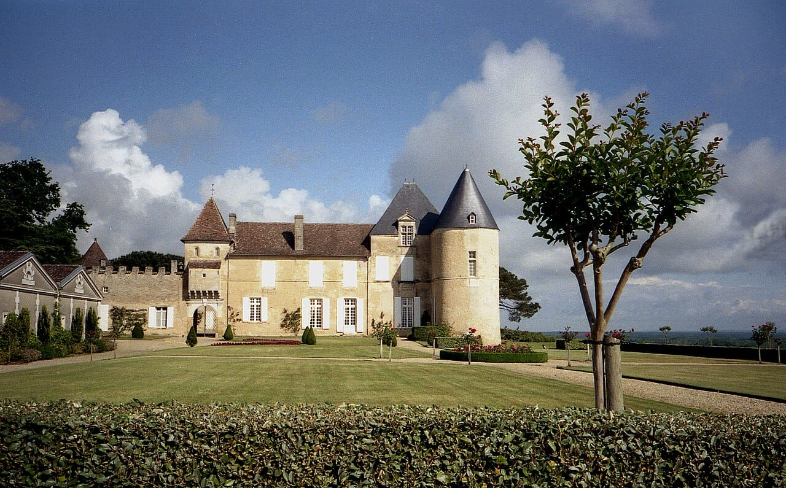
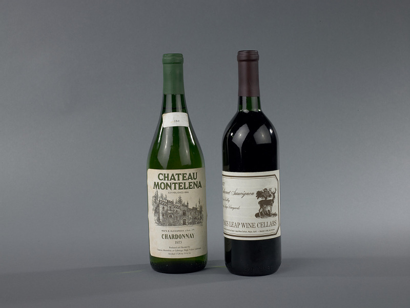

# 1976年巴黎审判：加州酒击败法国名庄

1976 年 5 月 24 日，一场盲品在巴黎举行。组织者是英国酒商史蒂文·斯普里尔与帕特里夏·加拉格尔，评委是法国葡萄酒界的专业人士。参赛酒共 20 款，加州与法国各 10 款。结果，加州酒在红、白两组都拿到最高分。这场后来被称为“巴黎审判”的活动，改变了许多人对葡萄酒产地等级的想象，也让跨产区盲品成为一种公共话题。

图：1976年巴黎审判：加州酒击败法国名庄的地域背景配图。图片：Benjamin Zingg, Switzerland，CC BY-SA 2.5，via Wikimedia Commons（[原图页面](https://commons.wikimedia.org/wiki/File:Ch%C3%A2teau_d%27Yquem.jpg)）。这张照片用于说明1976年巴黎审判：加州酒击败法国名庄所涉事件发生地的环境，不是该事件的现场记录。

## 背景

1970 年代的法国葡萄酒仍被视为世界标准。[波尔多](ref:bordeaux)与勃艮第的名庄凭借 1855 年分级、原产地命名制度与长期形成的拍卖价格，构成了一套看似稳固的等级秩序。相比之下，加州葡萄酒在禁酒令结束后才重新起步；二战后纳帕谷的葡萄种植扩张、加州大学戴维斯分校的酿酒教学，以及新一代酒农的田间实验，使质量提升很快，但它在欧洲市场几乎没有话语权。

斯普里尔在巴黎经营葡萄酒学校，既销售法国酒，也向客户介绍加州酒。他与加拉格尔策划这场对比，更接近一次借助美国建国两百周年热度的公关活动，而不是要推翻法国酒的等级。

## 经过与时间线

盲品在巴黎举行，样品去标签、按编号呈上。红葡萄酒组为 6 款加州赤霞珠与 4 款波尔多，白葡萄酒组为 6 款加州霞多丽与 4 款勃艮第。评委共 11 人，其中 9 位法国葡萄酒界人士的分数被计入，包括餐厅经营者、酒评人、侍酒师与原产地管理机构官员。评委按外观、香气、口感与整体印象打分，工作人员汇总排序。

白葡萄酒组第一为 1973 年蒙特莱那酒庄霞多丽，红葡萄酒组第一为 1973 年鹿跃酒庄 S.L.V. 赤霞珠，另有多款加州酒进入前列。当时在场的记者只有《时代》周刊的乔治·塔伯，报道于 1976 年 6 月刊出，事件由此进入公众视野。

时间线可以概括为：1976 年 5 月 24 日盲品举行；1976 年 6 月《时代》周刊报道；1981 年纳帕谷获批为美国葡萄种植区；2006 年美国国会通过决议，纪念这场盲品 30 周年。

## 关键人物与机构

斯普里尔是组织者，也是把加州酒带入巴黎社交网络的人；加拉格尔负责具体筹备与联络。九位计分评委中，奥黛特·卡恩代表酒评界，奥贝尔·德维兰来自勃艮第名庄，雷蒙·奥利维耶与让-克洛德·弗里纳代表顶级餐饮，克里斯蒂安·瓦内克是侍酒师，皮埃尔·塔里代表波尔多酒庄，皮埃尔·布雷茹与克洛德·杜布瓦-米约来自原产地管理机构。这个组合说明，评委并非外行，而是当时法国酒业的核心圈层。

机构层面，斯普里尔的葡萄酒学校提供了场地与信誉，《时代》周刊提供了传播，美国国会与纳帕谷酒商组织则在后来的纪念中把一次商业盲品转化为国家叙事。加州大学戴维斯分校的酿酒研究、纳帕谷酒农的试验田，以及 1970 年代加州酒厂对法国橡木桶与温控发酵的采用，构成了加州酒能够进入比较的技术背景。

## 对酒业的具体改变

第一，价格与声誉。盲品之后，加州酒在餐厅酒单、拍卖与媒体评测中的可见度上升，纳帕谷地块价格随投资进入而上行。第二，产区制度。1981 年纳帕谷获批为美国葡萄种植区，产区内开始以子产区与单一葡萄园为单位建立身份。第三，市场结构。加州酒厂数量在 1970 年代后期继续增加，出口从零散试销转向有组织的推广。第四，评鉴文化。跨产区盲品成为媒体、酒商与教育机构常用的比较方法，评委的国籍与偏好被公开讨论。第五，叙事产业。纪录片、畅销书与周年纪念把这场盲品固定为“新世界击败旧世界”的故事，反过来影响了酒庄的定价与营销。

## 争议与后续评价

第一，样本与代表性。20 款酒、特定年份、特定酒庄，不能代表两个产区的整体水平。第二，单次结果与长期品质。运输、保存、醒酒与上酒顺序都会影响评分，后续复赛的结果也不完全一致。第三，评委构成。9 位计分评委都是法国人，熟悉波尔多与勃艮第而对加州酒缺乏经验；这既可能压低加州酒分数，也可能因为陌生而抬高其新鲜感。第四，媒体放大。《时代》的报道选择了戏剧化框架，后来的研究提醒读者区分现场记录与再叙述。第五，商业化的神话。巴黎审判成为加州酒的品牌资产，也遮蔽了法国酒庄在 1970 年代同样经历的技术更新。

## 常见误读

一，“加州酒全面击败法国酒”。事实是两组共 20 款酒的排序，加州酒在两组夺冠，但并不存在产区级的全面胜负。二，“参赛的法国酒是随便选的”。四款波尔多与四款勃艮第都是当时有代表性的名庄酒，只是年份与状态未必处于最佳。三，“评委被收买或作弊”。没有证据支持这一说法，争议主要集中在方法与代表性。四，“这场盲品直接导致法国酒衰落”。法国酒的价格与出口在 1970 年代后期继续增长，巴黎审判改变的是认知边界，而不是法国酒的根基。五，“1976 年之后加州酒才被认可”。加州酒在美国国内早已有市场，盲品加速的是国际认知。

相关条目：[法国](ref:france)、[拉菲古堡红葡萄酒](ref:lafite)。

## 进阶判断

图：1976 年巴黎盲品会的获奖酒样，加州与法国葡萄酒评价体系的分水岭。图片：Unknown author Unknown author，Public domain，via Wikimedia Commons（[原图页面](https://commons.wikimedia.org/wiki/File:Judgment_of_Paris_1976_Winners_NMAH-2006-7043.jpg)）。

| 维度 | 1976 年发生了什么 | 后续影响 |
| --- | --- | --- |
| 评审 | 巴黎盲品，法国评委 | 加州酒进入比较视野 |
| 结果 | 加州红白均胜出 | 重赛与争议持续 |
| 产业 | 加州声誉上升 | 新世界产区叙事改变 |
| 证据 | 获奖酒瓶留存 | 成为博物馆藏品 |

**加州酒赢了所有类别吗？** 不是。1976 年这场盲品常被概括为“加州获胜”，但具体结果是红、白两组各有排序；不能简化成所有法国名庄都被打败。

**这场盲品被重复过吗？** 有重赛与后续纪念活动，结果并不完全一致。一次盲品是事件，不是长期质量判决；年份、储存与评审变化都会影响结果。

**获奖酒瓶是真的吗？** 博物馆收藏的获奖酒瓶有来源与鉴定记录，但市场上也有仿造与“故事酒”。买历史纪念酒要看来源链、拍卖记录与专业鉴定。

延伸阅读：[拉菲](ref:lafite)、[葡萄酒](ref:wine)。

## 另见

- [波尔多](ref:bordeaux)：法国左岸与右岸的产区框架，也是参赛红葡萄酒的主要来源。
- [法国](ref:france)：原产地命名制度与主要产区，理解评委背景的入口。
- [拉菲古堡](ref:lafite)：1855 分级中的名庄样本，代表被挑战的等级秩序。
- [葡萄酒](ref:wine)：葡萄酒的定义、工艺与分类。
- [第一次喝葡萄酒怎么选](ref:first-wine)：从产区、品种到价格的入门路径。

**关键事实。**

| 项目 | 内容 |
| --- | --- |
| 一句话定位 | 1976 年 5 月 24 日，英国酒商史蒂文·斯普里尔在巴黎组织盲品，20 款酒中加州与法国各 10 款；加州酒在红、白两组都拿到最高分，这场后来被称为“巴黎审判”的活动改变了加州酒的国际地位，也成为跨产区比较的经典案例 |
| 时间 | 1976 年 5 月 24 日 |
| 地点 | 法国 |
| 历法 | 公历 |
