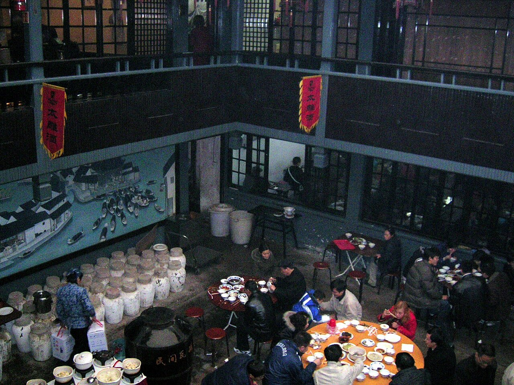

# 1979 年第三届全国评酒会：暗评与香型分组

1979 年，第三届全国评酒会在辽宁大连举行。这一届最值得记住的不是名单，而是方法：样品改用密码编号、评委不知道来源，评选按香型分组，评酒员还要先通过考核。中国白酒的品评从此更像一次受控的比较实验。

图："1979 年第三届全国评酒会：暗评与香型分组"的地域背景配图。图片：Jiong Sheng，CC BY-SA 2.0，via Wikimedia Commons（[原图页面](https://commons.wikimedia.org/wiki/File:ShaoxingXianheng.jpg)）。这张照片用于说明"1979 年第三届全国评酒会：暗评与香型分组"所涉事件发生地的环境，不是该事件的现场记录。

## 背景

1978 年以后，酒类生产恢复，企业数量与产量上升，市场开始出现“名酒”与普通酒的价差。上一届沿用的公开品评方式容易受品牌先入之见影响，行业希望用更客观的程序减少争议。与此同时，香型研究在推进：茅台试点、汾酒试点与泸州老窖的窖泥研究，使酱香、浓香、清香、米香等分类逐渐成为共同语言。

另一层背景是评酒队伍的专业化。此前的评委多由各地推荐，水平参差，评分尺度不统一。[周恒刚](ref:zhou-henggang)等技术人员提出“选酒先考人”，主张先考核评委的感官能力，再让其参与评比。这一思路在本届成为制度，并延续到 1984 年与 1989 年。

## 经过与时间线

参评样品统一编码，评委只看到编号与类别，不知道生产企业。评审按香型分组，同组内比较香气、口感、回味与风格典型性；分组还考虑糖化剂与酒度，以减少不可比因素。评酒员在会前接受感官能力考核，取得资格后才能参与打分。评分采用 100 分制，按组淘汰、排序。

这一届评出国家名酒 18 种，其中白酒 8 种；另评出国家优质酒 47 种。白酒八种为：茅台酒、汾酒、五粮液、剑南春、古井贡酒、洋河大曲、董酒、泸州老窖特曲。与 1963 年的八种相比，全兴大曲与西凤酒落选，洋河大曲与剑南春进入。常见解释是西凤被按清香型分组参赛，风格不占优势；也有资料把落选归因于送样批次与评委构成。

时间线可以概括为：1978 年生产秩序恢复；1979 年大连评酒会首次实行密码编号与评委考核；同年公布 18 种名酒与 47 种优质酒；1984 年第四届沿用暗评并扩至 26 种名酒；1989 年第五届评出十七大名酒。

## 关键人物与机构

[周恒刚](ref:zhou-henggang)是本届评酒会技术工作的主持者之一，长期从事白酒工艺与香味研究，推动了评委考核、香型分组与百分制评分。经考核产生的新一届国家评委包括沈怡方、高月明、梁邦昌、熊子书等人，他们后来成为白酒行业的技术骨干。主办工作仍由轻工业部与商业系统承担，地方轻工部门负责送样。

机构层面，轻工业部侧重生产技术，商业部侧重流通，标准与检测机构提供理化分析支持。评酒会的组织方式体现了改革开放初期的过渡特征：一方面保留计划分配的名额与地方推荐，另一方面引入可复核的编码、考核与分组程序。

## 对酒业的具体改变

第一，暗评成为惯例。此后 1984、1989 两届沿用密码编号，评选程序更接近现代盲品。第二，香型成为行业通用分类，直接影响了[浓香型](ref:strong-aroma)等概念的市场认知。第三，评酒员队伍职业化。考核制度让品评从“老师傅的经验”变成可培训、可认证的技能。第四，名单的商业价值上升。入选与否开始显著影响定价与渠道，名酒企业获得了扩大产能的动力。第五，方法外溢。编码、分组与百分制被地方评酒、质量评比与企业内部品控采用。

局限同样存在：暗评只能减少品牌偏见，不能消除评委个人尺度差异；香型分组使跨香型比较变得困难，“最好喝”的问题被改写成“同类中是否典型”；送样仍由企业自选，样品与市售产品的一致性缺乏独立验证。

## 争议与后续评价

第一，届次与年份的对应。1952、1963、1979 三届常被简称为“前三届”，但具体月份与举办城市在不同资料中有出入。第二，名单数量。18 种名酒、47 种优质酒是常见说法，个别资料把不同届的数字混用。第三，落选原因。后世常把名酒落选解释为质量下降，实际也可能与送样批次、香型分组或评委构成有关。第四，西凤的香型归属。把西凤划入清香型是后来的常见解释，但是否为当年正式分组，仍需查原始文件。第五，方法评价。暗评提高了公正性，但它仍是感官评价，不能等同于理化检测。

## 常见误读

一，“1979 年是第一届全国评酒会”。第一届全国评酒会在 1952 年举行，1979 年是第三届。二，“暗评意味着完全客观”。编码只隐藏品牌，评委的偏好与疲劳仍会影响分数。三，“八大名酒是 1979 年新评出的八个品牌”。其中多数在 1963 年已经入选，本届是有进有出。四，“落选名酒质量一定变差”。送样批次与分组规则可能比质量变化更能解释结果。

## 另见

- [中国](ref:china)：评酒会主办国与产区框架。
- [白酒](ref:baijiu)：暗评与香型分组的主要对象。
- [浓香型白酒](ref:strong-aroma)：同组竞争最激烈的香型之一。
- [泸州老窖集团](ref:luzhou)：连续入选的浓香型代表企业。
- [周恒刚](ref:zhou-henggang)：推动评委考核与香型分组的技术专家。
- [1963 年第二届全国评酒会](ref:evaluation-1963)：上一届，首次设立优质酒。
- [1952 年全国评酒会](ref:evaluation-1952)：全国评酒制度的起点。

**关键事实。**

| 项目 | 内容 |
| --- | --- |
| 一句话定位 | 1979 年在辽宁大连举行的第三届全国评酒会，首次采用密码编号暗评并对评酒员进行考核，按香型、糖化剂与酒度分组比较，评出 18 种国家名酒；本文说明这次方法上的转折及其对名酒名单的影响 |
| 时间 | 1979 年 |
| 地点 | 中国 |
| 历法 | 公历 |

**来源与边界。** 本页关于「1979 年第三届全国评酒会：暗评与香型分组」的关键事实，主要由以下来源交叉核对：新华网（第三届全国评酒会的时间、地点与暗评方法）、中国新闻网（1979 年白酒名酒名单变化；只引短句；1979 年 18 种名酒的品类构成；只引短句）、中国酿酒工业协会（评酒员考核、香型分组与优质酒数量）等 8 条来源。价格、批次与状态会变，涉及这些字段时以页面所列来源的最新版本为准。正文为项目自写，来源只作核验，不复制原文。
