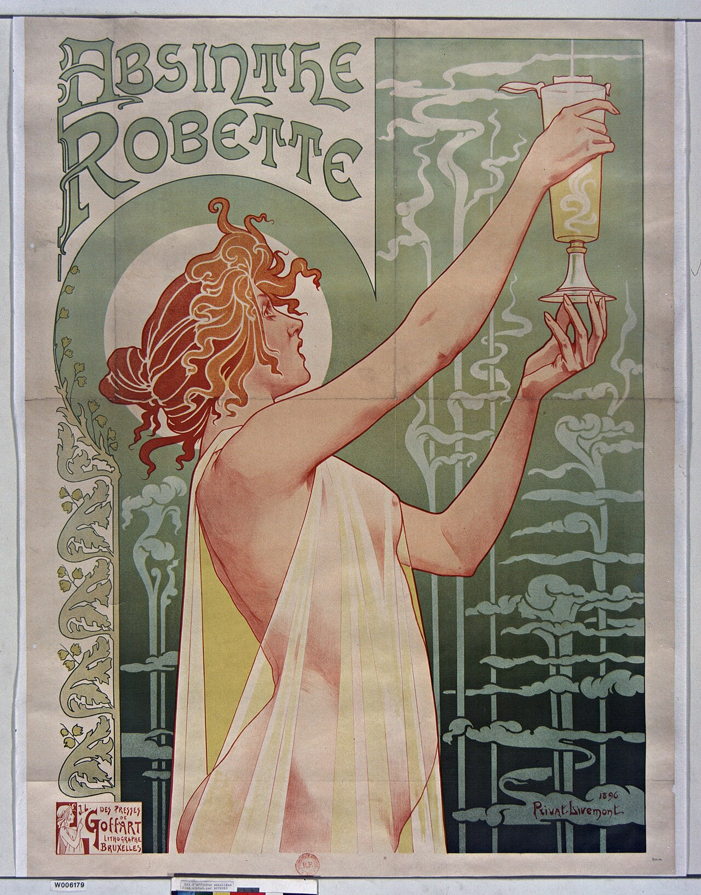
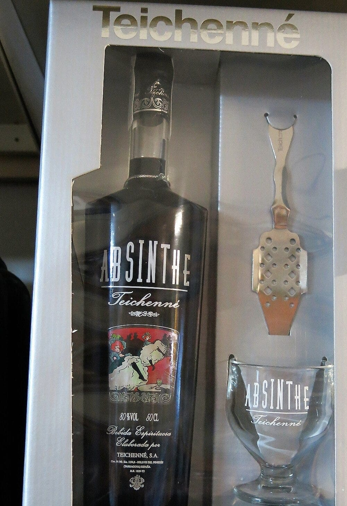

# 1915 年法国苦艾酒禁令：一场科学、战争与葡萄酒业的合谋

1915 年 3 月 16 日，法国正式禁止苦艾酒及类似利口酒的生产、流通与销售。今天回看，这项禁令常被简化为“苦艾酒会让人发疯”的科学结论；但历史过程要复杂得多。一次世界大战、民族主义、葡萄酒业的经济危机、禁酒运动与对 thujone 的医学恐惧共同推动禁令。苦艾酒并不是被一种单一成分“定罪”的，它是在特定政治与经济环境中被塑造为“国家衰败”的象征。

图：1896 年 Privat-Livemont 为 Absinthe Robette 绘制的广告海报；禁令前苦艾酒消费文化的样本。图片：Privat-Livemont，Public domain，via Wikimedia Commons（[原图页面](https://commons.wikimedia.org/wiki/File:Absinthe_Robette_affiche%2C_Privat-Livemont_1896.jpg)）。

## 时代背景

19 世纪后期，苦艾酒在法国城市迅速流行。它以高酒精度草本浸提液为基础，带有茴香、苦艾与多种香草的风味，常被兑水饮用。苦艾酒的价格低于许多葡萄酒，在咖啡馆、酒吧与艺术家圈子里都有市场。1880 年代以后，法国葡萄酒业遭遇根瘤蚜危机、产量波动与进口竞争，部分葡萄酒生产者把苦艾酒视为争夺同一消费群体的对手。

与此同时，禁酒运动与医学界开始把苦艾酒问题化。医生报告所谓“苦艾酒中毒”（absinthism），认为它会导致幻觉、癫痫、犯罪与种族退化。thujone 被指为罪魁祸首。20 世纪初，瑞士、比利时、美国等地陆续限制或禁止苦艾酒；法国国内则出现“苦艾酒是外国毒药、葡萄酒才是法国健康饮品”的民族主义叙事。战争爆发后，这种叙事获得了更强的国家动员色彩。

## 经过与时间线

1914 年 8 月，第一次世界大战爆发，法国进入战时状态。8 月 16 日，内政部长在紧急状态下禁止全国销售苦艾酒；巴黎警察局此前已先行禁止。1915 年 1 月 14 日，限制苦艾酒的法案提交众议院；2 月 12 日参议院通过；3 月 4 日众议院表决；3 月 16 日法律生效，禁止苦艾酒及类似利口酒的生产、流通与销售。

禁令并不是“立即从法国酒单上消失”。苦艾酒的地下生产与跨境贸易持续存在，Pernod Fils 等品牌把部分生产转移到西班牙塔拉戈纳。类似苦艾酒的茴香酒（pastis）在禁令框架下发展，成为法国南部的替代饮品。直到 2011 年，法国才正式解除对“absinthe”名称的禁令；在此之前，含苦艾草提取物的酒类可以以“植物浸提酒”等名义销售，但不能直接叫苦艾酒。

## 关键人物与机构

法国参议院、众议院与内政部是禁令的制度推手。医学界与禁酒团体提供了“公共健康”的话语，葡萄酒业则提供了经济动机。Pernod Fils 等苦艾酒生产商是禁令的直接对象，它们在法国被禁后转向西班牙与其他市场。艺术家与作家则把苦艾酒塑造成现代生活、波希米亚与堕落的象征；爱德华·马奈 1859 年的《苦艾酒饮者》就是一个早期例子，但这幅画并不是禁令的原因。

需要区分“文化形象”与“法律证据”。马奈、德加等画家的作品让苦艾酒成为现代都市生活的视觉符号，但真正推动禁令的是战时政治、行业利益与医学争论。把禁令归因于一幅画，是把复杂的政策过程艺术化为单一因果。

## 对酒业的具体改变

第一，苦艾酒生产转移。法国品牌在西班牙等地继续生产，国内市场转入地下或改换标签。第二，茴香酒兴起。pastis 等替代饮品填补了苦艾酒留下的市场空间，后来成为法国南部的重要酒类。第三，thujone 监管框架形成。欧盟后来对含 thujone 的食品与草药产品设置限量，苦艾酒的“致幻”叙事被科学重新审视。第四，葡萄酒业获得竞争优势。禁令减少了苦艾酒与葡萄酒在低价市场的直接竞争，但并不能简单说葡萄酒业“消灭”了苦艾酒。第五，苦艾酒的文化复兴。1990 年代以后，欧洲多国放宽限制，苦艾酒以“复古”“波希米亚”与“高酒精度”形象重新进入市场。

## 争议与史料

第一，thujone 的毒性被夸大。现代分析认为，19 世纪苦艾酒的 thujone 含量通常不足以产生当时描述的严重幻觉；所谓“苦艾酒疯狂”更多是酒精滥用、掺假与社会偏见的结果。第二，禁令的动机不是单一的。医学、禁酒运动、葡萄酒业、民族主义与战争动员都在其中起作用，不能只讲“科学发现”。第三，禁令范围被误读。它针对的是“absinthe”这一名称与配方，不是所有含苦艾草的饮料；类似产品仍以其他名称流通。第四，时间线存在差异。1914 年的行政禁令与 1915 年的法律禁令是两件事，前者是战时紧急措施，后者是正式立法。第五，解禁时间常被忽略。法国直到 2011 年才解除对“absinthe”名称的禁令，苦艾酒并非在整个 20 世纪都完全非法。

## 常见误读

一，“苦艾酒含 thujone，所以会致幻”。thujone 在高剂量下有毒性，但传统苦艾酒的含量通常不足以解释“致幻”传说。二，“禁令是科学证明苦艾酒危险的结果”。科学争论只是其中一条线索，政治与经济动机同样重要。三，“法国是唯一禁止苦艾酒的国家”。瑞士、美国、比利时等国也有各自的限制，时间与方式不同。四，“马奈的画导致了禁令”。画作影响了公众想象，但禁令是 1915 年的立法与战时政策，不是艺术事件。五，“2011 年解禁意味着苦艾酒完全自由”。解禁后仍有酒精度、thujone 含量与食品标签的监管，苦艾酒并非无限制商品。

相关条目：[法国](ref:france)。

## 另见

- [苦艾酒](ref:absinthe)：苦艾酒的定义、原料与饮用方式。
- [法国](ref:france)：葡萄酒业、禁酒运动与酒类立法的背景。
- [1935 年原产地命名制度](ref:aoc)：法国酒类监管从“禁酒”转向“产地保护”的另一条路径。
- [金酒](ref:gin)：另一种曾被道德化、税收化的廉价烈酒。
- [美国禁酒令](ref:prohibition)：国家全面禁酒与部分禁令的比较案例。

对照阅读：[苦艾酒](ref:absinthe)、[法国 AOC 制度（1935）：原产地控制命名的诞生](ref:aoc)。

**关键事实。**

| 项目 | 内容 |
| --- | --- |
| 一句话定位 | 法国在第一次世界大战初期先由巴黎警察局禁止苦艾酒销售，1915 年 3 月 16 日又通过法律，禁止苦艾酒及类似利口酒的生产、流通与销售；禁令常被归因于“苦艾致幻”，但现代研究显示，当时对 thujone 的恐惧被夸大 |
| 时间 | 1914 年 8 月—1915 年 3 月 16 日 |
| 地点 | 法国 |
| 历法 | 公历 |

## 相关图像

图：苦艾酒礼盒：黑色 Teichenné 酒瓶、槽孔金属糖匙与印有 ABSINTHE 的玻璃杯。图片：Tangopaso，Public domain，via Wikimedia Commons（[原图页面](https://commons.wikimedia.org/wiki/File:Absinthe_bottle_with_glass_and_spoon.jpg)）。关联图像：1915 年法国苦艾酒禁令：一场科学、战争与葡萄酒业的合谋。
