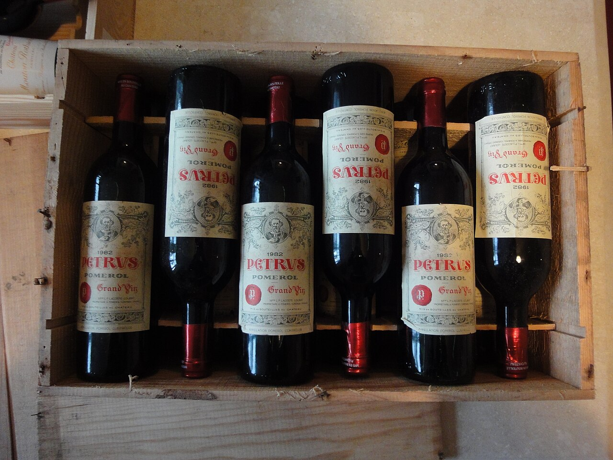
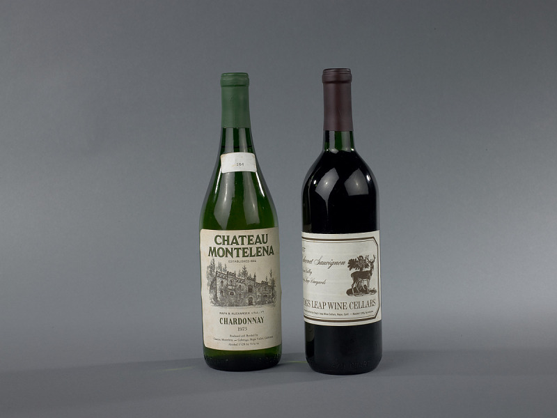

# 1982 波尔多年份：一个年份如何成为现代葡萄酒市场的转折点

1982 年的波尔多，是一个被气候、评论与市场共同塑造的年份。它拥有温暖的冬季、提前的发芽、炎热的七月与干燥的九月，葡萄成熟度高，酒体丰厚，果味浓郁。对喜欢这种风格的人来说，它是“现代波尔多”的起点；对偏好酸度与克制的人来说，它又显得过于成熟。围绕 1982 的争论，最终不仅改变了一个年份的价格，也改变了葡萄酒评论在现代市场中的位置。

图：一箱 1982 年柏图斯（Pétrus）酒瓶；1982 年份成为现代波尔多市场叙事的一部分。图片：Andrew Phillips，CC BY 2.0，via Wikimedia Commons（[原图页面](https://commons.wikimedia.org/wiki/File:Several_bottles_of_1982_Petrus.jpg)）。

## 年份与气候

1982 年的生长季开始得比常年早。木桐酒庄的记录显示，冬季异常温和，3 月 30 日前后葡萄芽均匀萌发；4 月与 5 月温暖，6 月有适量降雨；开花在 5 月底至 6 月初，比常年提前近两周。7 月干热，7 月 30 日出现强雷暴；8 月没有过度高温，第一周的降雨对葡萄有利。9 月干燥，葡萄在理想条件下成熟。木桐的采收期为 9 月 15 日至 24 日；拉图从 9 月 16 日采到 30 日；拉菲则记录了早熟、7 月高温雷雨与 8 月较凉导致成熟不均的细节。不同酒庄的微气候与品种结构，使同一年的酒风格并不完全一致。

这种气候给了葡萄高糖分与厚果皮，也带来一个技术难题：酸度下降。葡萄成熟度高，酒精度上升，酸度相对降低；对传统派来说，这意味着酒可能缺乏长期陈年所需的骨架。对新兴消费者来说，丰厚的果味与柔顺口感正是吸引力所在。1982 的争论，从一开始就是“成熟度”与“平衡感”的争论。

## 市场与评论

1982 年份在发布初期并没有立刻引爆市场。部分美国评论者，包括 Robert Finigan 与《纽约时报》的 Terry Robards，认为酒过于成熟、酸度不足，担心它们不能长期陈年。罗伯特·帕克（Robert Parker Jr.）当时还是相对年轻的酒评人，他在《The Wine Advocate》上详细看好 1982，认为其果味与结构足以支撑长期陈年。随着酒款在瓶中发展，帕克的判断被证明更接近市场与消费者的体验，他的声誉与订阅量迅速上升，1984 年离开律师职业，全职投入酒评。

1982 也赶上波尔多期酒市场的转折。1970 年代的经济低迷、1973—1974 年石油危机与1976 年巴黎审判之后，波尔多需要新的市场叙事；1982 的丰厚风格、美国收藏家的兴趣、强势美元与期酒交易机制共同推动了价格与关注度。它不是帕克一个人“制造”的年份，但帕克确实成为这个年份最重要的公共解释者之一。

## 关键人物与机构

帕克是 1982 叙事中最具争议也最持久的名字。他的《The Wine Advocate》坚持订阅制、拒绝广告，以独立评论自我定位；1982 的成功让这种模式获得市场信任。与他相对的，是当时更传统的美国酒评人 Robert Finigan 与《纽约时报》的 Terry Robards，他们更看重酸度与陈年潜力，对 1982 持保留态度。酒庄方面，木桐、拉图、拉菲、柏图斯、白马等不同风格的酒款，共同构成了 1982 的“样本库”；没有这些酒款的长期表现，单靠评论无法建立年份声誉。

机构层面，1855 年列级庄体系、波尔多期酒制度、美国拍卖行与葡萄酒媒体共同放大了 1982 的影响力。1855 分级提供了等级框架，期酒制度把“未来酒”变成可交易商品，拍卖行与媒体则把年份故事转化为价格。1982 不是这些制度的原因，而是它们在一个特定年份上的集中体现。

## 对酒业的具体改变

第一，评论权威的重心转移。帕克的成功让独立、订阅制、以消费者为导向的酒评获得前所未有的市场权力，也让“酒评人可以影响价格”成为公开事实。第二，期酒市场的扩张。1982 之后，波尔多期酒更系统地进入美国与亚洲市场，年份叙事成为定价的一部分。第三，风格争论公开化。成熟度、酸度、果味与陈年潜力之间的张力，成为酒庄、评论者与消费者持续争论的话题。第四，酒庄的国际化。1982 的成功吸引美国与亚洲买家进入波尔多，改变了酒庄的所有权、营销与价格结构。第五，年份神话的形成。1982 被反复描述为“世纪年份”，但不同酒庄、不同地块的表现差异很大；神话化既推动了市场，也遮蔽了细节。

## 争议与史料

第一，“1982 是完美年份”的说法过于笼统。顶级酒庄的表现出色，但并非所有酒款都同等成功；成熟度高、酸度低，使部分酒在长期陈年中表现不一。第二，帕克的角色被神话化。他确实看好 1982，并在后来被证明判断准确；但市场起飞还依赖美元、期酒制度、酒庄营销与收藏家需求。第三，其他评论者并非全错。Finigan 与 Robards 对酸度与陈年潜力的担忧，在部分酒款上确有体现；1982 的争论不是“正确 vs 错误”，而是两种审美与判断标准的冲突。第四，气候解释被简化。1982 的天气有利于成熟，但不同产区的降雨、土壤与采收时间造成差异；不能把年份表现全部归因于天气。第五，价格与品质不能完全等同。1982 的价格包含了稀缺性、品牌、评论与市场情绪，不能简单视为品质排名。

## 常见误读

一，“1982 年所有波尔多都好”。年份整体成功，但酒庄、地块与采收决定差异很大。二，“帕克一个人创造了 1982 的市场”。他提供了关键评论，但市场还依赖期酒、美元、拍卖与酒庄宣传。三，“反对帕克的人都错了”。对酸度与陈年潜力的保留意见，在部分酒款上成立；这是一场风格争论，不是简单对错。四，“1982 是最伟大的年份”。伟大与否取决于偏好、酒款与陈年阶段；1982 是“标志性”年份，不是唯一标准。五，“1982 的成功证明酒越成熟越好”。它证明了成熟风格的市场吸引力，也暴露了酸度与平衡的风险；后来的年份并没有全部复制这一风格。

相关条目：[法国](ref:france)。

## 另见

- [波尔多](ref:bordeaux)：左岸与右岸的产区、等级与风格框架。
- [法国](ref:france)：原产地命名、酒庄制度与葡萄酒市场背景。
- [葡萄酒](ref:wine)：从原料、发酵到陈年的基础框架。
- [1855 年波尔多分级](ref:classification)：理解 1982 酒庄等级与价格的历史背景。
- [1976 年巴黎审判](ref:paris)：另一场改变波尔多市场叙事的跨产区比较。

对照阅读：[波尔多](ref:bordeaux)、[葡萄酒](ref:wine)。

## 相关图像

图：1976 年巴黎盲品会的获奖酒样，加州与法国葡萄酒评价体系的分水岭。图片：Unknown author Unknown author，Public domain，via Wikimedia Commons（[原图页面](https://commons.wikimedia.org/wiki/File:Judgment_of_Paris_1976_Winners_NMAH-2006-7043.jpg)）。关联图像：1982 波尔多年份：一个年份如何成为现代葡萄酒市场的转折点。
