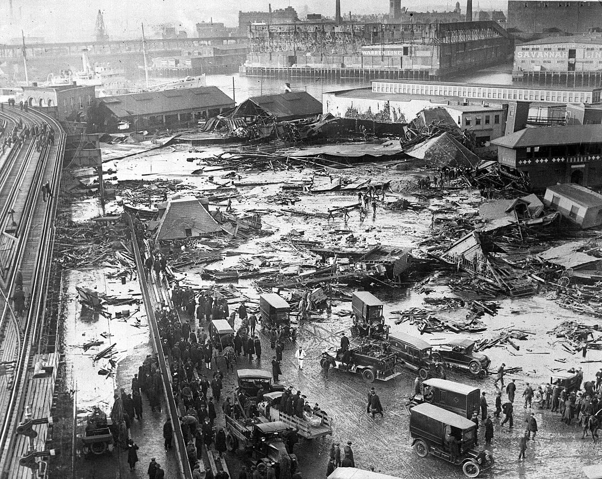
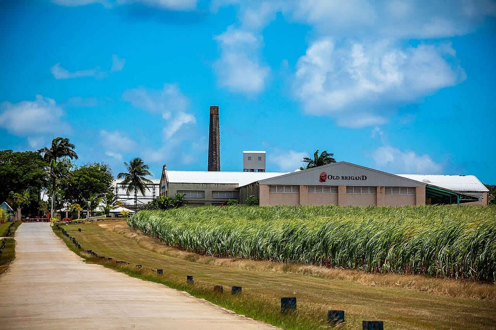

# 波士顿糖蜜洪水 1919：一场工业酒精原料的灾难

1919 年 1 月 15 日中午，波士顿北端的居民听到一阵低沉的轰鸣，起初以为是高架列车经过。几分钟后，一座高约 50 英尺的钢制储罐裂开，约 230 万加仑糖蜜像一堵墙一样冲进街区。糖蜜不是水，它黏稠、沉重，能抬起房屋、掀翻铁轨，也能把人困在废墟里。事故造成 21 人死亡、150 人受伤，成为美国工业史上最著名的灾难之一。

图：1919 年 1 月 15 日糖蜜洪水后，波士顿北端高架铁路下的废墟。图片：BPL，Public domain，via Wikimedia Commons（[原图页面](https://commons.wikimedia.org/wiki/File:BostonMolassesDisaster.jpg)）。

## 时代背景

糖蜜是制糖工业的副产品，也是生产工业酒精的重要原料。第一次世界大战期间，军火工业需要大量酒精来制造无烟火药，糖蜜因此成为战略物资。美国工业酒精公司（United States Industrial Alcohol，USIA）通过子公司 Purity Distilling 在波士顿港附近建罐，把从加勒比地区运来的糖蜜储存起来，再通过管道与铁路送往蒸馏厂。

储罐建在商业街（Commercial Street）附近，紧邻高架铁路、码头与密集住宅。1915 年建成后，居民就发现罐壁接缝渗漏，孩子们甚至能拿容器接流出的糖蜜。公司没有彻底修复，而是把储罐漆成棕色，试图掩盖渗漏痕迹。战争时期的赶工、监督者缺乏工程经验、储罐测试不足，为后来的破裂埋下伏笔。

## 经过与时间线

1919 年 1 月 15 日午后，储罐在装满新到货的糖蜜后爆裂。罐体碎片与糖蜜一起冲出，糖蜜波估计以每小时 35 英里的速度推进，掀翻高架铁路的一段，冲走房屋、马车与行人，并把消防站从地基上推走。救援者包括波士顿警察、附近军舰上的学员与红十字会人员。糖蜜在低温下黏度更高，救援与清理极为困难；清理工作估计耗费 87,000 个工时。

事故发生后，受害者家属提起集体诉讼。USIA 一度把事故归咎于“无政府主义者破坏”，但调查与诉讼持续六年，超过 3,000 名证人作证。法庭指定的审计员休·奥格登（Hugh Ogden）认定储罐施工存在缺陷，公司应赔偿约 100 万美元。事故也促使波士顿及美国其他城市加强储罐、建筑与工业设施的许可与检查。

## 关键人物与机构

Purity Distilling 与母公司 USIA 是储罐的建设与运营方；公司财务主管 Arthur Jell 负责建罐，却没有工程背景，也没有对储罐进行充分的漏水测试。波士顿市政府、警察与消防部门承担了现场救援；马萨诸塞州法院与指定审计员则处理了责任认定。遇难者中有码头工人、马车夫、两名 10 岁儿童与一名消防员，说明灾难影响的不只是工厂内部，而是整个街区。

在更广的产业链上，糖蜜连接着加勒比甘蔗种植园、波士顿港口、美国军火工业与[朗姆酒](ref:rum)蒸馏传统。糖蜜既是朗姆酒的原料，也是工业酒精的原料；同一批货物可以在战时进入军火供应链，也可以在和平时期进入酒厂。这种多重用途，使波士顿储罐成为大西洋糖业与酒精工业的一个节点。

## 对酒业的具体改变

第一，工业原料储存的安全标准提高。储罐设计、焊接、测试与定期检查成为工程与保险领域的重要议题。第二，城市分区与工业设施监管受到关注。高密度住宅区旁的巨型储罐，暴露出土地使用与工业风险之间的冲突。第三，糖蜜供应链的脆弱性被看见。糖蜜价格、运输与储存环节的事故，会影响朗姆酒与工业酒精的生产。第四，灾难记忆进入流行文化。波士顿人长期传说夏天街头仍能闻到糖蜜味，事故也成为工程伦理与城市史的经典案例。第五，它与禁酒令形成时间上的讽刺。储罐破裂的第二天，美国宪法第十八修正案获得批准；一年后禁酒令生效，工业酒精与饮用酒精的边界被重新划定。

## 争议与史料

第一，死亡人数与死因统计存在差异。官方记录为 21 人死亡，但部分死者是在数周或数月后因伤势、感染或肺炎去世，名单与即时死亡人数并不完全重合。第二，事故原因并非单一。储罐壁过薄、焊接质量差、测试不足、糖蜜发酵产生气体、气温骤升导致压力变化，都可能是共同因素；把原因归结为某一项，会过度简化。第三，公司责任与“破坏论”。USIA 曾试图把事故归咎于无政府主义者，但法庭与工程调查没有支持这一说法。第四，糖蜜波的形态被夸张。它不是一瞬间的“爆炸”，而是储罐破裂后黏稠液体的高速冲击与后续淹没。第五，禁酒令与事故的关系常被误读。禁酒令不是事故原因；储罐建设主要是为战时工业酒精需求，但禁酒令的时间邻近使两者常被并列叙述。

## 常见误读

一，“糖蜜像水一样冲过来”。糖蜜密度高、黏度大，冲击力与淹没方式都与水不同，救援也更困难。二，“储罐是突然爆炸”。更准确的说法是储罐结构失效、罐壁破裂，糖蜜在压力下冲出。三，“21 人全部当场死亡”。部分受害者在事后因伤势或感染去世。四，“这是禁酒令造成的”。事故发生在禁酒令生效前一年，储罐主要为工业酒精生产而建；禁酒令是背景，不是直接原因。五，“这只是一场奇闻”。它同时是工业安全、城市规划、移民劳工与战时供应链的历史，不应只被当作怪谈。

## 另见

- [朗姆酒](ref:rum)：糖蜜作为原料的烈酒传统。
- [美国](ref:usa)：工业酒精、禁酒令与城市酒类监管的背景。
- [巴巴多斯](ref:barbados)：加勒比糖蜜与朗姆酒产业的重要产地。
- [古巴朗姆酒国有化](ref:cuba)：另一段糖蜜、甘蔗与国家权力交错的历史。
- [美国禁酒令](ref:prohibition)：与事故时间相邻的酒类管制转折。

对照阅读：[朗姆酒](ref:rum)、[巴巴多斯](ref:barbados)。

**关键事实。**

| 项目 | 内容 |
| --- | --- |
| 一句话定位 | 1919 年 1 月 15 日，波士顿北端一座装有约 230 万加仑糖蜜的储罐爆裂，糖蜜以约 35 英里时速冲入街区，造成 21 人死亡、150 人受伤；储罐属于美国工业酒精公司旗下的 Purity Distilling，糖蜜用于战时工业酒精生产 |
| 时间 | 1919 年 1 月 15 日 |
| 地点 | 美国 |
| 历法 | 公历 |

## 相关图像

图：巴巴多斯类别配图。图片：Unknown author Unknown author，CC BY 2.5，via Wikimedia Commons（[原图页面](https://commons.wikimedia.org/wiki/File:Foursquare_Rum_Distillery.jpg)）。关联图像：波士顿糖蜜洪水 1919：一场工业酒精原料的灾难。
