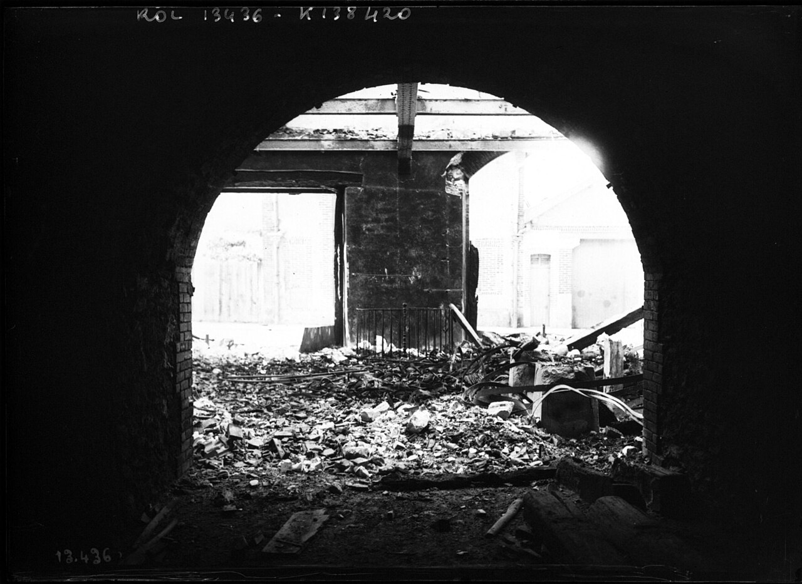
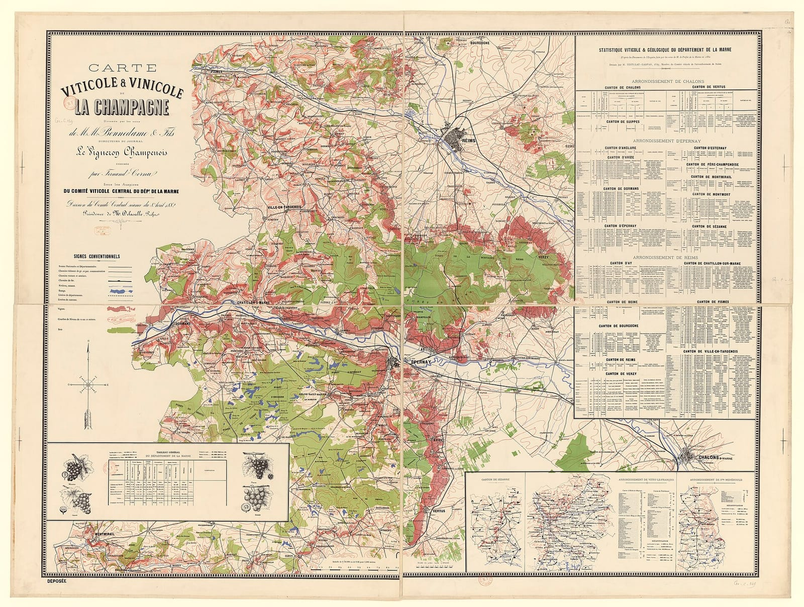

# 香槟区划界（1927）：地名、地块与一场划界战争

1927 年 7 月 22 日，法国通过法律正式划定香槟葡萄产区。它以 1908 年法令确定的马恩省、埃纳省市镇为基础，加上奥布省三镇，以及 1919 至 1924 年收获申报中主张“香槟”命名的市镇，共 407 个市镇。法律的关键不在省界，而在地块：只有当时已经种葡萄、或在根瘤蚜危机前种过葡萄的土地，才有权使用“香槟”命名。

图：1911 年 4 月阿伊村遭劫掠后的酒窖废墟，1927 年划界前的冲突背景。图片：Agence Rol，Public Domain，via Wikimedia Commons（[原图页面](https://commons.wikimedia.org/wiki/File:Apr%C3%A8s_le_pillage_d%27Ay,_avril_1911_-_btv1b69160215.jpg)）。这不是 1927 年法律签署现场的记录。

## 时间与地点

划界的核心区域在法国东北部的马恩省、埃纳省与奥布省，涉及兰斯、埃佩尔奈、沙隆、维特里勒弗朗索瓦、特鲁瓦等市镇群。1927 年法律给出的市镇数为 407 个，其中马恩省 272 个、奥布省 70 个、上马恩省 2 个、塞纳-马恩省 5 个。

时间线可以分三段：1905 年反欺诈法与 1908 年法令是划界的准备；1911 年的葡萄农起义把划界冲突推向高潮；1927 年法律完成法定划定，1936 年 6 月 29 日法令正式设立香槟原产地控制命名（AOC）。

## 背景：1905 年法与香槟危机

香槟的划界问题不是孤立的。19 世纪末的根瘤蚜危机摧毁了大量葡萄园，灾后重建伴随着产量过剩、掺假与酒价波动；南部大量廉价酒流入，进一步压低了价格。1905 年 8 月 1 日的反欺诈法是法国第一次尝试用法律界定“可以主张原产地命名的葡萄产区”，但只给出原则，没有给出可执行的地块清单。

1908 年的法令开始具体划界，却激化了矛盾：被划入的市镇希望保住命名，被划出的市镇则认为自己被剥夺了历史权利。1911 年，香槟产区爆发葡萄农起义，抗议划界不公；军队介入，冲突造成伤亡。划界从此不再只是技术问题，而是地方政治问题。

## 经过：1927 年 7 月 22 日法

1927 年 7 月 22 日的法律给出了一个可执行的方案：以 1908 年法令确定的马恩省与埃纳省市镇为基础，加上奥布省三镇；对于旧香槟省与巴尔叙塞纳县的其他市镇，只有在 1919 至 1924 年的收获申报中主张过“香槟”命名的，才被纳入。

法律还规定，在相关市镇内，只有“法律颁布时已经种植葡萄”或“在根瘤蚜入侵前曾用于葡萄种植”的土地，才能赋予其葡萄酒使用“香槟”命名的权利。这一条把“历史种植权”写进法律：不是所有划入市镇的土地都自动合格，只有有种植前史的地块才算数。

这套设计解决了两个问题：一是把省界之争转化为地块之争，减少了整省整县的对抗；二是用“收获申报”作为证据，让历史主张可以被行政记录检验。但它也留下了新的问题：申报记录本身不完整，地方委员会的解释宽严不一。

## 划界标准：地块而非省界

1927 年法律的划界标准可以概括为三层。

第一层是行政区：先确定哪些市镇属于划定区。第二层是地块：在市镇内部，只承认有葡萄种植前史的土地；法律颁布时已种或根瘤蚜前种过，是两条可核查的时间门槛。第三层是生产区：即使地块在划定区内，也要符合土壤、底土、朝向与微气候条件，才能被列为可生产香槟的地块。

这三层把“地名”从行政区划中剥离出来，变成一套可以逐块登记的权利。它也为后来的 AOC 制度提供了模板：地名不是一块招牌，而是一组可核查的地块与规范。

## 修订：1928 年过度划定与 1951 年复审

1927 年法律实施后，地方委员会负责登记地块。1928 年的登记结果明显偏宽：超过 4.6 万公顷土地被列为可生产香槟的地块，其中一些历史上只用于餐酒，并非香槟。

面对这一偏差，香槟行业在 1951 年推动通过一项法律，允许 INAO 在听取香槟葡萄农总会意见后复审既有登记。复审持续约 25 年，逐块核对“历史种植权”与土壤、底土、朝向、微气候等技术条件。结果是产区大幅收缩：可生产面积从约 4.6 万公顷降到约 3.4 万公顷，实际享有命名的市镇从 407 个降到 302 个，另有 105 个市镇被暂停资格——它们仍在法定划定区内，但不得使用命名，也不得新植葡萄。

这段修订史说明，划界不是一次性的立法行为，而是长期的行政与技术要求。1927 年法律给出框架，1928 年登记给出初稿，1951 年复审给出修正，三者共同构成今天的香槟产区。

## 影响与争议

第一，它确立了“地名—地块—规范”的三角结构。后来的法国 AOC 与欧盟原产地保护，都沿用这一结构：先划范围，再定地块，再写生产规范。

第二，它把香槟变成了一个高门槛的稀缺资产。面积收缩与种植限制，使香槟的价格与声誉建立在供给约束之上；对酒农而言，划入与划出意味着资产价值的巨大差异。

第三，它留下了长期争议。被暂停资格的 105 个市镇，至今仍在划定区内却不能使用命名；1911 年起义与 1928 年过度登记的记忆，仍是香槟地方史的一部分。

第四，它与其他产区的划界逻辑可以比较。波尔多的 1855 年分级是酒庄等级，勃艮第的划分是地块等级，香槟的 1927 年法律则是“市镇 + 地块 + 种植前史”的复合标准；三者都回答“谁有权使用地名”，但答案不同。

第五，地图问题需要说明。本页不绘制香槟产区地图：1927 年法律的地块清单与今日产区边界需要专门的地理数据与出处，凭空绘制的边界图会误导读者。

## 时间线

- 1905：8 月 1 日反欺诈法，首次尝试界定可主张原产地命名的葡萄产区。
- 1908：法令开始具体划界。
- 1911：香槟葡萄农因划界问题起义。
- 1919—1924：相关市镇在收获申报中主张“香槟”命名。
- 1927：7 月 22 日法律划定 407 个市镇，并规定地块的种植前史门槛。
- 1928：地方委员会登记超过 4.6 万公顷，划定偏宽。
- 1936：6 月 29 日法令正式设立香槟 AOC。
- 1951：法律允许 INAO 复审登记。
- 1970：欧共体首批葡萄酒法规生效，香槟纳入欧洲框架。

## 延伸阅读

- [法国 AOC 制度（1935）](ref:aoc-1935)：香槟划界之后的全国制度。
- [香槟跨专业协会](ref:champagne)：香槟产区的行业组织与当前介绍。
- [法国](ref:france)：法国葡萄酒产区与制度背景。
- [世界葡萄酒史](ref:world-wine-history)：原产地制度出现之前的全球葡萄酒贸易。

补充阅读：[1855年波尔多分级：一张为世博会赶出的名单](ref:c-extra-1)。

相关条目：[法国](ref:france)、[香槟协会：种植者与酒商如何共同管理一个产区](ref:champagne)、[法国 AOC 制度（1935）：原产地控制命名的诞生](ref:aoc-1935)。

## 相关图像

图：香槟协会：种植者与酒商如何共同管理一个产区相关实景照片。图片：Bonnedame, Raphaël-Frédéric (1843-1870). Fonction indéterminée Cornu, Fernand (18..-19..?). Fonction indéterminée Testulat-Gaspar, A. (18..-18..? ; cartographe)，Public domain，via Wikimedia Commons（[原图页面](https://commons.wikimedia.org/wiki/File:Carte_viticole_%26_vinicole_de_la_Champagne_-_dress%C3%A9e_par_les_soins_de_MM._Bonnedame_%26_Fils,_directeurs_du_journal_%22Le_Vigneron_Champenois%22_;_dessin%C3%A9e_par_Fernand_Cornu_Sous_les_auspices_du_Comit%C3%A9_Vinicole_Central..._-_btv1b53020922z.jpg)）。关联图像：香槟区划界（1927）：地名、地块与一场划界战争。
